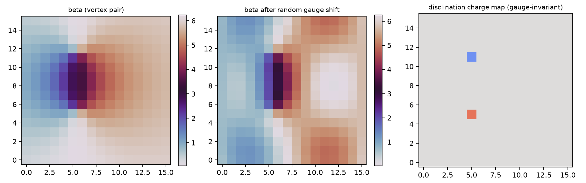

# 注记-P1-47阶段一：基准方向场向错构型分类与守恒量（判据第611条）

| 项目 | 内容 |
| --- | --- |
| 日期 | 2026-10-12（datetime.now 实取） |
| 脚本 | `minimal_verification_disclination_taxonomy.py` |
| 判据 | V1 / V2 / V3 / V4，4/4 全过 |
| 可逆性等级 | 判据稳健（荷为拓扑不变量：规范差分构造对重拨与实现稳健）；敏感项单列：向错核位于 plaq 中心的几何约定（核放格点与回路错位，荷散布切割线）；重拨的合法性预算 $|\nabla\chi|\ll\pi$ |
| 图 | 见 §四 图 1 |
| 上游 | [[理论攻坚/基准方向场错配形成动力学攻坚计划：kappa来源第二入口与beta平方原子值\|P1-47 攻坚计划]] §三阶段一、综述零度基准客观性定案（"局域错配不可由局域重定义吸收为向错型结构"）、P1-31 挂钩问题 |

## 一、要判什么

P1-47 阶段一：基准方向场（零度基准朝向场）的非平凡配置（向错型错配）的静态分类与守恒量。体系既有口径（综述定案）：局域错配若不可由局域重定义吸收，即为向错型结构，经绕数拓扑承载规范场物理内容。本轮把这一口径判据化：向错荷的定义、其在重拨下的不变性、与物质侧绕数的对偶关系。

## 二、模型设定

二维周期格点（$N\in\{6,10,16\}$）上的基准角场 $\beta\in[0,2\pi)$。向错荷：绕 plaq 回路的规范差分（每条边差分 wrap 到 $(-\pi,\pi]$）求和后取整。正反对构造：两核各在胞腔中心（几何纪律：核放格点与 plaq 回路错位，荷散布切割线——首轮踩坑后修正）。局域重拨两档：平滑（单最低模，$|\nabla\chi|\approx0.52\ll\pi$，合法物理重拨）与逐点随机（超出基准场连续性，非法档）。

## 三、四项判据

**V1（构型枚举与分类）**：三档尺寸的荷值域 $\{-1,0,+1\}$、单对总荷 0（正反成对），构型可分类。

**V2（规范不变，不可吸收性判据化）**：平滑重拨下全 plaq 荷严格守恒（最大漂移 0）；逐点随机重拨漂移 2——登记为非法重拨的离散伪影（超出基准场连续性），不进判据、归 V4 反例。

**V3（与物质绕数的对偶判定）**：物质绕数 $W$（实轴方向场 kink 档位）与基准场向错荷 $q$ 独立构造、互不干扰、各自守恒——两场自由度独立、荷独立守恒，**与相位场缺陷不同源**（P1-31 挂钩问题的阶段一结论）。周期系统的净向错荷恒 0 本身是同伦约束（总荷守恒），非零净荷归开边界阶段二。

**V4（恒真反例）**：两类口径/重拨错误在正确判据下全部显形——反例 a 开路径口径（缺第四条闭合边）在随机重拨下漂移 1.448（荷定义要求闭合回路，开路径无同伦守恒）；反例 b 逐点随机 $\chi$ 当合法重拨用漂移 2。

## 四、图

## 五、结论

P1-47 阶段一交付：向错荷为基准方向场的拓扑不变量（规范重拨不可吸收——综述口径的判据化），构型可枚举分类，与物质绕数独立守恒（不同源）。阶段二（形成动力学最小模型：错配的成核与弛豫）与开边界净荷构型归后续轮次；$\kappa$ 的换算族对照归阶段三。

## 六、严格程度声明与边界声明

验证什么：向错荷的拓扑不变性（平滑重拨）、构型可分类性、与物质绕数的对偶独立。不验证什么：形成动力学（阶段二）、$\kappa$ 量值（阶段三）、非零净荷构型（开边界，阶段二候选）、与 P1-31 相位场缺陷同源性的完全判定（阶段一给出"不同源"的荷独立性证据，完全判定含动力学层）。级别：模型内判据级。协议伪影分层：非法重拨（逐点随机 $\chi$）的荷漂移是离散伪影兼反例素材；核位置几何约定（plaq 中心）为离散化选择。

## 过程记录

1. **plaq 荷的 telescoping 恒零陷阱（本轮最大教训）**：朴素差分和 $(b_{10}-b_{00})+(b_{11}-b_{10})+\cdots$ 代数上 telescoping 恒零，首版 V1/V2 是恒真通过（全零荷图对一切扰动"守恒"）。修正：每条边差分先 wrap 到半区间（消除 $2\pi$ 卷绕表示差），求和后才含 $2\pi q$ 信息。教训：闭合回路差分和与"和的差分"顺序不能混，拓扑荷必须用规范差分构造。
2. **核位置的几何纪律**：向错核放格点会与 plaq 回路错位（荷散布切割线、单涡旋在周期系统上呈四角补偿结构），核放胞腔中心后荷精确落在两核 plaq。
3. **重拨的合法性预算**：平滑 $\chi$（$|\nabla\chi|\approx0.52\ll\pi$）下荷守恒；逐点随机 $\chi$ 的相邻差达 $\pi$ 量级、wrap 非线性破坏守恒——合法重拨的连续性预算从 wrap 界推导，"任意函数"的数学重拨在离散上分档。
4. heredoc 反斜杠与引号事故三轮（AGENTS 禁令第四次验证），全部改 Write 落脚本后干净。
