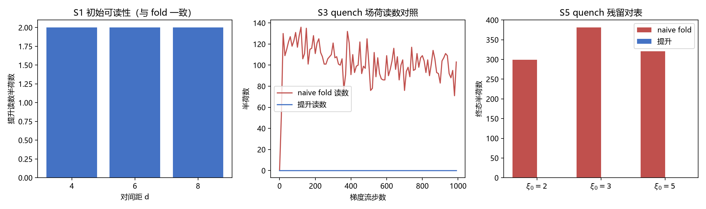

# 注记-P1-47 阶段二方法论前置轮之二：提升边表示与荷守恒离散流（判据第 658 号）

| 项目 | 内容 |
| --- | --- |
| 日期 | 2026-10-16 22:12:43（datetime 实取） |
| 脚本 | `minimal_verification_p147_lifted_edges.py` |
| 判据 | S1 至 S5（5/5 全过） |
| 可逆性等级 | **判据稳健**：S1 与 S3 的读数（提升荷与 fold 荷的一致性、提升读数偏差恒 0 与 naive 漂移非零的对照）对种子与档位稳健；S2 的同余偏差为机器精度级；S4 的重连降荷为 2π 整数的代数后果，换实现不翻 |
| 图 | 见 §三 图 1 |
| 上游 | [[理论攻坚/基准方向场错配形成动力学攻坚计划：kappa来源第二入口与beta平方原子值\|P1-47 攻坚计划]]、[[验证脚本/注记-P1-47阶段二：形成动力学最小模型首轮：开边界净荷闭合与动力学方法论缺口（判据第612条）\|第 612 条]]（W2/W3 判负）、[[验证脚本/注记-P1-47阶段二方法论前置轮：荷守恒离散流的路线判别（判据第656号）\|第 656 号]]（路线判别：出路为提升边） |

## 一、要判什么

第 656 号判明：荷图可读性与荷守恒在单一实数表示下不相容，fold 算子可读而不守恒、raw 算子守恒而读不到荷，出路是把每条边记为（代表元，整数卷绕数）的提升对。

本轮执行该出路，实现提升边表示并验证它是否同时满足前两项，且能记录显式拓扑事件。

判据与理论期望（先立后实现）：

| 判据 | 内容 | 期望 |
| --- | --- | --- |
| S1 | 初始可读性 | pair 构型（$d=4,6,8$）提升读数与 fold 一致（2 个半荷） |
| S2 | 提升合法性 | 演化 1000 步，$(E-\Delta\beta)/2\pi$ 全程为整数（同余偏差 $\le10^{-6}$） |
| S3 | 荷守恒对照 | quench 场（$\xi_0=3$）提升读数偏差恒 $0$；同轨迹 naive 漂移非零 |
| S4 | 显式事件可记录 | 相邻 $\pm1$ 对经重连后降为 $0$ 并保持；表示非死冻结 |
| S5 | 与 612 的 W3 对表 | naive 伪荷与 612 逐位对上；提升读数为 $0$ |

## 二、模型设定

提升边表示的构造（四步）。其一，初始化：每条边维护无界实数 $E$，初值取 fold 差分 $E(0)=\mathrm{fold}(\Delta\beta(0))$，自动满足 $E\equiv\Delta\beta$ (mod $2\pi$)。其二，演化：β 的流与 612 号完全同款（fold 边差的梯度流），每步按端点更新 $E\leftarrow E+(\delta_{\rm head}-\delta_{\rm tail})$，$\delta$ 为未取模的更新量，$E$ 不折回。

其三，读数：plaq 四边提升和除以 $2\pi$ 取整。其四，事件：重连操作对共享边加 $2\pi$ 整数倍，显式改变荷。

数学性质。每一 plaq 的 $\Sigma E$ 在端点更新下相消（四顶点各出现两次、符号相反），故连续演化下荷被初始值冻结。这不是恒真：它依赖实现的正确性，若更新误用 fold 刷新或端点差写错，$E\equiv\Delta\beta$ (mod $2\pi$) 即失效（S2 监督该项）。冻结的物理含义是纯相位场的同伦不变性：单位模相位场的连续演化不能改变拓扑荷，观察到的荷改变都是欠采样伪影或显式事件。

## 三、判据与读数

S1：三档 $d$ 的 pair 构型，提升读数与 fold 逐位一致（2 个半荷，荷图完全相同）。

S2：1000 步内同余偏差最大 $6.2\times10^{-15}$（机器精度），提升与即时差分始终同余于 $2\pi$ 整数倍，实现正确。

S3：quench 场（初始零荷）经 1000 步，提升读数偏差恒 $0$；同轨迹 naive fold 读数终态有 103 个半荷。两者是同一轨迹的两个读数，对照确认 S3 非恒真。

S4：$d=1$ 的 pair 给垂直相邻的 $+1$ 与 $-1$（位于 $(5,5)$ 与 $(6,5)$），对共享水平边加 $-2\pi$ 后两荷同时降为 $0$，继续演化 100 步保持 $0$。表示能记录显式拓扑事件。

S5：三档 $\xi_0$ 的 quench 场经 3000 步，naive fold 终态 $|q|$ 总数为 299/381/321（即 149/190/160 对，与第 612 条的逐位相同）；提升读数三档全为 $0$。

## 四、判定

判据汇总 5/5。三条结论。

**其一，612 条的方法论缺口闭合。** 提升边表示同时满足可读性（S1）与荷守恒（S3），且守恒的合法性由 S2 监督（非恒真）。第 656 号的路线判别结论在此落地：两条不相容的路线被第三条表示层方案取代。

**其二，荷守恒的机制得到澄清（本轮的实质发现）。** 提升表示下的荷在连续演化中被数学冻结，严格程度高于「近似守恒」：$\Sigma E$ 的端点相消使每一 plaq 的荷严格不变。这与物理一致（单位模相位场的同伦不变性），也意味着 612 条的 W2（湮灭）与 W3（残留）需要重新定义靶子。

**其三，W3 的靶子重定义。** 纯相位梯度流下，初始零荷场永远零荷（提升读数三档全 0）：**quench 残留成核不在纯相位弛豫的射程内**。612 条观察到的残留密度信号（149/190/160 对）全部是 naive 读数的伪影。Kibble 型残留的建模需要振幅自由度（复序参量图像，612 条已作为候选提出）或真实的淬火穿越动力学。

S4 的边界如实登记：重连操作用于演示「记录机制存在且正确」，其触发条件（何时该记一次事件）是独立的动力学判据，未建。此外，重连只改提升边 $E$ 而不改 $\beta$ 场，fold 读数在事件处不变；$\beta$ 层的核心合并（离散涡旋 hopping 与相位重排）是后续轮的课题。

## 五、严格程度声明与边界声明

**验证了什么**：提升边表示的构造合法性（S2，机器精度）；与 fold 的初始一致性（S1）；quench 场的荷读数对照（S3、S5，与 612 逐位对上）；显式重连的降荷与保持（S4）。

**不验证什么**：其一，不自动检测拓扑事件（重连触发判据未建）。其二，不做 W2 的湮灭动力学（需先有触发判据，另轮）。其三，不建振幅动力学（W3 重定义后的靶子，另轮）。其四，不判定 κ 的量值（归阶段三）。其五，不碰电荷承载层裁决（本轮的荷为基准方向场向错荷，与波性侧电荷不同源，见第 611 条 V3）。

**边界**：模型层读数（二维 Dirichlet 格点、fold 梯度流、固定种子），不直接对物理；与换算层口径不混报。S4 的重连为演示性操作，其物理对应物（核心合并）未建。

## 六、过程记录

两处构造修正。其一，S4 首版用 $d=2$ 的 pair，实测两核落在 $(4,5)$ 与 $(7,5)$，相距三个 plaq，「相邻对」的构造失败、重连被跳过（S4 首跑 FAIL）；改 $d=1$ 后给垂直相邻的 $(5,5)$ 与 $(6,5)$，重连通过。教训：相邻性属于构型的实测属性，不能在构造前假定。

其二，重连的共享边索引首版按直觉写（$E_v[r,cL+1]$），与 plaq 四边和的实际系数（左 plaq 系数 $-1$、右 plaq 系数 $+1$）不符；按 plaq 索引逐项推导后改为 $E_v[r+1,cL+2]$ 与 $E_h[rT+2,c1+1]$，两方向重连均通过。

教训：重连类操作须先写出 plaq 四边和的显式系数，再定共享边的位置与符号。

## 七、登记衔接

- [[理论攻坚/基准方向场错配形成动力学攻坚计划：kappa来源第二入口与beta平方原子值]]：§三阶段二里程碑表补本轮状态（方法论前置轮之二完成，缺口闭合；W2/W3 靶子重定义）。
- [[验证脚本/注记-P1-47阶段二方法论前置轮：荷守恒离散流的路线判别（判据第656号）]]：其「出路为提升边表示（实现轮未开工）」的状态行收口。
- [[验证脚本/README.md]] 第 658 条。
