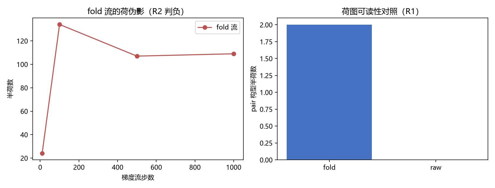

# 注记-P1-47 阶段二方法论前置轮：荷守恒离散流的路线判别（判据第 656 号）

| 项目 | 内容 |
| --- | --- |
| 日期 | 2026-10-16 16:52:00（datetime.now 实取） |
| 脚本 | `p147_structure_preserving.py` |
| 判据 | R1 PASS / R2 FAIL / R3 PASS / R4 PASS / R5 PASS（4/5，R2 如实判负） |
| 可逆性等级 | **判据敏感**：R1 的结论依赖 arctan2 差型构型（换成多值解析构造的构型，raw 路线可能复活）；R2 的 FAIL 读数（step 9）依赖固定步长与初始种子，换步长会移动出现步但不改判负方向 |
| 图 | 见 §三 图 1 |
| 上游 | [[理论攻坚/基准方向场错配形成动力学攻坚计划：kappa来源第二入口与beta平方原子值\|P1-47 攻坚计划]] §三阶段二、[[验证脚本/注记-P1-47阶段二：形成动力学最小模型首轮：开边界净荷闭合与动力学方法论缺口（判据第612条）\|第 612 条]] |

## 一、要判什么

第 612 条把 W2/W3 判负归为**方法论缺口**：拓扑荷守恒的离散数值方法是后续判据的前置，缺它则任何成核与湮灭读数都被伪影污染。本轮判别两条候选路线能否补上这个前置：

路线 fold，边差取折叠代表元（`_edge`，612 条同款），荷图可读；路线 raw，边差不折回，流稳定。若其中一条同时满足荷图可读与荷守恒，则前置轮交付，612 条的 W2/W3 可重启。

判据与理论期望（先立后实现）：

| 判据 | 内容 | 期望 |
| --- | --- | --- |
| R1 | fold 荷图可读性 | arctan2 差型构型上 fold 读出半荷而 raw 读不出 |
| R2 | fold 流荷守恒 | quench 场上 fold 流 1000 步荷图偏差恒 0 |
| R3 | fold 流数值稳定性 | 折回代表元保住有界性，无溢出 |
| R4 | raw 流荷守恒（对照） | raw 流荷图守恒但初始荷图恒零，守恒恒真 |
| R5 | 反例检验（恒真纪律） | 大步长必须破坏 fold 流荷守恒，否则 R2 恒真 |

## 二、模型设定

二维 Dirichlet 吸收端格点，能量泛函 $E=\sum\mathrm{edge}(\Delta\beta)^2$（与 612 条同）。两种梯度流实现只差边差算子：fold 用 `(b-a+π) mod 2π - π`，raw 用 `b-a`；fold 流每步折回代表元 `% 2π`，raw 流不折回。构型三族：arctan2 差型正反对（间距 $d=4,6,8$）、单涡旋、相关化随机场 quench（$\xi_0=3$，种子 45）。步长 $\mathrm{d}t=0.02$（R5 反例用 0.5）。

## 三、读数

R1：三档 $d$ 的 pair 构型，fold 读出 2 个半荷（非零 plaq 如 $d=4$ 给 $[9,11]$ 与 $[14,11]$），raw 恒读 0。raw 算子对 arctan2 差型构型**荷图失明**：这类构型的分支切割把真实卷绕藏在超过 $\pi$ 的边差里，不折回就看不到。

R2：quench 场（初始半荷 0）经 fold 流，第 9 步荷图偏差即达 1，第 999 步仍为 1。伪影早期出现，与 612 条同型。折回代表元只保住有界性（R3：1000 步后 $\beta\in[0,6.270]$，无溢出），保不住荷。

R3：fold 流数值稳定，折回代表元这一步是有效的。

R4：raw 流荷图偏差恒 0，但其初始荷图本就恒零，故该守恒对 quench 场是**恒真陈述**，不含物理信息。

R5：大步长 $\mathrm{d}t=0.5$ 下荷图偏差为 1，与小步长同值。荷守恒是可真可假的性质，不是恒真式。

## 四、判定

判据汇总 R1 PASS / R2 FAIL / R3 PASS / R4 PASS / R5 PASS（4/5）。**方法论缺口未闭合，且形状比 612 条登记的更硬。**

三条结论：

其一，荷图可读性与荷守恒在单一实数表示下不相容。fold 算子让荷图可读（R1），但它守不住荷（R2）；raw 算子守住荷（R4），却读不到荷（R1），且其守恒对 quench 恒真。两个性质各由一个算子承担，无法在同一表示里兼得。

其二，612 条把伪影归因为「edge 跨 $\pm\pi$ 界的 round 翻转是离散伪影」，本轮给出更精确的定位：伪影源于边差被流的步长推过折叠临界。这不是实现错误，折回代表元（R3）无法阻止，因为临界穿越发生在折回之前。

其三，荷守恒必须换表示层维护。出路是把每条边记为（代表元，整数卷绕数）的提升对，流在提升层做修正，读数时才折回。这属实现轮，不在本轮射程。

**收口（2026-10-16 同日）**：提升边实现轮已执行，见 [[验证脚本/注记-P1-47阶段二方法论前置轮之二：提升边表示与荷守恒离散流（判据第658号）|第 658 号]]（5/5）：提升边表示同时满足可读性与荷守恒，612 条方法论缺口闭合；W3 靶子重定义为「需振幅自由度或真实淬火」，W2 重启需先建重连触发判据。

## 五、严格程度声明与边界声明

**验证了什么**：两条候选路线在荷图可读性、荷守恒、数值稳定性、恒真性四项上的判别；612 条伪影的根因定位。

**不验证什么**：其一，不实现提升边保结构流（属后续实现轮）。其二，不重启 612 条的 W2/W3 判据（仍挂起，待提升边实现）。其三，不判定 $\kappa$ 的量值（归阶段三）。其四，不碰电荷承载层裁决与既有判据。

**边界**：R1 的结论依赖 arctan2 差型构型。若换用多值解析构造的构型（如复对数提升型），raw 路线可能复活，届时应重跑 R1。模型层读数不直接对物理，与换算层口径不混报。

## 六、过程记录

1. **首版投影方案的失败**：最初设计的是「梯度流加荷投影」（把荷图不符的 plaq 逐格修正），两处失败：自投影即不收敛（Gauss-Seidel 逐 plaq 修正后仍有偏差 1），且 naive 一步的荷图变化为 0，投影无对象。该方案已废弃。
2. **诊断顺序的价值**：先跑 R1 后跑 R2，让 raw 路线的恒真性（R4）先暴露，才避免把「raw 流荷守恒」误读成缺口已闭合。若跳过 R1 直接实现保结构流，会得到一条在目标构型上荷图恒零的「保结构」流，是精致的空转。
3. **与 612 条的关系**：612 条判负后登记「保结构数值方法为前置轮」，本轮即该前置轮，结论是前置轮的靶子比登记的更难：要换表示层，不是换积分器。

## 七、登记衔接

- [[理论攻坚/基准方向场错配形成动力学攻坚计划：kappa来源第二入口与beta平方原子值]]：§三阶段二里程碑表补本轮状态（首轮判别：路线不相容，待提升边实现轮）。
- [[验证脚本/注记-P1-47阶段二：形成动力学最小模型首轮：开边界净荷闭合与动力学方法论缺口（判据第612条）]]：方法论缺口表述按本轮结论收紧。
