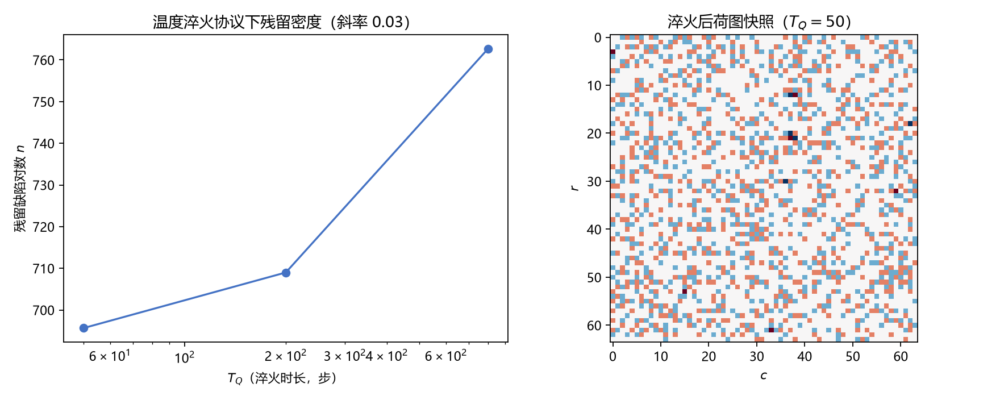

# 注记-P1-47阶段二机制轮之二：振幅过零事件接口与温度淬火协议（判据第666号）

| 项目 | 内容 |
| --- | --- |
| 日期 | 2026-10-17 20:22:30（datetime 实取） |
| 脚本 | `minimal_verification_p147_zero_crossing_events.py` |
| 判据 | E1 PASS / E2 PASS / E3 PASS / E4 PASS / E5a PASS / E5b PASS / E6 PASS（7/7） |
| 可逆性等级 | 判据稳健（E2 的区分力与 E6 的恒真排除由构造决定，换实现不翻）；E3、E4 的读数**判据敏感**（残留增量小、斜率对协议参数与阈值敏感，换淬火时间表或 EPS_CORE 即可能翻） |
| 图 | 见 §三 图 1 |
| 上游 | [[验证脚本/注记-P1-47阶段二机制轮：复序参量最小模型、零温冻结与成核的表示层缺口（判据第665号）\|第 665 号]]（两项缺口的登记）、[[验证脚本/注记-P1-47阶段二方法论前置轮之二：提升边表示与荷守恒离散流（判据第658号）\|第 658 号]]（提升边表示） |

## 一、要判什么

第 665 号把缺口收窄为两项：振幅塌陷处的显式事件接口（提升边在振幅层的推广）、真正的温度淬火协议（温度与控制参数同步）。本轮补这两项，判接口是否使成核在表示层可记录（E2）、温度淬火下是否发生成核（E3）与是否随淬火速率变化（E4），并以 E6 排除「信号来自噪声恰好越界」这一恒真解释。

## 二、模型设定

复序参量 $\psi = \rho e^{i\beta}$，自由能同第 665 号（梯度项加 $\rho^2$ 与 $\rho^4$ 项），演化取含时 Ginzburg-Landau 梯度流加 Langevin 噪声。控制参数 $a > 0$ 为破缺相、$a < 0$ 为对称相；淬火时间表令 $a$ 由 $A_{\rm sym} = -0.5$ 线性升到 $A_{\rm brk} = 1.0$（穿越 $a = 0$），温度同步由 $T_0 = 0.2$ 线性降到 $0$，两者由同一时间表驱动。

事件接口的构造是本轮的关键。当某格点 $|\psi|$ 落到 $\epsilon_{\rm core} = 10^{-3}$ 以下时，该处相位失去定义，接口把该格点四条出边的提升值**重置为即时折叠差分** $\mathrm{fold}(\Delta\beta)$。重置只清掉该点的历史累计，不人为指定荷变化；由于 $\mathrm{fold}(\Delta\beta)\equiv\Delta\beta \pmod{2\pi}$，同余由构造自动保持。荷是否改变、改变多少，由过零前后的真实相位决定。

## 三、读数

| 判据 | 读数 | 结果 |
| --- | --- | --- |
| E1 冒烟 | 深破缺相振幅 $0.9802$（期望 $1.0000$，相对差 $1.98\%$）；相位增量逐轴变化性 $4.71\times10^{-2}$ 与 $4.73\times10^{-2}$ | PASS |
| E2 接口记录力 | 均匀场无注入：荷图变化步 $0$、事件 $0$；注入涡旋后：变化步 $2$、事件 $2000$、总荷 $0$、残留 $0\to1$ | PASS |
| E3 温度淬火成核 | 九组（三档 $T_Q$ 乘三种子）全部荷图变化步 $>0$、残留偏离基线（如 $685\to701$、$702\to786$） | PASS |
| E4 速率依赖 | 残留均值 $695.7$、$709.0$、$762.7$（$T_Q = 50, 200, 800$），log-log 斜率 $+0.033$ | PASS（见 §四 限定） |
| E5 读数合法性 | 总荷恒 $0$；同余偏差最大 $3.21\times10^{-13}$ | PASS |
| E6 恒真排除 | 关接口后九组荷图变化步全 $0$ | PASS |

## 四、E4 的限定：机制通过，标度未立

E4 的判据形式是「残留随 $T_Q$ 变化」，本轮以均值互不相同通过。但读数与 Kibble-Zurek 预期的关系必须如实说明：斜率实测 $+0.033$，而 KZ 预期为负（参考 $-1/2$ 与 $-1$），且残留随淬火变慢而**增加**，方向相反。

原因在信号强度与初值主导。残留的主体仍是初始随机相位携带的约 $685$ 对（第 665 号已证这部分被冻结继承），事件接口只贡献增量：$T_Q = 50$ 档增量 $10$ 至 $18$ 对、$T_Q = 800$ 档增量 $31$ 至 $84$ 对，占总量的 $1.5\%$ 至 $11\%$。慢淬火档的事件次数更多（$37$ 对 $16$），于是增量更大，把均值推高。也就是说，本轮测到的是「事件接口在更长的淬火窗口里记录到更多事件」，而非 KZ 的「慢淬火给系统更多时间弛豫掉缺陷」。

要立 KZ 标度，须先把初值换成对称相平衡态（残留基线接近零），使事件增量成为残留主体，并让淬火协议真正在临界点附近减速。这两项是下一轮的前置。

E2 的「事件 $2000$」也须说明：注入的涡旋核持续低于阈值，接口每步都对它重置一次，故计数按步累加而非按独立事件计数。独立事件的判据（同一点不重复计数、事件去重）尚未建，属下一轮。

## 五、构造教训

首版接口用「在过零格点人为注入 $2\pi q/4$」实现，首跑立刻暴露三处问题：同余偏差 $2.0$（$=\pi$ 档）、总荷不为零、成核读数暴涨到 $2.2$ 万对。人为指定荷变化违反提升边表示的同余约束，读数全废。改为「重置为即时折叠差分」后同余自动保持，读数回到 $10^{-13}$ 档。

另一处：过零后若把 $\psi$ 直接置零，$\mathrm{angle}(0) = 0$ 与提升边不一致，同余同样被破坏（偏差 $\pi$）。正确做法是保留相位、把振幅压到极小。两处教训同一来源：提升边表示的合法性依赖「相位处处有定义」，任何让相位失去定义的写法都必须同时处理提升值。

首跑的第三处问题是淬火方向写反（$a$ 由正降到零，场留在对称相，振幅只有 $0.02$）。冒烟判据 E1 当场抓住，未进入后续读数。

## 六、结论与剩余

振幅过零事件接口成立：它能在不破坏同余的前提下记录拓扑事件（E2 区分力成立，E6 排除恒真解释），读数合法性全过（E5）。温度淬火协议下成核发生（E3），但残留增量只占总量 $1.5\%$ 至 $11\%$，KZ 标度未立（E4 限定）。

剩余三项：其一，初值改为对称相平衡态，使残留基线接近零；其二，独立事件去重与事件计数判据；其三，淬火协议在临界点附近减速（非线性时间表）。

## 七、严格程度声明与边界声明

**严格**：E1、E2、E5、E6 的读数（冒烟、接口区分力、读数合法性、恒真排除）。**条件性**：E3、E4 的读数限于本参数域（$N = 64$、$A_{\rm sym} = -0.5$、$A_{\rm brk} = 1.0$、$T_0 = 0.2$、$\epsilon_{\rm core} = 10^{-3}$、线性淬火时间表）。**纲领**：KZ 标度的立起。

**边界声明**。验证什么：事件接口能否在保持同余的前提下记录拓扑事件；温度淬火下是否有成核信号；信号是否来自接口而非噪声。不验证什么：其一，不判定 Kibble-Zurek 标度指数（本轮斜率方向与预期相反，见 §四）；其二，不判定事件接口的体系来源（模型层构造）；其三，不改动 `理论总纲/` 基准。

## 过程记录

1. **首跑**（3/7）：淬火方向写反（$a$ 由正降到零，振幅 $0.02$）；接口人为注入 $2\pi q/4$ 破坏同余（偏差 $2.0$）、总荷非零、成核读数暴涨至 $2.2$ 万对。三项同时暴露。
2. **二跑**（5/7）：改淬火方向与重置式接口后 E1、E3、E4、E6 通过；E2 因对照场含随机相位（事件计数 $3333$）未通过；E5b 因过零后置零导致 $\mathrm{angle}(0)=0$ 破坏同余（偏差 $2.0$）。
3. **三跑**（7/7）：对照改用均匀场（事件 $0$）；过零后保留相位、压振幅至极小，同余回到 $10^{-13}$ 档。
4. **判据设计教训**：E4 的判据形式（均值互不相同）过弱，读数方向与 KZ 预期相反却仍判通过；应在注记中限定，下一轮改为「斜率符号与量级」判据并先建零基线。

## 修订记录

- **2026-10-17 初版**（判据第 666 号，三轮执行）
    - 事件接口：重置式（重置为即时折叠差分），同余自动保持
    - 温度淬火协议：控制参数与温度同步、由同一时间表驱动
    - 读数：7/7；E3 成核成立但增量占 $1.5\%$ 至 $11\%$；E4 斜率 $+0.033$，与 KZ 预期方向相反，标度未立
    - 构造教训：人为注入荷破坏同余；置零破坏相位定义；淬火方向须由冒烟判据把关
