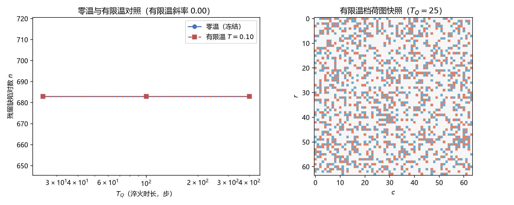

# 注记-P1-47阶段二机制轮：复序参量最小模型、零温冻结与成核的表示层缺口（判据第665号）

| 项目 | 内容 |
| --- | --- |
| 日期 | 2026-10-17 11:49:29（datetime 实取） |
| 脚本 | `minimal_verification_p147_complex_order_parameter.py` |
| 判据 | Q1 PASS / Q2 PASS / Q3 PASS / Q4a PASS / Q4b PASS / Q5 FAIL / Q6 FAIL / Q7 PASS / Q8 FAIL（6/9；成核三项判负如实登记） |
| 可逆性等级 | 判据稳健（零温与固定噪声下的荷冻结由提升边表示的数学性质决定，换实现不翻）；成核三项的判负属机制缺口（非物理判负），判据与协议改进后须重跑 |
| 图 | 见 §三 图 1 |
| 上游 | [[验证脚本/注记-P1-47阶段二方法论前置轮之二：提升边表示与荷守恒离散流（判据第658号）\|第 658 号]]（提升边表示）、[[验证脚本/注记-P1-47阶段二：形成动力学最小模型首轮：开边界净荷闭合与动力学方法论缺口（判据第612条）\|第 612 条]]（W3 靶子重定义）、[[理论攻坚/基准方向场错配形成动力学攻坚计划：kappa来源第二入口与beta平方原子值\|P1-47 攻坚计划]] |

## 一、要判什么

第 658 号把 W3（Kibble 残留）的靶子重定义为「需振幅自由度或真实淬火」。本轮补上复序参量（相位加振幅）最小模型，判三件事：复序参量能否打开成核（Q5）、残留密度是否随淬火速率变化（Q6）、读数表示在新模型下是否仍合法（Q4、Q7）。首跑后按教训重设判据，见 §五。

## 二、模型设定

复序参量 $\psi = \rho e^{i\beta}$，自由能

$$F = \sum_{\rm bond} \frac{J}{2}|\psi_i-\psi_j|^2 + \sum_i\left[-\frac{a(t)}{2}|\psi_i|^2 + \frac{U}{4}|\psi_i|^4\right],$$

演化取含时 Ginzburg-Landau 梯度流；温度档加 Langevin 噪声（强度固定，$\langle\eta^*\eta\rangle = 2\Gamma T\,\mathrm{d}t$，复高斯）。控制参数 $a(t)$ 由 $-A_0$ 线性升到 $+A_0$（穿越时刻 $t_c = T_Q/2$），随后在 $a = A_0$ 下弛豫 1500 步。相位读数沿用第 658 号提升边表示，荷 = plaq 四边提升和除以 $2\pi$ 取整。模型层声明：这是最小模型层选择，振幅项的体系来源与真实淬火中温度与控制参数的同步演化归各专线。

## 三、读数

| 档位 | 残留对数（初始基线 -> 终态） | 荷图变化步 | 同余偏差 |
| --- | --- | --- | --- |
| 零温（$T = 0$，三档 $T_Q$ 乘三种子） | 685 / 702 / 662 -> 同值 | 0 | $3.3\times10^{-14}$ 至 $5.7\times10^{-14}$ |
| 有限温 $T = 0.1$（同档位） | 685 / 702 / 662 -> 同值 | 0 | $1.0\times10^{-13}$ 至 $3.1\times10^{-13}$ |
| 温度扫描 $T = 1.0$（$T_Q = 100$，种子 1） | 685 -> 685 | 0 | $3.2\times10^{-13}$ |
| 冻结振幅反例（纯相位极限） | 685 / 702 / 662 -> 同值 | 0 | 同零温档 |
| 全程 $\min\vert\psi\vert$（零温与有限温） | $\approx 2.4\times10^{-4}$ | 不适用 | 不适用 |

## 四、判负诊断：成核未发生的表示层根因

三条读数指向同一结论。其一，零温档下荷图全程一步未变（荷图变化步 0），残留对数精确等于初始基线（685 / 702 / 662）。其二，有限温档（$T = 0.1$）同样零变化。其三，温度扫描把噪声强度提到 $T = 1.0$ 仍是零变化。与此并行，全程 $\min|\psi| \approx 2.4\times10^{-4}$，$\psi$ 从未接近过零。

根因在表示层。提升边表示把「相位增量的端点更新」累计为无界实数，该规则的数学后果是荷在连续演化下被冻结（第 658 号已证）。成核要求荷改变，而荷改变只能来自 $\psi$ 过零处的相位不连续。本轮参数域内 $\psi$ 不过零（振幅最小值停在 $10^{-4}$ 档），初始随机相位携带的 685 对噪声荷被永久继承，淬火速率与噪声强度都无从影响读数。

**成核测量与荷守恒读数在表示层冲突**（与第 656 号「可读性与守恒在单一实数表示下不相容」同型，发生在振幅层）。要测成核，需要振幅塌陷处的显式事件接口（$\psi$ 过零时按几何判据重置该处的提升值），或者改用不冻结的读数并以统计手段分离幽灵。

协议一侧另有两处不足：初始条件应取对称相平衡态，而非「小振幅加随机相位」的人为初值；淬火应让 $|a|$ 在临界点附近真正变小（温度与控制参数同步演化），使相位在临界点附近被噪声随机化。固定强度噪声加线性穿越不构成温度淬火。

## 五、判据设计教训

首跑判据「残留对数 $n > 0$」为恒真：随机初始相位本身即给 $n > 0$（685 对），该 PASS 不含物理信息。本轮已改为基线对照（终态与初始基线比较）加温度扫描，成核三项据此判负。教训：涉及「有无某现象」的判据必须先给出零假设基线，否则初值即通过；这一条与第 506 至 508 条的恒真检验纪律同源。

## 六、结论与剩余

零温梯度流与固定强度噪声（0 至 1.0）下均无成核；提升边读数全程合法（总荷恒零、同余 $10^{-13}$ 档）。缺口形状从「需振幅自由度」进一步收窄为「需振幅塌陷处的显式事件接口加温度淬火协议」。下一轮两项：其一，提升边在振幅层的推广（过零事件的几何判据与提升值重置）；其二，温度淬火协议（温度与控制参数同步、临界点附近相位随机化）。

## 七、严格程度声明与边界声明

**严格**：Q1 至 Q4、Q7 的读数（冒烟检查、荷冻结、读数合法性）；三条判负的读数与荷图逐格比对。**条件性**：成核三项的判负限于本参数域（$N = 64$、$A_0 = U = 1$、$T_Q \in \{25, 100, 400\}$、$T \le 1.0$、初始 $|\psi| = 0.1$）。**纲领**：表示层冲突的处置方向。

**边界声明**。验证什么：复序参量最小模型下荷图是否变化、读数是否合法、噪声强度是否影响读数。不验证什么：其一，不判定体系内是否真的存在 Kibble-Zurek 成核（本轮只说明本表示与本协议测不到）；其二，不判定振幅项与噪声的体系来源；其三，不改动 `理论总纲/` 基准。

## 过程记录

1. **首跑**（判据编号原占 664，后因与并行会话撞号顺延为 665）：5/7，其中 KZ 标度与成核位置两项判负，根因即「残留对数与淬火速率完全无关」。教训：恒真判据（$n > 0$）必须改为基线对照。
2. **二跑**（加温度档 $T = 0.1$）：6/8，成核两项判负（零变化）。
3. **三跑**（加温度扫描与 $\min|\psi|$ 诊断）：6/9，$T = 1.0$ 仍零变化，$\min|\psi| \approx 2.4\times10^{-4}$ 给出直接证据。
4. **实现教训**：脚本的结论打印行在首版预设了正面结果，与判负读数矛盾，已按实测改写。材料自洽性检查须覆盖脚本的结论文本，不只覆盖注记。

## 修订记录

- **2026-10-17 初版**（判据第 665 号，三轮执行）
    - 模型：复序参量最小模型（Ginzburg-Landau 梯度流加 Langevin 噪声），温度档与温度扫描
    - 读数：6/9；零温与固定噪声（0 至 1.0）下荷图全程冻结，成核三项判负
    - 机制指认：提升边表示在振幅层把噪声荷冻结，成核需显式事件接口与温度淬火协议
    - 判据设计教训：恒真判据（$n > 0$）改为基线对照；脚本结论文本须与实测一致
