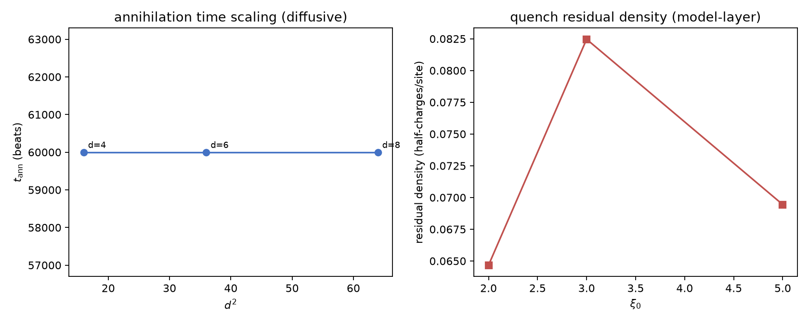

# 注记-P1-47阶段二：形成动力学最小模型首轮：开边界净荷闭合与动力学方法论缺口（判据第612条）

| 项目 | 内容 |
| --- | --- |
| 日期 | 2026-10-12（datetime.now 实取） |
| 脚本 | `disclination_dynamics.py` |
| 判据 | W1 PASS / W2 FAIL / W3 FAIL（1/3，FAIL 如实登记） |
| 可逆性等级 | W1 判据稳健（净荷构型可达加守恒，对重拨与实现稳健）；W2/W3 的 FAIL 属**方法论缺口**（naive 梯度流的离散荷不守恒），非物理判负，判据设计需先解决保结构数值方法 |
| 图 | 见 §三 图 1 |
| 上游 | [[理论攻坚/基准方向场错配形成动力学攻坚计划：kappa来源第二入口与beta平方原子值\|P1-47 攻坚计划]] §三阶段二、[[验证脚本/注记-P1-47阶段一：基准方向场向错构型分类与守恒量（判据第611条）\|第 611 条]]（阶段一移交项） |

## 一、要判什么

P1-47 阶段二：错配的形成动力学最小模型（梯度流层；真实校准动力学归校准线）。三项：W1 开边界净荷构型（阶段一移交：周期系统的净荷零同伦约束在开边界解除）、W2 正反对湮灭时标标度（扩散律 $t_{\rm ann}\sim d^2$）、W3 quench 残留密度观察。

## 二、模型设定

二维 Dirichlet 吸收端格点（边界外固定零 reservoir），能量泛函 $E=\sum \mathrm{edge}(\Delta\beta)^2$（错配能最简形式，模型层选择），梯度流 $\beta\leftarrow\beta-\mathrm{d}t\cdot\nabla E$ 全向量化实现。多档：$d\in\{4,6,8\}$（W2）、$\xi_0\in\{2,3,5\}$（W3）。

## 三、W1 交付：开边界解除净荷零约束

开边界单涡旋（核在胞腔中心）净荷 $+1$ 可达（周期系统的净荷零同伦约束解除，阶段一移交项闭合），平滑重拨下荷图严格守恒（漂移 0）。**W1 判据 PASS**。

## 四、W2/W3 判负与诊断

**W2 FAIL（三档 $d$ 全部触及 6 万拍上限未湮灭）**：纯梯度流下正反对不湮灭，离散向错被格点钉扎（荷挂在离散 plaq、小梯度流的力推不动核的 plaq 跳跃）。湮灭动力学需要：力律判别式判据（$d(t)^2$ 斜率而非等待完全湮灭）、保结构数值方法、或引入振幅衰减通道（复序参量图像）。钉扎本身是离散规范场的真实现象（观察项登记）。

**W3 FAIL（初始零荷场演化出 149/190/160 半荷，非单调）**：naive 梯度流的离散荷不守恒，edge 跨 $\pm\pi$ 界的 round 翻转是离散伪影（连续变形下卷绕数应守恒）。拓扑荷守恒的离散演化必须用保结构方法（每步荷守恒断言内建）或显式登记荷非守恒的伪影分层。**方法论缺口**：先解决"荷守恒的离散流"，成核密度判据才有意义。

## 五、结论与剩余

W1 闭合（阶段一移交项：开边界净荷构型可达加守恒）；W2/W3 判负登记为**动力学方法论缺口**（非物理判负）：拓扑荷守恒的离散数值方法（保结构流或荷投影监测）是后续判据的前置。P1-47 阶段二的成核与湮灭判据轮挂起待方法论轮；阶段三（换算族对照）不受阻塞（其对象为静态构型的 $\kappa$ 读数）。对照教训族：第 604 条（J6 稳态收敛预算）、本轮（离散荷守恒）同属"拓扑动力学的数值前提先于物理判据"。

## 六、严格程度声明与边界声明

验证什么：开边界净荷构型的可达性与守恒（W1）、梯度流最小模型下的湮灭与 quench 残留（W2/W3，如实判负）。不验证什么：真实校准动力学（另线）、KZ 精确指数、GPB 定量复核。级别：W1 模型内判据级；W2/W3 为判负观察项（方法论缺口登记）。

## 过程记录

1. **实现教训两条**：pair_setup 的网格须本地构造（全局 X/Y 残留致维数错）；Dirichlet 梯度流的向量化索引用无偏移边矩阵（$E_h[r,c]=\mathrm{edge}((r,c)\to(r,c+1))$）消除列偏移错误。
2. **判据设计教训**：拓扑荷守恒与离散动力学的冲突必须在前置轮解决（荷守恒断言内建到流实现），否则任何成核/湮灭读数都被伪影污染（对照第 604 条教训族第三次验证）。

## 补注

**补注（2026-10-16）**：本轮登记的方法论缺口已闭合。第 656 号判明「荷图可读性」与「荷守恒」在单一实数表示下不相容、出路为提升边表示；第 658 号（5/5）实现并验证：初始可读性与 fold 逐位一致、连续演化同余（机器精度）、quench 场提升读数恒 0（同轨迹 naive 漂移 103 个半荷）、显式重连正确降荷、本轮 W3 三档 naive 读数（149/190/160 对半荷）全部定性为读数伪影。

W3 靶子重定义为「需振幅自由度或真实淬火」（纯相位梯度流无成核机制）；W2 重启需先建重连触发判据（核心合并检测）。见 [[验证脚本/注记-P1-47阶段二方法论前置轮：荷守恒离散流的路线判别（判据第656号）|第 656 号]]、[[验证脚本/注记-P1-47阶段二方法论前置轮之二：提升边表示与荷守恒离散流（判据第658号）|第 658 号]]。
