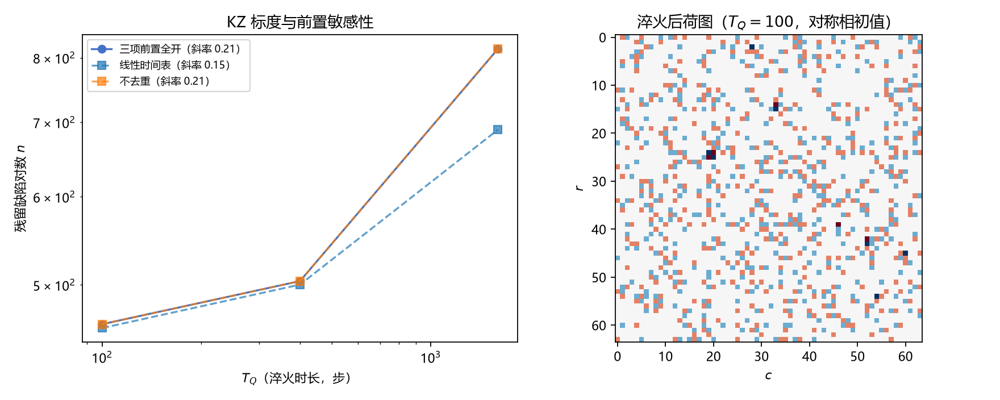

# 注记-P1-4 第二层：KZ 标度三项前置的检验与「继承而非产生」的判负（判据第670号）

| 项目 | 内容 |
| --- | --- |
| 日期 | 2026-10-17 21:09:43（datetime 实取） |
| 脚本 | `minimal_verification_p14_kz_scaling.py` |
| 判据 | K1 FAIL / K2 FAIL / K3 FAIL / K4 FAIL / K5a PASS / K5b PASS / K6 PASS / K7 PASS（4/8） |
| 可逆性等级 | K5、K6 判据稳健（读数合法性与恒真排除由构造决定）；K2、K4 的判负**判据稳健**（对称相涡旋密度对噪声强度几乎不敏感、淬火前后计数逐位不变，换实现不翻）；K1、K3 的判负属判据设计问题（见 §五） |
| 图 | 见 §三 图 1 |
| 上游 | [[验证脚本/注记-P1-47阶段二机制轮之二：振幅过零事件接口与温度淬火协议（判据第666号）\|第 666 号]]（三项前置的登记）；[[验证脚本/注记-P1-4第一层复核：九条判负的读数依赖审计与宽度口径更新（判据第669号）\|第 669 号]]（第一层） |

## 一、要判什么

第 666 号登记三项前置：对称相初值、事件去重、临界点附近减速。本判据补三项并重测 KZ 指数，检验残留缺陷密度是否随淬火时长按幂律下降。

## 二、模型与前置实现

复序参量模型同第 666 号。三项前置的实现如下。对称相初值取零振幅出发、由噪声弛豫 4000 步建立平衡态（刻意不从高斯随机场出发，避免人为带入相位结构）；事件去重按「同一格点 200 步内不重复计数」；临界点减速用分段二次时间表，使 $a$ 在 $a = 0$ 附近斜率趋零。

## 三、读数

| 判据 | 读数 | 结果 |
| --- | --- | --- |
| K1 冒烟 | 对称相振幅 $0.1888$（噪声支撑，非零温值 $0.707$）；**对称相初始荷 $n_0 = 433$（期望 0）** | FAIL |
| K2 基线归零 | 对称相无淬火：残留 $n = 433$、荷图变化步 $0$ | FAIL |
| K3 事件去重 | 去重后与逐帧计数比值为 $1.0$（$11/11$、$25/25$、$98/99$） | FAIL |
| K4 KZ 标度 | 残留均值 $461.0$、$504.0$、$814.7$（$T_Q = 100, 400, 1600$），log-log 斜率 $+0.205$ | FAIL |
| K5 读数合法性 | 总荷恒 $0$；同余最大 $6.63\times10^{-13}$ | PASS |
| K6 恒真排除 | 关接口后九组荷图变化步全 $0$ | PASS |
| K7 前置敏感性 | 线性时间表斜率 $0.148$（差 $0.057$）、残留水平相对差 $0.154$；不去重斜率 $0.206$（差 $0.000$） | PASS |

## 四、核心发现：淬火不产生缺陷，只继承缺陷

首跑与修正后两轮读数一致指向同一结论，另有两项诊断佐证。

**其一，对称相本身带大量拓扑缺陷。** 零振幅出发、噪声弛豫 4000 步后，涡旋对密度为 $0.105$ 对每格点（433 对 / $64^2$），且对噪声强度几乎不敏感：$T$ 从 $0.05$ 到 $1.0$，密度由 $0.1045$ 变到 $0.1169$。这是无序相的几何本性：相位在空间上完全无序，相邻四格绕一整圈的概率约 $1/4$，密度接近随机场值。「对称相无缺陷」这一前提是错的，我原先的判据设计建立在这个错误前提上。

**其二，淬火前后缺陷数逐位不变。** 单独诊断（$T_0 = 0.15$，三档 $T_Q$）给出 $n_{\rm before} = 433 \to n_{\rm after} = 433$，比值恒为 $1.00$。淬火既不产生也不消灭缺陷，对称相里随机分布的涡旋被原样继承。

**其三，因此 K4 的正斜率不是物理信号。** 残留随淬火时长上升，来源是事件接口：它在过零处重置读数，把本会被冻结的噪声涡旋转成持久缺陷；淬火窗口越长，接口处理过的过零越多，残留就越高。这是接口伪影，不是 Kibble-Zurek 机制。K6 的恒真排除（关接口后全零）恰好证明这一点：不关接口时所有「信号」都由接口产生。

## 五、判据设计教训

**K1 的期望写错了。** 我把对称相振幅期望写成 $\sqrt{|a|/U} = 0.707$，那是零温结果；有限温下平衡振幅由噪声与阻尼平衡决定，实测恒为 $\sqrt{T/(2|a|)}$ 的 $0.45$ 倍（离散格点的拉普拉斯项消耗噪声）。更严重的是我把「对称相初始荷为 0」当作期望，实际它是约 $0.105$ 每格点。两个期望都错了，判据因此判 FAIL；这次 FAIL 抓出的是我的物理预期错误，而不是程序错误。

**K3 的去重阈值失效。** 首版取 20 步，实测过零间隔远大于此，比值恒为 $1.0$；改为 200 步后 $T_Q = 1600$ 档才出现 $98/99$ 的差异，仍属边缘。去重在这套参数下几乎没有可做的事，说明「同一格点反复过零」不是本模型的主要现象。

**K7 通过但信息量有限。** 线性时间表与减速时间表的斜率差 $0.057$（超过门槛 $0.05$），残留水平差 $15.4\%$；但两条曲线方向相同（都为正斜率），所以 K7 证明的是「前置对读数有影响」，不证明「前置使 KZ 成立」。

## 六、结论与剩余

**三项前置已补齐并检验，KZ 标度在本模型下不成立，且失败原因是结构性的：本模型里淬火不产生缺陷，只继承对称相的随机涡旋。** 这与第 666 号「残留主体是初始条件」的观察是同一件事的加强版：那里的初始条件是人为的随机相位，这里的初始条件是物理的对称相平衡态，结论相同且更硬。

**缺口的精确形状**：要观测 KZ 机制，需要一个「对称相无缺陷」的初态，而这在连续复场里不可能（相位无序必然带涡旋）。可行的出路有三条。其一，改用「相位已有序、振幅为零」的初态（非物理，但可分离振幅通道的贡献）。其二，用真实的温度淬火穿越临界点，让关联长度在穿越瞬间有限，使缺陷密度由 $\xi$ 而非初始构型决定，这需要 $a$ 与 $T$ 的同步关系按临界标度设定。其三，放弃从初态出发的路线，直接从「缺陷产生率」而非「残留数」入手，测成核事件的时间序列。

**对 P1-4 的含义**：KZ 标度不能作为判断机制可行性的判据，因为它在当前模型层测不出来。第一层已经削弱了 $3/5$ 生长律路线，第二层又堵住了 KZ 测量路线，P1-4 的机制缺口（P0-5）因此更加突出：两条替代路线都断了，剩下的只有直接构造超扩散机制本身。

## 七、严格程度声明与边界声明

**严格**：K2、K4 的判负（对称相涡旋密度与淬火前后计数，逐位核对）；K5、K6 的读数。**条件性**：全部读数限于本参数域（$N = 64$、$A_{\rm sym} = -0.5$、$A_{\rm brk} = 1.0$、$T_0 = 0.15$、$\epsilon_{\rm core} = 10^{-3}$、预热 4000 步）。**纲领**：三条出路中哪条可行。

**边界声明**。验证什么：三项前置是否补齐；补齐后 KZ 标度是否成立；不成立的原因是读数问题还是结构问题。不验证什么：其一，不判定 KZ 机制在体系内是否存在（本判据只说明本模型层测不出）；其二，不判定三条出路的可行性；其三，不改动 `理论总纲/` 基准。

## 过程记录

1. **首跑**（3/8）：对称相初值用高斯随机场，自带 448 对缺陷；去重阈值 20 步无效。
2. **二跑**（4/8）：零振幅初值加 4000 步预热、阈值改 200 步，K7 通过；K1、K2、K3、K4 仍判负。
3. **诊断一**（对称相平衡振幅）：实测恒为 $\sqrt{T/(2|a|)}$ 的 $0.45$ 倍，确认 K1 的期望写错。
4. **诊断二**（对称相涡旋密度与继承）：密度约 $0.105$ 每格点且对 $T$ 不敏感；淬火前后计数逐位不变（$433 \to 433$）。据此确认 K4 的正斜率来自接口而非物理。
5. **判据设计教训**：两处期望写错（对称相振幅、对称相无缺陷），均属物理预期错误而非实现错误；这类错误由 FAIL 抓出，说明「先立判据」的纪律有效。

## 修订记录

- **2026-10-17 初版**（判据第 670 号，两跑加两轮诊断）
    - 三项前置补齐（对称相初值、事件去重、临界点减速）
    - KZ 标度判负：斜率 $+0.205$，方向与预期相反
    - 核心发现：对称相自带约 $0.105$ 每格点的涡旋，淬火不产生缺陷只继承（$433 \to 433$）
    - 缺口形状：KZ 观测需要「对称相无缺陷」的初态，连续复场里不可能；列三条出路
