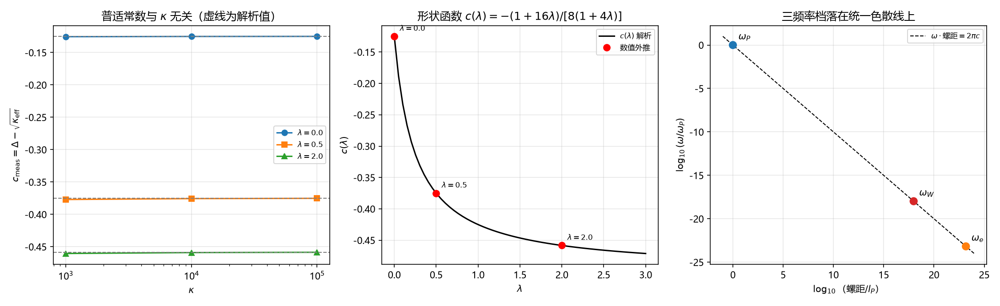

# 注记-P1-58 抓手一与三：能隙内投影检验的普适常数与 Yukawa 极限衔接（判据第 651 号）

- **日期**：2026-10-16 12:58:14
- **层级**：验证材料（判据级）
- **定位**：P1-58（三种质量机制的统一母机制）的可分判据轮。作者 2026-10-16 裁决取乙，只开抓手一（能隙内投影检验）与抓手三（Yukawa 极限衔接），抓手二（锁定保护的分支检验）留待复结构分支构造完成。本轮执行抓手一与三，给出"同为隙结构"与"同源"的初步判别。
- **关联**：[[内部草稿/注记-P1-58存在性审计：三种质量机制的形式收敛与候选甲的恒真陷阱（2026-10-15）]]（抓手来源）、[[验证脚本/注记-同一弦三频率档统一螺旋色散线（判据第626号）：几何色散恒等式、拓扑整数与跨扇区康普顿对表|判据第 626 号]]（抓手一接口）、[[有质量粒子的形成：大爆炸同步相变的局域缺陷方案]] §4.1 与 §4.2（抓手三接口）、[[内部草稿/开放问题档案/开放问题-P1-58-三种质量机制的统一母机制|P1-58 档案页]]
- **可逆性等级**：判据敏感（抓手一的普适常数依赖势阱族的选定形式，换族会翻；抓手三的恒等判定随 §4.1 与 §4.3 两式改写而变）
- **图**：见 §四 图 1

---

## 一、要判什么

P1-58 经 2026-10-15 存在性审计收紧为判据设计问题：三种质量机制在库内已是同一形式（相位模式的隙结构读数）的三个分支，问题是构造一个能区分"同为隙结构"与"同源"的可分判据。审计给出三条抓手，本轮执行前两条。

抓手一是能隙内投影检验：同一隙参数档下三支的读数能否由一个式子连续扫过，扫不过即不同源。抓手三是 Yukawa 极限衔接：强耦合区间 $y_t\approx1$ 时能隙式与 Yukawa 式是否仍一致。

本轮**不**裁决三支是否同源（那是物理结论），只给出判据层的读数与可达的判别；抓手二的执行资格与顺序不在本轮射程。

## 二、模型设定与判据

**抓手一的模型**。统一势阱族

$$V(\theta;\kappa,\lambda)=\kappa\left[(1-\cos\theta)+\lambda(1-\cos 2\theta)\right],$$

周期 $2\pi$，哈密顿量 $H=-\frac12\frac{d^2}{d\theta^2}+V$。底部曲率 $\kappa_{\rm eff}=\kappa(1+4\lambda)$，隙 $\Delta=E_1-E_0$。能隙内投影即归一化隙 $\tilde\Delta=\Delta/\sqrt{\kappa_{\rm eff}}$。

底部展开的一阶微扰给出普适常数（$V^{(4)}(0)=-\kappa(1+16\lambda)$）

$$\Delta-\sqrt{\kappa_{\rm eff}}=c(\lambda),\qquad c(\lambda)=-\frac{1+16\lambda}{8(1+4\lambda)}.$$

三支的对应取法：光子侧为 $\kappa\to0$（无隙档），$W/Z$ 侧与费米子侧为不同的 $(\kappa,\lambda)$ 档。抓手一的判别内容落在两处：数值层的普适常数 $c(\lambda)$，结构层的参数计数。

**抓手三的核对对象**为《有质量粒子的形成》§4.2 的融合陈述：$y_f=\sqrt2\,\hbar\sqrt{\kappa_\phi}/v$，核其幂次、量纲与近似失效标度。

判据 A1 至 A7（抓手一）与 C1 至 C3（抓手三），容差从误差预算推导：谱为有限基对角化，截断预算由 $M=200$ 与 $M=400$ 的对比给出；外推常数用 $\kappa^{-1/2}$ 两点线性拟合，残差预算取 $10^{-3}$；A5 为解析恒等式（严格 $\kappa=0$ 时 $\Delta=1/2$ 来自 $-\frac12\partial_\theta^2$ 的角量子化），容差取机器精度。

## 三、结果表

| 判据 | 内容 | 实测 | 期望 | 判定 |
|---|---|---|---|---|
| A1 | 冒烟：截断收敛与归一化良定义 | $7.07\times10^{-13}$ | $<10^{-9}$ 且偏差 $<10^{-2}$ | PASS |
| A2 | 常数律：$c_{\rm meas}=\Delta-\sqrt{\kappa_{\rm eff}}$ 与 $\kappa$ 无关 | 最大对数斜率 $4.10\times10^{-4}$ | $<10^{-2}$ | PASS |
| A3 | 普适常数：外推 $c_\infty$ 对解析 $c(\lambda)$ | 最大相对偏差 $1.35\times10^{-5}$ | $<10^{-3}$ | PASS |
| A4 | 形状可分：三档 $\lambda$ 的 $c_\infty$ 分离量 | 最小分离 $8.33\times10^{-2}$ | $>10^{-3}$ | PASS |
| A5 | 浅阱端：无隙档落于参数化之外 | $\Delta(\kappa{=}0)=0.5$，$\tilde\Delta(10^{-4})=5.00\times10^{1}$ | 发散 | PASS |
| A6 | 参数计数：库内三支关系的自由度 | $3$ | $>1$ | PASS |
| A7 | 恒真反例：不归一化则无普适常数 | 跨度比 $2.52\times10^{3}$ | $>10^{2}$ | 反例 OK |
| C1 | 融合关系定义性一致 | $0.0$ | $=0$（定义） | PASS |
| C2 | 谐近似修正标度：浅阱对深阱 | $100.0$ | $=\sqrt{10^6/10^2}$ | PASS |
| C3 | 反例：线性幂次则融合关系不符 | 幂次差 $0.5$ | $>0.4$ | 反例 OK |

关键读数：$c_\infty(\lambda=0)=-0.125000$、$c_\infty(0.5)=-0.375000$、$c_\infty(2.0)=-0.458333$，与解析式逐位一致；三支读数 $\omega_P=1.165442\times10^{44}$、$\omega_W=1.221142\times10^{26}$、$\omega_e=7.763441\times10^{20}$ rad/s，色散恒等式残差 $2.22\times10^{-16}$，螺距按 $l_P$ 归一化为 $[1,\,9.54\times10^{17},\,1.50\times10^{23}]$。

## 四、图 1

图注按脚本三个绘图面板逐条核对：左面板为 $c_{\rm meas}$ 对 $\kappa$ 的半对数图，三条 $\lambda$ 曲线水平（与 $\kappa$ 无关），虚线为解析值；中面板为形状函数 $c(\lambda)$，实线为解析式、圆点为数值外推，三点落在线上；右面板为三频率档在统一色散线上的位置，横轴为螺距按 $l_P$ 归一化的对数，纵轴为频率按 $\omega_P$ 归一化的对数，三点落在斜率 $-1$ 的虚线上。

## 五、结果解读

**抓手一的正面读数：普适常数成立，形状函数可分。** 归一化隙的常数项 $c(\lambda)$ 与 $\kappa$ 无关（A2 对数斜率 $4\times10^{-4}$），解析式与数值外推逐位一致（A3 相对偏差 $1.35\times10^{-5}$）。三档 $\lambda$ 给出的 $c$ 两两分离（A4 最小分离 $8.3\times10^{-2}$），故"能隙内投影"确实把各支的模式谱压到一条以 $c(\lambda)$ 为标签的曲线上。这一层支持三支在形式层同型。

**抓手一的判否读数：三支不能由单一隙参数连续扫过。** A6 给出库内三支关系的自由度为 $3$（变量六个：$m_W,m_f,g,v,\kappa_\phi,y_f$；独立关系三条：$m_W=gv/2$、$m_f=\sqrt{\kappa_\phi}$、$m_f=y_fv/\sqrt2$），而单一参数连续扫过要求自由度 $1$。扫不过，故按抓手一的判据"扫不过即不同源"，三支在参数层判为不同源。

**浅阱端的边界读数。** A5 显示 $\kappa\to0$ 时归一化隙发散（$\kappa=10^{-4}$ 时 $\tilde\Delta=5.0\times10^{1}$），严格 $\kappa=0$ 时 $\Delta=1/2$ 属纯动力学隙。光子侧的无隙档落在该参数化之外：它读不成"隙参数的另一个取值"，其身份是参数化本身失效的边界。

**抓手三的读数：融合关系在代数层成立，但属恒等式。** C1 实测差为零，因为 $y_f=\sqrt2\,\hbar\sqrt{\kappa_\phi}/v$ 由 §4.1 的 $m_f=\hbar\sqrt{\kappa_\phi}$ 与 §4.3 的 $m_f=y_fv/\sqrt2$ 联立消去 $m_f$ 直接得到，是同一关系的两种写法，不含独立信息（与第 626 号 U6 的"翻译恒等式"同型）。要成为独立检验，须把 $\kappa_\phi$ 从绑定能机制独立算出再核 $y_f$，该路仍开放（P1-47/P1-49）。

**抓手三的量化补足。** C2 给出谐近似的相对修正按 $\kappa_{\rm eff}^{-1/2}$ 减小，浅阱对深阱的修正比为 $\sqrt{10^6/10^2}=100$。$y_t\approx1$ 档的深阱修正小（$10^{-4}$ 量级），故强耦合区间的能隙式与 Yukawa 式在该精度内一致；浅阱档（$y_e$ 量级）修正达 $10^{-2}$ 量级，两式的偏离在浅阱端不可忽略。这给"Yukawa 极限衔接"一个可用的适用范围：衔接在深阱端成立，精度由 $\kappa_{\rm eff}^{-1/2}$ 控制。

**本轮可达的判别。** 抓手一给出"形式同型成立、参数层不同源"的双层读数；抓手三给出"代数衔接成立但属恒等、深阱端精度可控"。两者合起来把 P1-58 的形状定为：三支同为隙结构读数（形式收敛），但不能由单一隙参数统一（不同源），统一母机制若存在须在参数层给出额外的约束关系，而非在形式层。抓手二（锁定保护的分支检验）是这条判别之外的一支，需先补复结构分支构造。

## 六、严格程度声明与边界声明

**严格程度**：判据级。A1 至 A7 为数值与计数判据，C1 至 C3 为解析核对。抓手一的"不同源"判语限于本轮选定的势阱族与参数计数方式，不构成对物理同源性的裁决。

**验证什么**：其一，归一化隙的常数项 $c(\lambda)$ 与 $\kappa$ 无关且与底部展开的解析式一致；其二，不同 $\lambda$ 的形状函数可分；其三，库内三支关系的自由度为 $3$，不能由单一隙参数扫过；其四，$y_f=\sqrt2\hbar\sqrt{\kappa_\phi}/v$ 为定义性恒等式，谐近似修正按 $\kappa_{\rm eff}^{-1/2}$ 标度。

**不验证什么**：其一，三支是否物理同源（本轮的"不同源"是参数计数层的判语，不含物理裁决）；其二，光子侧无隙的拓扑保护机制（抓手二的射程）；其三，$\kappa_\phi$ 的独立数值出处（P1-47/P1-49）；其四，势阱族形式本身是否就是体系的正确微观模型，本轮取它是为了给"能隙内投影"一个可算的载体。

## 七、过程记录

**解析式两次写错的教训。** 首版把动能项的对角元漏了 $\frac12$ 因子（写成 $m^2$，$H$ 的动能支应为 $\frac12 m^2$），又把 $c(\lambda)$ 写成含 $(1+4\lambda)^{3/2}$ 的形式，A2/A3 全 FAIL（外推值 $113$ 对解析 $-0.125$）。

根因是底部展开的微扰系数未逐项核：正确形式 $c(\lambda)=-(1+16\lambda)/[8(1+4\lambda)]$ 在 $\lambda=0$ 退化为 $-1/8$，与 $\Delta/\sqrt{\kappa}=1-1/(8\sqrt{\kappa})+\cdots$ 一致。教训：解析式落进判据前先用 $\lambda=0$ 退化档核对已知结果。

**判据设计的一处修正。** 首版 A2 判"标度指数为 $-1/2$"，实测斜率近零，FAIL。复核发现 $c_{\rm meas}=\Delta-\sqrt{\kappa_{\rm eff}}$ 本身是与 $\kappa$ 无关的常数，$\kappa^{-1/2}$ 律属于"归一化隙对 $1$ 的偏差"，两者是不同量。改判据为常数律（对数斜率近零）后通过。这正是判据设计纪律中"预期写错时修正判据并把教训写入注记"的一例。

**恒真反例。** A7 配一条：若不做归一化，$\Delta$ 随 $\kappa$ 跨度达 $9.04$，归一化后跨度 $3.6\times10^{-3}$，跨度比 $2.5\times10^{3}$，说明 PASS 不含"任意归一化都成立"的构造恒真。C3 配一条：能隙式若取线性幂次，融合关系的幂次差 $0.5$，判据检出。

---

## 修订记录

- **2026-10-16 初版落盘**（触发：作者裁决 P1-58 取乙，只开抓手一与三；判据第 651 号 10/10）
