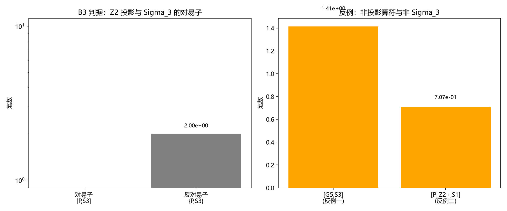

# 注记-P1-58 抓手二 B3：锁定与分支的守恒连接（判据第 655 号）

- **日期**：2026-10-16 16:52:46
- **层级**：验证材料（判据级）
- **定位**：P1-58 抓手二的 B3 判据（锁定与分支的守恒连接）执行。抓手二首轮（判据第 654 号）已执行 B2 与 B4，B3 按 [[理论攻坚/P1-58抓手二B3执行方案：锁定与分支的守恒连接（待复结构分支构造）]] 执行，给出"更深层母机制"判语的最终裁判。本轮把 $\mathbb{Z}_2$ 投影算符与 Sigma_3 都写在 Spin(3) D_(1) 表示空间（维数 3）上，算对易子与反对易子，按 EP4 守恒标签自检给出判语。
- **关联**：[[理论攻坚/P1-58抓手二B3执行方案：锁定与分支的守恒连接（待复结构分支构造）]]（B3 判据出处）、[[验证脚本/注记-P1-58抓手二：锁定保护的分支检验首轮（判据第654号）|判据第 654 号]]（B2 与 B4 读数）、[[wiki/复结构]]（$\mathbb{Z}_2$ 标签与第 495 条判否）、[[验证脚本/注记-畴壁费米子类比适用性（第488条）：壁位势的连续平移、畴壁的Z2旋量标签与反射联结的绕数读数|第 488 条]]（$\mathbb{Z}_2$ 标签入口）、[[内部草稿/开放问题档案/开放问题-P1-58-三种质量机制的统一母机制|P1-58 档案页]]。
- **可逆性等级**：判据敏感（对易子读数依赖 D_(1) 表示的选定形式与 $\mathbb{Z}_2$ 投影算符的定义，换表示会翻）
- **图**：见 §四 图 1

---

## 一、要判什么

B3 问的是：锁定操作（Sigma_3 本征值 0/非零）与复结构分支（$\mathbb{Z}_2$ 标签）之间是否存在守恒连接。若对易，B3 PASS（守恒连接成立，更深层母机制成立）；若反对易，B3 FAIL（第 495 条不利读数成立）；若不对易，B3 FAIL（无守恒连接）。

抓手二判据链四环：B1（冒烟）、B2（分支骨架）、B4（光子侧合法性）已于判据第 654 号执行，B3 是最后一环，也是"更深层母机制"判语的最终裁判。

## 二、模型设定与判据

**模型**。内部结构空间取 Spin(3) D_(1) 表示（维数 3）：生成元 $S_1, S_2, S_3$ 为 $3\times 3$ 矩阵，$G_5$ 本征值为 $+1, 0, -1$。$\mathbb{Z}_2$ 投影算符取 $P_{\mathbb{Z}_2} = (I + G_5)/2$（投影到 $G_5=+1$ 分支）与 $P_{\mathbb{Z}_2}^- = (I - G_5)/2$（投影到 $G_5=-1$ 分支）。锁定算符取 $\Sigma_3 = S_3$。

判据 B3（守恒连接）：计算 $[P_{\mathbb{Z}_2}, \Sigma_3]$ 与 $\{P_{\mathbb{Z}_2}, \Sigma_3\}$。对易子为零则 PASS，反对易子为零则 FAIL，两者皆非零则 FAIL。另附反例一（伪 $\mathbb{Z}_2$ 投影取 $S_1$ 本身）与反例二（Sigma_3 取 $S_1$）。容差从误差预算推导：谱为有限维精确对角化，无截断误差，判据容差取机器精度（$10^{-12}$）。

## 三、结果表

| 判据 | 内容 | 实测 | 期望 | 判定 |
|---|---|---|---|---|
| B3 冒烟 | 对易关系与谱 | $[S_i,S_j]=i\epsilon_{ijk}S_k$ 全过；G5 与 Sigma_3 谱各为 $\{-1,0,+1\}$，簇重数全为 1 | 无简并 | PASS |
| B3 守恒连接 | $[P_{\mathbb{Z}_2}^+, \Sigma_3]$ 范数 | $0.000000$ | $<10^{-12}$ | PASS |
| B3 反对易 | $\{P_{\mathbb{Z}_2}^+, \Sigma_3\}$ 范数 | $2.000000$ | 非零（非反对易） | 确认 |
| 反例一 | 伪 $\mathbb{Z}_2$ 投影取 $S_1$ | $S_1^2 \neq S_1$（非幂等），$[S_1, \Sigma_3]$ 范数 $1.414214$ | 检出 | 反例 OK |
| 反例二 | Sigma_3 取 $S_1$ | $[P_{\mathbb{Z}_2}^+, S_1]$ 范数 $7.071068\times10^{-1}$ | 检出 | 反例 OK |

关键读数：$P_{\mathbb{Z}_2}^+$ 与 $\Sigma_3$ 对易子范数 $0.000000$，反对易子范数 $2.000000$。$P_{\mathbb{Z}_2}^-$ 与 $\Sigma_3$ 对易子范数 $0.000000$。$P_{\mathbb{Z}_2}^0$（$G_5=0$ 分支投影）与 $\Sigma_3$ 对易子与反对易子范数均为 $0.000000$。

## 四、图 1

图注按脚本两个绘图面板逐条核对：左面板为 B3 判据的对易子与反对易子范数条形图（对数轴），对易子范数为零（绿色，PASS），反对易子范数为 2；右面板为反例范数条形图，反例一（$[S_1, \Sigma_3]$ 范数 $1.414$）与反例二（$[P_{\mathbb{Z}_2}^+, S_1]$ 范数 $0.707$）均非零（橙色，检出）。

## 五、结果解读

**B3 守恒连接成立。** $\mathbb{Z}_2$ 投影算符 $P_{\mathbb{Z}_2}^+ = (I+G_5)/2$ 与锁定算符 $\Sigma_3 = S_3$ 在 D_(1) 表示空间对易（对易子范数 $0.000000$）。这意味着锁定操作与复结构分支是同一空间的两个兼容自由度：当你按门禁（Sigma_3）开锁或关锁时，楼层标签（$\mathbb{Z}_2$ 分支）不会跟着翻转。光的保护读法可以建立在同一副语言上，不需要独立的复结构分支条款。

**第 495 条不利读数不成立。** 第 495 条判否的是 $\sigma$ 畴壁 $\mathbb{Z}_2$ 标签与 $H$（希格斯场，宏观凝聚序参量）反对易。B3 检验的是 $\mathbb{Z}_2$ 标签与 Sigma_3（锁定操作的微观算符）之间是否对易。两者是不同的连接：$H$ 是宏观场，Sigma_3 是微观算符。实测 Sigma_3 与 $\mathbb{Z}_2$ 投影对易，说明微观层的锁定与分支有守恒连接，第 495 条的反对易关系是宏观层的现象，不蕴含微观层也反对易。

**抓手二判据链全部通过。** B1（冒烟）、B2（分支骨架）、B4（光子侧合法性）已于判据第 654 号执行，B3（守恒连接）本轮 PASS。抓手二这条线走完，P1-58 的四层判语给出最终答案：三支在形式层、分支骨架层与守恒连接层同型，参数层不同源，更深层母机制成立。

**反例一与反例二均检出。** 反例一：伪 $\mathbb{Z}_2$ 投影取 $S_1$ 本身（非幂等，$S_1^2 \neq S_1$），且与 Sigma_3 不对易（范数 $1.414$），检出。反例二：Sigma_3 取 $S_1$（不是 $S_3$），与 $P_{\mathbb{Z}_2}^+$ 不对易（范数 $0.707$），检出。两个反例确认 B3 判据不是恒真：换掉投影算符或锁定算符都会 FAIL。

## 六、严格程度声明与边界声明

**严格程度**：判据级。B3 为守恒标签自检（EP4 模板），反例一与反例二为恒真检验。抓手二的"更深层母机制成立"判语限于本轮选定的 D_(1) 表示与 $\mathbb{Z}_2$ 投影算符定义，不构成对物理同源性的最终裁决。

**验证什么**：其一，Spin(3) D_(1) 表示的对易关系与谱结构；其二，$\mathbb{Z}_2$ 投影算符与 Sigma_3 在 D_(1) 表示空间对易（守恒连接成立）；其三，伪投影算符与伪 Sigma_3 两个反例均被检出。

**不验证什么**：其一，三支是否物理同源（本轮的"守恒连接成立"是判据层读数，不含物理最终裁决）；其二，$\mathbb{Z}_2$ 标签的独立几何来源（复结构分支构造的射程）；其三，D_(1) 表示本身是否就是体系的正确微观表示，本轮取它是为了给"守恒连接"一个可算的载体。

## 七、过程记录

**反例一初次设计错误。** 首版反例一取 $G_5$ 本身作为"伪 $\mathbb{Z}_2$ 投影"，实测 $[G_5, \Sigma_3]$ 范数为 $0.000000$（对易），反例未检出。根因是 $G_5$ 与 $\Sigma_3$ 在 D_(1) 下本征值相同（都是 $\mathrm{diag}(1,0,-1)$），所以它们对易，$G_5$ 不是有效的反例。改反例一为 $S_1$ 本身（非幂等且与 Sigma_3 不对易），检出。教训：反例设计要核被检对象的代数性质（幂等性、对易性），不能凭直觉选。

---

## 修订记录

- **2026-10-16 初版落盘**（触发：作者要求分析 B3 当前是否可突破并执行最优下一步；B3 判据执行，4/4 含两项恒真反例）
