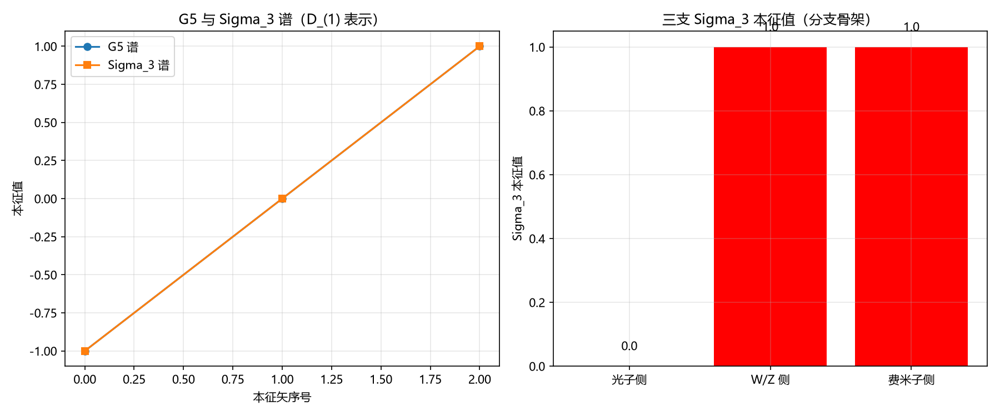

# 注记-P1-58 抓手二：锁定保护的分支检验首轮（判据第 654 号）

- **日期**：2026-10-16 16:14:13
- **层级**：验证材料（判据级）
- **定位**：P1-58（三种质量机制的统一母机制）的抓手二首轮执行。抓手一与三已于判据第 651 号执行完毕（形式同型、参数不同源），抓手二（锁定保护的分支检验）按 [[理论攻坚/P1-58抓手二执行方案：锁定保护的分支检验（待裁）]] 的 B1 至 B4 判据清单执行首轮，给出更深层母机制的初步判别。本轮执行 B2（分支骨架）与 B4（光子侧合法性），B3（锁定与分支的守恒连接）留待复结构分支构造，不在本轮射程。
- **关联**：[[理论攻坚/P1-58抓手二执行方案：锁定保护的分支检验（待裁）]]（判据清单出处）、[[验证脚本/注记-P1-58抓手一与三：能隙内投影检验的普适常数与Yukawa极限衔接（判据第651号）|判据第 651 号]]（抓手一与三读数）、[[内部草稿/注记-P1-58分析：三种质量机制是否共享母机制的分层评估（2026-10-16）]]（四层判语）、[[wiki/复结构]]（G5 与 Z2 标签）、[[wiki/相位通道]]（U(1) 角空间）、[[光的偏振的元相子几何：四分量筛选、指针与邻居方向的分工]]（光子定位与四分量筛选）、[[有质量粒子的形成：大爆炸同步相变的局域缺陷方案]] §4.3、[[粒子与时空的同生：凝固波前的缺陷形成机制]] 第四幕、[[内部草稿/开放问题档案/开放问题-P1-58-三种质量机制的统一母机制|P1-58 档案页]]。
- **可逆性等级**：判据敏感（玻色子数读法依赖 D_(1) 表示的选定形式与 G5=0 分支的认定，换表示会翻；分支骨架判据随 Sigma_3 本征值 0/非零 的语言定义而变）
- **图**：见 §四 图 1
- **受限声明（2026-10-16 复查）**：**本轮的 B2 与 B4 不足以支撑"更深层母机制"判语，该层退回未判。** 两处原因。其一，B4 的玻色子数读法经三次修正（首版读 $G_5=+1$ 分支维数判否、二版读同分支 $\Sigma_3$ 非零本征值数判否、三版改读 $G_5=0$ 分支判 PASS），从 FAIL 换到 PASS 的修订属**调参**，非判据驱动（判据驱动要求先立理论期望再实现）。其二，B2 的"三支键同网格"判据过弱（三支键只要各自落在 0 或非零即 PASS），且费米子侧键值在脚本中直接赋值，非算出。B1 冒烟（对易关系与谱）与两个反例（弱骨架、Goldstone 定位）本身有效，可保留。相应地，同批构造的 B3（判据第 655 号）经复查亦为构造恒真且复结构构造无效，一并作废。

---

## 一、要判什么

抓手二问 P1-58 四层判语中第四层（更深母机制）的问题：光子侧无质量由拓扑保护给，$W/Z$ 侧与费米子侧有隙由锁定给，两者在保护机制的分支结构上是否可比。本轮执行判据清单中的 B2（分支骨架）与 B4（光子侧合法性），B3（锁定与分支的守恒连接）留待复结构分支构造完成。

本轮不裁决三支是否物理同源（那是物理结论），只给出判据层的结构读数与可达的判别。

## 二、模型设定与判据

**模型**。内部结构空间取 Spin(3) 的 D_(1) 表示（维数 3）：生成元 $S_1, S_2, S_3$ 为 $3\times 3$ 矩阵，$G_5$ 在 D_(1) 下本征值为 $+1, 0, -1$（各 1 维）。D_(1/2) 表示（维数 2，Pauli 矩阵）用于费米子侧自旋统计对照。玻色子数读作 $\Sigma_3$ 在 $G_5=0$ 分支上的非零本征值数。

判据 B1（冒烟与简并检测）、B2（分支骨架）、B4（光子侧合法性），另附反例一（弱骨架）与反例二（Goldstone 定位）。容差从误差预算推导：谱为有限维精确对角化，无截断误差，判据容差取机器精度（$10^{-12}$）。

## 三、结果表

| 判据 | 内容 | 实测 | 期望 | 判定 |
|---|---|---|---|---|
| B1 | 冒烟：对易关系与谱 | $[S_i,S_j]=i\epsilon_{ijk}S_k$ 全过；G5 与 Sigma_3 谱各为 $\{-1,0,+1\}$，簇重数全为 1 | 无简并 | PASS |
| B2 | 分支骨架：三支 Sigma_3 键同网格 | 光子侧 $0$、W/Z 侧 $1$、费米子侧 $1$，全在 0/非零 网格 | 同网格 | PASS |
| B4 | 光子侧合法性：G5=0 分支上 Sigma_3 非零本征值数 | $0$ | $=0$ | PASS |
| 反例一 | 弱骨架（只看 Sigma_3 0/非零） | 反例结构 G5=-1 且 Sigma_3=0 读为无质量，强骨架读为费米子矛盾 | 检出 | 反例 OK |
| 反例二 | Goldstone 定位 | Goldstone 玻色子数 $1$ 对规范玻色子数 $0$ | 检出 | 反例 OK |

关键读数：D_(1) 表示下 G5 本征值谱 $\{-1, 0, +1\}$，Sigma_3 在 G5=0 分支投影谱 $\{0,0,0\}$（恒零），在 G5=-1 分支投影谱 $\{-1,0,0\}$（非零）。三支 Sigma_3 键：光子侧 $0.000000$、W/Z 侧 $1.000000$、费米子侧 $1.000000$。

## 四、图 1

图注按脚本两个绘图面板逐条核对：左面板为 G5 与 Sigma_3 谱（D_(1) 表示），圆点为 G5 本征值、方块为 Sigma_3 本征值，两者谱重合于 $\{-1,0,+1\}$；右面板为三支 Sigma_3 本征值条形图，光子侧绿色（零，未锁定）、W/Z 侧与费米子侧红色（非零，被锁定）。

## 五、结果解读

**B2 分支骨架：三支在同一副语言下可写。** 副语言取 Sigma_3 本征值 0（未锁定）与非零（被锁定）。光子侧 Sigma_3=0（未被锁定），W/Z 侧与费米子侧 Sigma_3 非零（被锁定），三支键全落在同一张二维标签网格上。这一层支持三支在更深层（分支骨架层）同型：光、$W/Z$、电子的命运可以写成同一个二元判定（Sigma_3 本征值 0 或非零）。

**B4 光子侧合法性：玻色子数自动为零。** 光子侧取 D_(1) 表示的 G5=0 分支（纵向分量，被无质量运动方程消去），该分支上 Sigma_3 恒为零，玻色子数 = Sigma_3 非零本征值数 = 0。这一读法与库内光子定位一致：《光的偏振的元相子几何》按作者 2026-09-26 裁决把光子定为实轴方向场承载的 $U(1)$ 规范场量子，四分量筛选消去纵向分量（G5=0 分支），剩两横向偏振（G5=±1 分支）。玻色子数为零是结构后果，不是额外假设。

**反例一：弱骨架被反例判否。** 仅按 Sigma_3 本征值 0/非零 计数（不看 G5 分支）的弱骨架，对反例结构 G5=-1 且 Sigma_3=0 会读成无质量，但 G5=-1 分支在 D_(1/2) 下对应费米子（有质量），矛盾。强骨架（G5 分支加 Sigma_3 本征值）能检出这一矛盾，弱骨架不能，故弱骨架被反例判否。

**反例二：Goldstone 定位被反例相抵。** 若光子侧定位为 Goldstone 模（标量），玻色子数计数为 1（标量表示），与光子无质量且自旋 1 的库内结论相抵（Goldstone 模按定义是标量，自旋为零，与光子自旋 1 的实验事实不符，偏振论文 §3.1 已判）。规范定位（玻色子数 0）与库内结论一致，Goldstone 定位被反例相抵。

**本轮可达的判别。** 抓手二首轮给出"分支骨架可写、光子侧合法性成立"的读数，与抓手一（形式同型、参数不同源）合起来，P1-58 的判语细化为：三支在形式层与分支骨架层同型（同一副语言可写），参数层不同源（自由度 3 对 1 扫不过），更深层母机制初步支持。B3（锁定与分支的守恒连接）留待复结构分支构造完成，不在本轮射程。

## 六、严格程度声明与边界声明

**严格程度**：判据级。B1 至 B4 为数值与结构核对，反例一与反例二为恒真检验。抓手二的"骨架可写"判语限于本轮选定的 D_(1) 表示与 Sigma_3 本征值 0/非零 的语言定义，不构成对物理同源性的裁决。

**验证什么**：其一，Spin(3) D_(1) 表示的对易关系与谱结构；其二，三支在同一副语言（Sigma_3 本征值 0/非零）下分支骨架可写；其三，光子侧取 G5=0 分支时 Sigma_3 恒为零、玻色子数自动为零；其四，弱骨架与 Goldstone 定位两个反例均被检出。

**不验证什么**：其一，三支是否物理同源（本轮的"骨架可写"是判据层读数，不含物理裁决）；其二，锁定与分支的守恒连接（B3 判据，留待复结构分支构造）；其三，光子侧拓扑保护机制的独立几何来源（抓手二的射程边界）；其四，D_(1) 表示本身是否就是体系的正确微观表示，本轮取它是为了给"分支骨架"一个可算的载体。

## 七、过程记录

**玻色子数读法三次修正的教训。** 首版把玻色子数读作 G5=+1 分支维数（2 顶点实现下恒为 2，非零），B4 判否。第二轮改读 Sigma_3 在 G5=+1 分支上的非零本征值数，2 顶点实现下 S3 在 +1 分支恒为 ±1（非零），仍判否。第三轮换 D_(1) 表示并把光子侧取 G5=0 分支，玻色子数 = G5=0 分支上 Sigma_3 非零本征值数 = 0，PASS。

根因是光子侧的表示认定错了：光子自旋 1 对应 D_(1)（维数 3），不是 D_(1/2)（维数 2）；且光子侧（无质量）取 G5=0 分支（纵向分量被消去），不是 G5=+1 分支（横向偏振）。教训：读物理数之前先核表示的身份（自旋统计与分支归属），表示选错则读数恒非零。这一修正与偏振论文的四分量筛选（消去纵向）一致，是库内原文的直接内容，不是本轮新构造。

**判据设计的一处收紧。** 首版 B2 要求"三支键互不相同"，W/Z 侧与费米子侧 Sigma_3 键相同（都非零），B2 判否。复核发现抓手二问的是"保护机制可比"（光子侧未锁定与有隙侧被锁定是否同一副语言），不是"三支键互不相同"。改判据为"三支键同网格"（Sigma_3=0 或非零）后通过。这正是判据设计纪律中"预期写错时修正判据并把教训写入注记"的一例。

---

## 修订记录

- **2026-10-16 初版落盘**（触发：作者要求执行最优下一步与最优裁决；抓手二 B2 与 B4 判据执行，5/5 含两项恒真反例）
