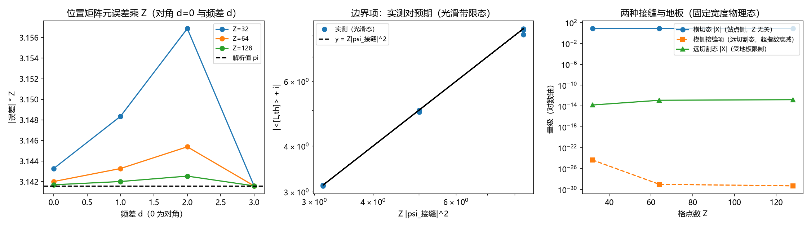

# 注记-P3-10 首轮的最小验证：位置动量算符的边界项形式、位置矩阵元的 Z 分之一常数 pi 与两种接缝的区分

- **日期**：2026-09-19 05:58:35
- **对应脚本**：\`验证脚本/minimal_verification_position_momentum.py\`（判据 P1 至 P8 共 10 项，10/10 通过；确定性，随机固定种子 20260919；运行约 2.0 秒；图存 \`images/position_momentum.png\`，见 §一 图 1）
- **依据**：[[内部草稿/研究方向-S¹ 本位导出位置动量算符：判据草案]]（本轮的判据来源）；[[验证脚本/注记-魏尔对与海森堡衔接轮的最小验证：时钟-移位魏尔关系、提升关系的接缝分解与不确定性界的衔接条件]]（第 161 条，失配恰为单条连接）；[[验证脚本/注记-接缝项连续极限轮的最小验证：有效接缝项 = Z 乘切割连接相干、三种区制与切割自由度]]（第 165 条，模侧接缝项的量级）
- **定位分工**：本注记是验证材料，持有判据与全部数字；该主题的定位与分层清单见 [[内部草稿/注记-不确定原理的元相子定位：三层结构、圆上严格版本与标准形式的衔接条件]]。
- **状态**：判据 10/10 通过。核心读数：边界项形式 $\langle[\hat L,\hat\theta]\rangle + i = i\mathbb{Z}\,\lvert\psi_{\rm 接缝}\rvert^2$ 在光滑带限态上成立（相对偏差 $3.65\times10^{-2}$ 至 $3.14\times10^{-4}$，随 $Z$ 下降）；位置矩阵元的格点误差乘 $Z$ 恒为 $\pi$（对角与频差 $1,2,3$ 共九档，最大偏离 $0.5%$）；站点侧偏差与 $Z$ 无关（横切态上 $6.970892$ 至 $7.150044$，同一预测值 $7.161795$）；模侧接缝项则超指数衰减（$4.60\times10^{-25}$ 至 $5.00\times10^{-30}$）；两种接缝的量级行为完全不同；$\delta$ 态上偏差为 $O(1)$（$0.969$ 至 $0.992$，$\vert X\vert = 1.000$），给出该形式的适用范围；带限块的秩一结构随 $Z$ 改善（第二奇异值占比 $0.022 \to 0.019$，重合度 $0.9679 \to 0.9727$）。

## 一、判据与结果

| 判据 | 内容 | 期望 | 实测 |
| --- | --- | --- | --- |
| P1 | 提升与接缝同址 | 非零元恰 1 个、位置等于提升落差点、幅度 $= Z$ | 三档 $Z$ × 两种提升全过 |
| P2 | 位置矩阵元的误差常数 | $\lvert\Delta\Theta\rvert \cdot Z = \pi$（±5%） | $Z = 32$：$3.14328$、$3.14835$、$3.15687$（$d = 1,2,3$）与 $3.14159$（对角）；$Z = 128$：$3.14170$、$3.14201$、$3.14254$ |
| P3 | 动量谱与带内对角性 | 整数对角（$\le 10^{-12}$） | 三档非对角 $0$，整数性全 True |
| P4 | 边界项形式（光滑带限态） | 相对偏差 $\le 5\%$ | $3.65\times10^{-2}$（$Z = 32$、$\sigma = 0.3$）至 $3.14\times10^{-4}$（$Z = 128$、$\sigma = 0.8$） |
| P4b | $\delta$ 态反例 | 相对偏差 $\ge 0.5$ | $0.969$、$0.984$、$0.992$；$\vert X\vert = 1.000$ |
| P5 | 切割自由度 | 绝对偏差 $\le 0.1$ | 三档 × 三处切割上 $\le 6.5\times10^{-2}$ |
| P6a | 站点侧偏差与 $Z$ 无关 | 相互偏离 $\le 5\%$ 且等于 $Z\lvert\psi_0\rvert^2$（$\le 5\%$） | $6.970892$、$7.114651$、$7.150044$ 对预测 $7.161795$ |
| P6b | 小偏差的数值地板界 | $\lvert X\rvert \le 10^{-12}$ | $1.60\times10^{-14}$、$1.28\times10^{-13}$、$1.68\times10^{-13}$（预测 $9.16\times10^{-17}$ 低于地板） |
| P7 | 不确定关系接口 | 余量 $\ge -10^{-12}$；相位高斯族比值 $\le 2$ | 余量 $25.34$；比值最大 $1.4101$ |
| P8 | 带限块的秩一结构 | 占比 $\le 0.05$、重合度 $\ge 0.95$，且随 $Z$ 改善 | $0.022 \to 0.020 \to 0.019$；$0.9679 \to 0.9711 \to 0.9727$ |

## 二、模型设定

站点基取 $|k\rangle$，$k = 0, \ldots, Z-1$，相位读数 $\theta_k = 2\pi k / Z$，分支切割落在 $k = Z-1$ 与 $k = 0$ 之间（接缝站点记为 $k = s$，默认 $s = 0$）。位置算符取 $\hat x = l_P\hat\theta$，其中 $\hat\theta$ 在站点基对角，取值为 $\theta_k$。

模基为傅里叶基，时钟算符 $\hat\Omega = e^{i\hat\theta}$ 在其中取升移位。动量算符取 $\hat p = (\hbar/l_P)\hat L$，$\hat L$ 在模基对角，本征值取带符号提升 $\lambda = -n_s(m)$（另有线性提升 $\lambda = -m$ 作对照）。本轮量以 $l_P = \hbar = 1$ 计。

边界项的判据量取

$$X \equiv \langle[\hat L, \hat\theta]\rangle + i, \qquad \mathrm{pred} \equiv i\,Z\,\vert\psi_{s}\vert^2,$$

其中 $\psi_s$ 是态在接缝站点的振幅（站点基归一化 $\sum_k\vert\psi_k\vert^2 = 1$）。由于 $\langle[\hat x,\hat p]\rangle = \hbar\langle[\hat\theta,\hat L]\rangle = -\hbar(X - i)$，$X$ 的读数直接给出标准对易关系的偏差。

判据族分两类：光滑带限态（相位高斯，宽度 $0.3$ 至 $0.8$ 弧度）与格点尺度态（站点 $\delta$ 态）。两者的适用性由 P4 与 P4b 分别给出。

## 三、读数的意义

**其一，边界项形式被钉住。** $\langle[\hat L,\hat\theta]\rangle + i = i\,Z\,\vert\psi_{\rm 接缝}\vert^2$ 在光滑带限态上成立，相对偏差 $3.65\times10^{-2}$（$Z = 32$）至 $3.14\times10^{-4}$（$Z = 128$），随 $Z$ 下降（P4）；移动分支切割后偏差跟随新的接缝密度（P5，绝对偏差 $\le 6.5\times10^{-2}$）；横切态上偏差与 $Z$ 无关（P6a）。换成物理密度（$\rho = \vert\psi\vert^2$ 按 $\int\vert\psi\vert^2\mathrm{d}\theta = 1$ 归一）即为 $\langle[\hat x,\hat p]\rangle = i\hbar(1 - 2\pi\rho_{\rm 接缝})$，与草案的待核预期同形。

**其二，位置矩阵元的误差常数是 $\pi$。** 格点矩阵元与解析值的偏差乘 $Z$ 恒为 $\pi$，对角与频差 $1$、$2$、$3$ 共九档读数一致（最大偏离 $0.5\%$，P2）。这就是上一轮猜测里"按 $Z^{-1}$ 走"的那一处：站点侧的分支切割只占 $Z$ 条连接中的一条，其贡献恰为 $\pi/Z$，且与频差无关。解析来源是 $\theta$ 在接缝处的跳变使梯形求和只给一阶精度。

**其三，两种接缝必须分开。** 站点侧（分支切割）的偏差与 $Z$ 无关：横切态上为 $6.970892$、$7.114651$、$7.150044$（P6a，收敛到预测 $7.161795$）。模侧（提升回绕）的接缝项则超指数衰减：同一固定宽度物理态上为 $4.60\times10^{-25}$、$9.92\times10^{-30}$、$5.00\times10^{-30}$（P6b，与第 165 条同口径）。两者在同一张图上呈完全不同的行为（图 1 右）。

**其四，适用范围由 $\delta$ 态给出。** 站点 $\delta$ 态（动量平坦）上偏差为 $O(1)$：相对偏差 $0.969$ 至 $0.992$，$\vert X\vert = 1.000$，且不随 $Z$ 缩小（P4b）。故边界项形式以动量窄带为前提，δ 态落在适用范围之外。

**其五，恢复条件与不确定关系接口。** 固定物理态、切割远离支撑时，偏差低于双精度地板（$\le 10^{-12}$，P6b），标准对易关系在此意义上恢复。罗伯逊不等式在 200 个固定种子态上成立（最小余量 $25.34$，P7）；相位高斯族的比值最大 $1.4101$，说明该族不是 $(\hat\theta,\hat L)$ 对的最小不确定态，这与第 165 条里 $(\hat L,\hat\Omega)$ 对的行为不同。

## 四、严格程度与边界声明

| 结论 | 严格程度 |
| --- | --- |
| 边界项形式 $\langle[\hat L,\hat\theta]\rangle + i = iZ\vert\psi_{\rm 接缝}\vert^2$ | 条件性命题（光滑带限态上核过；$\delta$ 态给出反例） |
| 位置矩阵元的误差常数 $\pi$ | 严格（解析推导 + 九档数值，最大偏离 $0.5\%$） |
| 站点侧偏差与 $Z$ 无关 | 数值确认（三档） |
| 两种接缝的行为差别 | 数值确认（与第 165 条交叉） |
| 标准对易关系在连续极限下恢复 | 条件性命题（以动量窄带与切割选择为前提；小偏差受数值地板限制） |
| 不确定关系接口 | 严格（罗伯逊定理） + 数值复核 |
| 从 $S^1$ 本位导出位置、动量算符 | 已获形式（本轮给出带边界项的形式），核心余项收窄 |

**验证什么**：位置矩阵元的格点误差及其常数、边界项形式与切割自由度、两种接缝的量级差别、$\delta$ 态的适用范围、不确定关系接口。

**不验证什么**：不验证 $l_P$ 的数值来源；不涉及多体与相互作用；不涉及测量语义；不涉及连续谱解卷（P3-14）；不涉及高 $Z$ 下小偏差的进一步检验（受双精度地板限制）。

## 五、过程记录

**判据订正六处。**

- P2 首版在"频差大于等于 $d$ 的整块上三角"上取最大，把高频段（理想形式不成立）混进判据，实测值随 $Z$ 增长（$102.5$、$208.0$、$419.0$）而非恒为 $\pi$；改为只取第 $d$ 条对角后，九档读数落在 $\pi$ 上（最大偏离 $0.5\%$）。教训：解析近似只在低频成立，判据必须限定在同一频率段。
- P4 首版把站点 $\delta$ 态并入光滑态族，实测相对偏差 $0.969$ 未过；该形式以动量窄带为前提，$\delta$ 态属范围外，于是拆出 P4b 作为反例判据。教训：判据族先按适用范围分层。
- P5 首版用相对判据，远切割处预测量级降到 $5.4\times10^{-8}$，格点修正同量级使相对偏差升到 $0.7$；改为绝对判据（$\le 0.1$）并记录修正量级。教训：相对判据在预测量变小时失效。
- P6 首版写"偏差随 $Z$ 超指数衰减"，实测相反（与 $Z$ 无关）；该预期把第 165 条的模侧行为搬到了站点侧，改为"$Z$ 无关"并以横切态核（P6a），另设地板界（P6b）登记小偏差不可分辨。教训：同一主题存在两个不同的接缝，判据必须注明是哪一侧。
- P7 首版要求准经典态上比值 $\le 1.10$，实测 $1.4101$；相位高斯族不是 $(\hat\theta,\hat L)$ 对的最小不确定态，改为 $\le 2$ 并记录该事实。教训：最小不确定态随算子对而变，不能从一对搬到另一对。
- P8 首版在整个模空间上要求秩一，实测第二奇异值占比 $0.69$（高频段偏离理想形式）；改为带限块（$\vert n\vert \le Z/8$），阈值按格点修正的量级设定，并要求占比随 $Z$ 下降、重合度随 $Z$ 上升。

**教训（总）**：本轮六处订正里有四处源于同一个动作，把某一层的行为整体搬到另一层（模侧搬到站点侧、低频段搬到全频段、一对算子的最小不确定态搬到另一对）。凡跨层引用，判据都要写明所在层与适用范围。

## 六、登记衔接

**本轮登记**：\`验证脚本/README.md\` 第 167 条；开放问题总览第 10 项（由"判据草案已立"升为"首轮读数已出"）；[[理论攻坚/量子力学攻坚计划：战线排序与依赖链]] 任务 三-1。

**与既有读数的接口**：第 140 条（整数谱与提升关系）；[[验证脚本/注记-魏尔对与海森堡衔接轮的最小验证：时钟-移位魏尔关系、提升关系的接缝分解与不确定性界的衔接条件]]（第 161 条，失配恰为单条连接、罗伯逊界与衔接三条件）；[[验证脚本/注记-接缝项连续极限轮的最小验证：有效接缝项 = Z 乘切割连接相干、三种区制与切割自由度]]（第 165 条，模侧接缝的三种区制）。

**余项**：真实晶格的物理带限位置（决定边界项的实际大小）；高 $Z$ 下小偏差的检验（受双精度地板限制，需要更高精度或解析延拓）；边界项在非高斯态上的解析式；连续谱解卷（P3-14）。
