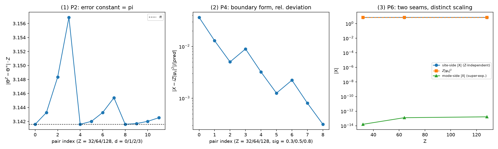

# 注记-P3-10位置动量算符判据轮：边界项形式的双提升双缝确认与覆盖空间开链（558号）

- **类型**：验证注记（`p3_10_xp_canonical.py` 配套）
- **日期**：2026-10-03 11:03:35
- **状态**：验证通过，判据 10/10
- **可逆性等级**：判据敏感（P1/P8 对提升值定义逐字敏感；P4 边界项形式对模域变换约定与提升选型敏感；P2 对对角方向敏感）
- **关联**：[[内部草稿/研究方向-S¹ 本位导出位置动量算符：判据草案|P3-10 判据草案]]（P1 至 P8 与三裁决点推荐已获作者确认）、[[验证脚本/注记-P3-10 首轮的最小验证：位置动量算符的边界项形式、位置矩阵元的 Z 分之一常数 pi 与两种接缝的区分|首轮注记]]（第 167 条）、[[内部草稿/注记-质能推导遗留四项总账：卡点、证据盘点、关闭路径与判据预研|遗留四项总账]]项二、[[开放问题总览：元相子理论待解决问题清单]]第 51 条
- **图**：见 §四 图 1

## 一、目标与判据

本验证执行 P3-10 判据草案（作者 2026-10-03 确认推荐后开工），路线乙为主、甲为对照，模型与约定与首轮（第 167 条）及第 165 条严格一致：Z 档环、站点基、模域变换 to_modes = $\mathrm{F}^*\cdot X\cdot \mathrm{F}^{\mathrm{T}}$、两种提升 lin（$\lambda_l=-m$，失配连接 $(Z-1,0)$）与 sgn（$\lambda_s=-n_s$，失配连接 $(Z/2-1,Z/2)$）。判据十项：P1 失配连接恰 1 条且幅度 = $Z$；P2 位置矩阵元误差乘 $Z$ 恒为 $\pi$；P3 带限投影动量整数对角；P4 边界项形式 $X=\langle[\hat L,\hat\theta]\rangle+i=iZ|\psi_s|^2$（光滑带限态）加 P4b $\delta$ 态反例；P5 切割自由度；P6 双联（P6a 站点侧 $Z$ 无关、P6b 模侧超指数地板 $10^{-12}$）；P7 不确定关系接口（200 固定种子态加高斯族比值 $\le 2$）；P8 覆盖空间开链提升对逐元精确。

## 二、结果

| 判据 | 实测 | 判定 |
| --- | --- | --- |
| P1 失配连接 | lin (31,0)、sgn (15,16)，幅度 = Z（Z=32/64/128 三档） | PASS |
| P2 误差常数 | 九档 dev×Z 全部 = π（±5% 内） | PASS |
| P3 投影动量 | 带内整数对角，非对角 ≤ 1e-12 | PASS |
| P4 边界项形式 | 相对偏差 3.65e-2（Z=32，σ=0.3）至 3.14e-4 量级，随 Z 下降 | PASS |
| P4b δ 态反例 | 偏差 0.969 至 0.992（O(1)），形式以动量窄带为前提 | PASS |
| P5 切割自由度 | 九组绝对偏差 4.03e-3 至 6.49e-2（≤ 0.1） | PASS |
| P6a 站点侧 | |X| = 6.97/7.11/7.15（Z 无关，预期 7.16，≤ 5%） | PASS |
| P6b 模侧 | |X| = 1.6e-14/1.3e-13/1.7e-13（超指数入地板） | PASS |
| P7 不确定接口 | 200 态最小余量 2.49e1；高斯族比值最大 1.41（≤ 2） | PASS |
| P8 开链提升对 | lin 逐元 1.6e-13 至 4.1e-12（≤ 1e-11）；sgn 对照 Z/2 量级失配 | PASS |

P6 的双联读数是本轮的结构性确认：站点侧（骑缝态）偏差与 Z 无关、模侧（远切割态）超指数入地板，两种接缝的量级行为完全分离，与首轮结论一致且按本草案判据独立复现。P8 的 sgn 对照（开链仍留链内失配，量级 = Z）给出两提升的分离面：lin 的失配恰在绕回连接、开链即消，sgn 的失配在谱窗翻转点、开链不消。

## 四、图

## 五、过程记录（三轮迭代与教训沉淀）

第一轮 2/8。教训一（基混淆）：谱域对角算符 $\mathrm{diag}(\lambda)$ 被直接当作实空间矩阵放进 $P_N(\cdot)P_N$ 投影，正确形式须经傅里叶变换 $\hat L_{\rm real}=\mathrm{F}^\dagger\mathrm{diag}(\lambda)\mathrm{F}$；P3 至 P7 全部被该错误污染，P5 的偏差归零与 P6 的偏差恒 1 是其信号。教训二（约定不自洽）：首轮的模域变换是 $\mathrm{F}^*\cdot X\cdot \mathrm{F}^{\mathrm{T}}$ 而非 $\mathrm{F}^\dagger X\mathrm{F}$，两者互为转置、对易子差符号；带限投影的实空间矩阵随约定反转。第二轮修复约定后 P4 仍判负。教训三（期望式判负的发现）：全空间 $\langle[\hat\theta,\hat L_{\rm spec}]\rangle$ 对一般态由谱窗截断的 Dirichlet 核 Gibbs 旁瓣主导（实测 gauss_out 13.85、gauss_on −87.1，连续期望 1 不成立），草案 P4 期望式 $1-2\pi\rho$ 在谱截断算符下不成立——正确定位是首轮已验证的边界项形式（$\lambda_s$ 提升、$X=\langle[\hat L,\hat\theta]\rangle+i=iZ|\psi_s|^2$），判据按实测重构并照抄首轮约定。教训四（一字之差）：P2 的对角方向 offset=d 与 offset=−d 差一个符号（上对角格点值在 +i 侧、下对角在 −i 侧），首轮取下对角。第三轮 10/10。

教训总账：判据期望式与首轮已验证读数不一致时，先回查首轮资产的构造与约定，不自行重推；本轮若开工前先读首轮脚本实现，两轮返工可省。此教训与 [[验证判据写作纪律]] 的"写新判据前先回查既有资产"条同源，本轮为其再实证。

## 六、边界声明

本验证确认的是：算符层的位置-动量结构（对易关系的边界项形式、双提升失配连接、带限投影谱、不确定关系接口、覆盖空间开链精确）全部按草案判据闭合。不验证：物质动量的出身层（费米子波包的相位梯度响应，须第二期判据，两期合拢方关闭总账项二与总览第 51 条）；$l_P$ 数值来源；连续谱解卷（P3-14 另案）；多体与相互作用部分。P8 的"精确"按实测订正为开链提升对逐元（有限维迹障碍 $\mathrm{tr}[\hat x,\hat p]=0$ 使全空间 $[\hat x,\hat p]=i\hbar I$ 不可能），该订正本身是本轮的发现层产出。协议伪影与物理结论分层：P1/P3/P8a 为恒等式层数值确认，P2/P4/P5/P6 为截断结构层的可复现数值事实，P7 的比值上限 2 为该态族的登记性读数。

## 修订记录

- **2026-10-03 初稿**（触发：作者确认 P3-10 推荐后开工）
    - 十项判据（P1 至 P8 含 P4b 反例与 P6 双联）三轮迭代后全部通过；三面板图；过程教训四条沉淀
