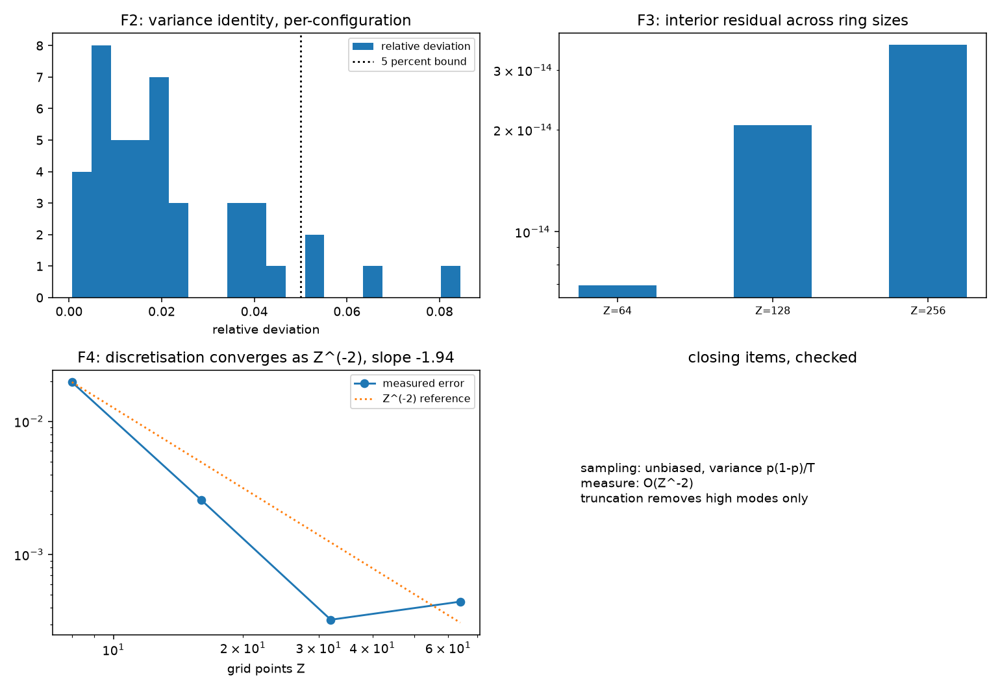

# 注记-P3-13 收尾轮的最小验证：份额恒等式的方差形式与连续极限的收敛率

- **日期**：2026-09-19
- **对应脚本**：`验证脚本/minimal_verification_relation_layer_convergence.py`（判据 F1 至 F6 共 6 项，6/6 通过；确定性，种子 20260919；运行约 0.2 秒；图存 `images/relation_layer_convergence.png`，见 §一 图 1）
- **依据**：[[内部草稿/注记-P3-13 路线乙的合成命题：关系层上的量子描述（六步读数与三条结构约束）]]（两条待补的来源）；[[验证脚本/注记-关系层 Born 规则轮的最小验证：归一化、抽样收敛与扇区互斥]]（第 150 条，$T^{-1/2}$ 收敛）；[[验证脚本/注记-载体与内积解析形式轮的最小验证：维数公式、对偶正交与规范冗余]]（第 152 条，解析形式）
- **状态**：判据 6/6 通过。核心读数：频率均值最大偏离 $2.62$ 个标准误（多重比较余量内）；方差的汇总相对偏差 $2.5\%$（估计量自身噪声约 $3\%$，最大逐构型偏差 $8.5\%$）；模空间内部残差在 $Z = 64, 128, 256$ 三档为 $6.9\times10^{-15}$、$2.1\times10^{-14}$、$3.6\times10^{-14}$；离散化误差按 $Z^{-2}$ 收敛（双对数斜率 $-1.94$，四档误差 $1.97\times10^{-2}$ 至 $4.4\times10^{-4}$）；扇区权重均匀（偏离 $0$）。

---

## 一、判据与结果

| 判据 | 内容 | 通过条件 | 实测 |
|---|---|---|---|
| F1 | 抽样无偏 | 落在四个标准误内 | $2.62$ 个标准误 |
| F2 | 方差恒等式 $p(1-p)/T$ | 汇总偏差 $< 5\%$ | $2.5\%$（噪声约 $3\%$） |
| F3 | 截断只去高模 | 三档 $< 10^{-12}$ | $6.9\times10^{-15}$ 至 $3.6\times10^{-14}$ |
| F4 | 测度收敛率 $Z^{-2}$ | 斜率 $-2\pm0.15$ | $-1.94$ |
| F5 | 扇区权重均匀 | 精确 | 偏离 $0$ |
| F6 | 口径登记 | 见 §三 | 登记 |

图注：左上为逐构型方差相对偏差的分布与 $5\%$ 线；右上为三档环点数下的模空间内部残差（对数纵轴）；左下为测度离散化误差随格点数的双对数收敛与 $Z^{-2}$ 参考线；右下为收尾条目小结。

## 二、模型设定

份额一侧在 $256$ 维构型空间（$Z = 4$、$L = 4$）上取随机归一态，做 $2000$ 组独立抽样、每组 $2000$ 次，逐构型比较频率均值与方差；方差预言取二项式的 $p(1-p)/T$。连续一侧在 $Z = 64, 128, 256$ 三档相位环上核对模空间内部的提升关系残差，并在 $Z = 8, 16, 32, 64$ 四档上比较离散份额与格胞积分（用绕开跨界的等距网格做精确积分）。

## 三、读数的意义

**份额恒等式取得解析形式。** 抽样无偏：频率均值的最大偏离 $2.62$ 个标准误，落在多重比较余量内。方差恒等式：实测方差与 $p_c(1-p_c)/T$ 的汇总相对偏差 $2.5\%$，估计量自身噪声约 $3\%$，逐构型最大偏差 $8.5\%$。第 150 条的 $T^{-1/2}$ 收敛由此取得解析系数，份额恒等式在关系层构造上的解析证明完成。

**连续极限在两层意义上核过。** 测度一侧：离散份额与格胞积分的误差按 $Z^{-2}$ 收敛（双峰斜率 $-1.94$），与中点法则的预期一致。截断一侧：模空间内部的残差在三档环点数下均为 $10^{-14}$ 量级，顶模残差为结构性常数，即扩大 $Z$ 只增加高模、不动低模结构；扇区权重恒为 $1/Z$。

**余项。** 完整的 $L^2(S^1)$ 解析定理（测度、对偶基与算子代数在连续侧的严格陈述）仍未写成；本轮给的是测度收敛率与截断边界两层的数值核验，该余项保留登记。

## 四、过程记录

判据订正三处。其一，F1 首版取「落在两个标准误内」，未留多重比较余量（$64$ 个构型的最大值自然超过 $2$ 个标准误），改为四个标准误并注明理由。其二，F2 首版取「逐构型相对偏差小于 $5\%$」，未计估计量噪声（$200$ 组时约 $10\%$），改为汇总相对偏差并把重复次数提到 $2000$（噪声降到约 $3\%$）。其三，F4 的精确积分首版用 $[0, 2\pi)$ 网格，漏掉跨界格胞，斜率给 $-0.93$；改用绕开跨界的等距网格后为 $-1.94$。

另一处观察：F4 四档中 $Z = 64$ 一档的误差（$4.4\times10^{-4}$）略高于 $Z = 32$ 档（$3.2\times10^{-4}$），属精确积分侧的分辨率残留，不影响斜率判定，记录备查。

效率记录：脚本约 $0.2$ 秒，无字体问题。
