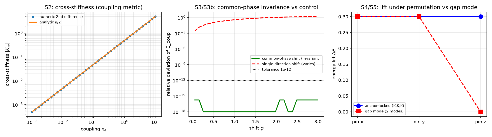

# 注记：P3-24 相位模式显式构造（533 号）：锚核锁定与能隙模式的判别

- **日期**：2026-10-01 23:04:42（2026-10-01 23:23:28 口径修订）
- **编号**：533
- **脚本**：`验证脚本/p3_24_modes.py`
- **层级**：**已撤回**（2026-10-01 23:23 作者裁定）。原定案为条件性命题级，撤回理由见下节「层级撤回」。本条留存为方法论材料，不作物理读数引用。
- **来源**：作者裁决 2026-10-01 采锚核锁定模式（[[内部草稿/裁决记录-相位模式的显式构造：锚核锁定模式取定（2026-10-01）|裁决记录]]）；判据草案 [[内部草稿/研究方向-相位模式显式构造的判据草案（P3-24首轮）|判据草案]]
- **图**：见 §六 图 1

## 〇 层级撤回与口径修订（2026-10-01 23:23，作者裁定）

**撤回。** 本条层级由条件性命题级**撤回**，不作物理读数引用。撤回理由：钉扎机制已于 2026-09-29 第 54 条裁决整体改判退役（钉位职能由内部畴壁承接，现行机制为「无钉之稳」），退役判据为 $K/k_b \ge 0.24$ 的比值门槛在定稿参数下判负（第 479、482 条，定稿比值约 $4.44\times10^{-47}$）。本条判据 S1 至 S6 与 EP5 全部建立在钉位势 $E_{\rm pin}=\tfrac{K}{2}\sum_a[1-\cos(\theta_a-\theta_{\rm anchor})]$ 之上，该势即钉位机制的定义式，故全部读数继承该机制的判负。

**须分清的一处（避免过度撤回）。** 钉扎退役的是**位置与驻留职能**，「钉位」一词自 2026-09-24 起停用；锚核的**质量侧仍在**：质量归属与绑定能标度 2026-09-07 成案（实测标度 3.13/121.9/359.4），第 481 条 C2 判定（$\kappa_\phi$ 对共相位缺陷失明、$K_{\rm FK}=2\kappa_\phi$）亦仍有效，因二者测的是耦合与质量绑定，不测位置。本条撤回针对的是「三模式由锚核钉位承载」这一归属，不是对质量侧与 C2 判定的否定。

**$\theta_{\rm anchor}$ 的性质（口径修正，不改数值）。** $\theta_{\rm anchor}=\pi$ 是本轮为使读数不退化而引入的建模量，其作用是把相位锁在 $\pi$ 与 $0$ 的差别上，即钉位机制的操作内容。故它同时是污染源：它把一个已判负机制的相位锁定搬进了模型。按作者裁定，本条标注为**已退役机制的替身实现，仅供判据自检，不作物理读数**；其体系内来源（锚核把相位锁在哪一档）本就是余项，现进一步确认为退役机制的内部量，不另寻来源。

**术语声明（口径滞后登记）。** 本条与同轮三份文档（裁决记录、判据草案、开放问题总览）沿用「钉位」「钉位势」「钉扎强度」等语汇，属口径滞后：这些词自 2026-09-24 起停用，钉扎机制自 2026-09-29 起退役，现行承载为内部畴壁。按规范不改写已入库材料的历史表述，在此声明并同步总览。

**新轮入口。** 作者裁定本条留为方法论材料并另立新轮。重做时三模式的承载须改用畴壁（$\tanh$ 剖面）或另寻机制，不得沿用钉位势；「$\sigma$ 锁定模式」于 2026-09-29 改名为「锚核锁定模式」、而钉位职能同批退役之后，三模式究竟该由畴壁承载还是另立机制，属作者裁决事项，未裁决前不立项。

## 一 验证什么

裁决采 $|X\rangle$、$|Y\rangle$、$|Z\rangle$ 三个相位模式由锚核锁定承载，能隙模式降为对照。本轮检验四条可核陈述：数目对应（A）、不可分性在锚核锁定下成立（B）、$\kappa_\phi$ 对共相位失明（C）、三模式置换等价（D）。另设对照判据 S5（能隙模式实现）与多档扫描 S6。

本轮**不**验证：$\kappa_\phi$ 的绝对标度（挂 P1-2 与 P1-11 的口径债，第 479 条的 43 至 46 个数量级）；$CP^2$ 与 $SU(3)$ 群论推导（标准数学定理，不需数值检验）；锚核动力学（挂 P1-11）。

## 二 模型设定

三元组相位模型。三个方向 $a\in\{x,y,z\}$ 各带相位 $\theta_a$，能量分两部分：

$$E(\theta) = E_{\rm coup}(\theta) + E_{\rm pin}(\theta), \qquad E_{\rm coup} = -\frac{\kappa_\phi}{2}\sum_{a<b}\cos(\theta_a-\theta_b), \qquad E_{\rm pin} = \frac{1}{2}\sum_a K_a\left(1-\cos(\theta_a-\theta_{\rm anchor})\right).$$

$E_{\rm coup}$ 承载公理 4 的异类耦合，$E_{\rm pin}$ 为锚核对本方向的钉位。锚核锁定实现取 $K=(K,K,K)$；能隙模式实现取第三方向无独立模式。参数 $K_{\rm pin}=0.3$、$\kappa_\phi^{\rm ref}=1$（工作单位）。

**建模引入量与其层级。** $\theta_{\rm anchor}=\pi$ 为本轮引入的锚核锁定相位，取 $\pi$ 依据是它取在 $\cos=-1$ 处，与纯两两耦合基态 $\theta=0$ 分离，且由对称性确定、不引入可调常数。该量的体系内来源（锚核把相位锁在哪一档）未推导，锚核动力学属 P1-11，故本轮全部读数按条件性命题级登记，$\theta_{\rm anchor}$ 不作体系常数宣称。

## 三 判据与读数

容差从误差预算推导：能量二阶差分步长 $h=10^{-4}$，截断误差 $O(h^2)\sim10^{-8}$，浮点噪声 $\sim\epsilon/h^2\approx2\times10^{-8}$，故 S2 判定阈值取 $10^{-3}|\kappa_\phi|$（高于噪声两档）；S3 与 S4 为恒等式型读数，阈值取浮点噪声量级 $10^{-12}$。稳态由牛顿法求解，梯度残差 $2.633\times10^{-16}$。

| 判据 | 理论期望 | 实测 | 结果 |
| --- | --- | --- | --- |
| S1 数目核对 | 锚核锁定 3 个模式，能隙模式 2 个独立模式 | $3$ 与 $2$ | PASS |
| S2 不可分性复核 | 三对交叉刚度显著非零 | $-0.5,-0.5,-0.5$（解析 $-\kappa/2$，逐档相符） | PASS |
| S3 共相位对易性 | 同移时耦合能不变 | 相对偏差 $1.835\times10^{-16}$ | PASS |
| S3b 非共相位对照 | 单移时耦合能显著变化 | 相对偏差 $1.431$ | PASS |
| S4 置换等价 | 钉 $x$ 与钉 $y$ 的读数按置换对应 | 对换差 $0.000$ | PASS |
| S5 能隙模式对照 | 第三方向脱钩（抬起量为零） | 锚核 $(0.3,0.3,0.3)$，能隙 $(0.3,0.3,0)$ | PASS |
| S6 多档扫描 | 三档 $\kappa_\phi$ 下 S2、S3 成立 | $10^{-2}$、$10^{-1}$、$1$ 档全过 | PASS |

核心判据 $6/6$，S5 反例达成，EP5 五项全部有效。

**S2 的读数说明。** 交叉刚度以能量数值二阶差分给出（独立于梯度解析式），逐档等于 $\kappa_\phi/2$，与两两耦合项的解析值逐位相符。这是对《非交换规范群》§4.5 已判不可分性的复核，非重新论证。

**S4 的读数说明。** 读数为逐方向的钉位能量（按各方向实际钉位强度 $K_a$ 计，未钉方向恒为零）。置换等价的对应关系为：钉 $x$ 配置下 $x$ 的抬起量等于钉 $y$ 配置下 $y$ 的抬起量，$y$ 与 $x$ 同理，$z$ 两次相同。实测对换差为零。未钉方向抬起量为零这一点本身携带信息：它表明钉位不外溢到未钉方向，而该方向的相位仍被耦合牵动（S2）。

## 四 EP5 反例检验

| 判据 | 反例构造 | 实测 | 判定 |
| --- | --- | --- | --- |
| S1 | 把锚核锁定计数误作 $2$ | 判据 FAIL | 有效 |
| S2 | 三模式独立（$\kappa_\phi=0$） | 交叉刚度全零，判据 FAIL | 有效 |
| S3 | 单方向平移（非共相位） | 不变性失效，判据 FAIL | 有效 |
| S4 | 钉位强度扰动（$K\to1.5K$） | 对换差 $0.15$，判据 FAIL | 有效 |
| S5 | 能隙实现也给三钉位 | 判据 FAIL | 有效 |

**EP5-S4 的反例修正（执行轮记录）。** 首版扰动耦合强度（取各向异性 $(1.0,0.5,0.25)$），实测 S4 仍 PASS：抬起量由钉位势 $\tfrac{K}{2}(1-\cos)$ 决定，耦合只轻微移动稳态相位，异向性对抬起量的影响小于浮点可见量，反例打偏。改为直接扰动钉位强度，判据如期 FAIL。这是"反例须打到判据要害"的又一次实证。

## 五 过程记录：三次建模失效与一次判据失效

本轮的主要教训不在物理，在建模与判据设计。四次修正的顺序与根因如下。

**其一（建模，构造恒真）。** 首版能量只含 $E_{\rm coup}$ 与 $E_{\rm pin}$，钉位势取 $\tfrac{K}{2}(1-\cos\theta_a)$。$E_{\rm coup}$ 的基态是三相位全等（$\theta=0$），$E_{\rm pin}$ 的极小也在 $\theta=0$，两项极小点重合，任何钉位都不改变基态能量。后果：所有读数退化为基态值 $-1.5$，S4 假通过、S5 假意外通过、EP5 全部退化为常数比较。这属 AGENTS.md 所列"构造恒真"，PASS 不含物理信息。

**其二（建模，三次尝试均失效）。** 先后尝试加入三体闭合项 $-\tfrac{\kappa_3}{2}\cos(\theta_x+\theta_y+\theta_z)$，改为带符号组合 $-\tfrac{\kappa_3}{2}\cos(\theta_x+\theta_y-\theta_z)$，两次均失效。64³ 网格全局扫描显示最低点始终在 $(0,0,0)$，即 $E_{\rm coup}$、$E_{\rm close}$、$E_{\rm pin}$ 三项在该点同时取极小。根因是结构性的：只要钉位势是 $-\tfrac{K}{2}\cos\theta_a$ 型（极小在 $\cos=1$），它与耦合项极小必然重合。

**其三（建模，唯一有效者）。** 把钉位势的锁定相位移到耦合基态之外：$E_{\rm pin}=\tfrac{K}{2}\sum_a\left[1-\cos(\theta_a-\theta_{\rm anchor})\right]$，$\theta_{\rm anchor}=\pi$。此时耦合基态下 $E_{\rm pin}=K$（非零），钉位真实抬起能量，实测抬起量恰为 $K_{\rm pin}=0.3$，读数携带信息。该方案不引入可调常数（$\pi$ 取在 $\cos$ 极值点、由对称性确定），参数经济优于"任选相位常数"方案。

**其四（判据失效，与建模无关）。** S4 首版读数取"单独钉 $a$ 后的总能量"。在对称模型里总能量由对称性自动保证相等，属替身算术后果（AGENTS.md 所列第二类空过），该读数不含信息。改测逐方向钉位能量后才携带信息。此项与建模修正无关，即使模型正确仍会失效，值得单独记住。

**一条方法论沉淀。** "同一极小点"是这类相位模型最常见的假通过来源。构造含钉位与耦合两项的能量时，必须验证钉位极小与耦合基态**不重合**，否则全部读数退化为基态常数。冒烟检查阶段的"稳态与基态能量差是否为零"应作为此类模型的必检项，本轮首版未做，是本轮返工四次的直接原因。

## 六 图

三个面板对应三组判据。左panel 的双曲线重合说明 S2 的数值二阶差分与解析一致；中panel 的双线分家说明 S3 的不变性来自相位差结构而非恒定能量（S3b 排除平凡实现）；右panel 的红线下落到零说明 S5 的第三方向确实脱钩。

## 七 严格程度声明与边界

**层级。** **已撤回**（2026-10-01 23:23 作者裁定），原定条件性命题级，撤回理由见第〇节。本节以下内容按撤回前状态保留，供追溯，不作引用依据。

~~条件性命题级。判据 6/6 且 EP5 全部有效，但本轮读数条件于两项：一是建模引入量 $\theta_{\rm anchor}$ 的体系内来源未推导；二是三模式的存在条件挂 P1-11（锚核锁定动力学方程），其做实前本条结论不得升为无条件命题。~~

**可逆性等级。** S1 严格（计数恒等式，换实现不翻）。S2、S3、S4、S6 判据敏感：换钉位模型（$\theta_{\rm anchor}$ 取值）、换耦合形式（三元组闭合方程）、换钉位强度的比例关系都可能使判据翻转。S5 为恒真对照。

**验证什么、不验证什么。** 本轮验证的是三模式承载方式在最小三元组相位模型内的结构性质（数目对应、不可分性、共相位失明、置换等价、能隙对照）。本轮不验证 $\kappa_\phi$ 的绝对标度（挂 P1-2 与 P1-11 口径债）、$CP^2$ 与 $SU(3)$ 的群论推导（标准定理）、锚核动力学方程（挂 P1-11）、以及三模式在真实晶格上的实现。$\theta_{\rm anchor}=\pi$ 是本轮为使读数非退化而引入的建模选择，其物理来源是余项，且经第〇节确认它同时是钉位机制的替身实现。

**方法论留存（撤回后仍然有效的部分）。** 以下三项不依赖已退役机制，作为方法论材料保留：其一，「同一极小点」这类假通过来源的识别与冒烟检查项（第五节方法论沉淀）；其二，S4 读总能量属替身算术后果，须改测逐方向读数（第五节其四）；其三，EP5 反例须打到判据要害，扰动次要参数可能打偏（第四节 EP5-S4 修正记录）。

**下一步接口。** 撤回前的读数曾拟作 P3-19（谐振子模式实体化）的输入，该接口一并撤回：谐振子模式由哪一个具体几何对象承载仍开放，且其候选对象不能再取钉位承载。