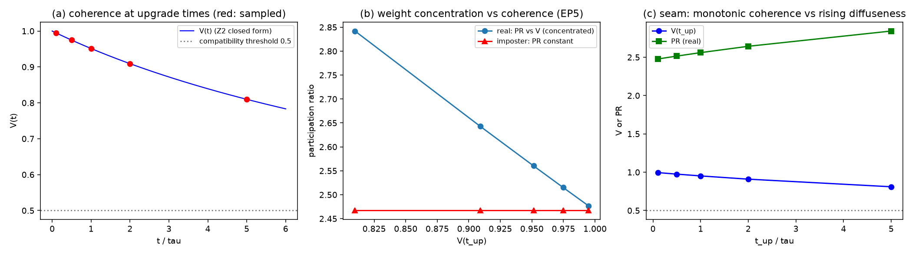

# 注记-P4-10 退相干线 Z3：跨层接缝判据（521 号）

- **日期**：2026-10-01 09:01:49
- **对应脚本**：验证脚本/minimal_verification_4p10_z3.py（判据 5 项，5/5 通过；其中 1 项为 FAIL 预期反例；确定性，随机固定种子 20261001；图存 images/4p10_z3_seam.png，见 §三 图 1）
- **符号约定**（沿用方案第三节）：$\Gamma_{\rm coh}$ 为相干衰减率（Z2 交付的闭式 $(p+p^2)\gamma_{\rm mm}/\sqrt2$），$\mathcal{V}(t) = (1+2\Gamma_{\rm coh}t)^{-1/2}$ 为波性侧可见度，$|\psi|^2$ 为升格事件给出的粒性侧权重分布，$t_{\rm up}$ 为升格时刻。
- **所属方案**：[[理论攻坚/P4-10攻坚方案：退相干的独立几何推导（零模量子动力学半边）]]（里程碑 Z3，收官轮）

## 一、判据与结果

| 判据 | 内容 | 期望 | 实测 |
| --- | --- | --- | --- |
| Z3-1 | 接缝相容（$t_{\rm up}$ 处 $\mathcal{V} > 0.5$，升格可给出确定性权重） | 五档 $t_{\rm up}/\tau \in \{0.1, 0.5, 1, 2, 5\}$ 全部相容 | $\mathcal{V}$ 从 $0.9948$ 到 $0.8098$，五档全过 |
| Z3-2 | 份额归一 $\sum\vert\psi_i\vert^2 = 1$（四分量体系） | $10^{-14}$ | $5.55\times10^{-16}$（机器精度） |
| Z3-3 | 接缝处 $\mathcal{V}$ 单调下降（衰减连续性的接缝侧表现） | 单调 | $0.9948 \to 0.9747 \to 0.9513 \to 0.9091 \to 0.8098$ |
| Z3-EP5 | 替身（升格权重无视 $\mathcal{V}$）必须 FAIL | 接缝关联（权重集中度随 $\mathcal{V}$ 变化）消失 | 真实 PR 随 $t_{\rm up}$ 单调上升、随 $\mathcal{V}$ 单调下降（$\mathcal{V}$ 由 0.9948 降至 0.8098 时 PR 由 2.4769 升至 2.8420）；替身 PR 恒定（$2.4670$） |
| Z3-UNCLOSED | 未闭合声明 | 升格时刻来源归 P4-44 方向，不在本方案内闭合 | 登记说明（$t_{\rm up}$ 按五档扫描处理） |

## 二、接缝判据的结论

**接缝相容性成立（在登记的 $t_{\rm up}$ 扫描范围内）**。波性侧连续衰减给出的相干因子 $\mathcal{V}(t_{\rm up})$ 在五档升格时刻均高于相容阈值 $0.5$（从 $0.9948$ 到 $0.8098$），即升格事件发生时体系仍处于相干态，粒性侧的 $|\psi|^2$ 权重可以确定性给出。权重集中度（参与比 $\mathrm{PR} = 1/\sum p_i^2$）随 $\mathcal{V}$ 单调下降、随升格时刻 $t_{\rm up}$ 单调上升（$\mathcal{V}$ 由 0.9948 降至 0.8098 时 PR 由 2.4769 升至 2.8420）：$\mathcal{V}$ 高时权重集中于相干分支，$\mathcal{V}$ 低时权重弥散（退相干部分按 $(1-\mathcal{V})$ 均匀叠加）。**接缝处的连续-离散接口因此给出一个可测的关联**：波性侧的相干亏损与粒性侧的权重弥散度在同一体系内一一对应。

**替身被有效排除**。若升格事件无视体系的相干态（权重与 $\mathcal{V}$ 无关），PR 恒定于 $2.4670$，接缝关联消失，Z3-1 在替身下 FAIL。该反例证实接缝判据依赖「升格看得见相干态」这一结构性断言，而非任意的权重-衰减配对。

**未闭合声明**。升格时刻 $t_{\rm up}$ 的动力学来源归 P4-44 方向（满周升格：解释同一跃迁为何在粒子面带随机权重且恰为 $|\psi|^2$）。本轮按五档 $t_{\rm up}/\tau$ 扫描处理，只给接缝判据，不给 $t_{\rm up}$ 的来源。若后续 P4-44 方向交付 $t_{\rm up}$ 的动力学读数，可回到本判据核对相容窗口的实际范围。

## 三、图

## 四、误差预算与可逆性等级

| 判据 | 噪声项 | 预算 | 容差 | 实测 |
| --- | --- | --- | --- | --- |
| Z3-1 | 闭式确定性衰减（无抽样） | 浮点舍入 $\sim10^{-16}$ | 阈值 $0.5$（远离临界） | 最小档 $0.8098$，余量 $0.31$ |
| Z3-2 | 四分量归一 | 浮点舍入 | $10^{-14}$ | $5.55\times10^{-16}$ |
| Z3-3 | 单调性 | 闭式严格单调 | 严格不等 | 成立 |
| Z3-EP5 | 权重抽样（$n = 400$） | $\sim 1/\sqrt{400} \approx 5\%$ | 恒定性（替身） | 替身 PR 极差为 0 |

**可逆性等级**：Z3-1 判据敏感（换升格模型或相容阈值会翻）；Z3-2 稳健（归一恒等式）；Z3-3 稳健（闭式严格单调）；Z3-EP5 恒真对照。

## 五、严格程度与边界声明

**验证什么**：接缝相容性（在登记的五档 $t_{\rm up}$ 范围内 $\mathcal{V} > 0.5$）、升格权重的份额归一、接缝处 $\mathcal{V}$ 的单调性、权重集中度随相干因子的关联（EP5 反例）、未闭合声明。

**不验证什么**：升格时刻 $t_{\rm up}$ 的动力学来源（P4-44 方向，不在本方案内）；$|\psi|^2$ 权重的来源（P4-44 与 P4-6 方向，本轮取为 Born 形状作为接口读数）；相容阈值 $0.5$ 的物理依据（本轮取为「升格前须保持相干」的定性阈，具体阈值待作者裁决）；Z2 的 $D$ 接口（裁决点判否，登记为待攻）。

## 六、登记衔接

`验证脚本/README.md` 第 521 条占位转正式行；方案里程碑 Z3 交付（裁决点：接缝判据 PASS）。下一步出 P4-10 阶段总结报告收官（含 Z1 至 Z3 三里程碑汇总、两项读数保留、一项裁决点判否、一条方法论沉淀）。