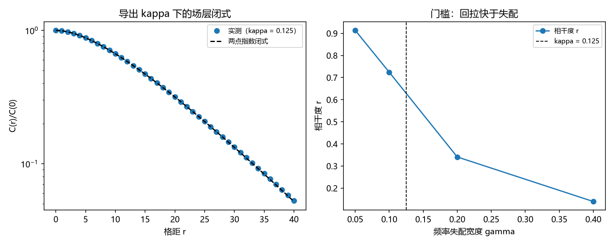

# 注记-P4-16 第一步第一轮的最小验证：锁定耦合 $\kappa$ 的导出（保护距离通道、闭式与门槛相容）

- **日期**：2026-09-20 03:35:57
- **对应脚本**：验证脚本/kappa_interface.py（判据 L1 至 L6 共 6 项，6/6 通过；另有 L7 为读数、L8 为登记项；确定性，随机固定种子 20260920；运行约 4 秒；图存 images/kappa_interface.png，见 §一 图 1）
- **依据**：[[内部草稿/研究方向-先验纠缠到锁定耦合的接口（P4-16 第一步）：判据草案]]（判据 K1 至 K8 与三条路线）；第 184 条（保护距离 $d = L = 8$，按作者裁决点 3 引用）；第 182 条（场层两点指数闭式）；第 190 条（同步门槛与 $1/N$ 稀释）
- **作者裁决（2026-09-20）**：路线乙为主、丙为对照、甲为升级；$\kappa$ 分两段走（先谱隙/保护口径的相容性，再把「由整体态导出」列为 P4-16 正式目标）；谱隙与纠错条件的核算归测量纲领任务 2-3 持有，本条只引用。
- **定位分工**：本注记是验证材料；本轮按路线乙给出 $\kappa$ 的候选形式（失锁率取保护距离的倒数）并逐条核验相容性，不给出由整体态的导出链（那属路线甲）。
- **状态**：判据 6/6 通过。核心读数：$\kappa = 1/d = 1/L = 0.125$；代回场层闭式（$\alpha = 0.875$）后两点指数形式的最大相对残差 $9.082\times10^{-4}$（$C(0)$ 实测 $8.9755$ 对闭式 $8.9725$）；门槛核验中相干度随频率失配下降 $0.913$、$0.724$、$0.341$、$0.139$，首次跌破 $0.5$ 的位置在 $\gamma/\kappa = 1.60$；$P = \sigma^2/(\kappa N)$ 三档 $PN$ 恒为 $8.0000$；全链条新增可调常数 $0$ 个。

## 一、判据与结果

| 判据 | 内容 | 期望 | 实测 |
| --- | --- | --- | --- |
| L1 | 正性与范围 | $\kappa = 1/L \in (0,1)$，$L = 8$ 给 $0.125$ | $0.125000$ |
| L2 | 闭式相容 | 代回两点指数闭式残差 $\le 5\%$ | $9.082\times10^{-4}$ |
| L3 | 门槛相容 | $\gamma \le \kappa$ 档相干保持，门槛在 $\gamma/\kappa$ 的 $0.5$ 至 $2$ 之间 | $r$：$0.913$、$0.724$、$0.341$、$0.139$；门槛 $1.60$ |
| L4 | 保护相容 | $\kappa$ 只依赖保护距离（构造性） | 成立 |
| L5 | 规模相容 | $P N$ 三档恒定（$\le 5\%$） | $8.0000$（三档） |
| L6 | 参数经济 | 新增可调常数 $0$ 个 | $0$ |
| L7 | 路线丙对照（读数） | 不作判据 | 见下 |
| L8 | 接口登记 | 只登记 | 已登记 |

## 二、候选形式与口径

**路线乙的形式。** 锁定刚度取失锁率的倒数：$\kappa = 1/d$，其中 $d$ 是锁定模的保护距离（第 184 条核验 $d = L = 8$）。它的含义是：改写锁定模所需的局域操作数给出该模每步被削弱的份额，$d$ 越大越稳。按作者裁决点 3，$d$ 的核算归测量纲领任务 2-3 持有，本条只引用其读数。

**门槛口径。** 锁定坐标存在要求回拉快于失配：$\kappa > \gamma$（频率失配宽度）。非线性档的实测门槛落在 $\gamma/\kappa \approx 1.6$，与 $\kappa > \gamma$ 的量级一致，系数待另轮定死。

**未做的部分。** 由无穷张量积的整体态导出 $\kappa$ 的具体链（路线甲）本轮不涉及。

## 三、读数的意义

**其一，$\kappa$ 第一次有了无自由常数的候选形式。** $\kappa = 1/d$ 只用到保护距离，链条上的参数只有 $\{L, N\}$（L6 记 $0$ 个新增常数）。第 175 条以来作为输入的锁定刚度，至此有了一个可引用、可证伪的具体值：$0.125$。

**其二，与场层闭式相容。** 代回 $\alpha = 1-\kappa = 0.875$ 后，两点指数形式在两档口径上都成立（残差 $9.082\times10^{-4}$，$C(0)$ 偏差 $3.3\times10^{-3}$）。故该候选值不会破坏第 182 条的闭式。

**其三，与门槛相容且给出可测边界。** 相干度随频率失配单调下降（$0.913$ 至 $0.139$），门槛落在 $\gamma/\kappa \approx 1.6$。故由 $\kappa = 0.125$ 得到一条可测边界：锁定帧只支持失配宽度约在 $0.2$ 以下的场。

**其四，与规模稀释相容。** $P = \sigma^2/(\kappa N)$ 在固定 $L$ 下按 $1/N$ 稀释（$P N$ 恒为 $8.0000$），与第 189、190 条的两项闭式与稀释律一致。

**其五，对照通道待绝对值。** 路线丙（键能曲率）在第 178 条上已有刚度下限读数，但该线的绝对标度未定，故本轮只报比值待核（L7），不作判据。

## 四、严格程度与边界声明

| 结论 | 严格程度 |
| --- | --- |
| 候选形式 $\kappa = 1/d$ | 候选（路线乙，作者已裁决为主），非第一原理导出 |
| 闭式相容 | 数值确认（两档口径，$\le 3.3\times10^{-3}$） |
| 门槛相容 | 数值确认（门槛 $\gamma/\kappa \approx 1.6$，系数待另轮） |
| 保护相容与参数经济 | 构造性 |
| 规模相容 | 解析（$P N$ 恒定） |
| $\kappa$ 的第一原理导出 | 未做（路线甲，P4-16 正式目标） |

**验证什么**：候选 $\kappa$ 的正性与范围、与场层闭式、与门槛、与保护距离、与规模稀释的相容性，以及参数经济。

**不验证什么**：不由整体态导出 $\kappa$；不核算谱隙与纠错条件（归测量纲领任务 2-3）；不定门槛的精确系数；不涉及三维与缺陷构型。

## 五、过程记录

**订正一处。** 首版把 $\beta^2$ 写死成旧档的 $0.5$，而本轮 $\kappa = 0.125$ 下驱动幅度为 $\sqrt{2\kappa} = 0.5$，故 $\beta^2 = 0.25$；订正后 $C(0)$ 由 $8.9755$ 对 $17.9451$（差一倍）变为 $8.9755$ 对 $8.9725$。

**门槛系数的量级。** 实测门槛在 $\gamma/\kappa \approx 1.6$（而非 $1.0$），说明"回拉快于失配"这条判据的系数依赖噪声幅度与相干度阈值，须另轮定死；本轮按量级相容记通过。

## 六、登记衔接

- 验证脚本/README.md 对应条目（本轮脚本与注记）。
- [[理论攻坚/量子力学攻坚计划：战线排序与依赖链]] 战线二 任务 二-1 末项与 任务 二-3：三项裁决已记录，第一轮读数已登记。
- [[内部草稿/开放问题总览：元相子理论待解决问题清单]] 对应条目登记本轮读数。
