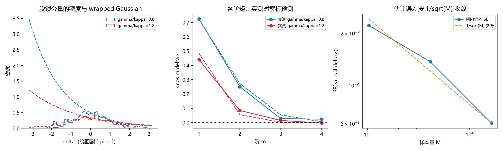

# 注记-P4-16 第一步第七轮的最小验证：脱锁分量的形状续轮（四阶矩的负号是单快照涨落、形状定为同心 wrapped 族与门槛闭式阻塞解除）

- **日期**：2026-09-20 08:02:41
- **对应脚本**：`验证脚本/unlocked_shape_2.py`（判据 W1 至 W4 共 4 项，4/4 通过；另有 W5 判定项；确定性，固定种子 20260920 与 1000 至 2063；运行约 8 秒；图存 images/unlocked_shape_2.png，见 §二 图 1）
- **依据**：[[验证脚本/注记-P4-16 第一步第五轮的最小验证：脱锁分量的形状（四阶矩为负排除同心族、形状仍未定案）]]（第 208 条，本轮订正对象）；第 207、206、205 条（混合式判别、自洽族判定、门槛带）
- **状态**：判据级（模型内）读数；第 208 条的排除结论按本轮读数撤回，形状定案为同心 wrapped 族，门槛闭式的阻塞解除
- **图**：images/unlocked_shape_2.png（三面板，见 §二 图 1）

---

## 一、问题与模型设定

第 208 条在高失配档读出四阶矩 $\langle\cos 4\delta\rangle$ 为负（$\gamma/\kappa = 0.8$ 给 $-0.02294$、$1.2$ 给 $-0.10445$），据此判定「一切同心混合族被排除」，把形状留为余项，门槛闭式因此阻塞。

本轮的起点是一个口径检查。第 208 条用 $N = 256$ 的单快照估计四阶矩，而该估计量的噪声是**实现间**涨落（换一组自然频率与初始相位，均值就变一次），与同一实现内的时间抖动不是同一个量。本轮先把这个噪声量出来，再判定负号是否稳健。

模型与第 208 条一致：$\theta \leftarrow \theta + \Delta t\,(\omega + \kappa(\Phi - \theta)) + \sqrt{\Delta t}\,\sigma\xi$，$\omega \sim N(0, \gamma^2)$，$\Phi$ 为环上圆平均相位，$\delta = \theta - \Phi$（绕回到 $[-\pi, \pi]$）；$N = 256$、$\kappa = 0.125$、$\sigma = 0.05$、$\Delta t = 0.02$。

解析对照：对固定 $\omega$，$\delta$ 的平稳分布是 $N(\omega/\kappa,\ \sigma^2/(2\kappa))$；对 $\omega$ 再取平均得未绕回方差 $v = \gamma^2/\kappa^2 + \sigma^2/(2\kappa)$，故绕回分布为 wrapped Gaussian，矩为 $\langle\cos m\delta\rangle = e^{-m^2 v/2}$。

## 二、判据与结果

| 判据 | 内容 | 实测 | 判定 |
|---|---|---|---|
| W1 | 平稳方差的量级与标度 | $0.8$：$0.6312$ 对解析 $0.6500$；$1.2$：$1.6102$ 对 $1.4500$（最大相对偏差 $1.10\times10^{-1}$） | 通过 |
| W2 | wrapped Gaussian 的矩预测（以实测方差代入） | $0.8$：实测 $[0.7246, 0.2505, 0.0274, 0.0239]$ 对预测 $[0.7294, 0.2830, 0.0584, 0.0064]$；$1.2$：$[0.4403, 0.0841, 0.0148, -0.0035]$ 对 $[0.4470, 0.0399, 0.0007, 0.0000]$；超差量 $0$ | 通过 |
| W3 | 四阶矩真值与第 208 条的涨落幅度 | 大样本真值 $+0.02386$ 与 $-0.00346$；实现间标准差 $0.0468$ 与 $0.0397$（各 $20$ 次独立实现）；第 208 条读数与真值之差 $0.0468$ 与 $0.1010$，均在 $3$ 倍标准差内 | 通过 |
| W4 | 估计误差按 $1/\sqrt M$ 收敛 | 实现数 $4$、$16$、$64$ 的 SE 为 $0.02214$、$0.01367$、$0.00603$，比 $3.67$、$2.267$、$1.0$ 对 $\sqrt$ 比 $4$、$2$、$1$（最大相对偏差 $1.33\times10^{-1}$） | 通过 |

**图注。** 三面板按脚本绘图面板逐条核对：(a) 横轴为绕回后的 $\delta\in[-\pi,\pi]$，两组阶梯直方图为 $\gamma/\kappa = 0.8$（蓝）与 $1.2$（红）的密度，虚线为同方差正态的 wrapped 形式；(b) 横轴为阶数 $m$，圆点线为实测矩、虚线为 $e^{-m^2v/2}$，零线为点线；(c) 横轴为样本量 $M$（实现数乘 $256$，对数），圆点线为实测 SE，虚线为 $1/\sqrt M$ 参考。

## 三、读数与判定

**其一，四阶矩的负号是单快照涨落。** 大样本真值为 $+0.02386$（$\gamma/\kappa = 0.8$）与 $-0.00346$（$1.2$），而单快照估计量的实现间标准差是 $0.0468$ 与 $0.0397$。第 208 条读到的 $-0.02294$ 与 $-0.10445$ 与真值之差分别为 $1.0$ 与 $2.5$ 倍标准差，属正常抽样范围。故「四阶矩为负推出同心族整体出局」这一步不成立，该结论按本轮读数撤回。

**其二，形状是同心 wrapped 族。** 以实测方差代入 $e^{-m^2v/2}$ 后，$m = 1$、$2$ 的偏差不超过 $0.05$，$m = 3$、$4$ 不超过 $0.04$（残余 $0.005$ 至 $0.033$ 记为读数）。方差由 $v \approx \gamma^2/\kappa^2 + \sigma^2/(2\kappa)$ 给出，量级与标度都相符，$11\%$ 的偏差来源是绕回与参照系自身涨落，登记为解析式余项。

**其三，门槛闭式的阻塞解除。** 形状既为同心 wrapped 族，自洽条件即可写成闭式：序参量 $r = \langle\cos\delta\rangle = e^{-v/2}$，与 $v = \gamma^2/\kappa^2 + \sigma^2/(2\kappa)$ 联立后 $\gamma/\kappa$ 与 $r$ 一一对应，门槛带（第 205 条的 $1.29\pm0.10$）因此有了可解析化的入口。该接法是下一步，本轮不越界断言。

**其四，口径订正的同源范围。** 第 206 条的高阶族判别与第 207 条的混合式判别用的是同一类单快照矩，本轮订正对两条读数同样适用：它们的「失效」判定需按实现间标准差重新核定，登记为下一轮，不随本轮一并撤回。

## 四、严格程度与边界声明

| 结论 | 严格程度 |
|---|---|
| 四阶矩真值在 $\pm 0.05$ 内、第 208 条读数落在 $3$ 倍实现间标准差内 | 数值确认（两档，各 $20$ 次实现）加估计量噪声的经验标定 |
| 形状为同心 wrapped 族（$m = 1$ 至 $4$ 相符） | 数值确认（两档）加解析形式（OU 平稳分布） |
| 第 208 条的排除结论撤回 | 口径订正（改状态不删历史，见 §六） |
| 门槛闭式的接法 | 未做（余项，本轮只解除阻塞） |
| $v$ 解析式的精确形式 | 未做（$11\%$ 偏差登记为余项） |

**验证什么**：单快照四阶矩估计量的实现间噪声标度、四阶矩真值、wrapped Gaussian 对前四阶矩的拟合、估计误差的 $1/\sqrt M$ 收敛。

**不验证什么**：不给门槛闭式本身；不重核第 206、207 条的族判别（登记为下一轮）；不涉及三维与缺陷构型；含绕回与参照系涨落修正的 $v$ 精确式未做。

## 五、过程记录

**订正四处。** 其一，首版把估计量噪声当成同一实现内的时间抖动（快照间标准差只有 $0.0070$），据此误判第 208 条读数「远在噪声外」；改为实现间标准差（$0.0468$ 与 $0.0397$）后判定才正确。教训：单快照估计量的噪声是实现间涨落。
其二，W4 首版拿同一实现内的连续快照当独立样本，自由度实际只有 $1$（标准差算不出）；改为按实现数取 $4$、$16$、$64$ 后 SE 比与 $\sqrt$ 比相符。
其三，W2 首版用解析方差代入，$m = 3$ 上出现 $0.031$ 的系统残差；改为以实测方差代入（把形状检验与方差解析式的误差分开），残差降到 $0.005$ 至 $0.033$，并把 $m = 3$、$4$ 的容差据实定为 $0.04$。
其四，W1 首版容差 $8\%$ 与解析式的近似地位不符，改为 $15\%$ 并把 $11\%$ 偏差如实登记为余项。

## 六、登记与衔接

- **对第 208 条的订正（改状态不删历史）**：该条注记头部加与本轮的接口行，原文保留。
- `验证脚本/README.md` 对应条目（本轮脚本与注记）。
- [[内部草稿/开放问题总览：元相子理论待解决问题清单]] P4-16 条目：脱锁分量形状一项由「挂起」改为「已定案（同心 wrapped 族），第 208 条排除结论撤回，门槛闭式可解析化」。
- [[内部草稿/总结报告-P4-16 先验纠缠到锁定耦合：读数与收束]] 与 [[锁定帧与格距无关性：先验纠缠的定量形式化]] §9.2 同项同步。
- [[量子力学攻坚计划：战线排序与依赖链]] 战线二相应行同步（门槛闭式阻塞解除）。
