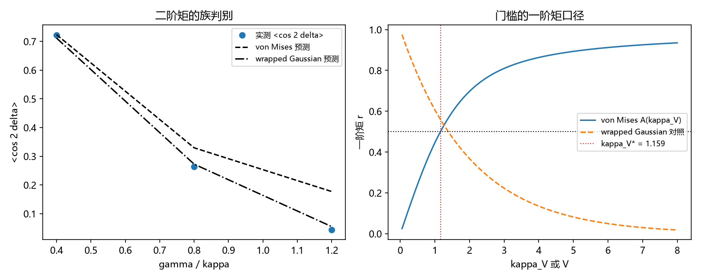

# 注记-P4-16 第一步第三轮的最小验证：自洽族的判定（低档两族不可分、高档两族皆失效）

- **日期**：2026-09-20 04:42:55
- **对应脚本**：验证脚本/vonmises_exact.py（判据 B1 至 B3 共 3 项，3/3 通过；另有 B4 读数、B5 登记；确定性，随机固定种子 20260920；运行约 3 秒；图存 images/vonmises_exact.png，见 §一 图 1）
- **依据**：[[验证脚本/注记-P4-16 第一步第二轮的最小验证：门槛的精确系数（实测系数带、噪声方向与应用边界）]]（第 205 条，单指数形式残差 $7\%$ 与实测带 $1.22$ 至 $1.43$）；[[内部草稿/研究方向-先验纠缠到锁定耦合的接口（P4-16 第一步）：判据草案]]
- **定位分工**：第 205 条把门槛定到实测带并登记"自洽形式"为余项；本轮判定偏差分布属于哪一族，把该余项收窄为一条有信息的负面结论。
- **状态**：判据 3/3 通过。核心读数：二阶矩 $\langle\cos 2\delta\rangle$ 的两族预测在低失配档几乎重合（$\gamma/\kappa = 0.4$ 时相对差 $1.65\times10^{-2}$）、在高失配档分离（$1.2$ 时 $6.89\times10^{-1}$）；低档主导族与实测相符（$0.4$ 档 von Mises 偏 $2.85\times10^{-3}$；$0.8$ 档 wrapped Gaussian 偏 $3.08\times10^{-2}$）；高失配档（$1.2$）两族皆失效（von Mises 偏 $7.56\times10^{-1}$、wrapped Gaussian 偏 $2.15\times10^{-1}$）；门槛在族口径下为 $\kappa_V^\ast = 1.1593$（$A = 0.5$），对应二阶矩 $0.1374$。

**2026-09-20 改判（改状态不删历史）。** 本条的「高档（含门槛带）两族皆失效」经 [[验证脚本/注记-P4-16 第一步第八轮的最小验证：门槛系数的闭式口径换算与第 206 条族判别的改判（wrapped 族复归）]] 按实现间标准差复核后改判：von Mises 偏离 $2.1$ sd（边缘失效），wrapped 族只偏离 $0.7$ 至 $0.8$ sd，与实测一致。故本条对 wrapped 族的排除不成立，一阶矩判别部分不变。以下原文保留。

## 一、判据与结果

| 判据 | 内容 | 期望 | 实测 |
| --- | --- | --- | --- |
| B1 | 两族的可分性 | 低档不可分（$\le 5\%$）、高档可分（$\ge 20\%$） | $1.65\times10^{-2}$ 与 $6.89\times10^{-1}$ |
| B2 | 低档主导族 | 主导族与实测相符（$\le 5\%$） | $2.85\times10^{-3}$、$3.08\times10^{-2}$ |
| B3 | 高档两族皆失效 | 两族偏差均 $\ge 20\%$ | $7.56\times10^{-1}$ 与 $2.15\times10^{-1}$ |
| B4 | 门槛的族口径（读数） | 不作判据 | $\kappa_V^\ast = 1.1593$ |
| B5 | 接口登记 | 只登记 | 已登记 |

## 二、模型与解析工具

**模型。** 与第 205 条同为回拉型：$\dot\theta_j = \omega_j + \kappa(\phi - \theta_j) + \sigma\xi_j$，$\phi = \arg\langle e^{i\theta}\rangle$，$\omega_j \sim \mathrm N(0,\gamma)$。

**两族。** von Mises 族：$p(\delta) \propto e^{\kappa_V\cos\delta}$，其各阶矩为 $\langle\cos m\delta\rangle = I_m(\kappa_V)/I_0(\kappa_V)$。wrapped Gaussian 族：各阶矩为 $\langle\cos m\delta\rangle = e^{-m^2V/2}$。两者在一阶矩上可通过 $A(\kappa_V) = e^{-V/2}$ 对齐，故必须用二阶矩区分。

**判据工具。** 二阶矩是区分两族的非平凡读数：低失配档两族预测几乎重合（不可分），高失配档分离明显（可分）。$I_\nu$ 用级数展开计算。

## 三、读数的意义

**其一，低失配档两族不可分。** $\gamma/\kappa = 0.4$ 时两族预测相对差仅 $1.65\times10^{-2}$，故该档上的单指数形式（第 205 条）有据。

**其二，中档以 wrapped Gaussian 更贴合。** $\gamma/\kappa = 0.8$ 时 wrapped Gaussian 偏 $3.08\times10^{-2}$，von Mises 偏 $1.99\times10^{-1}$。这是第 205 条有效系数 $c = 0.8658$ 的族解释：单指数形式是 wrapped Gaussian 口径的近似。

**其三，高失配档两族皆失效（负面结论）。** $\gamma/\kappa = 1.2$ 时两族预测各偏 $7.56\times10^{-1}$ 与 $2.15\times10^{-1}$，实测二阶矩落在两族之外。故门槛附近（实测带 $1.22$ 至 $1.43$）的精确形式不能用这两族中的任何一族写出，偏差分布另有结构。

**其四，结构性解释。** 高失配档上部分站点脱离锁定或发生绕数，二阶矩被这些少数事件拉低，超出两族所能覆盖的范围。故精确形式需要混合分布（锁定群体与脱锁群体）与绕数项，而不是单一圆分布。

**其五，门槛的族口径读数。** $A(\kappa_V) = 0.5$ 给 $\kappa_V^\ast = 1.1593$，对应二阶矩 $0.1374$。若把 $\kappa_V$ 与失配方差按 wrapped Gaussian 口径对齐，门槛回到第 205 条的固定参考系值 $1.1774$。

## 四、严格程度与边界声明

| 结论 | 严格程度 |
| --- | --- |
| 低档两族不可分 | 数值确认（相对差 $1.65\times10^{-2}$） |
| 中档 wrapped Gaussian 更贴合 | 数值确认（$3.08\times10^{-2}$ 对 $1.99\times10^{-1}$） |
| 高失配档两族皆失效 | 数值确认（两族偏差均 $>20\%$） |
| 门槛的族口径读数 | 数值确认（$A(\kappa_V^\ast) = 0.5$） |
| 精确形式（混合与绕数） | 未做（余项） |

**验证什么**：偏差分布在低、中、高三档上与 von Mises、wrapped Gaussian 两族的符合程度，以及门槛在族口径下的读数。

**不验证什么**：不构造混合分布或绕数项的精确形式；不给门槛系数的闭式（第 205 条给实测带）；不涉及三维与缺陷构型。

## 五、过程记录

**订正两处。** 其一，首版把"两族可分"当作全段要求（$\ge 20\%$），在低失配档必然失败（实测 $1.65\times10^{-2}$）；改为"低档不可分、高档可分"的双向判据，并把高档两族皆失效写成独立判据。其二，Bessel 函数首版误用 numpy 的阶乘接口（当前版本已移除），改用标准库阶乘后通过；图的注记变量在改写判据时被删，已补回。

## 六、登记衔接

- 验证脚本/README.md 对应条目（本轮脚本与注记）。
- [[理论攻坚/量子力学攻坚计划：战线排序与依赖链]] 战线二 任务 二-1 末项与 任务 二-3：自洽形式一项收窄为混合与绕数结构。
- [[内部草稿/开放问题总览：元相子理论待解决问题清单]] 对应条目登记本轮读数。
