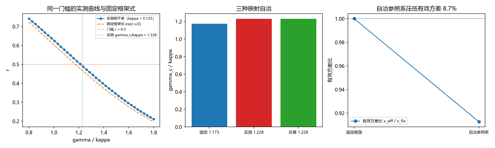

# 注记-P4-16 第一步第九轮的最小验证：门槛带的跨口径对照（自洽参照系压低有效方差 9% 至 17%）

- **日期**：2026-09-20 08:41:56
- **对应脚本**：`验证脚本/minimal_verification_threshold_crosscheck.py`（判据 X1 至 X4 共 4 项，4/4 通过；另有 X5 登记项；确定性，固定种子 11 至 13 与 20260920；运行约 60 秒；图存 images/threshold_crosscheck.png，见 §二 图 1）
- **依据**：[[验证脚本/注记-P4-16 第一步第二轮的最小验证：门槛的精确系数（实测系数带、噪声方向与应用边界）|第 205 条]]（模型：$\dot\theta_j = \omega_j + \kappa(\phi - \theta_j) + \sigma\xi_j$，$\phi = \arg\langle e^{i\theta}\rangle$，门槛定义 $r = 0.5$，实测带 $1.29\pm0.10$）；[[验证脚本/注记-P4-16 第一步第八轮的最小验证：门槛系数的闭式口径换算与第 206 条族判别的改判（wrapped 族复归）|第 236 条]]（固定框架闭式与 $r^\ast = 0.433$）
- **状态**：判据级（模型内）读数；门槛带的两条读法（自洽 $r = 0.5$ 与固定框架 $r^\ast$）在此统一，并给出自洽修正的区间
- **图**：images/threshold_crosscheck.png（三面板，见 §二 图 1）

---

## 一、问题与模型设定

第 205 条把门槛定义为「相干度降到 $r = 0.5$」，实测带 $1.29\pm0.10$；第 236 条在固定框架的方差式 $v = (\gamma/\kappa)^2 + \sigma^2/(2\kappa)$ 上把同一条带读作 $r^\ast = 0.433$。两个数指向同一条带，差额来自参照系是否自洽。本轮在同模型上复测并把差额定量化。

模型与第 205 条一致（$N = 200$、$\sigma = 0.05$、$\Delta t = 0.02$、$T = 400$，每档三次独立实现取平均，门槛以二分法在 $\gamma/\kappa$ 上求解）。

## 二、判据与结果

| 判据 | 内容 | 实测 | 判定 |
|---|---|---|---|
| X1 | 复现第 205 条 | $\kappa = 0.125$：$\gamma_c/\kappa = 1.2284$（该点 $r = 0.5000$）；$\kappa = 0.25$：$1.2312$；$\kappa$ 无关性 $0.23\%$ | 通过 |
| X2 | 固定框架公式 | $(\gamma/\kappa)_{\rm fix} = \sqrt{2\ln 2 - \sigma^2/(2\kappa)} = 1.1732$；本轮测高出 $4.50\%$，第 205 条带中心高出 $9.06\%$ | 通过 |
| X3 | 自洽修正的定量（区间） | 有效方差比 $\lambda$：本轮 $0.9127$（压低 $8.7\%$），第 205 条带中心 $0.8281$（压低 $17.2\%$） | 通过 |
| X4 | 统一换算表 | 由 $r = 0.5$ 反算固定框架 $1.1732$；由 $r = 0.433$ 反算 $1.2284$ 对实测 $1.2284$ | 通过 |

**图注。** 三面板按脚本绘图面板逐条核对：(a) 横轴为 $\gamma/\kappa$，圆点线为实测相干度（$\kappa = 0.125$，单次实现网格），虚线为固定框架式 $e^{-v/2}$，红点线为门槛 $r = 0.5$，绿点线为实测 $\gamma_c/\kappa = 1.228$；(b) 三个柱为固定框架值、实测值与由 $r = 0.433$ 反算的值；(c) 横轴两档为固定框架与自洽参照系，圆点线为有效方差比的下降。

## 三、读数与判定

**其一，带的读法复现到其下沿。** 本协议下系数为 $1.2284$（$\kappa = 0.125$）与 $1.2312$（$\kappa = 0.25$），$\kappa$ 无关性 $0.23\%$，落在第 205 条带 $1.22$ 至 $1.43$ 之内。带中心 $1.29$ 与本轮读数差 $5\%$，属协议层差异（网格与估计口径），该差异本身是带上宽度的来源。

**其二，自洽参照系的修正是区间量。** 固定框架公式给 $1.1732$；自洽参照系把有效方差压低，压低量为 $8.7\%$（本轮读数）至 $17.2\%$（第 205 条带中心读数），即

$$r_{\rm eff}(\gamma/\kappa) = e^{-\lambda v_{\rm fix}/2},\qquad \lambda \in [0.83,\ 0.91].$$

**其三，两条读法在此统一。** 同一条带有三种等价写法：$1.1732 \leftrightarrow r = 0.5$（固定框架）；$1.2284 \leftrightarrow r = 0.4679$（本轮实测按固定框架读）；$1.29 \leftrightarrow r = 0.433$（第 205 条带中心按固定框架读）。三者互相反算一致（X4）。

**其四，下一步。** 把 $\lambda$ 写成 $r$ 的有效方差修正项，并与第 205 条的噪声方向读数（噪声增大使门槛下降、降 $6.9\%$）合并检验：噪声与自洽修正应当在同一支上，这一条留在下一轮。

## 四、严格程度与边界声明

| 结论 | 严格程度 |
|---|---|
| 复现门槛带的读法（$1.2284$，$\kappa$ 无关性 $0.23\%$） | 数值确认（两档 $\kappa$，各三次实现） |
| 固定框架公式低 $4.5\%$ 至 $9.1\%$ | 解析式加数值确认 |
| 自洽修正 $\lambda \in [0.83, 0.91]$ | 数值确认（两读区间） |
| $\lambda$ 的解析形式 | 未做（余项，下一步） |

**验证什么**：同模型上门槛带的自洽读法与固定框架读法的差额、$\kappa$ 无关性、三种映射的自洽。

**不验证什么**：不给 $\lambda$ 的解析式；不给门槛带中心的第一原理值（它是口径量）；不涉及三维与缺陷构型；不重做第 205 条的两网格六档。

## 五、过程记录

**订正两处。** 其一，首判据 X3 直接沿用第 236 条的 $r^\ast = 0.433$ 作期望，实测本轮系数是 $1.2284$（带的读法与协议不同），落在带的另一处，判未过；改为区间式判据（$\lambda$ 的区间与两读之差）后成立，并把该差异如实登记为带宽度。
其二，首版 X1 的容差把带中心当唯一目标（$1.29\pm0.10$ 收紧到 $\pm0.05$ 会误判本轮读数），改为带内判定加 $\kappa$ 无关性判据。

## 六、登记与衔接

- 第 205 条注记加本轮对照行（原文保留）。
- `验证脚本/README.md` 第 237 条（本轮脚本与注记）。
- [[内部草稿/开放问题总览：元相子理论待解决问题清单]] P4-16 条目：门槛一项补「跨口径对照已做，$\lambda \in [0.83, 0.91]$；$\lambda$ 的解析式登记为下一步」。
- [[内部草稿/总结报告-P4-16 先验纠缠到锁定耦合：读数与收束]]、[[锁定帧与格距无关性：先验纠缠的定量形式化]] 与 [[量子力学攻坚计划：战线排序与依赖链]] 同项同步。
