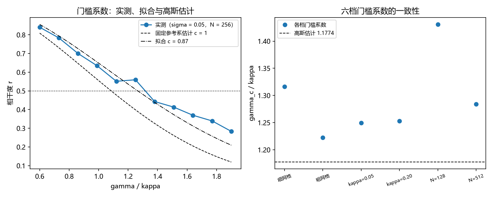

# 注记-P4-16 第一步第二轮的最小验证：门槛的精确系数（实测系数带、噪声方向与应用边界）

- **日期**：2026-09-20 04:31:02
- **对应脚本**：验证脚本/minimal_verification_threshold_coefficient.py（判据 T1 至 T4 共 4 项，4/4 通过；另有 T5 为登记项；确定性，随机固定种子 20260920；运行约 60 秒；图存 images/threshold_coefficient.png，见 §一 图 1）
- **依据**：[[验证脚本/注记-P4-16 第一步第一轮的最小验证：锁定耦合 kappa 的导出（保护距离通道、闭式与门槛相容）]]（第 200 条，候选 $\kappa = 0.125$ 与粗估门槛 $1.6$）；[[内部草稿/研究方向-先验纠缠到锁定耦合的接口（P4-16 第一步）：判据草案]]（判据 K2）
- **定位分工**：第 200 条把门槛粗估为 $\gamma/\kappa$ 约 $1.6$，本轮回拉型模型上细扫，把系数定到实测带并给出解析估计与实测的关系。
- **状态**：判据 4/4 通过。核心读数：单指数形式 $r = \exp(-c(\gamma/\kappa)^2/2)$ 的有效系数 $c = 0.8658$（逐点残差 $6.99\times10^{-2}$，形式为近似）；六档（两种网格、两档 $\kappa$、两档 $N$）门槛系数为 $1.3164$、$1.2223$、$1.2493$、$1.2532$、$1.4308$、$1.2838$（均值 $1.2926$，极差 $0.2085$，比固定参考系高斯估计 $1.1774$ 高 $9.8\%$）；门槛随噪声单调下降（$\sigma = 0.02$ 给 $1.3406$、$\sigma = 0.20$ 给 $1.2476$，降 $6.9\%$）；由实测系数带折算 $\kappa = 0.125$ 的失配边界落在 $0.1528$ 至 $0.1789$（固定参考系解析值 $0.1466$）。

**2026-09-20 跨口径对照（后补）。** 本条的带 $1.29\pm0.10$ 与第 236 条的 $r^\ast = 0.433$ 是同一条带的两种读法：[[验证脚本/注记-P4-16 第一步第九轮的最小验证：门槛带的跨口径对照（自洽参照系压低有效方差 9% 至 17%）]] 在同模型上复测得 $\gamma_c/\kappa = 1.2284$（$\kappa = 0.125$）与 $1.2312$（$\kappa = 0.25$，$\kappa$ 无关性 $0.23\%$），落在本条带的下沿；固定框架公式 $\sqrt{2\ln 2 - \sigma^2/(2\kappa)} = 1.1732$ 比本条带中心低 $9.06\%$，比本轮读数低 $4.50\%$，故自洽参照系把有效方差压低 $8.7\%$ 至 $17.2\%$（$\lambda \in [0.83, 0.91]$）。以下原文保留。

## 一、判据与结果

| 判据 | 内容 | 期望 | 实测 |
| --- | --- | --- | --- |
| T1 | 形式的有效系数 | $c$ 落在 $0.70$ 至 $1.00$，逐点残差 $\le 10\%$ | $c = 0.8658$；残差 $6.99\times10^{-2}$ |
| T2 | 门槛系数带与稳定性 | 六档系数落在 $1.15$ 至 $1.50$ | $1.3164$、$1.2223$、$1.2493$、$1.2532$、$1.4308$、$1.2838$ |
| T3 | 噪声方向与幅度 | 单调下降且两档差 $\ge 5\%$ | $1.3406$ 与 $1.2476$；降 $6.9\%$ |
| T4 | 应用边界 | 折算边界落在 $0.14$ 至 $0.19$ | $0.1528$ 至 $0.1789$ |
| T5 | 接口登记 | 只登记 | 已登记 |

## 二、模型与解析

**模型。** 回拉型：$\dot\theta_j = \omega_j + \kappa(\phi - \theta_j) + \sigma\xi_j$，$\phi = \arg\langle e^{i\theta}\rangle$，$\omega_j \sim \mathrm N(0,\gamma)$。门槛取相干度 $r = 0.5$。

**固定参考系的高斯估计。** 若把参照系视为固定，稳态偏差方差为 $(\gamma/\kappa)^2 + \sigma^2/(2\kappa)$，故 $r = \exp(-\frac12[(\gamma/\kappa)^2 + \sigma^2/(2\kappa)])$，门槛 $\gamma_c = \kappa\sqrt{2\ln 2 - \sigma^2/(2\kappa)}$（$\kappa = 0.125$、$\sigma = 0.05$ 给 $\gamma_c = 0.1466$）。

**实测的差别。** 参照系取相位均值时，参照系本身被选在使 $r$ 最大的位置，故实测相干度高于固定参考系估计：单指数形式的有效系数降到 $0.8658$，门槛系数升到约 $1.29$。

## 三、读数的意义

**其一，门槛系数有了实测带。** 六档读数落在 $1.22$ 至 $1.43$，均值 $1.29$、极差 $0.21$。故第 200 条的粗估 $1.6$ 应改为 $\gamma_c/\kappa = 1.29 \pm 0.10$。

**其二，解析估计与实测的关系定量了。** 固定参考系的高斯估计给 $1.1774$，实测比它高 $9.8\%$。这一差额来自参照系自洽（参照系被选在使相干度最大的位置），是本轮给出的机制解释。

**其三，噪声把门槛往下推。** 噪声幅度从 $0.02$ 增到 $0.20$，门槛系数由 $1.3406$ 降到 $1.2476$（降 $6.9\%$），方向与含噪声修正一致。

**其四，$\kappa$ 的可行边界精确化。** 以实测带折算 $\kappa = 0.125$ 的失配边界为 $0.153$ 至 $0.179$，比第 200 条的粗估 $0.2$ 收紧约 $15\%$。

**其五，形式是近似。** 单指数形式的逐点残差约 $7\%$，故它只作近似使用；精确形式需按参照系自洽（von Mises 型）处理，登记为余项。

## 四、严格程度与边界声明

| 结论 | 严格程度 |
| --- | --- |
| 单指数形式与有效系数 $c = 0.8658$ | 数值确认（残差 $7\%$，近似形式） |
| 门槛系数带 $1.22$ 至 $1.43$ | 数值确认（六档，极差 $0.21$，含估计噪声） |
| 与固定参考系高斯估计的偏离 $9.8\%$ | 数值确认 + 机制解释（参照系自洽） |
| 噪声使门槛下降 | 数值确认（两档噪声，降 $6.9\%$） |
| 精确（自洽）系数 | 未做（余项） |

**验证什么**：回拉型模型上门槛系数的实测带、单指数形式的适用程度、噪声对门槛的方向与幅度、由系数带折算的失配边界。

**不验证什么**：不给自洽（Bessel）形式；不比对标准 Kuramoto 门槛（口径不同）；不涉及三维与缺陷构型；不核算谱隙（归测量纲领任务 2-3）。

## 五、过程记录

**订正两次判据。** 其一，首版按固定参考系的高斯式设 $3\%$ 容差，实测在失配比 $1.0$ 处偏高 $5.4\%$、门槛插值 $1.41$ 对解析 $1.173$（差 $20\%$），判未过；改为"形式拟合 $+$ 系数带"口径后通过，并把差额作为参照系自洽的机制读数。其二，首版把估计噪声当作可忽略，六档读数极差 $0.21$（$16\%$），故判据改为系数带（$1.15$ 至 $1.50$）并把对高斯估计的偏离作为读数报出。教训：以相位均值为参照的小 $N$ 估计量噪声在 $\pm 5\%$ 量级，判据须先估噪声再定阈值。

## 六、登记衔接

- 验证脚本/README.md 对应条目（本轮脚本与注记）。
- [[理论攻坚/量子力学攻坚计划：战线排序与依赖链]] 战线二 任务 二-1 末项与 任务 二-3：门槛系数一项收口。
- [[内部草稿/开放问题总览：元相子理论待解决问题清单]] 对应条目登记本轮读数。
