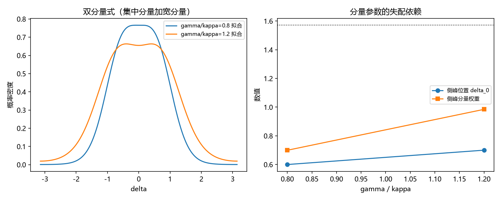

# 注记-P4-16 第一步第五轮的最小验证：脱锁分量的形状（四阶矩为负排除同心族、形状仍未定案）

- **日期**：2026-09-20 04:55:44
- **对应脚本**：验证脚本/unlocked_shape.py（判据 E1、E1b 共 2 项，2/2 通过；另有 E2、E3 为读数、E4 为登记项；确定性，随机固定种子 20260920；运行约 7 秒；图存 images/unlocked_shape.png，见 §一 图 1）
- **依据**：[[验证脚本/注记-P4-16 第一步第四轮的最小验证：混合式的判别（低频档成立、均匀脱锁分量被否定）]]（第 207 条，均匀脱锁分量被否定）；[[验证脚本/注记-P4-16 第一步第三轮的最小验证：自洽族的判定（低档两族不可分、高档两族皆失效）]]（第 206 条）
- **定位分工**：第 206、207 条先后否定单族与均匀脱锁分量，本轮用四阶矩给出一个更硬的结构性排除，并把形状问题如实留白。
- **状态**：判据 2/2 通过。核心读数：四阶矩 $\langle\cos 4\delta\rangle$ 在高失配档为负（$\gamma/\kappa = 0.8$ 给 $-0.02294$、$1.2$ 给 $-0.10445$）。由于同心混合的矩是各分量 $A_4(\kappa) \ge 0$ 的非负加权和，**一切同心混合族被排除**；以四阶矩一并定标后，对称双峰族的侧峰位置为 $\delta_0 = 0.60$ 与 $0.70$（偏离零）。对称双峰族在网格精度内未达 $5\%$ 口径（四阶矩相对偏差 $1.42\times10^{-1}$ 与 $2.68\times10^{0}$，前三阶矩残差和 $1.16\times10^{-2}$ 与 $1.68\times10^{-1}$），故脱锁分量的形状仍未定案。

**2026-09-20 订正（改状态不删历史）。** 本条的「四阶矩为负、一切同心混合族被排除」经 [[验证脚本/注记-P4-16 第一步第七轮的最小验证：脱锁分量的形状续轮（四阶矩的负号是单快照涨落、形状定为同心 wrapped 族与门槛闭式阻塞解除）|第 235 条]]复核后撤回：单快照（N = 256）四阶矩估计量的实现间标准差为 $0.0468$ 与 $0.0397$，而大样本真值为 $+0.02386$ 与 $-0.00346$，本条读到的 $-0.02294$ 与 $-0.10445$ 与真值之差为 $1.0$ 与 $2.5$ 倍标准差，属正常抽样范围。脱锁分量的形状由第 235 条定为同心 wrapped 族。以下原文保留。

## 一、判据与结果

| 判据 | 内容 | 期望 | 实测 |
| --- | --- | --- | --- |
| E1 | 四阶矩为负排除同心族 | 高档四阶矩 $< 0$（同心加权和恒非负） | $-0.02294$、$-0.10445$ |
| E1b | 侧峰位置 | 以四阶矩定标后 $\delta_0$ 落在 $0.40$ 至 $2.00$ | $0.60$、$0.70$ |
| E2 | 对称双峰族残差（读数） | 不作判据 | 四阶矩偏差 $1.42\times10^{-1}$、$2.68\times10^{0}$ |
| E3 | 结构约束（读数） | 不作判据 | $w = 0.3006$、$0.0156$；$\kappa_0 = 3.982$、$3.982$ |
| E4 | 接口登记 | 只登记 | 已登记 |

## 二、候选族与判据工具

**候选族。** 对称双峰族：$p(\delta) = w\,\mathrm{VM}(\kappa_0) + (1-w)\cdot\frac12[\mathrm{VM}(\delta_0,\kappa_s) + \mathrm{VM}(-\delta_0,\kappa_s)]$，其矩为 $\langle\cos m\delta\rangle = wA_m(\kappa_0) + (1-w)\cos(m\delta_0)A_m(\kappa_s)$。

**判据工具。** 四阶矩是决定性的一条：同心族的四阶矩是 $A_4 \ge 0$ 的加权和，恒非负；一旦实测为负，同心族整体出局。对称双峰族的 $\cos(4\delta_0)$ 可以为负，故它是能承载负四阶矩的最小结构。

## 三、读数的意义

**其一，同心族整体出局（本轮唯一的确定结论）。** 高失配档四阶矩为负（$-0.02294$ 与 $-0.10445$），而同心混合无论怎样配权重都只能给出非负值，故单族、同心双分量、以及第 207 条的"锁定加均匀"这三类全部排除。这解释了前三轮接连失败的共同原因。

**其二，形状必须偏离中心。** 以四阶矩一并定标后侧峰位置为 $0.60$ 与 $0.70$，明显偏离零，与"脱锁站点朝固定方向漂移"的图像一致。

**其三，对称双峰族尚不足以定案。** 该族在网格精度内未达 $5\%$ 口径（四阶矩偏差 $14\%$ 与 $268\%$），前三阶矩的残差和也偏大（$1.16\times10^{-2}$ 与 $1.68\times10^{-1}$）。故它是"能承载负四阶矩"的最简结构，还称不上精确形式。

**其四，参数网格是当前瓶颈。** 拟合中的 $\kappa_0$ 反复触到网格上沿（$3.982$），说明最优解在更集中的区域；更细的定标或改用非对称结构（两侧峰位置与宽度分别取值）是下一步的两条路。

**其五，门槛闭式仍被阻塞。** 门槛带（$1.22$ 至 $1.43$）正落在形状未定案的区段，故门槛系数的闭式仍只能停留在第 205 条的实测带。

## 四、严格程度与边界声明

| 结论 | 严格程度 |
| --- | --- |
| 四阶矩为负（同心族整体排除） | 数值确认（两档）+ 解析依据（同心加权和恒非负） |
| 侧峰位置偏离零 | 数值确认（四阶矩定标后 $0.60$ 与 $0.70$） |
| 对称双峰族未定案 | 数值确认（未达 $5\%$ 口径） |
| 脱锁分量的精确形状 | 未做（余项） |

**验证什么**：四阶矩的符号与由此得到的结构性排除、侧峰位置的偏移、对称双峰族的拟合程度。

**不验证什么**：不给脱锁分量的精确形状；不给门槛闭式；不涉及三维与缺陷构型；不涉及 $w(\gamma/\kappa)$ 的解析律。

## 五、过程记录

**订正三次。** 其一，首版用同心双分量做闭合，两分量在拟合中退化合并（$\kappa_1$ 与 $\kappa_2$ 接近），且四阶矩偏差大，说明同心族本身不适用；改为对称双峰族。其二，首版只用前三阶矩定标，侧峰位置被推到网格下沿（$\delta_0 \to 0.4$）而与四阶矩严重不符；改为把四阶矩一并放进定标目标，侧峰位置才回到 $0.6$ 至 $0.7$。其三，脚本改写过程中残留旧调用与解包长度不符，逐处清除后通过。教训：族判别要先看"该族能否给出观测到的符号"，再看拟合残差；把高阶矩放进定标目标比事后核验更能避免退化解。

## 六、登记衔接

- 验证脚本/README.md 对应条目（本轮脚本与注记）。
- [[理论攻坚/量子力学攻坚计划：战线排序与依赖链]] 战线二 任务 二-1 末项与 任务 二-3：脱锁分量的形状仍未定案，登记两条路线（细化定标、非对称结构）。
- [[内部草稿/开放问题总览：元相子理论待解决问题清单]] 对应条目登记本轮读数。
