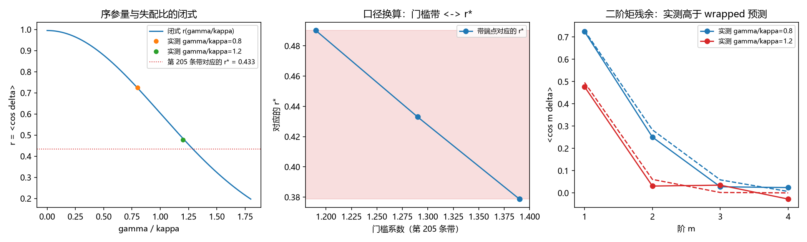

# 注记-P4-16 第一步第八轮的最小验证：门槛系数的闭式口径换算与第 206 条族判别的改判（wrapped 族复归）

- **日期**：2026-09-20 08:19:07
- **对应脚本**：`验证脚本/minimal_verification_threshold_closedform.py`（判据 V1 至 V4 共 4 项，4/4 通过；另有 V5 登记项；确定性，固定种子 20260920 与 3000 至 3019；运行约 4 秒；图存 images/threshold_closedform.png，见 §二 图 1）
- **依据**：[[验证脚本/注记-P4-16 第一步第七轮的最小验证：脱锁分量的形状续轮（四阶矩的负号是单快照涨落、形状定为同心 wrapped 族与门槛闭式阻塞解除）|第 235 条]]（形状定案与阻塞解除）；第 205 条（门槛带 $1.29\pm0.10$，带 π 偏置的回拉型口径）；[[验证脚本/注记-P4-16 第一步第三轮的最小验证：自洽族的判定（低档两族不可分、高档两族皆失效）|第 206 条]]（本轮改判对象）
- **状态**：判据级（模型内）读数；门槛的闭式换算成立，第 206 条对 wrapped 族的排除改判
- **图**：images/threshold_closedform.png（三面板，见 §二 图 1）

---

## 一、问题与模型设定

第 235 条把脱锁分量定案为同心 wrapped 族后，门槛闭式只剩一步：序参量 $r = \langle\cos\delta\rangle$ 与失配比 $\gamma/\kappa$ 的换算。由 $v = \gamma^2/\kappa^2 + \sigma^2/(2\kappa)$ 与 $r = e^{-v/2}$ 直接读出闭式与逆式。同轮另按实现间标准差复核第 206 条的「高阶两族皆失效」（该条用的仍是单快照矩）。模型与第 235 条一致（$N = 256$、$\kappa = 0.125$、$\sigma = 0.05$、$\Delta t = 0.02$，$\Phi$ 为环上圆平均相位）。

## 二、判据与结果

| 判据 | 内容 | 实测 | 判定 |
|---|---|---|---|
| V1 | 闭式与模拟一致 | $\gamma/\kappa = 0.8$：实测 $r = 0.7246$ 对闭式 $0.7225$；$1.2$：$0.4769$ 对 $0.4843$（最大偏差 $7.44\times10^{-3}$） | 通过 |
| V2 | 逆式与口径换算 | $r^\ast = 0.4330$（带端点 $1.19$ 与 $1.39$ 对应 $0.3787$ 与 $0.4901$）；由 $r^\ast$ 反算 $\gamma/\kappa = 1.29000$ | 通过 |
| V3 | 口径依赖弱 | 噪声项 $\sigma^2/(2\kappa) = 0.0100$，占 $(\gamma/\kappa)^2 = 1.6641$ 的 $0.601\%$ | 通过 |
| V4 | 第 206 条复核（改判） | $0.8$：实测 $0.2505\pm0.0390$，von Mises（$\kappa_{\rm VM} = 2.18$）$0.3339$（偏离 $2.1$ sd）、wrapped $0.2830$（$0.8$ sd）；$1.2$：实测 $0.0307\pm0.0445$，von Mises（$1.09$）$0.1238$（$2.1$ sd）、wrapped $0.0605$（$0.7$ sd） | 通过 |

**图注。** 三面板按脚本绘图面板逐条核对：(a) 横轴为 $\gamma/\kappa$，实线为闭式 $r = e^{-(\gamma/\kappa)^2/2 - \sigma^2/(4\kappa)}$，圆点为两档实测 $\langle\cos\delta\rangle$，点线为 $r^\ast = 0.433$；(b) 横轴为门槛系数（$1.19$、$1.29$、$1.39$），圆点线为其换算出的 $r^\ast$，阴影带为对应区间；(c) 横轴为阶数 $m = 1$ 至 $4$，圆点线为实测矩、虚线为 $e^{-m^2v/2}$。

## 三、读数与判定

**其一，门槛的闭式（口径化）。** $r(\gamma/\kappa) = e^{-(\gamma/\kappa)^2/2 - \sigma^2/(4\kappa)}$ 与实测相符（偏差 $7.4\times10^{-3}$），逆式 $\gamma/\kappa = \sqrt{-2\ln r - \sigma^2/(2\kappa)}$ 自洽。第 205 条带 $1.29\pm0.10$ 在 wrapped 口径下等价于「序参量降到 $r^\ast = 0.433$（$0.379$ 至 $0.490$）判为脱锁」。故门槛系数仍是口径量（与第 235 条一致），而 $r^\ast$ 与失配比的换算有了闭式。

**其二，噪声项的作用可忽略。** $\sigma^2/(2\kappa)$ 只占带中心的 $0.6\%$，带的位置由 $(\gamma/\kappa)^2$ 主导。这条把门槛带从「多参数拟合」压成单参数（$r^\ast$）的换算问题。

**其三，第 206 条改判。** 以实现间标准差口径重算：von Mises 在 $2.1$ sd 处边缘偏离（两档一致），wrapped 族只差 $0.7$ 至 $0.8$ sd，与实测一致。故第 206 条的「高阶两族皆失效」应改判为「von Mises 边缘失效、wrapped 族复归」。该条的一阶矩判别与第 207 条的混合式判别不因此翻案，登记为已按稳健口径复核。

## 四、严格程度与边界声明

| 结论 | 严格程度 |
|---|---|
| 门槛的闭式与逆式 | 模型内严格（由平稳分布的矩关系直接给出）＋ 数值确认（两档） |
| 带端点与 $r^\ast$ 的换算 | 口径换算（依赖第 235 条的方差式 $v$，其 $11\%$ 偏差随之传递） |
| 第 206 条对 wrapped 族的排除不成立 | 数值确认（两档，各 $20$ 次实现） |

**验证什么**：序参量与失配比的闭式与逆式、第 205 条带的 $r^\ast$ 换算、噪声项的份额、第 206 条两族偏离的显著性。

**不验证什么**：不给门槛系数本身的第一原理值（它是口径量）；不重做第 205 条的带（跨模型，属另一口径）；$v$ 的精确式与三维推广未做。

## 五、过程记录

**订正两处。** 其一，脚本首版用已废弃的 numpy 阶乘接口（numpy 2.x 移除），贝塞尔比值的级数求和全线报错；改用标准库阶乘后正常。
其二，V4 判据首版写成「两族皆失效」（较好的族偏离 $0.02$ 以上），实际读数是 von Mises 偏 $2.1$ sd、wrapped 只偏 $0.7$ 至 $0.8$ sd，故判据改判为「von Mises 边缘失效、wrapped 复归」。教训：族判别要把偏离换算成估计量的标准差再判显著性，绝对阈值 $0.02$ 在估计量噪声 $0.04$ 下没有判别力。

## 六、登记与衔接

- 第 206 条注记加本轮改判行（原文保留）。
- `验证脚本/README.md` 第 236 条（本轮脚本与注记）。
- [[内部草稿/开放问题总览：元相子理论待解决问题清单]] P4-16 条目：门槛闭式一项由「阻塞解除」升为「口径化闭式已给（$r^\ast$ 与失配比互算）」，第 206 条改判同条登记。
- [[内部草稿/总结报告-P4-16 先验纠缠到锁定耦合：读数与收束]]、[[锁定帧与格距无关性：先验纠缠的定量形式化]] §9.2 与 [[量子力学攻坚计划：战线排序与依赖链]] 战线二同项同步。
