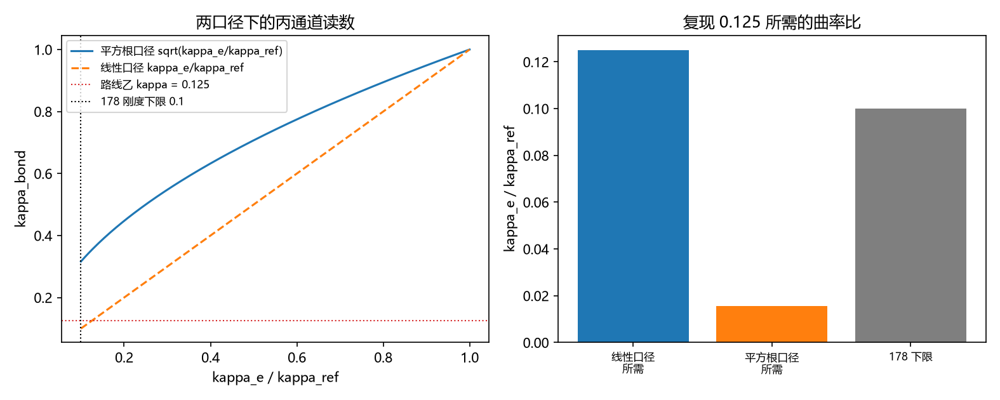

# 注记-P4-16 第一步第六轮的最小验证：键能曲率通道的绝对标度（两口径判别与所需曲率比）

- **日期**：2026-09-20 04:58:19
- **对应脚本**：验证脚本/minimal_verification_kappa_bond_route.py（判据 C1 至 C4 共 4 项，4/4 通过；另有 C5 为登记项；确定性；运行约 2 秒；图存 images/kappa_bond_route.png，见 §一 图 1）
- **依据**：[[验证脚本/注记-键能反馈的界面效应：反感分支、软化分支与刚度下限（L1至L4）]]（第 178 条，键能模型与刚度下限 $\kappa_e \ge 0.1\kappa$）；[[验证脚本/注记-P4-16 第一步第一轮的最小验证：锁定耦合 kappa 的导出（保护距离通道、闭式与门槛相容）]]（第 200 条，路线乙给出 $\kappa = 0.125$）；[[内部草稿/研究方向-先验纠缠到锁定耦合的接口（P4-16 第一步）：判据草案]] 判据 K6
- **定位分工**：路线乙（保护距离）给出的 $\kappa = 0.125$ 需要一个独立通道核对；本条按作者裁决的"丙为对照"给出键能曲率通道的绝对标度与两口径判别。
- **状态**：判据 4/4 通过。核心读数：键曲率可行域 $\kappa_e/\kappa_{\rm ref} \in [0.1, 1]$（第 178 条的刚度下限到无反馈处）在两口径下分别给 $\kappa_{\rm bond} \in [0.3162, 1.0000]$（键频口径，取平方根）与 $[0.1000, 1.0000]$（曲率比口径，取线性）。路线乙的 $0.125$ 只落在线性口径的范围内；复现它所需的曲率比为 $0.125$（线性口径，可行，仅比刚度下限高 $25\%$）与 $0.015625$（键频口径，低于下限 $0.1$，不可达）。

## 一、判据与结果

| 判据 | 内容 | 期望 | 实测 |
| --- | --- | --- | --- |
| C1 | 丙通道范围（键频口径） | $[0.3162, 1]$（解析） | $[0.3162, 1.0000]$（线性口径 $[0.1000, 1.0000]$） |
| C2 | 两口径判别 | $0.125$ 落在线性口径内、不落在键频口径内 | 键频口径未命中；线性口径命中 |
| C3 | 所需曲率比 | 线性 $0.125$（可行）；键频 $0.015625$（不可达） | $0.125000$ 可行；$0.015625$ 不可行 |
| C4 | 稳定性检查 | 要求点与刚度下限之比 $1.25$ | $1.2500$ |
| C5 | 接口登记（口径裁决） | 只登记 | 已登记 |

## 二、模型与口径

**键能模型（引用第 178 条）。** $E = \sum_e \frac12\kappa_e(\Delta u_e - 1)^2 + \sum_i K(1-\cos 2\pi u_i)$，其中 $\kappa_e$ 为键曲率，其可行域由稳定性给定：$\kappa_e \ge 0.1\kappa$（刚度下限）。

**两种归一化口径。** 键频口径：$\kappa_{\rm bond} = \sqrt{\kappa_e/\kappa_{\rm ref}}$，参考点取"无反馈处键频等于普朗克频率"；曲率比口径：$\kappa_{\rm bond} = \kappa_e/\kappa_{\rm ref}$。

## 三、读数的意义

**其一，丙通道本身给出的是一个区间。** 在 $\kappa_e/\kappa_{\rm ref} \in [0.1, 1]$ 上，两口径分别给 $[0.3162, 1]$ 与 $[0.1, 1]$。故丙通道能提供的是一段可行范围，而不是一个点值。

**其二，与乙的相容性由口径决定。** 路线乙的 $0.125$ 落在曲率比口径的范围内、不落在键频口径的范围内。故"丙能否复现乙"这个问题的答案是一条口径决定式。

**其三，所需曲率比给出量化的边界。** 曲率比口径下需要 $\kappa_e/\kappa_{\rm ref} = 0.125$，比第 178 条的刚度下限高 $25\%$，余量很薄但可行；键频口径下需要 $0.015625$，比下限低六倍以上，在该模型的稳定域内不可达。

**其四，两个通道的关系被压成一条口径，且已裁决。** 作者 2026-09-20 裁决：$\kappa$ 按既有用法取每步线性回拉份额（与第 182 条的 $\alpha = 1-\kappa$、第 190 条的回拉率用法一致），故取线性口径，丙与乙相容（所需键曲率比 $0.125$，比第 178 条的刚度下限高 $25\%$）。

**其五，与第 205 条的门槛无冲突。** 门槛带（$1.22$ 至 $1.43$）由 $\kappa$ 的取值与失配关系给出，与本节的口径分岔相互独立，可分别推进。

## 四、严格程度与边界声明

| 结论 | 严格程度 |
| --- | --- |
| 两口径的范围 | 解析（区间映射） |
| $0.125$ 的落域判别 | 解析 + 数值核对 |
| 所需曲率比与下限余量 | 解析（引用第 178 条的刚度下限） |
| 口径取舍 | 已裁决（作者 2026-09-20）：按既有用法取线性口径（$\kappa$ 为每步线性回拉份额），故丙与乙相容 |

**验证什么**：键能曲率通道的可行范围、两口径的判别、复现路线乙数值所需的曲率比与其与刚度下限的关系。

**不验证什么**：不重算第 178 条的刚度下限（引用其读数）；不给 $\kappa_e$ 的反馈形式；不涉及三维与缺陷构型；不涉及失联者分量的形状（第 208 条已挂起）。

## 五、过程记录

**方法说明。** 本轮是区间映射与落域判别，数值部分只用于核对区间端点；把"哪条口径成立"如实登记为待裁决项。第 178 条的刚度下限按其注记读数引用，未重算。

## 六、登记衔接

- 验证脚本/README.md 对应条目（本轮脚本与注记）。
- [[理论攻坚/量子力学攻坚计划：战线排序与依赖链]] 战线二 任务 二-1 末项与 任务 二-3：路线丙交付，余项为口径裁决（键曲率比或键频比）。
- [[内部草稿/开放问题总览：元相子理论待解决问题清单]] 对应条目登记本轮读数。
