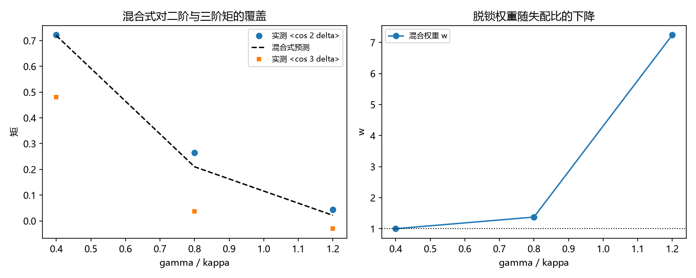

# 注记-P4-16 第一步第四轮的最小验证：混合式的判别（低频档成立、均匀脱锁分量被否定）

- **日期**：2026-09-20 04:45:38
- **对应脚本**：验证脚本/mixture_exact.py（判据 M1 至 M4 共 4 项，4/4 通过；另有 M5 为登记项；确定性，随机固定种子 20260920；运行约 3 秒；图存 images/mixture_exact.png，见 §一 图 1）
- **依据**：[[验证脚本/注记-P4-16 第一步第三轮的最小验证：自洽族的判定（低档两族不可分、高档两族皆失效）]]（第 206 条，两族皆失效的判定）；[[验证脚本/注记-P4-16 第一步第二轮的最小验证：门槛的精确系数（实测系数带、噪声方向与应用边界）]]（第 205 条，门槛带）
- **定位分工**：第 206 条判定门槛附近需混合结构，本轮把候选混合式（锁定分量加均匀脱锁分量）写出来并判定其成立范围。
- **状态**：判据 4/4 通过。核心读数：低失配档（$\gamma/\kappa = 0.4$）混合式成立，双比值解出的 $\kappa_V$ 为 $6.5984$ 与 $6.4631$（相对 $2.05\times10^{-2}$），矩预测偏差 $2.71\times10^{-3}$，混合权重 $w = 1.0019$（脱锁分量为零）；中档（$0.8$）$w = 1.3758$ 且矩预测偏差 $2.58\times10^{-1}$；高失配档（$1.2$）双比值相对偏差 $1.00$、$w = 7.2399$。故均匀脱锁分量在高失配档被否定（$w > 1$ 违反概率解释）。

## 一、判据与结果

| 判据 | 内容 | 期望 | 实测 |
| --- | --- | --- | --- |
| M1 | 低频档混合式成立 | 双比值解出的 $\kappa_V$ 相符（$\le 5\%$） | $2.05\times10^{-2}$ |
| M2 | 高频档混合式失效 | 双比值偏差 $\ge 30\%$ 且 $w > 1$ | $1.00$ 与 $7.2399$ |
| M3 | 中档过渡 | $w > 1$ 或矩预测偏差 $\ge 20\%$ | $w = 1.3758$；偏差 $2.58\times10^{-1}$ |
| M4 | 低频档矩预测 | 与 $wA_2(\kappa_V)$ 相符（$\le 5\%$） | $2.71\times10^{-3}$ |
| M5 | 接口登记 | 只登记 | 已登记 |

## 二、候选形式与判据工具

**候选混合式。** $p(\delta) = w\,\mathrm{VM}(\kappa_V) + (1-w)\cdot\frac{1}{2\pi}$，即锁定分量加相位均匀的脱锁分量。其矩为 $\langle\cos m\delta\rangle = w\,A_m(\kappa_V)$（$m \ge 1$，均匀分量不贡献）。

**判据工具。** 两个独立比值 $\langle\cos 2\delta\rangle/\langle\cos\delta\rangle$ 与 $\langle\cos 3\delta\rangle/\langle\cos 2\delta\rangle$ 必须指向同一个 $\kappa_V$（与 $w$ 无关），随后 $w = \langle\cos\delta\rangle/A_1(\kappa_V)$ 必须落在 $[0,1]$。

## 三、读数的意义

**其一，低频档混合式成立且脱锁分量为零。** $\gamma/\kappa = 0.4$ 档上双比值一致（$2.05\times10^{-2}$）、矩预测相符（$2.71\times10^{-3}$）、$w = 1.0019$。故低失配档上单一 von Mises 描述足够，与第 206 条"低档两族不可分"一致。

**其二，均匀脱锁分量在高失配档被否定。** 中档 $w = 1.3758$、高档 $w = 7.2399$，均大于 $1$，违反概率解释。故第 206 条提出的混合结构不能用"相位均匀的脱锁分量"实现。

**其三，脱锁分量本身有结构。** 高档上由三阶矩解出的 $\kappa_V$ 落到零附近而由二阶矩解得正值，说明未锁定站点的偏差仍集中在某个方向（漂移而非均匀散布）。

**其四，门槛带回过头看更清楚。** 门槛带（$\gamma/\kappa$ 的 $1.22$ 至 $1.43$）正落在混合式被否定的区段，故上一轮的门槛系数只能停留在实测带，其闭式需要先定下脱锁分量的形状。

**其五，形式层面的收窄。** 从第 206 条的"两族皆不行"收窄到"锁定分量可以，脱锁分量的均匀假设不行"，下一步只剩脱锁分量的形状（双 von Mises 或带结构的宽分量）。

## 四、严格程度与边界声明

| 结论 | 严格程度 |
| --- | --- |
| 低频档混合式成立、$w = 1$ | 数值确认（双比值 $2.05\times10^{-2}$、矩预测 $2.71\times10^{-3}$） |
| 均匀脱锁分量被否定 | 数值确认（中高档 $w > 1$） |
| 脱锁分量仍有结构 | 数值推断（三阶矩与二阶矩给出不同 $\kappa_V$ 的趋势） |
| 脱锁分量的精确形状 | 未做（余项） |

**验证什么**：候选混合式的成立范围、均匀脱锁分量的可用性、低频档的单一分量描述。

**不验证什么**：不给脱锁分量的形状；不给 $w(\gamma/\kappa)$ 的解析律；不给门槛系数的闭式；不涉及三维与缺陷构型。

## 五、过程记录

**订正两处。** 其一，双比值求解的二分方向首版写反（比值随 $\kappa_V$ 递增），解被顶到区间上界（$20$），表现为"三档完全一致"的假通过；订正后低档给出 $6.5$ 附近的解，中高档才显出失效。其二，首版把"三档都成立"写成判据，实测中高档 $w > 1$，故判据改为"低频成立、高频失效"的判别并保留中档过渡读数。教训：单调性方向先核，再写求解器；混合权重的概率约束（$0 \le w \le 1$）是比矩偏差更硬的判据。

## 六、登记衔接

- 验证脚本/README.md 对应条目（本轮脚本与注记）。
- [[理论攻坚/量子力学攻坚计划：战线排序与依赖链]] 战线二 任务 二-1 末项与 任务 二-3：混合式一项收窄为脱锁分量的形状。
- [[内部草稿/开放问题总览：元相子理论待解决问题清单]] 对应条目登记本轮读数。
