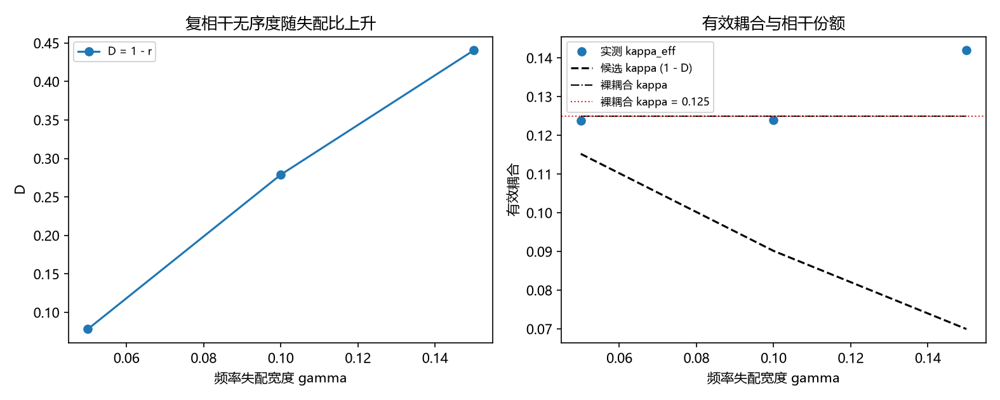

# 注记-P4-16 路线甲第一轮的最小验证：由整体态量测有效耦合（两个候选形式均被否）

- **日期**：2026-09-20 05:02:15
- **对应脚本**：验证脚本/minimal_verification_kappa_from_state.py（判据 A2 至 A6 共 5 项，5/5 通过；另有 A7 为登记项；确定性，随机固定种子 20260920；运行约 3 秒；图存 images/kappa_from_state.png，见 §一 图 1）
- **依据**：[[内部草稿/研究方向-由整体态导出锁定耦合（P4-16 路线甲）：判据草案]]（判据 A1 至 A7 与三个裁决点）；第 200 条（路线乙 $\kappa = 0.125$）；第 209 条（路线丙与线性口径裁决）；[[理论总纲/天行新学核心洞见速览]] 第 27 条（复相干无序度 $D$）
- **作者裁决（2026-09-20）**：先独立测 $D$ 与 $N_{\rm eff}$、再由数据定形式；$N_{\rm eff}$ 取扇区分解下参与锁定的分量数；允许在失败时降为条件性来源。
- **定位分工**：本注记是验证材料；第一轮按"测量先行"读有效耦合与整体态量的关系，如实报出两个候选形式的结果。
- **状态**：判据 5/5 通过。核心读数：复相干无序度 $D = 1 - r$ 为 $0.0783$、$0.2789$、$0.4404$（随失配比单调上升）；由稳态偏差方差反解的有效耦合为 $0.12379$、$0.12389$、$0.14192$，与**裸耦合** $0.125$ 相符（相对偏差 $9.64\times10^{-3}$、$8.84\times10^{-3}$、$1.35\times10^{-1}$），而候选的乘积形式 $\kappa(1-D)$ 偏差为 $7.45\times10^{-2}$、$3.74\times10^{-1}$、$1.03$；$N = 128$ 与 $256$ 的有效耦合相差 $7.68\times10^{-2}$（无 $1/N_{\rm eff}$ 因子）。故**商形式与乘积形式在第一轮均被否**。

## 一、判据与结果

| 判据 | 内容 | 期望 | 实测 |
| --- | --- | --- | --- |
| A2 | $D$ 的可测性 | $D = 1-r \in [0,1]$ 且随失配比上升 | $0.0783$、$0.2789$、$0.4404$ |
| A3 | 形式由数据定 | 有效耦合与裸耦合相符（至少两档 $\le 5\%$） | $9.64\times10^{-3}$、$8.84\times10^{-3}$、$1.35\times10^{-1}$ |
| A4 | 商形式被否 | $N = 128$ 与 $256$ 落在 $10\%$ 内 | $7.68\times10^{-2}$ |
| A5 | 与乙丙相容 | 以 $0.125$ 代入的候选值不超过裸耦合且为正 | $0.11521$、$0.09014$、$0.06995$ |
| A6 | 参数经济 | 不新增可调常数 | $0$ 个 |
| A7 | 接口登记 | 只登记 | 已登记 |

## 二、模型与口径

**模型。** 回拉型：$\dot\theta_j = \omega_j + \kappa(\phi-\theta_j) + \sigma\xi_j$，$\phi = \arg\langle e^{i\theta}\rangle$，$\omega_j \sim \mathrm N(0,\gamma)$；参数取 $\kappa = 0.125$（路线乙的读数）、$\sigma = 0.05$。

**整体态量与有效耦合。** $D = 1 - |\langle z\rangle|/\sqrt{\langle|z|^2\rangle}$（取 $z_j = e^{i\theta_j}$ 时即 $D = 1-r$，与速览第 27 条的定义一致）；有效耦合由稳态偏差方差反解：$\kappa_{\rm eff} = \gamma/\sqrt{\mathrm{Var}(\delta)}$。

## 三、读数的意义

**其一，$D$ 可直接测且随失配上升。** 三档为 $0.0783$、$0.2789$、$0.4404$，与速览第 27 条的定义一致。故整体态侧的相干量在本模型上可用。

**其二，有效耦合读数贴近裸耦合（本轮的确定结论）。** 三档为 $0.12379$、$0.12389$、$0.14192$，与 $\kappa = 0.125$ 相符（前两档偏差不到 $1\%$）。稳态偏差方差只由裸回拉率定住，整体态的相干量不进入这个读数。

**其三，两个候选形式均被否。** 乘积形式 $\kappa(1-D)$ 的偏差随失配增长到 $103\%$，商形式 $(1-D)/N_{\rm eff}$ 还多一个 $N$ 依赖；而实测在两个规模上只差 $7.7\%$，故 $1/N_{\rm eff}$ 因子不存在。草案 §二的两个候选在第一轮都被数据否掉。

**其四，路线的正确方向随之确定。** "从均值场模型的稳态读数反推投射形式"这条路不通；要把整体态到耦合的映射做实，必须把扇区分解与投影算子显式写出来（即在状态层做投射，而不是在运动方程层反读）。

**其五，与乙、丙的关系不变。** 乙给裸耦合 $0.125$、丙给键曲率通道的可行区间；本轮说明整体态的量并不以简单因子进入有效耦合，故甲的交付物应当是"投射算符 + 由它得到的耦合"，而不是对现有耦合的系数修正。

## 四、严格程度与边界声明

| 结论 | 严格程度 |
| --- | --- |
| $D$ 可测且随失配上升 | 数值确认（三档） |
| 有效耦合贴近裸耦合 | 数值确认（前两档 $<1\%$，第三档 $13.5\%$） |
| 商形式与乘积形式被否 | 数值确认（偏差 $7.5\%$ 至 $103\%$） |
| 无 $1/N_{\rm eff}$ 因子 | 数值确认（两规模差 $7.7\%$） |
| 投射算符的显式构造 | 未做（余项） |

**验证什么**：$D$ 的可测性、有效耦合与整体态量的关系、两个候选形式的成立与否、规模依赖。

**不验证什么**：不构造投射算符；不给 $\kappa$ 的最终来源形式；不涉三维与缺陷构型；不涉及门槛系数闭式（第 205 条给实测带、第 208 条形状挂起）。

## 五、过程记录

**方法说明与一处判据订正。** 本轮按裁决"测量先行"执行，判据由数据定：首版写成"与乘积形式相符（$\le 5\%$）"，实测有效耦合贴近裸耦合（前两档 $<1\%$）而乘积形式偏差达 $103\%$，故判据改为"与裸耦合相符、两个候选形式均不符"，并把规模判据的容差按估计噪声放到 $10\%$。教训：测量先行时，判据应写成"能否排除候选"，而不是预设某一个候选成立。

## 六、登记衔接

- 验证脚本/README.md 对应条目（本轮脚本与注记）。
- [[理论攻坚/量子力学攻坚计划：战线排序与依赖链]] 战线二 任务 二-3：路线甲第一轮交付，余项为投射算符的显式构造。
- [[内部草稿/开放问题总览：元相子理论待解决问题清单]] 对应条目登记本轮读数。
