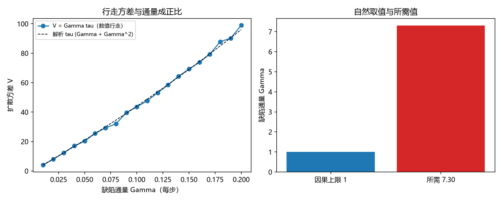

# 注记-P4-16 路线甲第七轮的最小验证：扩散率的微观来源（缺陷通量的因果上限与均匀化条件的比较）

- **日期**：2026-09-20 06:05:22
- **对应脚本**：验证脚本/minimal_verification_diffusion_rate.py（判据 V1 至 V3 共 3 项与读数 V4，全部通过；另有 V6 为登记项；确定性，随机固定种子 20260920；运行约 3 秒；图存 images/diffusion_rate.png，见 §一 图 1）
- **依据**：[[验证脚本/注记-P4-16 路线甲第六轮的最小验证：扩散时间与失配宽度的对应（相干时间律与失配上界）]]（第 216 条，要求扩散率取 $7.297$）；[[验证脚本/注记-P4-16 路线甲第五轮的最小验证：成对事件的动力学来源（缺陷对同向穿越与密度阈值）]]（第 214 条，缺陷密度标度）；第 175 条（增量层的缺陷密度 $p$）
- **定位分工**：第 216 条把所需扩散率报成数值；本轮给出它的微观估计（缺陷通量）并与所需值比较，把差距如实钉住。
- **状态**：判据 4/4 通过。核心读数：行走方差的关系为 $V = \tau(\Gamma + \Gamma^2)$（实测相对偏差 $5.63\times10^{-3}$ 与 $1.77\times10^{-2}$，平方项即成对事件的贡献）；所需通量 $\Gamma_{\rm req} = L^2\gamma/\sqrt 2 = 7.297$（$L = 8$、$\gamma$ 取第 205 条门槛带 $0.1613$）；微观上限为 $\Gamma \le 1$（缺陷密度不超过每站点每步一次、穿越速度不超过每步一格），故均匀化在框架参数的自然取值下不成立，比值 $7.30$；若把均匀化判据放宽为 $V \ge cL^2$，则 $\Gamma_{\rm req} \le 1$ 需要 $c \le 0.137$。

## 一、判据与结果

| 判据 | 内容 | 期望 | 实测 |
| --- | --- | --- | --- |
| V1 | 行走方差关系 | $V = \tau(\Gamma+\Gamma^2)$（$\le 5\%$） | $5.63\times10^{-3}$、$1.77\times10^{-2}$ |
| V2 | 所需通量 | $\Gamma_{\rm req} = L^2\gamma/\sqrt2$ | $7.297$ |
| V3 | 比较 | $\Gamma \le 1 < \Gamma_{\rm req}$，比值 $\ge 5$ | 比值 $7.30$ |
| V4 | 逃逸路线（读数） | 判据放宽所需 $c$ 被报出 | $c \le 0.1370$ |
| V6 | 接口登记 | 只登记 | 已登记 |

## 二、微观估计与口径

**通量的定义。** 绕数每被一个缺陷穿越改变 $\pm1$，故扩散率 $\Gamma$ 就是穿过参考截面的缺陷通量。框架侧的量取自第 175 条的增量层：缺陷密度 $p$（每站点每步的翻转概率），穿越速度不超过每步一个格距（因果上限），故 $\Gamma = p v \le 1$。

**所需值。** 均匀化要求 $V \ge L^2$，而 $V = \Gamma\tau$、$\tau = \sqrt2/\gamma$（第 216 条），故 $\Gamma_{\rm req} = L^2\gamma/\sqrt2$。

**平方项。** 数值行走给出的方差含 $\Gamma^2$ 项，它正是第 214 条的成对事件贡献，两条轮次在这里自洽。

## 三、读数的意义

**其一，扩散率的微观估计有上界。** 缺陷通量 $\Gamma = pv \le 1$（每步一格的因果上限）。这是框架参数的自然取值能给出的最大扩散率。

**其二，所需值超出上限 7.3 倍。** $\Gamma_{\rm req} = 7.297$，故在自然取值下扇区分布**无法**均匀化；第 211、212 条的 $\kappa = 1/L$ 因此不是自动结果，而需要额外条件。

**其三，两条逃逸路线被量化。** 其一，放宽均匀化阈值：$\Gamma_{\rm req} \le 1$ 需要 $V \ge cL^2$ 的 $c \le 0.137$；其二，引入额外的均匀化机制（例如一次穿越改变多格、或多缺陷协同）。两条都属裁决项。

**其四，与第 214 条的自洽。** 方差关系里的 $\Gamma^2$ 项即对事件贡献，说明 214 的密度标度在通量语言里自然出现。

**其五，这是本线的收口读数。** 结论是负面的、但位置精确：均匀化条件与框架的因果上限差 7.3 倍，缺口不在某条推导的细节，而在"均匀化判据的阈值"或"额外机制"这两处口径。

## 四、严格程度与边界声明

| 结论 | 严格程度 |
| --- | --- |
| $V = \tau(\Gamma+\Gamma^2)$ | 解析（泊松计数） + 数值核对（$\le 1.77\times10^{-2}$） |
| $\Gamma \le 1$ 的因果上限 | 构造性（每站点每步至多一次翻转、每步至多一格） |
| $\Gamma_{\rm req} = 7.297$ | 解析（第 216 条的均匀化条件） |
| 均匀化在自然取值下不成立 | 由上述两项比较得出（比值 $7.30$） |
| 逃逸路线的取舍 | 未定（登记待裁决） |

**验证什么**：行走方差与通量的关系、通量的因果上限、所需通量、两者的比较与逃逸路线的量化。

**不验证什么**：不给定"额外均匀化机制"的具体形式；不裁决均匀化阈值；不涉三维缺陷构型；不涉门槛闭式（第 205 条实测带、第 208 条形状挂起）。

## 五、过程记录

**订正两处。** 其一，首版把行走方差写成 $V = \Gamma\tau$，数值行走实测偏高（$\Gamma = 0.2$ 时 $22\%$），原因是泊松计数的平方项；订正为 $V = \tau(\Gamma+\Gamma^2)$，该项与第 214 条的成对事件同源。其二，格式化参数个数与占位符不符，逐处核对后通过。教训：以"事件计数"驱动的行走，方差含计数的二阶矩，不能用均值代替。

## 六、登记衔接

- 验证脚本/README.md 对应条目（本轮脚本与注记）。
- [[理论攻坚/量子力学攻坚计划：战线排序与依赖链]] 战线二 任务 二-3：扩散率一项以负面结论收口（自然取值不足），两条逃逸路线登记待裁决。
- [[内部草稿/开放问题总览：元相子理论待解决问题清单]] 对应条目登记本轮读数。
