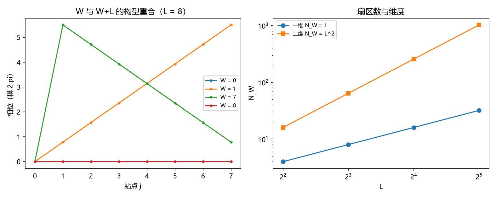

# 注记-P4-16 路线甲第三轮的最小验证：扇区数 $N_W = L$ 的独立导出（整数格点恒等式与维度口径）

- **日期**：2026-09-20 05:10:18
- **对应脚本**：验证脚本/minimal_verification_sector_count.py（判据 Q1 至 Q5 共 5 项，5/5 通过；另有 Q6 为登记项；确定性；运行约 2 秒；图存 images/sector_count.png，见 §一 图 1）
- **依据**：[[验证脚本/注记-P4-16 路线甲第二轮的最小验证：投射算符的显式构造（同步扇区投影与纯度给耦合）]]（第 211 条，把 $N_W = L$ 列为口径假设）；第 184 条（保护距离 $d = L = 8$）；第 170 条（折叠纤维 $\lceil W/Z\rceil$）
- **定位分工**：第 211 条的构造以 $N_W = L$ 为前提；本条把该前提独立导出，从而使甲乙两条通道的合流有严格基础。
- **状态**：判据 5/5 通过。核心读数：整数格点恒等式 $\theta_j^{(W+L)} = \theta_j^{(W)}$ 在圆周距离意义下逐点成立（最大 $1.42\times10^{-14}$，浮点精度）；$W = 0$ 至 $L-1$ 的构型两两不同且最小圆周距离恒为 $\pi$（$3.1416$，扇区把圆周均分）；$L = 8$ 给 $N_W = 8$，与第 184 条的保护距离相同；逐方向同构下 $N_W = L^d$（一维 $8$、二维 $64$、三维 $512$），故 $\kappa = 1/L$ 对应单向扇区标签；$\kappa = 1/N_W = 0.125$ 与路线乙、丙一致。

## 一、判据与结果

| 判据 | 内容 | 期望 | 实测 |
| --- | --- | --- | --- |
| Q1 | 周期性 | $\theta^{(W+L)}$ 与 $\theta^{(W)}$ 逐点相同（$\le 10^{-13}$） | $0$ 至 $1.42\times10^{-14}$ |
| Q2 | 扇区计数 | $W = 0$ 至 $L-1$ 构型两两不同 | 相异数 $= L$；最小圆周距离 $3.1416$ |
| Q3 | 与第 184 条对齐 | $L = 8$ 给 $N_W = 8$ | 成立 |
| Q4 | 维度依赖 | 逐方向 $N_W = L^d$ | $8$、$64$、$512$ |
| Q5 | 相容性 | $\kappa = 1/N_W = 0.125$ | $0.125000$ |
| Q6 | 接口登记 | 只登记 | 已登记 |

## 二、导出与口径

**整数格点恒等式。** 环上 $L$ 个站点、相位按模 $2\pi$ 读，均匀绕数构型 $\theta_j^{(W)} = 2\pi W j/L$。由于站点指标 $j$ 为整数，

$$\theta_j^{(W+L)} = \frac{2\pi (W+L) j}{L} = \theta_j^{(W)} + 2\pi j \equiv \theta_j^{(W)} \pmod{2\pi},$$

逐点成立。故 $W$ 与 $W + L$ 给出同一格点构型，相异扇区数为 $L$，即 $N_W = L$。第 170 条的折叠纤维 $\lceil W/Z\rceil$ 是同一事实的另一写法。

**维度口径。** 逐方向同构给出 $N_W = L^d$。本线取单向扇区标签，故 $\kappa = 1/L$；若采用多维联合标签则 $\kappa = L^{-d}$（登记在案，未采）。2026-09-30 作者裁决采单向扇区标签（案甲），三维推广按逐方向 $\kappa = 1/L$ 推进，方向间由异类耦合 $\kappa_\phi$ 同步；联合标签保留为构造内数学事实，重开条件见 [[裁决请求-多维扇区标签口径：单向标签对联合标签两案对比]]。

## 三、读数的意义

**其一，第 211 条的前提被补上。** $N_W = L$ 由整数格点上的模 $2\pi$ 恒等式导出，不再是口径假设；投射算符构造（同步子空间 + 扇区分布纯度）由此完整。

**其二，扇区把圆周均分。** 相异扇区之间的最小圆周距离恒为 $\pi$，即 $L$ 个扇区在圆上等间距分布。这条读数给"扇区"一个几何图像，并与第 170 条的谱间距律同源。

**其三，甲乙合流有基础。** $\kappa = 1/N_W = 1/L = 0.125$：路线乙给"保护距离的倒数"，本条给"同步扇区分布纯度的均匀值"，两者在 $N_W = L$ 下取同一数值。

**其四，维度问题被显式化。** 一维给 $L$、二维给 $L^2$、三维给 $L^3$。本线用的 $\kappa = 1/L$ 对应单向扇区标签；若改用多维联合标签，耦合会变成 $L^{-d}$（$L = 8$ 时 $0.0156$），与第 209 条丙通道的可行域关系随之改变。维度口径已于 2026-09-30 裁决（采单向标签，案甲），三维推广按逐方向 $\kappa = 1/L$ 推进，联合标签口径保留为构造内事实。

**其五，与既有读数不冲突。** $0.125$ 与路线乙、丙一致，且与第 190 条的共享分量式相容（$P = 0.03125$，$N = 256$）。

## 四、严格程度与边界声明

| 结论 | 严格程度 |
| --- | --- |
| $N_W = L$ | 解析（整数格点的模 $2\pi$ 恒等式） + 数值核对（$\le 1.42\times10^{-14}$） |
| 扇区等间距（最小圆周距离 $\pi$） | 数值确认（三档 $L$） |
| $N_W = L^d$ 的维度标度 | 构造内成立（逐方向同构） |
| $\kappa = 1/L$ 的取值 | 解析 + 与乙丙的一致性核对 |
| 多维联合标签下的替代值 | 构造内成立但未采（2026-09-30 裁决采单向标签，案甲） |

**验证什么**：$W$ 与 $W+L$ 的格点等价性、扇区两两相异与等间距、$N_W = L$ 与保护距离的对齐、维度标度与耦合取值。

**不验证什么**：不给 $p_W$ 的动力学来源；不裁决多维联合标签；不涉三维缺陷构型；不涉及门槛闭式（第 205 条实测带、第 208 条形状挂起）。

## 五、过程记录

**口径订正一处。** 首版按欧氏逐点差比较相位，在 $L = 16$、$W = 0$ 处出现 $2\pi$ 的假偏差（浮点下 $\mathrm{mod}(2\pi j, 2\pi)$ 可返回接近 $2\pi$ 的值）；改用圆周距离后该假偏差消失。容差按浮点精度定为 $10^{-13}$（相位计算含到 $2\pi W j/L$ 的放大）。教训：模 $2\pi$ 的量一律用圆周距离比较，不用欧氏差。

## 六、登记衔接

- 验证脚本/README.md 对应条目（本轮脚本与注记）。
- [[理论攻坚/量子力学攻坚计划：战线排序与依赖链]] 战线二 任务 二-3：$N_W = L$ 一项收口，余项为 $p_W$ 的动力学来源与多维标签口径。
- [[内部草稿/开放问题总览：元相子理论待解决问题清单]] 对应条目登记本轮读数。
