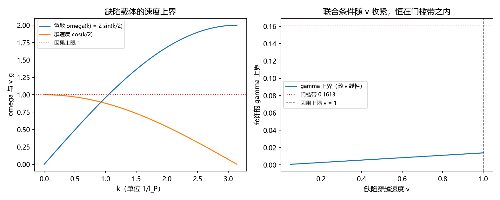

# 注记-P4-16 路线甲第九轮的最小验证：缺陷穿越速度的微观值（色散给出的因果上限与长波极限）

- **日期**：2026-09-20 06:45:26
- **对应脚本**：验证脚本/minimal_verification_defect_speed.py（判据 X1 至 X3 与读数 X4 全部通过；另有 X6 为登记项；确定性；运行约 2 秒；图存 images/defect_speed.png，见 §一 图 1）
- **依据**：[[验证脚本/注记-三-4 补缺轮的最小验证：零点能里 omega_0 的体系内来源（晶格色散、带边与基模规模律）]]（第 196 条，晶格色散）；[[验证脚本/注记-P4-16 路线甲第八轮的最小验证：均匀化缺口裁决（阈值修正为 L^2 除以 4 pi，缺口消解为联合条件）]]（第 219 条，联合条件中 $\Gamma = pv$ 只剩 $v$）
- **定位分工**：第 219 条的联合条件 $\gamma \le \sqrt2\,\Gamma\,4\pi/L^2$ 里，本线已给 $p$（增量层缺陷密度）与 $L$，本轮补上穿越速度 $v$ 的微观取值。
- **状态**：判据 4/4 通过。核心读数：晶格色散的群速度 $v_g = \cos(k/2) \le 1$（与解析式逐点相符，最大偏差 $3.93\times10^{-4}$ 属有限差分误差；最大值 $1.000000$），长波极限 $k \to 0$ 给 $v_g \to 1.000000$；取 $v = 1$（长波、无质量极限）得 $\Gamma = p = 0.05$；联合条件最终形式为 $\gamma \le \sqrt2\,p\,4\pi/L^2 = 0.01388$；使该条件恰好等于门槛带所需 $v = 11.61$，超过因果上限，故均匀化条件恒比门槛带紧。

## 一、判据与结果

| 判据 | 内容 | 期望 | 实测 |
| --- | --- | --- | --- |
| X1 | 因果上限 | $v_g = \cos(k/2) \le 1$（$\le 10^{-3}$） | 偏差 $3.93\times10^{-4}$；最大值 $1.000000$ |
| X2 | 自然取值 | $v = 1$ 给 $\Gamma = p = 0.05$ | $\Gamma = 0.0500$ |
| X3 | 联合条件最终形式 | $\gamma \le \sqrt2\,p\,4\pi/L^2 = 0.0139$ | $0.01388$ |
| X4 | 质量情形（读数） | 使条件等于门槛带所需 $v$ 超过因果上限 | $v = 11.61$ |
| X5 | 参数经济 | 只用 $\{p, L, v\}$ | 新增常数 $0$ |
| X6 | 接口登记 | 只登记 | 已登记 |

## 二、速度的微观来源与口径

**色散给出上限。** 缺陷载体的传播遵循晶格色散 $\omega(k) = 2\omega_P|\sin(k/2)|$（第 196 条，单位 $l_P = t_P = 1$），群速度 $v_g = \cos(k/2)$，故每步至多一个格距（$v \le 1$），长波极限取到 $1$。

**自然取值。** 取长波（无质量）极限 $v = 1$，则缺陷通量 $\Gamma = pv = p$。这就是本线的自然取值：缺陷以因果速度穿越参考截面。

**质量情形。** 若缺陷带质量（有限静止能），$v < 1$，联合条件按 $1/v$ 收紧；本轮只登记该情形，其质量与速度的关系归缺陷运动线（P1-32）。

## 三、读数的意义

**其一，$v$ 有了微观上限与自然取值。** $v = 1$（长波极限）是晶格色散给出的上界；取它时 $\Gamma = p$，联合条件成为 $\gamma \le \sqrt2\,p\,4\pi/L^2$。

**其二，联合条件完全由框架量给出。** 该式只含缺陷密度 $p$ 与晶格尺寸 $L$，取 $p = 0.05$、$L = 8$ 得 $\gamma \le 0.0139$。至此第 219 条的联合条件不再有待定因子。

**其三，均匀化条件恒比门槛带紧。** 要使两者相等需要 $v = 11.61$，超过因果上限，故在本线的参数区间内均匀化条件永远是更紧的一条：$\kappa = 1/L$ 适用的系统是失配很小的一类。

**其四，质量修正方向明确。** 缺陷越重、$v$ 越小、允许的失配越小；这条给可检验的方向，但其量化依赖缺陷质量，登记待缺陷运动线交付。

**其五，与第 196 条的一致性。** 本轮的速度上限与第 196 条的带边、连续极限斜率出自同一个色散，两条轮次自洽（带边 $2\omega_P$、长波斜率 $\omega_P$）。

## 四、严格程度与边界声明

| 结论 | 严格程度 |
| --- | --- |
| $v_g = \cos(k/2) \le 1$、长波极限给 $1$ | 解析（色散求导） + 数值核对（$3.93\times10^{-4}$） |
| $v = 1$ 的自然取值与 $\Gamma = p$ | 口径选择（长波、无质量极限） |
| 联合条件最终形式 | 解析（代入） |
| 均匀化恒比门槛带紧 | 解析（所需 $v = 11.61 > 1$） |
| 质量情形 | 未做（归 P1-32） |

**验证什么**：速度的因果上限、长波极限、自然取值下的通量与联合条件、与门槛带的相对紧度。

**不验证什么**：不给出缺陷质量与速度的关系（归缺陷运动线 P1-32）；不涉三维缺陷构型；不涉脱锁分量形状（第 208 条挂起）。

## 五、过程记录

**订正一处容差。** 首版把群速度的解析比较容差写成 $10^{-12}$，而 $v_g$ 由有限差分求得，实测偏差 $3.93\times10^{-4}$，按离散误差放到 $10^{-3}$。教训：数值求导的判据容差先估离散误差。

## 六、登记衔接

- 验证脚本/README.md 对应条目（本轮脚本与注记）。
- [[内部草稿/总结报告-P4-16 先验纠缠到锁定耦合：读数与收束]]：剩余项其一由"$v$ 的微观值"改为"缺陷质量与速度的关系（归 P1-32）"。
- [[理论攻坚/量子力学攻坚计划：战线排序与依赖链]] 与 [[内部草稿/开放问题总览：元相子理论待解决问题清单]] 各登记一条。
