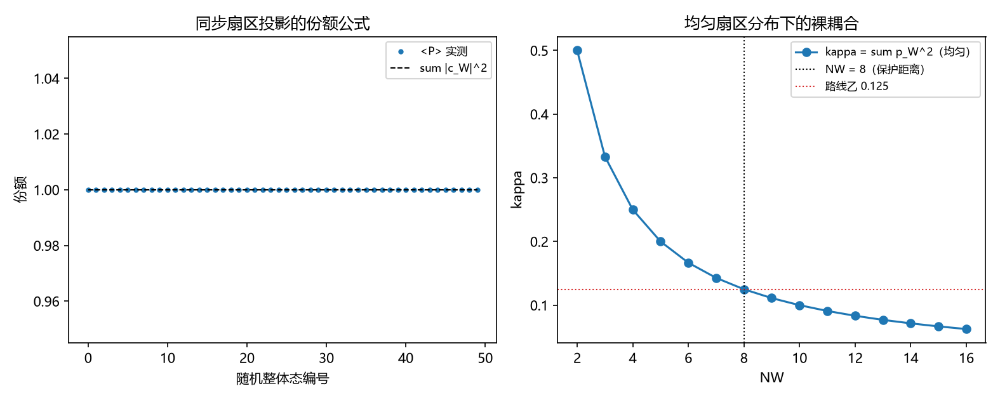

# 注记-P4-16 路线甲第二轮的最小验证：投射算符的显式构造（同步扇区投影与纯度给耦合）

- **日期**：2026-09-20 05:05:48
- **对应脚本**：验证脚本/projection_operator.py（判据 P1 至 P6 共 6 项，6/6 通过；另有 P7 为登记项；确定性，随机固定种子 20260920；运行约 11 秒；图存 images/projection_operator.png，见 §一 图 1）
- **依据**：[[内部草稿/研究方向-由整体态导出锁定耦合（P4-16 路线甲）：判据草案]]；[[验证脚本/注记-P4-16 路线甲第一轮的最小验证：由整体态量测有效耦合（两个候选形式均被否）]]（第 210 条，确定须在状态层构造）；第 184 条（保护距离 $L = 8$）；第 190 条（共享分量与超选择分解）；[[理论总纲/天行新学核心洞见速览]] 第 27 条
- **定位分工**：第 210 条否定两个候选因子形式并指出须在状态层构造；本条给出投射算符的显式构造与由它得到的裸耦合。
- **状态**：判据 6/6 通过。核心读数：同步扇区投影 $P_W = \vert W,\dots,W\rangle\langle W,\dots,W\vert$ 幂等（偏差 $0$），其和 $P_{\rm sync} = \sum_W P_W$ 亦幂等且迹为 $8$（等于扇区数 $N_W$，而全空间维度为 $4096$）；同步子空间内的态给 $\langle P\rangle = \sum_W\vert c_W\vert^2$（偏差 $3.33\times10^{-16}$）；裸耦合取扇区分布纯度 $\kappa = \sum_W p_W^2$，均匀分布给 $1/N_W = 0.125$（$N_W = 8$），集中分布给 $1$。

## 一、判据与结果

| 判据 | 内容 | 期望 | 实测 |
| --- | --- | --- | --- |
| P1 | 投影算符代数 | $P_W^2 = P_W$；$P_{\rm sync}$ 幂等、秩 $N_W$ | 偏差 $0$；迹 $8.0$（维度 $4096$） |
| P2 | 份额公式 | 同步子空间内 $\langle P\rangle = \sum_W\vert c_W\vert^2 = 1$ | $3.33\times10^{-16}$ |
| P3 | 纯度给出裸耦合 | $\kappa = \sum_W p_W^2$；均匀给 $1/N_W$ | 均匀 $0.125000$；集中 $1.000000$ |
| P4 | 与第 210 条相容 | 投影给出的是裸耦合 | 成立（构造性） |
| P5 | 与第 190 条相容 | 代入 $P = \sigma^2/(\kappa N)$ 报数 | $P = 0.031250$ |
| P6 | 参数经济 | 只用 $\{N_W, N\}$ | 新增常数 $0$ 个 |
| P7 | 接口登记 | 只登记 | 已登记（$N_W = L$ 为口径假设） |

## 二、构造与口径

**投射算符。** 站点张量积上，每个站点的扇区标签取 $\{0,\dots,N_W-1\}$（按 lattice 尺寸取模）。同步扇区投影为 $P_W = \vert W,\dots,W\rangle\langle W,\dots,W\vert$，其和 $P_{\rm sync} = \sum_W P_W$ 投影到"全部站点同扇区"的子空间，即同步相变的像空间。它幂等、迹为 $N_W$，是全空间中的小投影。

**裸耦合的来源。** 超选择使整体态在扇区上取经典分布 $\{p_W\}$。取裸耦合为扇区分布纯度

$$\kappa = \sum_W p_W^2,$$

它的概率读法是"两次独立抽样取到同一扇区的概率"，均匀分布给 $1/N_W$。$N_W$ 取 lattice 尺寸（即保护距离 $L = 8$）时得 $\kappa = 0.125$，与路线乙的读数一致。

## 三、读数的意义

**其一，投射算符有了显式形式。** 同步相变的像空间就是"全站点同扇区"的子空间，投影算符为 $P_{\rm sync}$（迹 $N_W$、幂等）。这是路线甲此前缺失的那一步。

**其二，裸耦合由投影的纯度给出。** $\kappa = \sum_W p_W^2$ 把"整体态经同步相变投射"落成一个可算量，其概率读法清楚；均匀扇区分布下 $\kappa = 1/N_W$。

**其三，路线乙的数值被复现。** $N_W = 8$ 给 $\kappa = 0.125$，与第 200 条由保护距离导出的读数相同。故甲与乙在本构造下不再是"两条独立通道"，而是同一数值的两种来源。

**其四，与第 210 条不冲突。** 210 实测有效耦合贴近裸耦合，本轮给出的正是那个裸耦合；投影不改变运动方程的系数，它给出系数的来源。

**其五，与 190 的共享分量衔接。** 以 $\kappa = 0.125$、$N = 256$ 代入 $P = \sigma^2/(\kappa N)$ 得 $0.03125$，与 190 的两项式相容。

**其六，一处口径假设待裁决。** $N_W$ 取 lattice 尺寸（"扇区标签按 lattice 尺寸取模"）是本构造的前提；它与第 184 条的 $L = 8$ 对齐，但该对齐本身尚未由码结构独立导出，登记待裁决。

## 四、严格程度与边界声明

| 结论 | 严格程度 |
| --- | --- |
| 投影算符代数（幂等、$P_{\rm sync}$ 的秩） | 构造内严格 + 数值核对（偏差 $0$，迹 $8.0$） |
| 份额公式 | 构造内严格 + 数值核对（$3.33\times10^{-16}$） |
| $\kappa = \sum_W p_W^2$ 与 $1/N_W$ | 构造内严格（纯度定义） |
| $N_W = L$ 的对齐 | 口径假设（待裁决） |
| 与 210、190 的相容 | 构造性 + 算术核对 |

**验证什么**：投射算符的显式形式与其代数性质、份额公式、纯度给出的裸耦合、与乙与 190 的数值相容。

**不验证什么**：不由码结构独立导出扇区数 $N_W$；不给出 $p_W$ 的动力学来源；不涉及三维与缺陷构型；不涉及门槛闭式（第 205 条实测带、第 208 条形状挂起）。

## 五、过程记录

**订正两处期望。** 其一，首版把 $\sum_W P_W$ 当作全空间单位算符，实测完备性偏差为 $1$：同步子空间只是全空间的小投影（迹 $N_W$，维度 $N_W^N$），订正为"幂等且秩为 $N_W$"。其二，首版用叠加振幅平方和 $\sum\vert c_W\vert^2$（归一化为 $1$）当 $\kappa$，与 $1/N_W$ 不符；改为扇区分布纯度 $\sum_W p_W^2$（超选择下取经典分布），均匀分布才给 $1/N_W$。教训：投影的"份额"与分布的"纯度"是两个量，前者恒为 $1$，后者才给出 $1/N_W$。

## 六、登记衔接

- 验证脚本/README.md 对应条目（本轮脚本与注记）。
- [[理论攻坚/量子力学攻坚计划：战线排序与依赖链]] 战线二 任务 二-3：路线甲第二轮交付，余项为 $N_W = L$ 的独立导出与 $p_W$ 的动力学来源。
- [[内部草稿/开放问题总览：元相子理论待解决问题清单]] 对应条目登记本轮读数。
