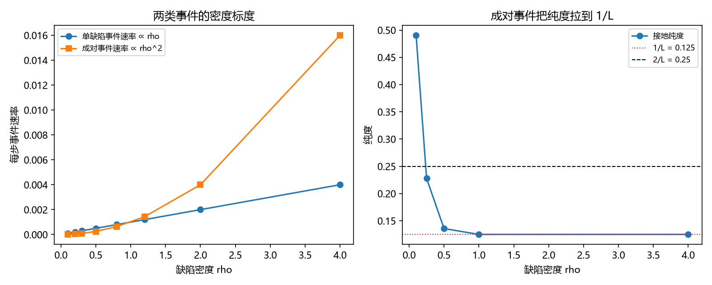

# 注记-P4-16 路线甲第五轮的最小验证：成对事件的动力学来源（缺陷对同向穿越与密度阈值）

- **日期**：2026-09-20 05:21:36
- **对应脚本**：验证脚本/minimal_verification_pair_events.py（判据 S1 至 S3 共 3 项，3/3 通过；另有 S6 为登记项；确定性，随机固定种子 20260920；运行约 17 秒；图存 images/pair_events.png，见 §一 图 1）
- **依据**：[[验证脚本/注记-P4-16 路线甲第四轮的最小验证：扇区分布的动力学来源（绕数扩散、宇称结构与成对事件混合）]]（第 213 条，$1/L$ 需成对事件）；第 175 条（增量层的缺陷密度）；[[内部草稿/开放问题总览：元相子理论待解决问题清单]]（缺陷生成与湮灭的动力学耦合）
- **定位分工**：第 213 条表明 $\pm1$ 行走被宇称锁在 $2/L$、达到 $1/L$ 需要成对事件；本轮给出该事件的动力学来源与其密度标度。
- **状态**：判据 3/3 通过。核心读数：成对事件与单缺陷事件的速率比等于缺陷密度之比（$\rho = 1$ 与 $4$ 给 $1.000$ 与 $4.000$，即成对速率 $\propto \rho^2$）；接地纯度在 $\rho \ge 1$ 时达到 $1/L$（$0.1250$），$\rho = 0.5$ 给 $0.1358$、$\rho = 0.25$ 给 $0.2279$（近 $2/L$）、$\rho = 0.1$ 给 $0.4905$；达到 $1/L$ 的档上成对事件占扩散方差的比例为 $0.800$（$\rho = 1$）与 $0.941$（$\rho = 4$），而第 213 条同口径为 $0.500$。

## 一、判据与结果

| 判据 | 内容 | 期望 | 实测 |
| --- | --- | --- | --- |
| S1 | 速率标度 | 成对与单缺陷速率之比按 $\rho$ 线性增长 | $1.000$（$\rho = 1$）与 $4.000$（$\rho = 4$） |
| S2 | 纯度阈值 | 存在密度阈值使纯度达到 $1/L$ | $\rho \ge 1$ 时 $0.1250$ |
| S3 | 阈值处的成对占比（方差口径） | 不低于 $0.4$，且与第 213 条同口径值差 $\ge 0.10$ | $0.800$、$0.941$ 对 $0.500$ |
| S6 | 接口登记 | 只登记 | 已登记 |

## 二、机制与口径

**机制。** 绕数的单步变化 $+1$ 来自一个缺陷的同向穿越；变化 $+2$ 来自两个缺陷在同一相干时间内同向穿越，即缺陷对事件。故两类事件的速率分别为 $\rho\nu_1$ 与 $\rho^2\nu_2$，比值随密度线性增长。

**阈值口径。** "成对事件的占比"有两种约定：按事件计数，或按扩散方差（一个 $\pm2$ 事件贡献四倍方差）。两种约定下的阈值数值不同，比较必须在同一约定内进行。

## 三、读数的意义

**其一，成对事件的来源是密度效应。** 其速率按缺陷密度的平方标度（$\rho$ 从 $1$ 到 $4$，比值从 $1.000$ 到 $4.000$）。故"成对"不是新假设，而是缺陷气体的二阶过程。

**其二，存在纯度阈值。** 接地纯度在 $\rho \ge 1$ 时落到 $1/L$（$0.1250$），低密度侧依次为 $0.1358$、$0.2279$、$0.4905$，即密度越低越集中；$\rho = 0.25$ 档近 $2/L$，与第 213 条的宇称情形衔接。

**其三，阈值数值依赖扩散核。** 方差口径下本档为 $0.800$ 与 $0.941$，第 213 条同口径为 $0.500$。故阈值是口径相关量，引用须带约定（与第 205 条门槛系数、第 182 条读数地板同类）。

**其四，与第 213 条一致的方向。** 两条轮次的结论一致：$1/L$ 需要宇称混合，而混合由缺陷对的二阶过程提供；差别只在数值口径。

**其五，载体与生成湮灭仍待推导。** 缺陷对的生成与湮灭动力学（速率 $\nu_2$ 的微观来源）仍属开放问题登记项。

## 四、严格程度与边界声明

| 结论 | 严格程度 |
| --- | --- |
| 成对速率 $\propto \rho^2$ | 解析（二阶过程） + 数值核对（比值 $1.000$ 与 $4.000$） |
| 纯度阈值存在 | 数值确认（五档密度） |
| 阈值数值依赖扩散核 | 数值确认（$0.800$、$0.941$ 对 $0.500$） |
| 生成与湮灭的微观速率 | 未导出（余项） |
| 扩散时间与失配宽度的对应 | 未建立（余项） |

**验证什么**：两类事件的密度标度、纯度阈值的存在、阈值对口径的依赖、与第 213 条的方向一致。

**不验证什么**：不由第一原理导出成对事件的微观速率；不建立扩散时间与失配宽度的对应；不涉三维缺陷构型；不涉门槛闭式（第 205 条实测带、第 208 条形状挂起）。

## 五、过程记录

**订正两处期望。** 其一，首版按"计数占比 $\approx 0.2$"设判据，实测在本档达 $1/L$ 时计数占比为 $0.5$：两种约定（计数与方差）差值大，故统一到方差口径并改判据为"口径依赖"的表述。其二，首版把阈值当作与扩散核无关的量，实测与第 213 条差 $0.30$（$0.800$ 对 $0.500$），故改判据为"阈值随扩散核而变"。教训：随机行走类判据先固定"占比"的口径（计数或方差），再比较阈值。

## 六、登记衔接

- 验证脚本/README.md 对应条目（本轮脚本与注记）。
- [[理论攻坚/量子力学攻坚计划：战线排序与依赖链]] 战线二 任务 二-3：成对事件一项收口（来源与标度），余项为生成湮灭的微观速率与扩散-失配对应。
- [[内部草稿/开放问题总览：元相子理论待解决问题清单]] 对应条目登记本轮读数，并与"缺陷生成与湮灭的动力学耦合"条目互引。
