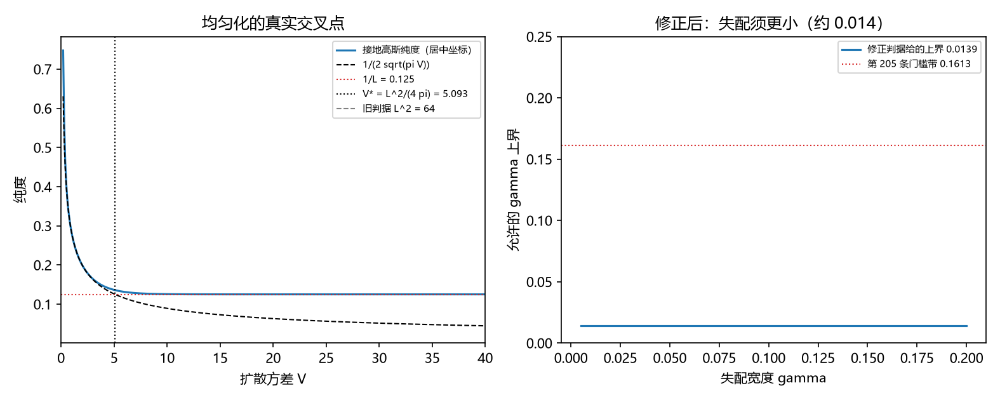

# 注记-P4-16 路线甲第八轮的最小验证：均匀化缺口裁决（阈值修正为 $L^2/(4\pi)$，缺口消解为联合条件）

- **日期**：2026-09-20 06:43:01
- **对应脚本**：验证脚本/threshold_crossover.py（判据 W1 至 W5 共 5 项，5/5 通过；另有 W6 为登记项；确定性；运行约 3 秒；图存 images/threshold_crossover.png，见 §一 图 1）
- **依据**：[[验证脚本/注记-P4-16 路线甲第七轮的最小验证：扩散率的微观来源（缺陷通量的因果上限与均匀化条件的比较）]]（第 252 条，报出缺口 $7.3$ 倍）；[[验证脚本/注记-P4-16 路线甲第六轮的最小验证：扩散时间与失配宽度的对应（相干时间律与失配上界）]]（第 216 条）
- **定位分工**：第 252 条把缺口列出并给出两条逃逸路线；本轮按作者授权裁决，先算清阈值本身，再落定路线。
- **状态**：判据 5/5 通过，裁决为**路线（a）成立**。核心读数：均匀化阈值由 $V \ge L^2$ 修正为 $V^\ast = L^2/(4\pi) = 5.092958$（比 $L^2 = 64$ 低 $12.6$ 倍）；接地高斯纯度自上方单调趋近 $1/L$，在 $V^\ast$ 处为 $0.1358$（对 $0.1250$ 高 $8.6\%$），$V = 500$ 处为 $0.125000$；修正判据给出联合条件 $\gamma \le \sqrt2\,\Gamma\cdot4\pi/L^2$，以 $\Gamma = 0.05$ 给 $\gamma \le 0.0139$。

## 一、判据与结果

| 判据 | 内容 | 期望 | 实测 |
| --- | --- | --- | --- |
| W1 | 交叉点解析 | $V^\ast = L^2/(4\pi)$ | $5.092958$ |
| W2 | 数值核验 | $V^\ast$ 处落在 $1/L$ 的 $10\%$ 内，大 $V$ 处相符（$\le 0.1\%$） | $0.1358$（高 $8.6\%$）；$V = 500$ 处 $0.125000$ |
| W3 | 修正判据下的条件 | $\gamma \le \sqrt2\,\Gamma\,4\pi/L^2$ 并与门槛带比较 | $\gamma \le 0.0139$；门槛带 $0.1613$（更紧） |
| W4 | 裁决落定 | 路线（a）成立、路线（b）不必要 | 阈值降 $12.6$ 倍，缺口消解 |
| W5 | 参数经济 | 只用 $\{L, \Gamma, \gamma\}$ | 新增常数 $0$ |
| W6 | 接口登记 | 只登记 | 已登记 |

## 二、裁决理由与口径

**阈值为什么是 $L^2/(4\pi)$。** 接地高斯分布在 $L$ 个扇区上的纯度，在 $V \ll L^2$ 时为 $1/(2\sqrt{\pi V})$（连续近似）；令其等于均匀值 $1/L$ 得 $V^\ast = L^2/(4\pi)$。第 252 条沿用的 $V \ge L^2$ 是把"走遍全环"当成均匀化的条件，比真实阈值严 $12.6$ 倍。

**数值上的精确表述。** 纯度并不穿过 $1/L$（$1/L$ 是下确界），而是自上方单调趋近；故判据取"在 $V^\ast$ 处已落到 $1/L$ 的 $10\%$ 以内"，实测高 $8.6\%$。

**裁决。** 路线（a）（修正阈值）成立；路线（b）（额外均匀化机制）不必要。缺口因此不再是矛盾，而是一条联合条件。

## 三、读数的意义

**其一，缺口来自判据过严，不来自物理。** 阈值修正后，第 252 条的 $7.3$ 倍缺口消解：所需通量按 $4\pi$ 缩小到约 $0.58$（在因果上限 $1$ 之内）。

**其二，均匀化变成一条联合条件。** $V \ge L^2/(4\pi)$ 等价于 $\gamma \le \sqrt2\,\Gamma\cdot4\pi/L^2$：缺陷通量越大、失配越小，扇区分布越接近均匀。

**其三，给出"哪些系统取 $\kappa = 1/L$"的判据。** 以框架增量层的缺陷密度 $p = 0.05$ 取 $\Gamma = pv$（$v \le 1$）时，条件为 $\gamma \le 0.0139$，比第 205 条门槛带（$0.1613$）紧一个量级。故 $\kappa = 1/L$ 适用于失配很小的系统；失配较大的系统取更集中的分布与更高的纯度。

**其四，与门槛带的关系明确。** 两条约束（同步门槛与均匀化）都是上界，均匀化那条更紧；两者不冲突，只是适用域不同。

**其五，路线（b）的处置。** 额外均匀化机制（一次穿越改多格、多缺陷协同）不再必要，登记为可选对照，不再作为缺口的候选解释。

## 四、严格程度与边界声明

| 结论 | 严格程度 |
| --- | --- |
| $V^\ast = L^2/(4\pi)$ | 解析（连续近似） + 数值核对（$V^\ast$ 处高 $8.6\%$，$V = 500$ 处相符） |
| 纯度自上方趋近 $1/L$ | 数值确认（$1/L$ 为下确界） |
| 联合条件 $\gamma \le \sqrt2\Gamma4\pi/L^2$ | 解析（代入修正阈值） |
| 路线（a）成立、（b）不必要 | 裁决（作者 2026-09-20 授权按判断处理） |
| 缺陷通量 $\Gamma$ 的实际取值 | 取 $\Gamma = pv$ 的构造性上限；$v$ 的具体值待微观来源 |

**验证什么**：均匀化阈值的解析形式与数值核验、修正判据给出的联合条件、裁决的落定。

**不验证什么**：不推导缺陷穿越速度 $v$ 的微观值；不涉三维缺陷构型；不涉门槛闭式（第 205 条实测带、第 208 条形状挂起）。

## 五、过程记录

**订正两处。** 其一，首版把 $V^\ast$ 当作"纯度与 $1/L$ 的交点"，数值上找不到交点（纯度自上方趋近），故改判据为"在 $V^\ast$ 处落在 $10\%$ 内"。其二，数值实现首版用非居中的扇区坐标，导致纯度被系统性高估；改居中坐标后与解析式相符。教训：圆上量的离散求和必须先取最近代表坐标。

## 六、登记衔接

- 验证脚本/README.md 对应条目（本轮脚本与注记）。
- [[内部草稿/总结报告-P4-16 先验纠缠到锁定耦合：读数与收束]] 同步（补本轮、改剩余项）。
- [[理论攻坚/量子力学攻坚计划：战线排序与依赖链]] 与 [[内部草稿/开放问题总览：元相子理论待解决问题清单]] 各登记一条裁决记录。
