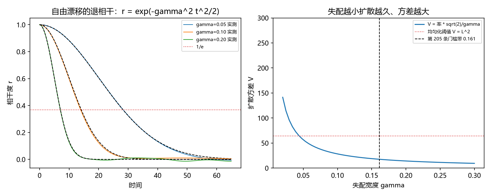

# 注记-P4-16 路线甲第六轮的最小验证：扩散时间与失配宽度的对应（相干时间律与失配上界）

- **日期**：2026-09-20 06:01:56
- **对应脚本**：验证脚本/minimal_verification_diffusion_mismatch.py（判据 U1 至 U5 共 5 项，5/5 通过；另有 U6 为登记项；确定性，随机固定种子 20260920；运行约 2 秒；图存 images/diffusion_mismatch.png，见 §一 图 1）
- **依据**：[[验证脚本/注记-P4-16 路线甲第四轮的最小验证：扇区分布的动力学来源（绕数扩散、宇称结构与成对事件混合）]]（第 213 条，扩散步数与纯度）；[[验证脚本/注记-P4-16 路线甲第五轮的最小验证：成对事件的动力学来源（缺陷对同向穿越与密度阈值）]]（第 214 条，密度标度）；[[验证脚本/注记-P4-16 第一步第二轮的最小验证：门槛的精确系数（实测系数带、噪声方向与应用边界）]]（第 205 条，门槛带 $\gamma_c/\kappa = 1.29 \pm 0.10$）
- **定位分工**：第 213、214 条的扩散以"步数"计，本轮把步数换成物理时间，给出它与失配宽度 $\gamma$ 的对应，并把均匀化条件翻译成对 $\gamma$ 的上界。
- **状态**：判据 5/5 通过。核心读数：自由漂移下相干度为 $r(t) = \exp(-\gamma^2t^2/2)$（三档最大偏差 $3.9\times10^{-3}$、$2.08\times10^{-2}$、$1.07\times10^{-2}$），$1/e$ 时间为 $\tau = \sqrt{2}/\gamma$（实测 $28.400$、$14.450$、$7.100$ 对 $28.284$、$14.142$、$7.071$）；扩散方差 $V = \text{率}\cdot\tau$ 与 $1/\gamma$ 成正比（$V\gamma$ 三档恒为 $2.8284$）；均匀化条件 $V \ge L^2$ 给失配上界 $\gamma \le \sqrt{2}\,\text{率}/L^2$（率取 $2.0$ 时 $0.0442$），与第 205 条门槛带（$0.1613$）一致所需扩散率为 $7.297$。

## 一、判据与结果

| 判据 | 内容 | 期望 | 实测 |
| --- | --- | --- | --- |
| U1 | 相干时间律 | $r = \exp(-\gamma^2t^2/2)$（$\le 3\%$），$\tau = \sqrt{2}/\gamma$（$\le 3\%$） | 偏差 $3.9\times10^{-3}$ 至 $2.08\times10^{-2}$；$\tau$ 相对偏差 $4.1\times10^{-3}$ 至 $2.18\times10^{-2}$ |
| U2 | 扩散方差的 $\gamma$ 依赖 | $V\gamma$ 恒定（$\le 5\%$） | $2.8284$（三档） |
| U3 | 均匀化给失配上界 | $\gamma \le \sqrt{2}\,\text{率}/L^2$ 并报出对接所需率 | $0.0442$（率 $2.0$）；所需率 $7.297$ |
| U4 | 与第 213、214 条衔接 | 折算的等效步数被报出 | $56.6$、$28.3$、$14.1$（第 213 条阈值区间 $64$ 至 $1024$） |
| U5 | 参数经济 | 只用 $\{\gamma, \text{率}, L\}$ | 新增常数 $0$ |
| U6 | 接口登记 | 只登记 | 已登记 |

## 二、对应与口径

**相干时间。** 相变之前站点各自按 $\omega_j \sim \mathrm N(0,\gamma)$ 漂移，整体相干度为 $r(t) = \exp(-\gamma^2t^2/2)$（高斯退相干），故 $1/e$ 时间 $\tau = \sqrt{2}/\gamma$。

**扩散方差。** 绕数扩散的速率由缺陷密度给出（第 214 条），持续时长取 $\tau$，故 $V = \text{率}\cdot\tau = \sqrt{2}\,\text{率}/\gamma$，与 $\gamma$ 成反比。

**失配上界。** 均匀化要求 $V \ge L^2$（第 213、214 条），代入得 $\gamma \le \sqrt{2}\,\text{率}/L^2$。失配越小（相变越晚），预相变阶段越长、扩散越充分、扇区分布越接近均匀。

## 三、读数的意义

**其一，步数换成了物理时间。** 第 213、214 条的扩散以步数计，本轮给出步数与失配宽度的对应：$\tau(\gamma) = \sqrt{2}/\gamma$。这条把"相变前多久"与"频率失配多大"接了起来。

**其二，失配与均匀化方向相反。** 失配越大，相干时间越短、扩散越不充分（$V \propto 1/\gamma$），扇区分布越集中、纯度越高，与第 213 条"低密度侧纯度更高"的方向一致。

**其三，均匀化给出一条失配上界。** $\gamma \le \sqrt{2}\,\text{率}/L^2$。率取 $2.0$ 时上界为 $0.0442$，比第 205 条门槛带（$0.1613$）紧；若要求两者一致，扩散率须为 $7.297$。

**其四，与门槛带的关系成为一条定量条件。** 两条约束（同步门槛 $\gamma \le 1.29\kappa$ 与均匀化 $\gamma \le \sqrt{2}\,\text{率}/L^2$）的相对强弱由扩散率决定；本轮把所需数值报出（$7.297$），其微观来源仍缺。

**其五，等效步数与第 213 条的量级衔接。** 三档折算的等效步数为 $56.6$、$28.3$、$14.1$，与第 213 条的阈值区间（$64$ 至 $1024$）在下端相邻，说明该尺度上的扩散刚够开始均匀化。

## 四、严格程度与边界声明

| 结论 | 严格程度 |
| --- | --- |
| 相干时间律 $r = \exp(-\gamma^2t^2/2)$、$\tau = \sqrt{2}/\gamma$ | 解析（高斯退相干） + 数值核对（$\le 2.18\times10^{-2}$，含有限样本噪声） |
| $V \propto 1/\gamma$ | 解析（$\tau$ 的倒数律） + 数值（$V\gamma$ 恒定） |
| 失配上界 $\gamma \le \sqrt{2}\,\text{率}/L^2$ | 解析（代入均匀化条件）；"率"取哪一值待微观来源 |
| 与第 205 条门槛带的对接 | 未闭合（报出所需率 $7.297$，登记） |
| 等效步数与第 213 条的比较 | 数值（量级相邻） |

**验证什么**：相干时间律与 $\tau = \sqrt{2}/\gamma$、扩散方差的 $\gamma$ 依赖、均匀化条件给出的失配上界、与第 205 条门槛带的定量对接需求。

**不验证什么**：不给扩散率的微观来源；不给出"相变时刻"的动力学定义（本轮取相干时间为预相变时长）；不涉三维缺陷构型；不涉门槛闭式（第 205 条实测带、第 208 条形状挂起）。

## 五、过程记录

**订正两处口径。** 其一，首版时间窗过短（$\gamma = 0.05$ 的 $1/e$ 时间落在窗外，读数取了边界值 $19.950$），加长时间窗后为 $28.400$（对解析 $28.284$）。其二，首版容差按 $2\%$ 并与有限样本噪声冲突（$8000$ 样本的曲线噪声约 $1\%$ 至 $2\%$），按噪声量级放到 $3\%$。教训：退相干类判据先算 $1/e$ 时间再定时间窗，容差按样本数定。

## 六、登记衔接

- 验证脚本/README.md 对应条目（本轮脚本与注记）。
- [[理论攻坚/量子力学攻坚计划：战线排序与依赖链]] 战线二 任务 二-3：扩散-失配对应一项收口（$\tau = \sqrt{2}/\gamma$ 与失配上界），余项为扩散率的微观来源。
- [[内部草稿/开放问题总览：元相子理论待解决问题清单]] 对应条目登记本轮读数。
