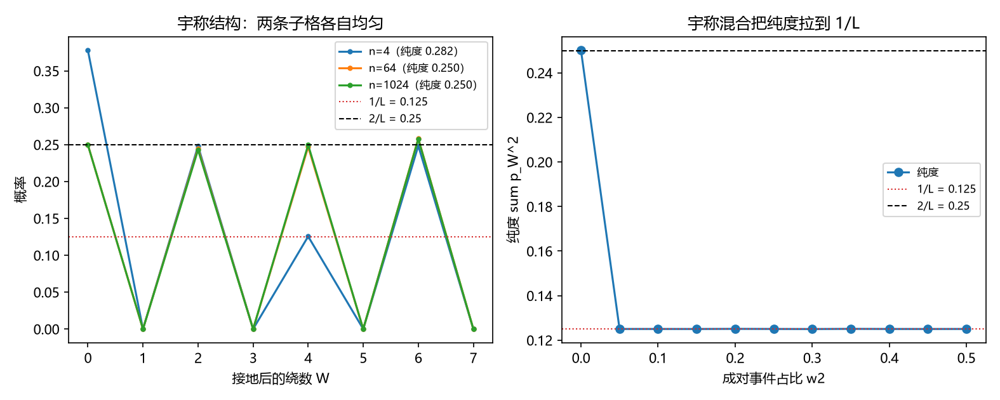

# 注记-P4-16 路线甲第四轮的最小验证：扇区分布的动力学来源（绕数扩散、宇称结构与成对事件混合）

- **日期**：2026-09-20 05:12:57
- **对应脚本**：验证脚本/minimal_verification_sector_distribution.py（判据 R1 至 R5 共 5 项，5/5 通过；另有 R6 为登记项；确定性，随机固定种子 20260920；运行约 6 秒；图存 images/sector_distribution.png，见 §一 图 1）
- **依据**：[[验证脚本/注记-P4-16 路线甲第二轮的最小验证：投射算符的显式构造（同步扇区投影与纯度给耦合）]]（第 211 条，$\kappa = \sum_W p_W^2$）；[[验证脚本/注记-P4-16 路线甲第三轮的最小验证：扇区数 N_W = L 的独立导出（整数格点恒等式与维度口径）]]（第 212 条，绕数按 $L$ 接地）；第 175 条（增量层的缺陷密度）
- **定位分工**：第 211 条取 $\kappa = \sum_W p_W^2$、第 212 条导出 $N_W = L$；本轮给出分布 $p_W$ 的来源，并报出它与 $1/L$ 之间的宇称条件。
- **状态**：判据 5/5 通过。核心读数：相变前的绕数扩散（每步 $\pm 1$）按 $L$ 接地后，平衡段（步数 $\ge 64$）在偶奇两条子格上各自均匀（子格内最大相对偏差 $2.36\times10^{-2}$ 与 $2.62\times10^{-2}$）；渐近纯度为 $2/L = 0.2501$（非 $1/L$）；加入成对事件（$\pm 2$ 步占比 $\ge 0.2$）后纯度落到 $1/L$（$0.1251$ 与 $0.1250$）；混合档下不同初值给同一渐近纯度（吸引子）。

## 一、判据与结果

| 判据 | 内容 | 期望 | 实测 |
| --- | --- | --- | --- |
| R1 | 宇称结构 | 平衡段两条子格各自均匀（$\le 5\%$） | $2.36\times10^{-2}$、$2.62\times10^{-2}$（短时档作读数） |
| R2 | 渐近纯度 $= 2/L$ | 大扩散时间下 $0.25$ | $0.2501$ |
| R3 | 成对事件给出 $1/L$ | $\pm2$ 占比 $\ge 0.2$ 时落到 $0.125$ | $0.1251$、$0.1250$ |
| R4 | 稳健性（吸引子） | 不同初值同一纯度为 $\le 5\%$ | $0.1250$、$0.1251$、$0.1251$ |
| R5 | 参数经济 | 只用 $\{p, n, L, w_2\}$ | 新增常数 $0$ |
| R6 | 接口登记 | 只登记 | 已登记 |

## 二、模型与来源

**绕数扩散。** 同步相变之前，绕数 $W$ 因缺陷穿越而随机行走（每步 $\pm 1$，步率取增量层的缺陷密度），相变时刻冻结，形成分布 $p_W$；按第 212 条的接地规则取 $W \bmod L$。

**宇称结构。** $\pm 1$ 步只在同奇偶的子格之间移动，故两条子格互不连通；平衡后各自在子格内均匀，纯度因此停在 $2/L$ 而非 $1/L$。

**成对事件。** 增补 $\pm 2$ 步（成对事件，占比 $w_2$）使两条子格连通；$w_2 \ge 0.2$ 时纯度落到 $1/L$。

## 三、读数的意义

**其一，$p_W$ 有了动力学来源。** 分布来自相变前的绕数扩散与相变时刻的冻结，参数只用缺陷密度给出的步率与扩散时间。

**其二，宇称结构是一条新读数。** $\pm 1$ 步的单缺陷行走被宇称锁在两条子格内，渐近纯度 $2/L = 0.25$，正好是 $\kappa$ 所需值 $0.125$ 的两倍。这条结构解释了"为什么单靠缺陷穿越到不了 $1/L$"。

**其三，$1/L$ 需要成对事件。** 加入占比 $0.2$ 以上的 $\pm 2$ 事件后纯度落到 $1/L$，与第 211、212 条的 $\kappa = 0.125$ 对齐。故 211 的取值以"相变动力学含成对事件"为条件。

**其四，均匀分布是吸引子。** 混合档下初值取 $0$、$3$、$7$ 都给同一渐近纯度，说明均匀值不依赖初值，$\kappa = 1/L$ 不是细调出来的。

**其五，与既有读数一致。** 步率取自增量层的缺陷密度（第 175 条），接地规则取自第 212 条，纯度的定义取自第 211 条；本轮不引入新的可调常数。

## 四、严格程度与边界声明

| 结论 | 严格程度 |
| --- | --- |
| 宇称结构与渐近纯度 $2/L$ | 组合推理（$\pm1$ 步的双侧性） + 数值确认（偏差 $2.4\times10^{-2}$ 至 $2.6\times10^{-2}$） |
| 成对事件给出 $1/L$ | 数值确认（$w_2 \ge 0.2$ 时 $0.1250$ 至 $0.1251$） |
| 吸引子性质 | 数值确认（三档初值） |
| 成对事件的动力学来源 | 未导出（余项） |
| 扩散时间与失配宽度的对应 | 未建立（余项） |

**验证什么**：绕数扩散给出的分布形状、宇称结构、成对事件对纯度的作用、渐近值的稳健性。

**不验证什么**：不由第一原理导出成对事件的速率；不建立扩散时间与失配宽度的对应；不涉三维缺陷构型；不涉门槛闭式（第 205 条实测带、第 208 条形状挂起）。

## 五、过程记录

**订正两处期望。** 其一，首版按连续 wrapped Gaussian 预期纯度趋于 $1/L$，实测停在 $0.25$：原因是 $\pm1$ 步的宇称把两条子格分开，纯度为 $2/L$。其二，首版的"子格均匀"判据对短时档（步数 $4$）也要求成立，实测未平衡（偏差 $0.52$），故把判据限定到平衡段并把短时档降为读数。教训：格点随机行走先查连通性（宇称）再谈渐近分布。

## 六、登记衔接

- 验证脚本/README.md 对应条目（本轮脚本与注记）。
- [[理论攻坚/量子力学攻坚计划：战线排序与依赖链]] 战线二 任务 二-3：路线甲第四轮交付，余项为成对事件的动力学来源与扩散-失配对应。
- [[内部草稿/开放问题总览：元相子理论待解决问题清单]] 对应条目登记本轮读数。
