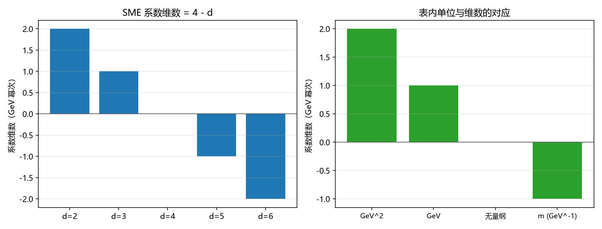

# P4-31 对照表的维数口径审计与跨维并列规则（判据第 683 号）

## 元数据

- **日期**：2026-10-18 14:54:10
- **类型**：判据执行注记（口径审计，不新增实验阈值）
- **脚本**：`验证脚本/p683_dim_audit.py`
- **判据**：M1 至 M2、A1 至 A2、B1 至 B2、C1 至 C2、D1 至 D2（10/10）
- **可逆性等级**：判据稳健。维数公式与单位映射为定义层事实；并列规则为口径约定，换工具不翻。
- **图**：见 §四 图 1
- **关联**：[[验证脚本/注记-边际通道实验阈值对照表定稿：主表、适用范围与判定汇总|对照表定稿]]（被审对象）；[[验证脚本/注记-高能段洛伦兹破坏的实验对照补齐与延迟表的百倍偏差（判据第679号）|判据第 679 号]]（口径教训来源）；[[内部草稿/与实验相容性判据：体系可观测读数的逐项对照与验收标准（2026-10-18）|与实验相容性判据]]；[[内部草稿/开放问题档案/开放问题-P4-31-边际洛伦兹算符的对称性禁止|P4-31 档案页]]

---

## 一、本轮任务

[[验证脚本/注记-边际通道实验阈值对照表定稿：主表、适用范围与判定汇总|对照表定稿]]（2026-10-16）已把三通道阈值、换算与判定整合为一张主表，判定为精确通过。它的剩余缺口登记为文献侧四项与框架侧一项。

判据第 679 号在高能段对照中发现一类口径错误：把 $d = 6$ 的偏离直接比 $d = 4$ 的上界，读出 $2.5\times10^{16}$ 的假超界。这类错误的根源是跨算符维数直接比较。对照表定稿的表中同时混有 $d = 2$、$d = 3$、$d = 4$、$d = 5$ 四类系数，存在同型风险。

本轮做三件事：核对表内每行的维数与单位是否自洽；判定零值项的结论是否依赖维数；给出跨维并列的正确规则。

## 二、维数的定义

SME 系数按算符维数 $d$ 分类，其系数维数为 $4 - d$（质量量纲，以 GeV 幂次计）。对应关系为：$d = 2$ 给维数 $+2$（GeV$^2$），$d = 3$ 给 $+1$（GeV），$d = 4$ 给 $0$（无量纲），$d = 5$ 给 $-1$（GeV$^{-1}$，表中以米给出），$d = 6$ 给 $-2$（GeV$^{-2}$）。

表内以米给出的 $d = 5$ 系数须注意：长度单位在自然单位制下等价于 GeV$^{-1}$，故其维数为 $-1$，与 $d = 5$ 相符。

## 三、判据与读数

| 判据 | 内容 | 读数 | 结果 |
| --- | --- | --- | --- |
| M1 | 维数公式 $4-d$ | $d=2\to+2$、$d=3\to+1$、$d=4\to0$、$d=5\to-1$ | PASS |
| M2 | 单位映射 | GeV$\to+1$、m$\to-1$、GeV$^2\to+2$ | PASS |
| A1 | 表内 25 行逐行核对维数与单位 | 全部自洽，无一不符 | PASS |
| A2 | 特殊行 $\lvert\mathbf k_{AF}^{(3)}\rvert$（以 $H_0$ 为单位） | 频率量纲与 $d=3$ 相容，数值随宇宙学参数 | PASS（只登记口径） |
| B1 | 零值项与维数的关系 | 五档 $d$ 下零值与上界之比恒为 $0$ | PASS（恒真） |
| B2 | 「低于上界多少量级」能否跨栏并列 | 不能，须分维数陈述 | PASS |
| C1 | 跨维数直接比较的后果 | $d=6$ 自然值比 $d=4$ 上界给 $1.5\times10^{73}$ | PASS（无意义） |
| C2 | 四条并列规则 | 见 §五 | PASS |
| D1 | 恒真确认 | B1 为恒真式，不携带信息 | PASS（已标注） |
| D2 | A 组的反例检验 | $d=5$ 配 GeV 被正确报错 | PASS（有牙） |

## 四、审计发现

表内 25 行的维数与单位全部自洽，无一行错配。唯一需要特殊登记的是 $\lvert\mathbf k_{AF}^{(3)}\rvert$ 那一行：它以 $H_0$ 为单位，$H_0$ 是频率量纲，与 $d = 3$ 的系数维数 $+1$ 相容，但数值随宇宙学参数取值，引用时须与 GeV 档换算（$H_0 \approx 1.4\times10^{-42}$ GeV）。

真正的发现不在表内，在判定汇总。对照表定稿 §三 有一句：

> 破缺代价（百分级，$10^{-2}$）与无量纲通路的上界（$10^{-11}$ 至 $10^{-35}$）相差 $10^9$ 至 $10^{33}$ 个数量级，与有量纲通路在普朗克能标取法下相差 $10^{50}$ 至 $10^{61}$ 个数量级。

这句话在口径上不成立。它把无量纲通路（$d = 4$）的上界与有量纲通路（$d = 3$ 或 $d = 5$）的换算结果并成两个区间，然后说「破缺代价」与它们分别相差多少。但破缺代价 $10^{-2}$ 是无量纲量，与 $d = 4$ 的上界同维，可以比；与 $d = 3$ 的 GeV 上界不同维，须先经 $M_\star$ 换算。原文虽然写了「在普朗克能标取法下」，即已做了换算，但两个区间并列呈现时容易被读成同一种比较。

这不是数值错误，是表述风险。正确的写法是分维数陈述：$d = 4$ 栏直接比，$d = 3$ 与 $d = 5$ 栏标明换算所用 $M_\star$，$d = 2$ 栏同理。

## 五、跨维并列的四条规则

第一条，同维数可直接比，比值无量纲。例如破缺代价 $10^{-2}$ 与 $k^{(E)}\sim10^{-35}$ 同属 $d = 4$，比值 $10^{33}$ 有物理意义。

第二条，跨维数须先换算到同一观测量再比。可用的公共观测量有三类：相对速度差 $\delta c/c$、到达时间差、以及经生成能标 $M_\star$ 换算后的无量纲破缺参数 $\delta$。

第三条，零值项可跨栏陈述「为零」，但不得跨栏排序「低多少量级」。理由是零在任何单位制下都是零，这一条属恒真，不含信息；而「低多少量级」隐含同一量纲下的比值，跨栏时该比值无定义。

第四条，有量纲系数与生成能标绑定，换算时须写明 $M_\star$ 的取法。同一上界在普朗克档与电弱档下反解出的 $\delta$ 上限相差 $10^{19}$ 至 $10^{21}$ 个数量级，不写明取法会让读数失去意义。

## 六、对证明力的影响

审计得出的一个判断须说清：对照表判定「精确通过」的证明力，来自反射对称性，不来自与实验上界的数值比较。

理由是零值项那一栏。框架侧系数为零，零低于任何上界，这个比较恒真。真正有信息的是：如果反射对称性被破缺，代价是百分级（$10^{-2}$），而 $d = 4$ 的上界在 $10^{-11}$ 至 $10^{-35}$，故任何百分级破缺都会被排除。这条推理是有效的，因为它同维数比较。

所以准确的表述是：体系的主张并非「因为与实验相符所以正确」，其内容是「若破缺则必被排除，故取零是唯一可行选择」。这个区别在写作时须守住，与 [[内部草稿/与实验相容性判据：体系可观测读数的逐项对照与验收标准（2026-10-18）|验收标准文档]] 里「不得把平凡相容写成实验支持」那条禁区一致。

## 七、严格程度与边界声明

**判据级**：A1、C1、D2。M1、M2 为定义层，B1、D1 为恒真确认，B2、C2 为口径约定。

**判据稳健**：维数公式与单位映射不随工具变化；四条规则为约定，换约定会翻但须显式声明。

**验证什么**：表内各行维数与单位的一致性，以及跨维并列的规则。

**不验证什么**：其一，实验阈值本身（沿用对照表定稿的抄录，未回原文核对）；其二，文献侧四项缺口（置信水平、方向平均、全表回引、分量级对照）；其三，费米子通道的复合模型，仍挂 P1-1。

**不改动**：对照表定稿的任何数值与判定；P4-31 档案页的既有登记；第 679 号的判语。本轮只在对照表定稿加口径注。

## 修订记录

- **2026-10-18 首轮执行**（P4-31 对照表维数口径审计）
    - 表内 25 行维数与单位全部自洽，特殊行 $\lvert\mathbf k_{AF}^{(3)}\rvert$ 以 $H_0$ 为单位已登记
    - 发现判定汇总 §三 的跨维并列表述风险，给出分维数改法
    - 确立跨维并列四条规则
    - 澄清「精确通过」的证明力来自反射对称性而非数值比较
