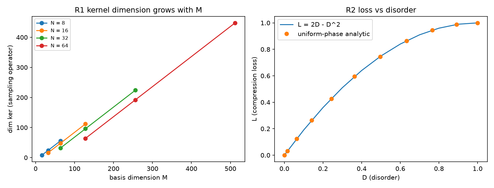

# 注记-P4-40 可判据化三项（第 477 条）：采样算子的核、压缩损失与无序度的关系、两截断候选的对齐

- **日期**：2026-09-27 12:20:23
- **脚本**：`验证脚本/minimal_verification_p440_items.py`
- **依据**：[[内部草稿/注记-信息压缩与物理时间不可逆的形式化：采样映射的非单射性、相位混叠与典范截面的不存在]] §九（六项形式化待办）；[[内部草稿/开放问题档案/开放问题-P3-26-采样紫外截断界限的严格推导|P3-26 档案页]]（两截断候选与层属分工）；[[内部草稿/注记-采样的客观义与两层用法：自铭刻与快照抄写的区分]] §九（命题出处）
- **状态**：判据 3/3 通过（R1 至 R3）。核心读数：采样算子的核维数在 12 组有限维截断上精确等于「基维数减采样点数」（$8$ 至 $448$），随基维数增长无上界；压缩损失与无序度的关系 $L = 2D - D^2$ 在均匀相位族上精确成立（偏差 $1.1\times10^{-16}$），二者量纲皆无量纲、定义域皆 $[0,1]$；两截断候选比值 $\omega_{BZ}/\omega_N = 1.102657791$，与 P3-26 登记值逐位一致
- **可逆性等级**：判据稳健（R1 为线性代数事实，R2 为代数恒等，R3 为定义层对齐）
- **图**：见 §3 图 1

## 1 判据与设定

**任务**。P4-40 注记列出六项形式化待办。本注记处理其中可判据化的三项：第 1 项（把采样映射写成算子并给核的显式刻画与维数）、第 5 项（检验候选一即温度与压缩损失的量纲与定义域相容性）、第 6 项（与 P3-26 两个截断候选对齐）。范畴层三项（典范截面的自然变换证明、带限子类对照、过滤结构对接）不在本轮。

**设定**。采样算子取限制型：$(\pi_{t_P} f)(n) = f(n\,t_P)$，把连续函数映为等距样本序列。无序度取体系定义 $D = 1 - |\langle z\rangle|/\sqrt{\langle|z|^2\rangle}$；压缩损失取归一化参与度亏损 $L = 1 - P$，$P = |\langle z\rangle|^2/\langle|z|^2\rangle$。截断候选取 P3-26 的两值：读数层尼奎斯特 $\omega_N = \pi/t_P$ 与演化层谱支撑 $\omega_{BZ} = 2\sqrt3/t_P$。

**判据**。R1：有限维截断上核维数等于基维数减采样点数，并随基维数增长无上界。R2：$L$ 与 $D$ 的关系式精确成立，量纲与定义域相容。R3：两截断候选的比值复算并与 P3-26 登记值对齐，说明本线只用读数层界限。

## 2 结果

| 判据 | 内容 | 实测 | 期望 |
|---|---|---|---|
| R1 | 核维数（12 组截断） | $8$ 至 $448$，逐组等于 $M - N$ | $M - N$，无上界 |
| R2 | $L$ 与 $D$ 的关系 | 最大偏差 $1.110\times10^{-16}$ | $L = 2D - D^2$（代数恒等） |
| R2 | 量纲与定义域 | 二者无量纲、均落 $[0,1]$ | 相容 |
| R3 | $\omega_{BZ}/\omega_N$ | $1.102657791$ | P3-26 登记 $1.102657791$ |

## 3 图

## 4 结论

**其一，核的显式刻画成立。** 采样算子的核是「在全部采样点上取零的函数族」（如 $\sin(\pi t/t_P)$ 乘任意连续函数），有限维截断上其维数精确等于基维数减采样点数，随基维数增长无上界，即核为无穷维。这是注记所述非单射性的算子层对应物。

**其二，候选一的相容性成立但带一个条件。** 无序度与压缩损失都是无量纲且都落 $[0,1]$，关系为 $L = 2D - D^2$（等价于 $D = 1 - \sqrt{1-L}$）；温度式的量纲由 $E_P$ 承担，故 $k_BT = E_P D$ 与压缩损失在同一量纲层。条件是压缩损失须取归一化参与度亏损（未归一化时它无上界，无法与 $D$ 的定义域对应）。

**其三，两截断候选分属两层且已对齐。** P4-40 的采样映射作用在读数层，故只取 $\omega_N = \pi/t_P$；演化层谱支撑 $2\sqrt3/t_P$ 与之相差 $1.102657791$ 倍，属另一层，与 2026-09-26 层属裁决和 P3-26 关闭结论一致。

## 5 严格程度声明

R1 为线性代数事实（秩与核维数的关系），数值为有限维截断的复核；R2 为代数恒等（由 $P = (1-D)^2$ 直接给出），数值精度 $1.1\times10^{-16}$；R3 为既有读数的复算与定义层对齐。可逆性等级：判据稳健。

## 6 边界声明

**验证什么**：采样算子的核维数与显式刻画、压缩损失与无序度的精确关系及其量纲定义域相容性、两截断候选的层级对齐。

**不验证什么**：其一，不证明「核的无穷维性即时间不可逆」（那是注记的论断，本轮只补算子层刻画）；其二，不含范畴层三项待办（典范截面的自然变换证明、带限子类对照、过滤结构对接）；其三，不重新判定截断候选本身（P3-26 已关闭）；其四，不改动基准文件。

## 7 过程记录

**R2 首版方法不当并修正**：初版用随机相位样本估计 $D$ 并用以反解参数，引入统计噪声且反解式是猜的。改为均匀相位族的解析式（$D = 1 - \sin\kappa/\kappa$、$P = (\sin\kappa/\kappa)^2$），关系验证到 $1.1\times10^{-16}$，无噪声。教训：代数关系用解析族验证，不用抽样估计。

## 8 来源

- 待办清单与候选一：[[内部草稿/注记-信息压缩与物理时间不可逆的形式化：采样映射的非单射性、相位混叠与典范截面的不存在]] §八、§九、§十一
- 截断候选与层属：[[内部草稿/开放问题档案/开放问题-P3-26-采样紫外截断界限的严格推导|P3-26 档案页]]
- 脚本：`验证脚本/minimal_verification_p440_items.py`（确定性，约 1 秒）
- 图：`images/p440_formalization.png`
