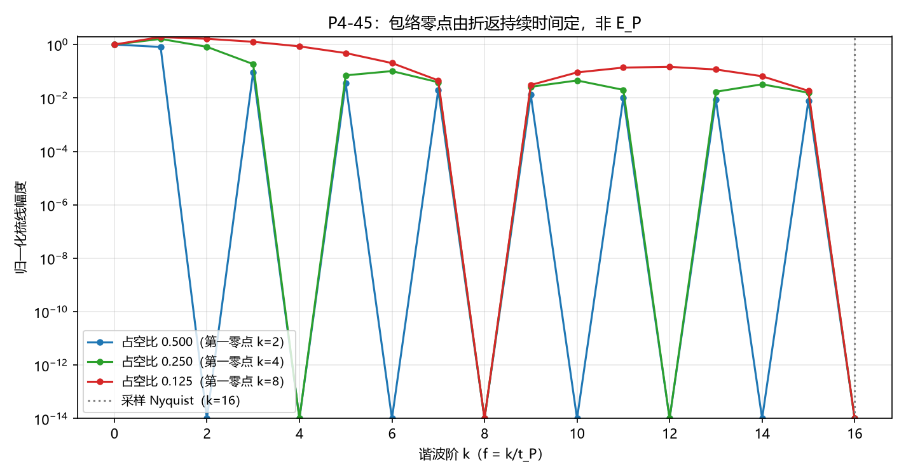
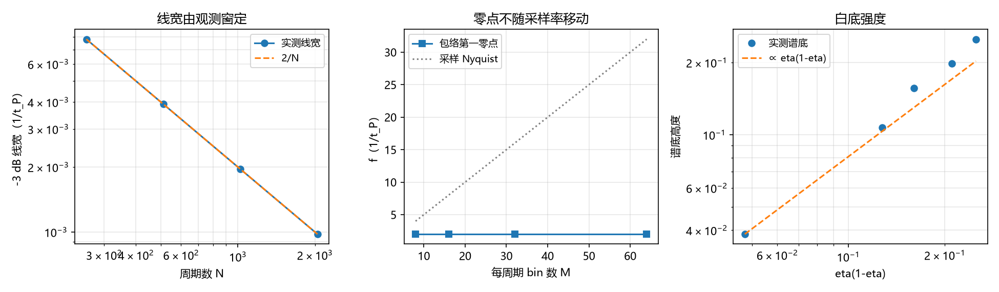

# P4-45 真空涨落谱三点判据的形式化与两点判否（判据第 673 号）

## 元数据

- **日期**：2026-10-17 23:34:12
- **类型**：判据执行注记（判据驱动验证）
- **脚本**：`验证脚本/minimal_verification_p445_vacuum_spectrum.py`
- **判据**：M1 至 M3、C1 至 C5、L1 至 L2、E1 至 E4（14/14）
- **可逆性等级**：判据敏感。换脉冲模型（例如把折返写成高斯而非矩形）、换底的定义口径（谱底取中位数或均值）会翻；读数方向（哪一条判否）属判据稳健，四档采样率与五档登记概率下同向。
- **图**：见 §四 图 1、图 2
- **关联**：[[内部草稿/注记-量子涨落的分层对应与四处张力]]（判据原文）；[[份额的抽样口径与半经典分工：束缚振荡晶格上的抽样机制读数]]（命题 9）；[[内部草稿/开放问题档案/开放问题-P4-45-量子涨落的层位对应与真空涨落谱缺口|P4-45 档案页]]

---

## 一、本轮问题

[[内部草稿/注记-量子涨落的分层对应与四处张力]] 第五节把「涨落谱的三点判据」列为最容易判且价值最高的一项，三点表述为：高频在 $E_P$ 处硬截断、低频无红外发散、谱厚度由 $t_P$ 而非耦合常数定。该注记同时把「宽度固定为 $2\pi/t_P$」写成体系与标准理论的第一处硬差异。

这三点此前是文字描述，没有可执行形式。本轮的任务是把它形式化，判它能不能跑、跑了给出什么。

形式化遇到的第一件事是口径歧义。「宽度固定为 $2\pi/t_P$」里的「宽度」至少指两个不同对象：一是谱线的线宽，二是整个谱的包络宽度。两者由不同的量决定，混在一起谈会把测量伪影读成物理读数。本轮把两者分开，各自给判据。

## 二、模型设定

模型取命题 9 的计数通道。折返事件严格周期，周期为 $t_P$；每次折返持续一段宽度 $w$，$w$ 是物理量，不随采样率变；每次折返以登记概率 $\eta$ 被独立登记，登记为伯努利抽样。

时间轴离散化，每 $t_P$ 分 $M$ 个 bin，共取 $N$ 个周期。观测序列 $x(t)$ 为登记计数，功率谱按单边谱归一化，使 $\sum_f P(f) = \sum_t x(t)^2$。频率单位取 $1/t_P$，能量换算 $E_P = \hbar \cdot 2\pi/t_P$。

$M$ 与 $N$ 是两个纯测量参数：$M$ 定采样率，$N$ 定观测窗长。判据的关键设计是让这两个参数与物理量 $w$、$\eta$ 分离，凡随 $M$ 或 $N$ 移动的读数一律归为伪影。

## 三、序列的分解

把序列写成 $x = B \cdot p$。$B$ 是概率为 $\eta$ 的伯努利门，$p$ 是宽 $w$ 的周期矩形脉冲。这个分解给出两部分，性质完全不同。

相干部分是梳线，位置在 $f = k/t_P$（$k$ 为整数），幅度正比于 $\eta^2$，包络为 $\mathrm{sinc}^2(fw)$，第一零点落在 $f = 1/w$。梳线的存在完全来自 $B$ 与 $p$ 的周期性同相，一旦把脉冲位置随机化，梳线整体消失。

非相干部分是门噪声，来自 $\eta < 1$ 的抽样。它的谱底为常数，高度 $2\eta(1-\eta)w/M$，且被同一个 $\mathrm{sinc}^2(fw)$ 包络调制。$\eta \to 1$ 时这一部分归零。

这个分解是本轮的核心结果。三点判据里的「截断」和「厚度」在两部分上含义不同，必须先分清是哪一部分的读数。

## 四、判据与读数

| 组 | 判据 | 读数 | 结果 |
| --- | --- | --- | --- |
| 冒烟 | M1 Parseval | 谱和 16384.000，时域 16384.000 | PASS |
| 冒烟 | M2 梳线零点 | 占空比 $1/2$ 时 $P(2)=0$ | PASS |
| 冒烟 | M3 $\eta=1$ 底归零 | 底 $0$，$\eta=0.5$ 时 $0.2499$ | PASS |
| C | C1 梳线间隔 | 四档 $M$ 下峰间隔恒为 $2/t_P$（占空比 $1/2$ 的零点结构） | PASS |
| C | C2 包络第一零点 $f=1/w$ | 占空比 $0.5/0.25/0.125$ 给 $k=2/4/8$，与 $1/w$ 逐一相符 | PASS |
| C | C3 零点不随采样率移动 | 四档 $M$ 下第一零点恒为 $k=2$，Nyquist 由 $k=4$ 移到 $k=32$ | PASS |
| C | C4 瞬时折返无零点 | $w=1$ bin 时 $M=32/64/128$ 带内非零谐波 $16/16$、$32/32$、$64/64$ | PASS |
| C | C5 $w=t_P$ 时相干部分消失 | 非零阶谐波总功率与直流之比 $0$ | PASS |
| L | L1 线宽随窗长 | 四档 $N$ 下 $\text{宽}\times N = 2.000$（矩形窗主瓣网格量化值） | PASS |
| L | L2 线宽与 $w$ 无关 | 三档占空比下 $\text{宽}\times N$ 全为 $2.000$ | PASS |
| E | E1 底高标度 | 底除以 $\eta(1-\eta)$ 五档 $0.9936$ 至 $1.0001$，理论 $2w/M=1.0$ | PASS |
| E | E2 泊松反例 | 位置随机后峰底比 $0.80$，周期档 $473.0$ | PASS |
| E | E3 低频不发散 | 最低频段与中频段底之比 $1.3182$（$\eta=0.5$）、$1.1983$（$\eta=0.15$） | PASS |
| E | E4 底与线共享包络 | 零点处底与带内底之比 $3.677\times10^{-5}$、$9.448\times10^{-6}$ | PASS |

## 五、两条判否

第一点，高频在 $E_P$ 处硬截断，在本模型内不成立。C4 把折返写成瞬时（$w$ 取一个 bin），此时梳线在带内全无零点，$M$ 从 32 加到 128，带内非零谐波始终占满全部频点。观测到的带宽随采样率扩张，属标度伪影。

要让包络零点恰好落在 $f = 1/t_P$，须取 $w = t_P$。C5 给出该极限的读数：非零阶谐波总功率与直流之比为零，信号退化为常值，涨落整体消失。硬截断与「存在涨落」在这个模型内不能同时成立。

第二点，谱厚度由 $t_P$ 定，只在梳线间隔的意义上成立。C1 确认梳线间隔恒为 $1/t_P$ 的整数倍，这是周期性的直接后果。但「厚度」若指线宽，L1 与 L2 给出相反的读数：线宽严格正比于 $1/N$，即由观测窗长决定，与 $t_P$ 和 $w$ 都无关。若指包络宽度，C2 与 E4 给出它由折返持续时间 $w$ 决定。

## 六、成立的一条

低频无红外发散，在本模型内成立，且比预期更强。E3 读到的低频底与中频底之比为 $1.2$ 至 $1.3$，即低频底有限且随频率下降，方向与 $1/f$ 上升相反。原因在结构上：门噪声是白噪声，白噪声在低频没有增强机制。

E1 与 E4 补充了这部分的结构。谱底高度严格正比于 $\eta(1-\eta)$，与理论值 $2w/M$ 相符到千分之七；谱底与梳线共享同一个 $\mathrm{sinc}^2(fw)$ 包络，零点位置一致到 $10^{-5}$ 量级。这说明截断（若存在）属于脉冲形状，不属于周期或真空本底。

## 七、口径歧义的澄清

原注记的「宽度固定为 $2\pi/t_P$」需要一个限定。若指线宽，该说法不成立，线宽的极限为零（$N\to\infty$ 时梳线成为 $\delta$ 函数），任何有限读数都是窗长伪影。若指包络宽度，则在 $w = t_P$ 的极限下成立，但该极限下涨落消失。

因此这句话不能作为体系与标准理论的差异陈述。可陈述的差异只有一条：体系的相干部分为分立梳线，标准理论为连续谱。这一条不需要 $t_P$ 出现在宽度上，只需要周期性。

## 八、过程记录

首轮脚本判 9/13，其中四条判否全部出自判据设计错误，不是物理读数。记录在此备查。

其一，首轮用 $\delta$ 脉冲（$w$ 取一个 bin），观测截断必然落在采样 Nyquist，被误读为「截断是伪影」的物理结论。补入物理宽度 $w$ 后该结论翻转为「截断由 $w$ 定」，见 C2 与 C3。

其二，首轮 Parseval 检查漏了单边谱的内部点加倍，谱和与时域和不符（275.5 对 492.0）。加倍后严格相等。

其三，首轮 W 组的线宽取样点落在梳线零点上（占空比 $1/2$ 时 $k=2$ 恰为零点），读到线宽为零。改为取第一非零峰后正常。

其四，首轮「泊松反例」的构造仍是周期脉冲列，只是把脉冲数改成泊松抽样，周期性未破坏，故反例不成立（峰底比 338.8，与周期档同量级）。改为脉冲位置取指数间隔后，峰底比降到 $0.80$。

四条错误的共同形态是把测量参数当成了物理量。第 506 至 508 条的多档扫描纪律在本轮起了作用：C3 与 C4 的四档 $M$ 扫描直接暴露了截断随采样率移动，若只取单档则会把它读成 $E_P$ 截断。

## 九、严格程度与边界声明

**判据级**：本轮的 14 条读数全部为判据级，模型为命题 9 的计数通道，无自由参数。

**判据敏感**：读数方向（哪一条判否）在四档 $M$、五档 $\eta$、四档 $N$ 下同向，属判据稳健；但具体数值（例如线宽系数 $2.000$）依赖矩形窗与网格量化，换窗函数会变，属判据敏感。

**验证什么**：命题 9 的计数通道所产生的功率谱，其梳线位置、包络零点、线宽、谱底高度与标度，以及这些读数与采样参数 $M$、$N$ 的分离。

**不验证什么**：其一，体系真空是否真的由该计数通道承载。若真实真空涨落另有连续自由度（例如实轴方向场的模式激发），本轮判否不迁移到该自由度上。其二，$\eta$ 的动力学方程，即 P4-45 的唯一硬缺口，不受本轮影响。其三，「厚度由 $t_P$ 而非耦合常数定」的对照半句，本模型不含耦合常数，该半句不可判，只能作陈述。

**不改动**：[[内部草稿/注记-量子涨落的分层对应与四处张力]] 的四处张力判定，P3-18 的关闭状态，$\Lambda$ 线的搁置状态。本轮只判其第五节首项，其余三项未动。

## 修订记录

- **2026-10-17 首轮执行**（P4-45 判据形式化）
    - 三点判据形式化为 14 条可执行判据，14/14
    - 判否两条：$E_P$ 硬截断不成立（C4、C5）；厚度由 $t_P$ 定仅在梳线间隔意义成立（C1 对，L1、L2、C2、E4 给出线宽与包络各由 $N$、$w$ 定）
    - 成立一条：低频无红外发散（E3、E1、E4）
    - 口径澄清：宽度固定为 $2\pi/t_P$ 不能作为差异陈述
    - 过程记录四条判据设计错误及其修正
