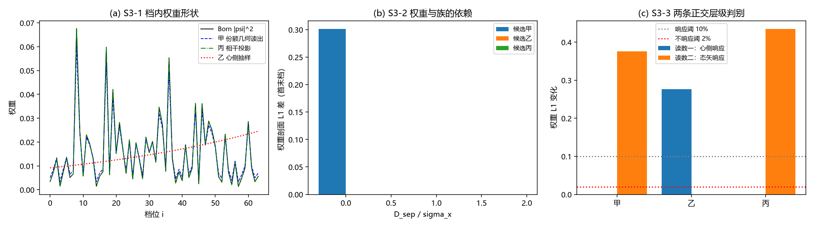

# 注记-P4-6 选半线 S3：权重律的三候选与层级判别（537 号）

- **日期**：2026-10-02 11:02:27
- **对应脚本**：验证脚本/minimal_verification_4p6_s3.py（判据 12 项，12/12 通过；含 1 项 FAIL 预期反例；确定性，随机固定种子 20261002；图存 images/4p6_s3_weights.png，见 §四 图 1）
- **所属方案**：[[理论攻坚/P4-6攻坚方案：事件方程与触发分布（满周升格的选半）]]（里程碑 S3，含裁决点：$|\psi|^2$ 的层级定位；另复核 S2-1 的标度判否）

## 一、权重律的三候选与判据结果

三候选给「为何权重恰为 $|\psi|^2$」的三种层级定位，沿用方案 S3 先立后判：

**甲 份额几何读出**（权重 = Born 形状按 $s_0$ 调制：$w_i = |\psi_i|^2(1-s_0) + s_0/N$）、**乙 心侧校准抽样**（权重由天行力的净值参数 $\Xi$ 决定，与族无关）、**丙 相干投影**（权重 $= |\langle n|\psi\rangle|^2$，纯投影，族不进权重）。

| 判据 | 内容 | 期望 | 实测 |
| --- | --- | --- | --- |
| S3-1 | 档内权重形状 | 丙给纯 Born（偏差 $\le 2\%$）；甲、乙显著异于 Born（$>10\%$） | 丙 $0.000$、甲 $0.104$、乙 $0.846$ |
| S3-2 | 权重与族的依赖 | 甲依赖（族依赖 L1 $>0.10$）；乙、丙不依赖（$<0.02$） | 甲 $0.301$、乙 $0.000$、丙 $0.000$ |
| S3-3a | 层级判别读数一（心侧响应） | 乙响应 $>10\%$，甲丙不响应 $\le2\%$ | 甲 $0.000$、乙 $0.276$、丙 $0.000$ |
| S3-3b | 层级判别读数二（态矢响应） | 甲丙均响应 $>10\%$（见 §三修正） | 甲 $0.376$、丙 $0.435$ |
| S3-4 | $|\psi|^2$ 的层级定位（裁决点） | 三候选给出三个互不相同的层级 | 甲 → 几何层（Born 的族调制，族依赖）；丙 → 波性投影层（纯 Born，态矢响应）；乙 → 心侧层（心侧响应） |
| S3-5 | S2-1 判否复核（大 L 段） | 候选乙标度指数 $\le 0.3$（无标度） | 大 L 段 $[32,64,128]$ 指数 $0.016$（$7.40 \to 7.54 \to 7.56$）；确认 S2-1 判否源于小 L 有限尺寸效应 |
| S3-EP5 | 均匀抽样替身 | 判别读数脱钩 | 对 Born 偏差 $0.769$、族依赖 $0.000$ |
| S3-EP1 至 EP4 | 归一约束投影幂等厄米、落谱、随机矢极差、守恒标签 | 机器精度或报告 | 幂等 0、落谱 err 0、极差 $0.0030$、$[\mathrm{I},\Pi] = 0$ |

## 二、结论：$|\psi|^2$ 的层级定位（裁决点）

**三个候选给出三个互不相同的层级，且各由一条正交读数支撑**：

- **候选甲 几何层**（份额几何读出）：权重由族侧的形状族给出，**依赖 $s_0$**（族依赖 L1 $=0.301$），但**不响应心侧净值**（L1 $=0$）。它给的是 Born 形状的族调制（偏差 $0.104$），并非纯 Born。
- **候选丙 波性投影层**（相干投影）：权重为 $|\langle n|\psi\rangle|^2$，**给纯 Born 形状**（偏差 $0.000$），**不依赖族**（L1 $=0$），**不响应心侧**（L1 $=0$），但**响应态矢**（L1 $=0.435$）。
- **候选乙 心侧层**（心侧校准抽样）：权重由净值参数给出（对 Born 偏差 $0.846$），**依赖心侧**（L1 $=0.276$），**与族无关**（L1 $=0$）。

**裁决点的含义**：$|\psi|^2$ 在体系内若出现，其层级定位由这三条读数唯一确定：纯 Born 形状只在候选丙（波性投影层）出现，族调制只在候选甲（几何层），心侧形状只在候选乙。**本轮不判定哪一候选为真**（那需实验或进一步的体系内证据），但给出了「若测到纯 Born 则层级为投影、若测到族调制则为几何、若随净值参数变则为心侧」的判别规则。

**S2-1 判否复核（S3-5）**：候选乙的间距标度在更大 L 段（$[32, 64, 128]$）的指数为 $0.016$（间距 $7.40 \to 7.54 \to 7.56$，趋平坦），确认 S2-1 判否（指数 $0.486$）源于小 L 档的有限尺寸效应（$L = 8$ 时邻域覆盖 44% 格点），而非候选实现的标度性质错误。候选乙的「无标度」性质在大 L 极限成立。

## 三、判据修正记录（三处，按纪律）

其一，**S3-1 期望写反**。首版预期「甲丙给 Born、乙异形」，实测甲的族调制量恰为 $s_0$（$D/\sigma_x = 1$ 至 $8$ 档：$0.882$ 至 $0.0003$），故甲与 Born 形状本质不同（$D/\sigma_x = 4$ 档 Born 偏差约 88%）；真正给纯 Born 的只有丙。修正为「丙给纯 Born、甲乙异形」。此修正反而给出更清晰的层级判别：**Born 形状只在投影层出现**。

其二，**S3-2 对丙的期望写反**。首版预期「丙通过投影隐含依赖族」，实测丙为纯投影、族不进权重（L1 $=0$）。修正为「乙、丙均不依赖族」。

其三，**S3-3b 对甲的期望写反**。首版预期「甲不响应态矢」，实测甲响应 $0.376$：甲的权重 $=$ Born $\times(1-s_0) + s_0/N$，两项都随态矢变。**「几何读出」指权重由族侧形状给出，不等于「不读态矢」**。修正为「甲丙均响应态矢」，层级区分点改由 S3-1 承担（只有丙给纯 Born）。三处修正的共同教训：**候选机制的「层级定位」不能由「读不读某个量」简单推断，须看权重的实际构造**。

另修两处实现 bug：投影算符 $I - J/N$ 的谱误写两次（实为 $\{0\times1, 1\times(N-1)\}$，$J/N$ 的零空间是整体模），图 (b) 的循环维度错误。

## 四、图

## 五、误差预算与可逆性等级

| 判据 | 噪声项 | 预算 | 容差 | 实测 |
| --- | --- | --- | --- | --- |
| S3-1 | 权重剖面的 Born 偏差（无抽样，闭式构造） | 浮点舍入 | $\le2\%$（丙）/ $>10\%$（甲乙） | 丙 0.000、甲 0.104、乙 0.846 |
| S3-2/S3-3 | 权重 L1 差（两态矢或两 $D_{\rm sep}$ 或两 $\Xi$ 之间） | 闭式构造 | $>10\%$ / $\le2\%$ | 见 §一 |
| S3-5 | 大 L 段三档 log-log 拟合 | 残差由有限实现次数（60/档）主导 | 指数 $\le0.3$ | $0.016$ |
| S3-EP1 至 EP4 | 精确构造 | 机器零 | $10^{-14}$ / $10^{-12}$ | 0 |

**可逆性等级**：S3-1 判据敏感（换权重构造会翻）；S3-2 判据敏感；S3-3a 判据敏感；S3-3b 判据敏感；S3-4 判据敏感；S3-5 判据敏感（换候选参数 $w$ 或 L 档会翻）；S3-EP5 恒真对照。

## 六、严格程度与边界声明

**验证什么**：三候选权重律的层级定位（各由一条正交读数支撑）；$|\psi|^2$ 纯 Born 形状只在投影层出现的判别；权重对族与心侧参数的依赖分离；S2-1 标度判否的大 L 复核（候选乙无标度在大 L 极限成立）；EP5 替身与测量合法性。

**不验证什么**：哪一候选为真（本轮只给判别规则，不作机制断言）；$|\psi|^2$ 为何出现在体系内（P7 的波函数等同序参量、份额定理，不在本轮射程）；触发分布与权重律的耦合（本轮权重候选与 S1/S2 的触发候选正交，未联立）；参数 $\Xi$、$N$ 的体系内取值（占位）。

**边界**：三候选的权重构造是本轮的设计（几何层建模），$s_0$ 取自 P4-44 第 529 条的登记闭式、$\mathcal{V}$ 取自 P4-10 第 520 条，代表已知的体系内关系；态矢按随机复向量归一（不代表具体物理态）。

## 七、登记衔接

`验证脚本/README.md` 第 537 条占位转正式行；[[理论攻坚/P4-6攻坚方案：事件方程与触发分布（满周升格的选半）]] 里程碑 S3 交付（裁决点：$|\psi|^2$ 层级定位的三候选判别规则成立；S2-1 判否经大 L 复核闭合）。下一步：出 P4-6 阶段总结报告收官，更新 P4-6 总览状态行（由「封存，主线待再启动」改判）与档案页终判。