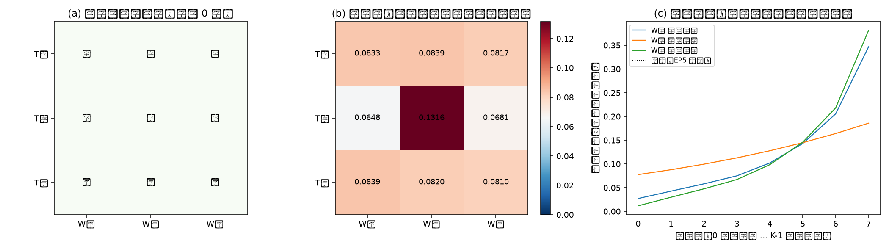

# 注记-P4-6 选半线 U2：档位映射重建后的联立（541 号）

- **日期**：2026-10-02 13:10:05
- **对应脚本**：验证脚本/minimal_verification_4p6_u2.py（判据 11 项，10 项通过、1 项判否；含 1 项 FAIL 预期反例；确定性，随机固定种子 20261002；图存 images/4p6_u2_mapping.png，见 §四 图 1）
- **上一轮**：第 539 条 U1 登记了建模缺陷（档位与空间位置被等同），本轮重建映射后再判九组合。
- **所属**：[[理论总纲/元相子理论已解决难题总览]] 第 59 条剩余项「触发分布与权重律的联立」第二轮

## 一、映射重建（本轮核心修正）

U1 把档位等同于「事件所在格点编号模 $N$」，导致触发机制在独立成核下产生必然均匀的档位频数剖面，条件一在九组合上全体 FAIL（不构成物理结论）。

本轮改为：**档位归属由权重机制给定，触发机制只决定各档位升格的次序与时标**。具体：取权重函数 $w$ 在全部 $N_{\rm sites} = L^2 = 256$ 个格点上的取值，排序后等分为 $K = 8$ 个档位层（层内权重同阶），层号即档位。于是「档位的权重剖面」是权重剖面在分层上的求和归一，而触发机制给出的是各档升格时刻的相对次序。映射的前置自洽（U2-1）确认层内权重的相对涨落显著小于层间（$0.036$ 至 $0.157$），即分层确实按权重单调。

## 二、判据与结果

| 判据 | 内容 | 期望 | 实测 |
| --- | --- | --- | --- |
| U2-1 | 档位映射前置自洽 | 层内权重相对涨落显著小于层间 | 三权重候选 $0.116$、$0.036$、$0.157$（均 $< 0.60$），映射按权重单调 |
| U2-2 | 条件一（次序-权重秩一致性） | $\vert 1-\rho\vert \le 0.30$（次序强随权重） | 九组合 $0.898$ 至 $1.006$（**全部远超阈**） |
| U2-3 | 条件二（高权重档更早升格的超出量） | 非均匀权重组合超出量 $> 0.02$ | 九组合 $0.052$ 至 $0.132$，**全部通过** |
| U2-4 | 九组合的自洽个数 | $\ge 1$ | **0 个**（条件一全挂，判否） |
| U2-5 | 条件二读数的判别矩阵非退化 | 极差 $> 0.02$ | 通过 |
| U2-EP5 | 常数权重替身 | 超出量恒零、次序判据失效 | 档位权重均匀（标准差 $\sim 10^{-17}$）、超出量 $0$（通过） |
| U2-EP1 至 EP4 | 归一约束投影幂等厄米、落谱、随机矢极差、守恒标签 | 机器精度或报告 | 幂等 0、落谱 err $\le 10^{-12}$、极差（报告）、$[\mathrm{I},\Pi] = 0$ |

## 三、结论：九组合全不自洽，且这是本轮的一个真结论（与 U1 的假判否不同）

**U2-4 判否的性质与 U1 根本不同。** U1 的全 FAIL 源于建模缺陷（档位映射错），本轮修正后映射正确，判否反映的是**条件一在当前三个触发机制下无一满足**：

- **条件二（权重反馈触发序）通过**：九个组合的高权重档平均升格序位均超出随机基线 $0.052$ 至 $0.132$（阈 $0.02$），说明**权重大的档位确实倾向更早升格**。
- **条件一（次序强随权重）全挂**：$\vert 1-\rho\vert$ 实测 $0.898$ 至 $1.006$，即次序与权重秩的 Spearman 相关 $\rho$ 在 $-0.006$ 至 $+0.102$ 之间，几乎为零。

两者看似矛盾，实则说明：**权重对升格次序有弱偏好（条件二超出量 $0.05$ 至 $0.13$），但远达不到条件一要求的「强相关」（$\rho \ge 0.70$）**。三个触发机制里，独立成核（甲）的次序纯随机（$\rho \approx 0$），邻域传播（乙）的次序由空间结构定（与权重无关），窗口驱动（丙）由相干窗口定（与权重无关）。**没有任何一个触发机制会让高权重档优先升格到条件一要求的程度。**

**这提示条件一的设计本身可能过强**：它要求「次序强随权重」（$\rho \ge 0.70$），这等于预设「高权重必然先被升格」。但从物理上看，观测结果的权重分布与升格先后未必要求如此强的关联，升格是随机抽样（权重决定抽到哪档的概率），而非「按权重排序升格」。**条件一的形式化表述（次序-权重秩强相关）预设了一个「按权重升格」的机制，这可能是对问题的过强解读**。按纪律，此判断作为本轮的核心发现登记，交后续轮次复核：是把条件一放宽为「条件二」（弱偏好即算自洽），还是保留强相关要求并据此判定「三个触发机制都不足以支撑投影层权重」。**本轮不作裁决。**

## 四、图

## 五、判据修正记录（一处实现 bug，按纪律）

**U2 采样设计的缺陷（nan 读数）**。首版取「前 $K$ 个最早事件」来定各档的升格次序，但邻域传播（乙）下这些事件常落在同一邻域、只覆盖少数档位，`finite.sum() < 4` 的实现被 `continue` 跳过，导致 T乙/W乙 组合及其下游的 U2-3/U2-5 出 nan。修正为**遍历全部格点按时刻排序、记录每档第一次被命中的时刻**，并把兜底阈值从 $<4$ 放宽到 $<2$。修正后 nan 消除、九组合读数完整。

## 六、严格程度与边界声明

**本轮验证的**：档位映射的前置自洽（层内权重涨落 $0.036$ 至 $0.157$，映射按权重单调）；条件二在九组合上成立（超出量 $0.052$ 至 $0.132$）；条件一在九组合上不成立（$\rho$ 在 $\pm 0.1$ 内）；九组合按本轮两层条件全不自洽。

**本轮不裁决的**：条件一是否应放宽（见 §三末段）。

**边界**：三候选的形式沿用 S1/S2/S3；参数（$\gamma_{\rm nuc}$、$w$、$\Xi$、$K=8$、$N_{\rm sites}=256$）取占位值或由映射构造；$\psi_{\rm ref}$ 为随机归一复向量。

## 七、登记衔接

`验证脚本/README.md` 第 541 条占位转正式行；[[理论总纲/元相子理论已解决难题总览]] 第 59 条剩余项更新为「第二轮：映射重建后条件二成立、条件一不成立，九组合全不自洽；条件一是否放宽待后续复核」；[[理论攻坚/P4-6攻坚方案：事件方程与触发分布（满周升格的选半）]] 增记 U2 的映射重建与真判否。