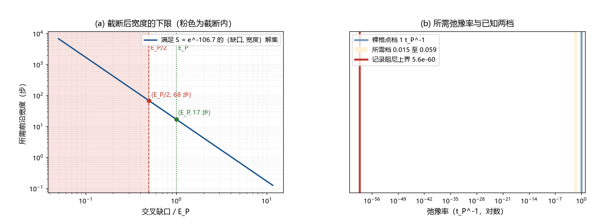

# 注记-P8a 前沿剖面最小模型（第376条）：紫外截断封缺口与宽度翻译为弛豫率

- **日期**：2026-09-24 03:22:22
- **类型**：判据执行轮（A 路前沿判句收窄；P8a 接口判定）
- **脚本**：`验证脚本/minimal_verification_front_profile_minimal.py`（第 376 条）
- **图**：见 §3 图 1（`images/front_profile_minimal.png`）
- **依据**：[[验证脚本/注记-A 路判句（第361条）：缺口与扫速的计数形式]]（计数式 $(\Delta/E_P)^2 w = 16.98$）；[[验证脚本/注记-A 路前沿侧侦察（第362条）：前沿速度已知、宽度缺失]]（前沿速度 $c$；须 17 步宽或超普朗克缺口）；[[晶格何以不破坏洛伦兹不变性：元相子理论的时空机制与分层定理]]（采样截断 $\omega \le \omega_P/2$）；[[验证脚本/注记-M6-S2G（γ 取数，可做部分）：最小模型的守恒性与观测上限]]（记录阻尼上界 $1.04\times10^{-16}$ 每秒）
- **状态**：判句收窄完成。缺口读法封死；宽度下限 17 至 68 步；弛豫率目标 0.0147 至 0.0589 $t_P^{-1}$

## 1 判据与设定

第 361 条把 A 路（朗道-齐纳）化为纯计数式 $(\Delta/E_P)^2(t_{\rm sweep}/t_P) = 16.98$，第 362 条确认前沿速度已知为 $c$、宽度与缺口缺失，两条补足路径（给宽度或给缺口）都留在模型侧未判。本轮在最小模型层面做三件事：用框架自己的紫外截断封掉缺口读法；把宽度改写为前沿剖面的弛豫率；把所需弛豫率与体系已知的两档速率对照。判据四条（P1 至 P4），全部为确定性算术，无自由参数。

## 2 结果

P1（尖锐前沿所需的缺口）：$w = 1$ 时计数式要求 $(\Delta/E_P)^2 = 16.98$，即 $\Delta = 4.12\,E_P$；$w = 2$ 需 $2.91\,E_P$，$w = 4$ 需 $2.06\,E_P$。缺口读法要求缺口超过普朗克档，与截断矛盾。

P2（截断下的宽度下限）：框架的采样截断给 $\Delta \le E_P/2$（两摆程约定；松读法至多 $\Delta \le E_P$）。代入计数式，$\Delta = E_P$ 给 $w \ge 17.0$ 步，$\Delta = E_P/2$ 给 $w \ge 67.9$ 步。缺口读法封死，宽度读法成为唯一出口，且宽度有下限。

P3（宽度翻译为弛豫率）：前沿以每步一格推进，剖面的宽度等于弛豫时间内前沿推进的距离，$w = v/\gamma$ 给出 $\gamma = 1/w$。$w = 17$ 步给 $\gamma = 0.0589\,t_P^{-1}$，$w = 68$ 步给 $0.0147\,t_P^{-1}$。

P4（两档对照）：裸格点档（剖面每步即时更新，$\gamma = 1\,t_P^{-1}$）比所需档高 $1.23$ 个数量级；记录阻尼观测上界（$5.6\times10^{-60}\,t_P^{-1}$）比所需档低 $58$ 个数量级。所需档换算为物理单位为 $2.73\times10^{41}$ 至 $1.09\times10^{42}$ 每秒。

## 3 图

## 4 结论与判句移交

缺口读法封死：把宽度压到单步的尖锐前沿需要 $\Delta = 4.12\,E_P$，超过框架截断；截断允许的最大缺口仍要求宽度不少于 $68$ 步。宽度读法成为唯一出口，且下限被钉住：A 路若要成立，前沿剖面至少跨 $17$ 步（松读法）或 $68$ 步（两摆程约定）。

这把 A 路的判句从「给出前沿宽度」收窄为「给出一个弛豫率为 $0.0147$ 至 $0.0589\,t_P^{-1}$ 的前沿形成过程」。目标值落在两个已知档之间：比格点更新率低约 $1.2$ 个数量级，即剖面比单格宽一至两个量级；比记录阻尼上界高 $58$ 个数量级。后一对位置的解读须带保留：前沿弛豫率与记录阻尼是否指向同一系数未建立（见 §5），本轮只登记两档不在同一量级。

判句移交：P8a 的下一段给出前沿形成过程的微观弛豫率（相变动力学里哪个物理量以 $0.0147$ 至 $0.0589\,t_P^{-1}$ 弛豫），或反向给出该宽度无法由 A 路动力学提供的论证。第 362 条的未定项保留：$S$ 对应朗道-齐纳的哪一支概率（透热支或绝热支），待相变模型定死后对数值。

## 5 严格程度与边界声明

严格程度：P1、P2 为算术（判据级）；P3 的运动学关系 $w = v/\gamma$ 为线性化剖面的定义（模型设定级）；P4 的对照为读数登记（裸格点档为格点更新率的直接读数，记录阻尼上界为 S2G 观测口径读数）。

边界：不建立相变动力学模型，不重算第 360 至 362 条；前沿弛豫率与记录阻尼的物理身份关系未建立（不作同一化，也不作无关断言）；截断的精确形式沿用体系纲领性推论 $\omega \le \omega_P/2$ 与 $E \le \hbar\omega_P/2$，其严格推导仍在遗留清单（[[晶格何以不破坏洛伦兹不变性：元相子理论的时空机制与分层定理]] §8）；不涉及 $S$ 的透热与绝热概率语义。

## 6 过程记录

触发：第 361、362 条把 A 路化为「17 步宽或超普朗克缺口」的二选一，两读法都未闭合。本轮先用截断排除缺口，再把宽度翻译成速率，得到可直接交给动力学模型的单一目标值。副产品是所需档与两档的相对位置：它低于格点率（每步一次更新），高于阻尼上界的慢通道档，量级定在每 $17$ 至 $68$ 步一次弛豫。
