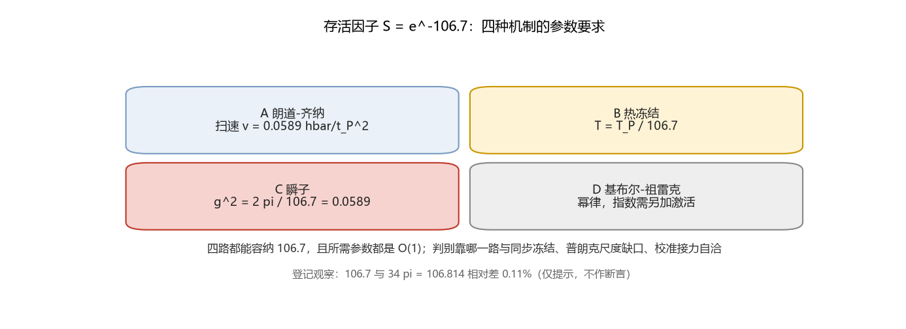

# 注记-S 的机制候选（第360条）：四种指数抑制的参数量级与判句

- **日期**：2026-09-22 07:16:29
- **类型**：判据执行轮（存活因子 $S$ 的机制候选首轮）
- **脚本**：`验证脚本/survival_factor_candidates.py`（第 360 条）
- **图**：见 §2 图 1（`images/survival_factor_candidates.png`）
- **依据**：[[有质量粒子的形成：大爆炸同步相变的局域缺陷方案]] §7.2 第四项（裁决二十八：$\kappa_\phi = \kappa_\phi^{(0)}S$，$S \approx e^{-106.7}$）；[[验证脚本/注记-κ_φ 必要性（第359条）：N1 极限清单与 N2 替代机制的读数复现要求]]（裸耦合 O(1)）；[[理论攻坚/量纲桥攻坚计划：从本体层单位到物理质量标度的导出]]
- **状态**：首轮完成。四路线参数要求算出；机制成立与否未判（下一步判句已立）

## 1 判据与设定

目标：把「$S \approx e^{-106.7}$ 从哪来」拆成可判句。做法是把指数 $106.7$ 摊到四种标准抑制机制的自由参数上，看所需参数是否落在自然档（O(1) 到 O(1/100)）。输入：$t_P$、$\hbar$、$k_B$、$E_P = \hbar/t_P = 1.9561\times10^9$ J、$T_P = 1.4168\times10^{32}$ K、$\kappa_\phi t_P = 9.293805\times10^{-47}$。全部为确定性算术。

## 2 结果：四路线的参数要求

| 路线 | 抑制形式 | 取普朗克档后的要求 | 读法 |
| --- | --- | --- | --- |
| A 朗道-齐纳 | $e^{-2\pi\Delta^2/(\hbar v)}$ | 扫速 $v = 0.0589\,\hbar/t_P^2$（$2.14\times10^{51}$ J/s） | O(1/20)，落在普朗克附近 |
| B 热冻结 | $e^{-\Delta E/(k_BT)}$ | $T = T_P/106.7 = 1.328\times10^{30}$ K | 冻结温度比普朗克低两个数量级 |
| C 瞬子 | $e^{-S_E/\hbar}$ | $g^2 = 2\pi/106.7 = 0.0589$（取 $S_E = 2\pi/g^2$） | 弱耦合档 |
| D 基布尔-祖雷克 | 幂律 | 不产生指数 | 除非叠加激活过程（归入 B） |

## 3 与裸耦合取值的交叉

指数 $106.7$ 对应裸耦合 $\kappa_\phi^{(0)}t_P$ 在 $2$ 至 $2.5$ 区间（取 $2$ 给 $106.69$，取 $2\pi/3$ 给 $106.73$，取 $\sqrt{2\pi}$ 给 $106.91$）。这与第 359 条的 O(1) 反解相容：机制与裸耦合处在同一量级档，$S$ 的推导不必同时解释两个层级。若 A 或 C 成立，$S$ 被直接算出，$\kappa_\phi$ 从输入降为导出（第 359 条草案的结局一）。

## 4 判别判句（下一步）

- A 判句：给出缺口 $\Delta$ 与扫速 $v$ 的体系内表达式（相变扫速由什么决定），二者落在普朗克档的 O(1/20) 即成立。
- B 判句：给出冻结温度 $T$ 的独立来源（宇宙学侧），并解释为何是 $T_P/107$。
- C 判句：给出 $g^2$ 的微观定义（弱耦合来源，即超导类比里库珀配对的对应物）。
- D 判句：若要保留幂律路线，须证明激活过程并给出激活能。

## 5 结构性数字观察（仅登记）

$106.7$ 与 $34\pi = 106.814$ 相对差 $0.107\%$（等价地 $2\pi\times17$）；但 $e^{-34\pi} = 4.085\times10^{-47}$ 与 $\kappa_\phi t_P$ 在裸耦合取 $1$ 时相差 $56\%$。此条只作提示登记，不作断言。

## 6 严格程度与边界声明

严格程度：参数要求为算术换算（判据级）；机制成立与否未判（纲领级）。边界：不验证相变动力学的具体模型，不重算既有读数，不替代 P8a 的数学化工作。

## 7 过程记录

触发：第 359 条把机制目标锁定为 $S$ 后开工。首轮发现：四路线的参数要求都落在 O(1) 到 O(1/100) 档，没有一路需要极端调参；因此判别落在「哪一路与该体系的同步冻结图像自洽」，数值可行性已不再是瓶颈。
