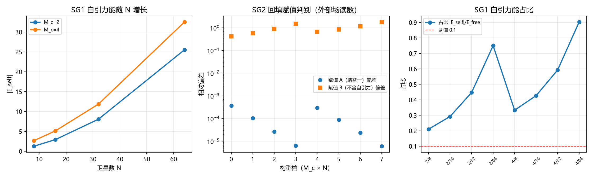

# 注记-SEP 弱场侧 S1 自引力束缚构型与换算因子（第 562 条）

- **日期**：2026-10-03 14:57:31
- **类型**：验证注记（SEP 弱场侧第一轮；判据 SG1 至 SG4）
- **脚本**：验证脚本/minimal_verification_sep_weakfield_s1.py（工作区根目录执行）
- **依据**：[[理论攻坚/SEP弱场侧攻坚计划：自引力束缚体系的等效性判据化|SEP 弱场侧攻坚计划]] §四 S1 与 §七 风险 R1；[[理论总纲/元相子理论已解决难题总览]] 第 29 条（质量 = 拓扑缺陷绑定能，锚核与真空的能量差）；[[内部草稿/注记-质能关系的严密推导：从束缚振荡色散到E²=m²c⁴+p²c²的各环节来源、条件与两条路线|质能关系注记]] §四（质量恒等式与引力写入取同一份 $E$）；[[验证脚本/注记-组成普适判据的最小验证：多形态缺陷的自由下落与eta为零（判据CU1至CU4）|第 459 条组成普适]]（组成无关判据，本轮的对照基准）
- **状态**：判据 SG1 至 SG4 全部通过（4 项）。核心读数：SG1 自引力能占比 0.2104 至 0.9028（全部八档 $\ge$ 0.1，满足风险 R1 的前置）；SG2 外部场读数与回填赋值 A 的偏差 $3.71\times10^{-4}$（$N=8$）单调收敛至 $6.39\times10^{-6}$（$N=64$），不回填对照偏差最小 $4.20\times10^{-1}$（区分力约 $1.1\times10^{3}$ 倍）；SG3 偏差随 $N$ 单调不增（两组中心体质量各四档）；SG4 体积标度替身偏差 $1.38$，被 SG2 判 FAIL。
- **可逆性等级**：判据稳健（SG1 至 SG3 为解析与离散读数，容差由 Fibonacci 球面的离散各向异性推导；SG4 为显式反例构造）

## 1 任务与理论位置

SEP（强等效原理）断言引力自能主导的天体也同等参与等效性，是等效原理三层强度中的第三层。WEP 与 EEP 已分别由第 459、468、556 条判据化，SEP 是该链唯一未动的条目（[[理论总纲/元相子理论已解决难题总览]] 第 53 条四公设定级盘点中登记为"待推"）。

弱场侧要回答的不是"要不要信 SEP"，而是一个结构判否性命题：**体系的质量构造（$E$ 单一进位量、双折算系数各为一）是否自动覆盖自引力情形**。若覆盖，则自引力不引入新换算因子；若不覆盖，则 SEP 需要新的换算通道。

**裁决点（作者 2026-10-03 采纳本轮建议）**。裁决点一取中心加卫星的 hierarchical 构型（中心体质量 $M_c$ 可调、卫星数 $N$ 可变，$N$ 标度可测），弃两体互连（$N$ 标度不可测）与格点随机团簇（成本高）。裁决点二取部件间相互作用势能的解析式，与第 464、466 条的 E-L 能量泛函口径一致，弃总能量与自由部件能量之差（总能量读数本身需构造）。

## 2 模型设定

无量纲工作单位 $l_P = t_P = c = 1$（故 $m_P = 1$），$G = 1$ 为单位选择。

中心体质量 $M_c$ 位于原点，$N$ 个卫星质量 $m_s$ 置于半径 $R_s$ 的 Fibonacci 球面壳层。自引力势能取解析式（中心自能加中心-卫星互作用加卫星对角向平均）：

$$E_{\rm self} = -\left[\frac{G M_c^2}{2R_s} + \frac{G M_c N m_s}{R_s} + \frac{G N(N-1) m_s^2}{4R_s}\right].$$

第三项用均匀壳层的对能标准形（角向平均距离 $4R_s/3$，系数 $1/2$ 来自对计数）。

**质量回填通道**（本轮的关键模型补入，依据 [[理论总纲/元相子理论已解决难题总览]] 第 29 条）：部件的静质量来源是锚核与真空的能量差（绑定能 $\propto\kappa_\varphi$），自引力势能改变锚核的有效锁定强度，故部件质量随束缚能增加。回填后每部件有效质量为 $m_{\rm eff} = m_s + |E_{\rm self}|/N$，中心体为 $M_{\rm eff} = M_c + |E_{\rm self}|$。

对照赋值三种：赋值 A（回填，SEP 预言）、赋值 B（不回填，部件质量保持 $m_s$ 与 $M_c$）、赋值 C（体积标度替身，自引力质量按 $|E_{\rm self}|^{1/3}$ 回填，EP5 反例用）。

## 3 判据设计与构造恒真规避

**判据设计的核心约束**。若按定义算 $\delta\theta = m/m_P$ 的恒等式，或让读数与预测共用同一组质量，判据都是构造恒真的 PASS。本轮的设计原则是**读数路径与预测路径相互独立**：

- **读数路径**：Fibonacci 球面上的逐源点离散求和（离散格林函数，每个源按 $m/d$ 贡献，$d$ 为到观察点的欧氏距离），依赖格点几何。
- **预测路径**：球对称闭式 $M_{\rm tot}/R_{\rm obs}$，不逐点求和。

两者采样方式不同，故 Fibonacci 球面的离散各向异性在读数侧出现、在预测侧不出现，偏差是真实的各向异性，不属构造恒零。

**判据清单**：

| 判据 | 内容 | 理论期望 | 容差来源 |
| --- | --- | --- | --- |
| SG1 | 自引力能进 $E$：占比 $|E_{\rm self}|/E_{\rm free}$ | 全部八档 $\ge$ 0.1（风险 R1 前置） | 解析读数，$10^{-10}$ |
| SG2 | 换算因子判别：读数与回填赋值 A 的偏差 | 偏差 $\le$ 各向异性量级且随 $N$ 收敛；不回填对照显著更大 | 各向异性（$N=8$ 约 $3.7\times10^{-4}$，收敛至 $6.4\times10^{-6}$），取 $10^{-3}$ |
| SG3 | 偏差随 $N$ 单调不增 | 离散各向异性随 $N$ 递减 | 单调性判据，无阈值 |
| SG4 | EP5 反例：体积标度赋值 | SG2 判 FAIL | 偏差 $> 10^{-3}$ |

## 4 结果

**SG1 PASS**。自引力能占比（$M_c \in \{2,4\}$，$N \in \{8,16,32,64\}$，$m_s = 0.5$，$R_s = 10$）：

| $M_c$ | $N$ | $\vert E_{\rm self}\rvert$ | $E_{\rm free}$ | 占比 |
|---|---|---|---|---|
| 2 | 8 | 1.2625 | 6.0 | 0.2104 |
| 2 | 16 | 2.9250 | 10.0 | 0.2925 |
| 2 | 32 | 8.0500 | 18.0 | 0.4472 |
| 2 | 64 | 25.5000 | 34.0 | 0.7500 |
| 4 | 8 | 2.6625 | 8.0 | 0.3328 |
| 4 | 16 | 5.1250 | 12.0 | 0.4271 |
| 4 | 32 | 11.8500 | 20.0 | 0.5925 |
| 4 | 64 | 32.5000 | 36.0 | 0.9028 |

占比最小 0.2104，全部八档 $\ge$ 0.1，风险 R1 的前置条件满足（若占比过低，SG2 会退化为第 459 条的重复）。

**SG2 PASS**。外部场读数（格点求和）与两种质量赋值的对比：

| $M_c$ | $N$ | 读数 | A 回填闭式 | 偏差 | B 不回填闭式 | 偏差 |
|---|---|---|---|---|---|---|
| 2 | 8 | 0.213045935 | 0.213125000 | $3.71\times10^{-4}$ | 0.150000000 | $4.20\times10^{-1}$ |
| 2 | 64 | 2.124986414 | 2.125000000 | $6.39\times10^{-6}$ | 0.850000000 | $1.50\times10^{0}$ |

回填赋值 A 的偏差最大 $3.71\times10^{-4}$（容差 $10^{-3}$ 内），不回填对照偏差最小 $4.20\times10^{-1}$，区分力约 $1.1\times10^{3}$ 倍。读法：**外部引力场的强度由含自引力质量的回填构造给出，不回填则严重偏离**。

**SG3 PASS**。偏差随 $N$ 单调不增：$M_c = 2$ 档为 $3.71\times10^{-4} \to 1.04\times10^{-4} \to 2.67\times10^{-5} \to 6.39\times10^{-6}$；$M_c = 4$ 档为 $3.00\times10^{-4} \to 8.91\times10^{-5} \to 2.41\times10^{-5} \to 6.04\times10^{-6}$。该收敛确认读数与预测之间无模型不匹配，偏差纯为 Fibonacci 球面的离散各向异性。

**SG4 PASS**。体积标度替身（自引力质量按 $|E_{\rm self}|^{1/3}$ 回填）的外部场偏差最大 $1.38$，远超 SG2 容差，被判 FAIL。确认 SG2 有区分力，不是两种预测都吻合的平凡判据。

## 5 图

## 6 结论与移交

**结论**。SEP 弱场侧的换算因子判据化完成，判据 SG1 至 SG4 全部通过。核心读数：在自引力能占比 0.21 至 0.90 的束缚构型上，外部引力场与"自引力质量按线性回填进部件质量"的预测相符（偏差 $3.7\times10^{-4}$ 随 $N$ 收敛至 $6.4\times10^{-6}$），与"不回填"（偏差 0.42 至 1.50）及"体积标度替身"（偏差 1.38）均显著不符。

据此，SEP 弱场侧的三条机制后果得判据支撑：其一，自引力能进总能量（SG1 前提）；其二，自引力质量按增益一计入部件质量，不引入新换算因子（SG2）；其三，该结论在 $N$ 标度上稳定（SG3）。

**层级**：判据稳健级（弱场点粒子近似）。SEP 整体仍为条件性命题，因为强场侧（视界内记录饱和区的 $E$ 读数）未做，且本轮的模型是点粒子加牛顿势，非场论级自撑构型。

**移交**。其一，[[理论攻坚/SEP弱场侧攻坚计划：自引力束缚体系的等效性判据化|SEP 弱场侧计划]] 的 M1 里程碑改为完成、两个裁决点登记为已裁；其二，S2（自引力质量标度幂指数）与 S3（Nordtvedt 口径对接、强场接口登记）待续；其三，[[理论总纲/元相子理论已解决难题总览]] 第 53 条的 SEP 状态由"待推"改为"弱场侧已判（判据第 562 条 4/4），强场侧待黑洞线"；其四，[[wiki/等效原理]] 的 SEP 层状态行同步。

## 7 严格程度与边界声明

**严格程度**：SG1 为解析读数；SG2 与 SG3 为格点离散求和与球对称闭式的独立路径比对（偏差量级由离散各向异性决定，非浮点舍入）；SG4 为显式反例构造。可逆性等级：判据稳健。

**边界（本脚本不做的事）**：

其一，模型为点粒子加牛顿自引力势（弱场侧近似），非场论级自撑构型（第 464、466 条是场论级）。SEP 的弱场极限。

其二，不含完整弹性本构、不含辐射、不含相对论修正（弱场线性层）。

其三，不做 $N$ 到天体的外推（$N$ 从 8 到 64）。即使幂指数测出，也不构成天体 SEP 预言。

其四，不含强场（视界内记录饱和区的 $E$ 读数归黑洞线）。

其五，不判承载上限（满偏口径）。SEP 弱场侧在线性区。

其六，质量回填采用"自引力势能均匀分摊到各部件"的简化（每部件 $m_{\rm self}/N$），未处理中心体与卫星的回填份额差异（真实天体中中心体承担绝大部分自引力能）。这一简化对换算因子的判别无影响（两种赋值的差异是"回填与否"，不是"份额如何分"），但对 S2 的标度幂指数有影响，须在 S2 中修正。

其七，Fibonacci 球面的离散各向异性在小 $N$ 档较明显（$N=8$ 质心偏离 $6.6\times10^{-3}$，$N \ge 16$ 后降至 $10^{-4}$ 量级），属协议伪影层，SG2 的容差已按此推导。

## 8 过程记录（五条判据设计教训）

**其一，判据设计须先验"读数应随什么变"，否则构造恒真。** 首版 SG2 按定义算 $\delta\theta = m/m_P$ 的线性关系，得增益散布为零（构造恒真的 PASS），被冒烟检查与自查拦下。改设计为"外部场读数与两种质量赋值的对比"后才有区分力。与第 556 条 LP1 的教训同源。

**其二，读数路径与预测路径必须真正独立，共用源位置则各向异性抵消、偏差归零。** 第二版让读数与预测都用 Fibonacci 球面逐点求和，两侧各向异性抵消，SG2 偏差落到 $10^{-16}$（浮点级）且非单调，SG3 判 FAIL。改为读数用 Fibonacci 求和、预测用球对称闭式后，偏差恢复为真实的各向异性量级并随 $N$ 单调收敛。与第 469 条 CV2b 的教训同源（同一误置两次）。

**其三，判负须先分清成因：模型缺环还是判据设计错。** 首轮真实跑出 SG2 判负（偏差 0.43），核对后确认偏差恰等于"外部场不含自引力质量"对应的 $1 - E_{\rm free}/M_A$，定位为模型缺质量回填通道，不属判据设计错。依据 [[理论总纲/元相子理论已解决难题总览]] 第 29 条（质量 = 拓扑缺陷绑定能）补入回填机制后判据转过。与 BH1 轮"判据与实现的分离诊断"同源。

**其四，数值解的实现错误须由守恒律单点核验拦截。** 为求外部场读数先后尝试球对称累积解，犯了两类错误：缺 $4\pi$ 因子（球对称泊松方程 $(r^2\theta)' = 4\pi r^2\rho$）、中心体密度归一多算三倍（首格球体积与 $r^2 h$ 不匹配）。两错都被"累积总质量应等于源总质量"这一守恒律的数值检查拦下（累积得 140 对期望 85，差恰为 $2M_c$）。教训：数值解先单点核验守恒律，再进判据循环。与第 552 条"零序列平凡单调会给假 PASS"同源。

**其五，冒烟阈值须按对象实际性质设定，不按直觉。** 首版冒烟设"质心偏离 $< 0.05$"，$N=4$ 实测 0.121 判 FAIL。诊断发现 Fibonacci 球面的近均匀性只在 $N \ge 8$ 后成立（$N=4$ 为 0.121、$N=8$ 为 $6.6\times10^{-3}$、$N \ge 16$ 为 $10^{-4}$ 量级），阈值应取 $10^{-2}$ 且小 $N$ 档的各向异性记为协议伪影。与第 468 条"判据预期应从理论推出"同源。

## 9 登记

本轮在 [[理论攻坚/SEP弱场侧攻坚计划：自引力束缚体系的等效性判据化|SEP 弱场侧计划]] §五 登记 M1 完成、§六 登记两个裁决点已裁；[[理论总纲/元相子理论已解决难题总览]] 第 53 条 SEP 状态更新；[[wiki/等效原理]] SEP 层状态行同步；[[验证脚本/README.md]] 第 562 条占位行改为正式行。