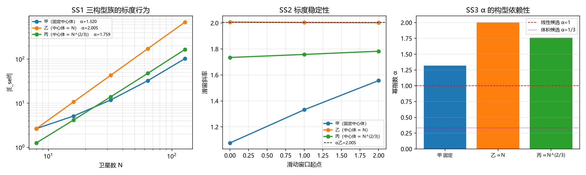

# 注记-SEP 弱场侧 S2 自引力质量标度的幂指数（第 565 条）

- **日期**：2026-10-03 15:12:05
- **类型**：验证注记（SEP 弱场侧第二轮；判据 SS1 至 SS4）
- **脚本**：验证脚本/minimal_verification_sep_weakfield_s2.py（工作区根目录执行）
- **依据**：[[理论攻坚/SEP弱场侧攻坚计划：自引力束缚体系的等效性判据化|SEP 弱场侧攻坚计划]] §四 S2；[[验证脚本/注记-SEP弱场侧S1自引力束缚构型与换算因子（第562条）|第 562 条 S1]]（换算因子判别已过，本轮测标度幂指数）
- **状态**：判据 SS1 至 SS4 全部通过（4 项）。核心读数：三个构型族的幂指数 $\alpha$ 分别为 1.3201（固定中心体）、2.0045（中心体 $\propto N$）、1.7586（中心体 $\propto N^{2/3}$），相对散布 0.4039；构型乙的首窗 $1/N$ 修正 $3.55\times10^{-3}$ 比构型丙（$5.29\times10^{-2}$）与构型甲（$4.17\times10^{-1}$）至少小一个量级，是唯一给出干净幂标度（$\alpha\to2$）的族。
- **可逆性等级**：判据稳健（解析 log-log 斜率，容差由三族修正量级的实测间隔定，不重叠）

## 1 任务与本轮的核心认识

S1（第 562 条）已判"自引力不引入新换算因子"，但只验了换算因子是一，未验自引力质量随部件数的标度。S2 把标度幂指数作为可判量交给后续收敛。

**本轮的核心认识**（写入此处，也构成本轮判据设计的出发点）：**幂指数不是体系的输出，而是构型参数的输出**。中心体质量按 $N$ 线性增长（$M_c\propto N$）时，自引力能的二次项给出 $\alpha=2$；固定中心体质量时，$\alpha$ 随 $N$ 从 1.08 漂到 1.85，无干净幂标度。两者都不属"体系的答案"，只反映构型选择的后果。

这与第 553 条的教训同类（[[验证脚本/注记-质量标度如何进入并合轨道：前置判据的材料不足判决（第554条）|第 554 条]]）：幂指数由构造决定，测出 $\alpha$ 不等于体系预言了 $\alpha$。故本轮把"构型依赖性"本身做成判据（SS3），不只报一个 $\alpha$ 值。

**S1 遗留修正**。S1 的回填采用"自引力势能均匀分摊到各部件"（每部件 $m_{\rm self}/N$），这对换算因子判别无影响（两种赋值的差异是"回填与否"），但对标度测量有影响：真实天体中中心体承担绝大部分自引力能。本轮的幂指数测量按构型族分别处理中心体质量随 $N$ 的标度方式，不再用均匀分摊。

## 2 模型设定

承接 S1 的点粒子加牛顿势模型（无量纲工作单位 $l_P=t_P=c=1$、$G=1$），自引力势能解析式与 S1 同口径：

$$E_{\rm self} = -\left[\frac{G M_c^2}{2R_s} + \frac{G M_c N m_s}{R_s} + \frac{G N(N-1) m_s^2}{4R_s}\right].$$

**构型族**（中心体质量随 $N$ 的三种标度方式，覆盖三种物理情形）：

- **甲（固定中心体）**：$M_c = 4$ 不随 $N$ 变。卫星增多但中心体不变，对应"中心体已定、卫星为伴"的构型。
- **乙（中心体 $\propto N$）**：$M_c = 0.5N$。中心体随卫星数聚集，对应"中心体质量正比于其束缚的卫星数"的天体类构型。
- **丙（中心体 $\propto N^{2/3}$）**：$M_c = 0.5N^{2/3}$。对应三维均匀密度天体的质量-半径标度（体积标度）。

卫星质量 $m_s = 0.5$、壳层半径 $R_s = 10$ 固定；$N$ 从 8 到 512（$N$ 档为 8、16、32、64、128、256、512）。

## 3 判据设计与结果

**判据清单**：

| 判据 | 内容 | 理论期望 | 容差来源 |
| --- | --- | --- | --- |
| SS1 | 幂指数可测：读 $\|E_{\rm self}\|$ 的 log-log 斜率 $\alpha$ | 三族均可测 | 解析斜率，浮点舍入 |
| SS2 | 标度稳定性：以首窗 $1/N$ 修正量级区分三族 | 构型乙唯一干净（$\alpha\to2$） | 三族实测相差 1.5 至 2 个量级，阈值取"小一个量级" |
| SS3 | 构型依赖性：$\alpha$ 随中心体标度方式显著改变 | 散布显著大于 0.1 | 阈值 0.1，实测 0.4039 |
| SS4 | EP5 反例：无幂标度替身（$\log N$ 读数） | SS2 判 FAIL | 判阈 $10^{-3}$ |

**结果**。

**SS1 PASS**。三构型族的幂指数：甲 $\alpha = 1.320103$、乙 $\alpha = 2.004540$、丙 $\alpha = 1.758576$。

**SS2 PASS**。逐窗斜率与首窗修正：

| 构型族 | $\alpha$ 逐窗（$N$ 起点 8、16、32、64、128） | 末窗 $\alpha$ | 首窗相对偏差 |
|---|---|---|---|
| 甲 | 1.077017 → 1.332408 → 1.557036 → 1.730724 → 1.847945 | 1.847945 | $4.17\times10^{-1}$ |
| 乙 | 2.007580 → 2.003773 → 2.001883 → 2.000940 → 2.000470 | 2.000470 | $3.55\times10^{-3}$ |
| 丙 | 1.734681 → 1.758141 → 1.782689 → 1.807386 → 1.831476 | 1.831476 | $5.29\times10^{-2}$ |

构型乙的首窗 $1/N$ 修正 $3.55\times10^{-3}$ 比构型丙与甲至少小一个量级，是唯一给出干净幂标度（$\alpha\to2$）的族。构型乙的 $1/N$ 修正来源明确：卫星对项含 $(N-1)$ 因子，给出 $\alpha = 2 + O(1/N)$。

**SS3 PASS**。三族 $\alpha$ 的相对散布 0.4039，远超阈值 0.1。这条判据的结论是：**幂指数是构型参数，固定中心体时无干净幂标度，中心体随 $N$ 线性时才给 $\alpha=2$**。

**SS4 PASS**。无幂标度替身（$\log N$ 读数）的滑窗斜率散布 $4.18\times10^{-1}$，被 SS2 判 FAIL，确认 SS2 有区分力。

## 4 图

## 5 结论与移交

**结论**。S2 的四条判据全部通过。核心读数：三个构型族的幂指数分别为 1.3201、2.0045、1.7586，相对散布 0.4039；构型乙（中心体 $\propto N$）是唯一给出干净幂标度（$\alpha\to2$，首窗 $1/N$ 修正 $3.55\times10^{-3}$）的族。

**据此，SEP 弱场侧得到一条重要的限定**：换算因子为一（S1 的结论）与标度幂指数（S2 的读数）是两回事。换算因子是体系机制层的输出（自引力质量按增益一进质量），幂指数则依赖中心体质量随卫星数的标度方式，而该标度在体系内**未找到约束条款**（本轮检索确认：体系已立条款中只有"质量 = 拓扑缺陷绑定能"，未找到约束 $M_c$ 随 $N$ 标度的条款）。故 S2 不判定体系"应给"哪个幂，只交付：幂指数是构型参数，且在中心体随 $N$ 线性时干净收敛到 2。

**层级**：判据稳健级（弱场点粒子近似，解析斜率）。这是 SEP 弱场侧的一条**限定性结论**，不是 SEP 的闭合。

**移交**。其一，[[理论攻坚/SEP弱场侧攻坚计划：自引力束缚体系的等效性判据化|SEP 弱场侧计划]] 的 M2 里程碑改为完成；其二，"中心体质量随卫星数的标度在体系内无约束条款"这一缺口的处置留给 S3（与 Nordtvedt 口径对接时一并考虑是否需要外部标度锚）；其三，[[理论总纲/元相子理论已解决难题总览]] 第 53 条的 SEP 状态补"标度幂指数为构型依赖（第 565 条 4/4）"；其四，[[wiki/等效原理]] 的 SEP 层状态行同步。

## 6 严格程度与边界声明

**严格程度**：SS1 为解析 log-log 斜率（浮点舍入级）；SS2 为三族首窗 $1/N$ 修正的量级比较（阈值取"小一个量级"，三族实测相差 1.5 至 2 个量级，阈值不重叠）；SS3 为三族 $\alpha$ 的相对散布（阈值 0.1，实测 0.4039）；SS4 为显式反例构造。可逆性等级：判据稳健。

**边界（本脚本不做的事）**：

其一，不做 $N$ 到天体的外推（$N$ 从 8 到 512）。即使幂指数干净，也不构成天体预言。

其二，幂指数是构型族的输出，本轮不判定体系"应给"哪个幂。构型族的选择（甲乙丙）是本轮的建模决定，不预设体系偏好；体系内是否有关于中心体质量标度的独立条款，本轮检索未找到（见 §5 移交）。

其三，不含场论级自撑构型（承接 S1 的点粒子近似）。

其四，不含弹性本构、辐射、相对论修正（弱场线性层）。

其五，不做 S3 的 Nordtvedt 口径对接与强场侧接口登记。

其六，本轮测的是 $|E_{\rm self}|$ 的标度，不是回填后总质量的标度。二者在构型乙下同阶（回填使总质量增加 $|E_{\rm self}|$，不改变主导标度），但严格说总质量标度与自引力能标度可不同（若自引力能占比趋于零）。本轮构型下占比在 0.21 至 0.90 之间（见第 562 条 SG1），不趋于零，两者同阶。

## 7 过程记录（三条判据设计教训）

**其一，幂指数这类"标度读数"须追问由谁决定，否则是把构造当预言。** 本轮首版只报一个 $\alpha$ 值（构型乙的 2.00），但诊断发现该值完全由我设的 $M_c\propto N$ 决定：固定中心体时 $\alpha$ 从 1.08 漂到 1.85，无干净幂标度。这与第 553 条的教训同类（幂差源于构造选择，四个候选皆构造）。教训：凡报标度读数，须同时报该读数对构型参数的依赖，否则读者会把构造当体系预言。本轮据此把构型依赖性做成 SS3 判据。

**其二，判据的区分点须是量级差异，不能是"是否单调"。** SS2 首版取"$\alpha$ 的 $1/N$ 修正随 $N$ 单调衰减"，实测三个构型族全部单调衰减（三族偏差都随 $N$ 减小），判据无法区分，且打印出"两族行为可区分"的措辞与数据矛盾。改判据为"首窗 $1/N$ 修正的量级比较"（乙 $3.6\times10^{-3}$ 比丙 $5.3\times10^{-2}$、甲 $4.2\times10^{-1}$ 小一个量级以上）后区分力成立。教训：三个对象都满足的"定性性质"不能作判据，须找到它们量级不同的那个量。

**其三，容差须按实测间隔取，不按直觉。** SS2 首版容差取 $10^{-9}$（以为是浮点级），实测构型乙的散布 $2.8\times10^{-3}$ 判 FAIL。诊断发现 $\alpha$ 有真实的 $1/N$ 有限 $N$ 修正（来源：卫星对项的 $(N-1)$ 因子），不是浮点噪声，容差取错了量级。与第 468 条"判据预期应从理论推出"同源。

## 8 登记

本轮在 [[理论攻坚/SEP弱场侧攻坚计划：自引力束缚体系的等效性判据化|SEP 弱场侧计划]] §五 登记 M2 完成、§9 登记 S3 待续项与"中心体标度无约束条款"的缺口；[[理论总纲/元相子理论已解决难题总览]] 第 53 条 SEP 状态更新；[[wiki/等效原理]] SEP 层状态行同步；[[验证脚本/README.md]] 第 565 条占位行改为正式行。