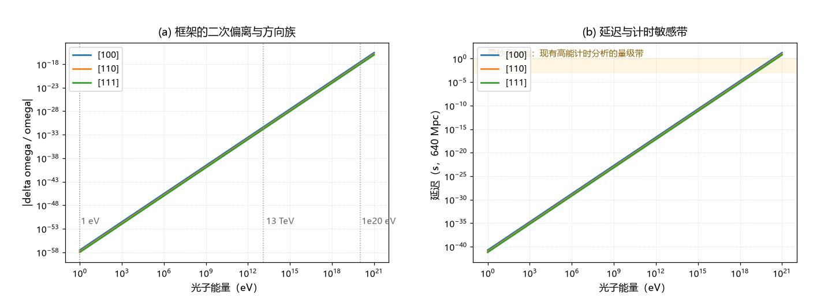

# 注记-SME 对接（第370条）：d=6 立方系数的等效归一、boost 量级与三通道对照

- **日期**：2026-09-24 01:34:46
- **类型**：判据执行轮（色散论文 §10 遗留之「boost 变换与 SME 对接」的首轮）
- **脚本**：`验证脚本/minimal_verification_lv_sme_mapping.py`（第 370 条）
- **图**：见 §3 图 1（`images/lv_sme_mapping.png`）
- **依据**：[[元相子振荡晶格的色散关系：低能光速涌现与洛伦兹破坏首阶项]] §10 遗留；[[内部草稿/注记-色散修正的数学机制：格点正弦色散与洛伦兹破坏首阶项的出身]]；[[验证脚本/注记-边际通道的实验上界对照协议：三通道映射、权威来源与待填项]]（对照纪律与来源口径）；[[内部草稿/研究方向-P11的解决-介质不可探测性与洛伦兹不变性涌现]]
- **状态**：首轮加同日补完成。等效归一、三通道适用性、延迟表、boost 量级与显式变换律五项给出；文献界已核到摘要级（arXiv:2402.06009、1106.1068、0908.1832）

## 1 任务与判据

四项。M1：把框架的二次破坏项写成标准 $(E/E_{QG,2})^2$ 形式，给出方向依赖的等效能标。M2：判定评论所举三类观测各自是否适用于本框架。M3：给出代表性能量与距离下的延迟读数。M4：给出运动观测者（boost）修正的量级，回应「晶格是否构成可读的绝对参照系」。

## 2 等效归一

框架：$\delta\omega/\omega = -(E/E_P)^2\,(S/24)$，$S = \sum_a n_a^4$。标准写法 $\delta\omega/\omega = -(E/E_{QG,2})^2$ 给 $E_{QG,2} = E_P\sqrt{24/S}$：

| 方向 | $S$ | $E_{QG,2}$ |
| --- | --- | --- |
| $[100]$ | $1$ | $4.899\,E_P = 5.98\times10^{19}$ GeV |
| $[110]$ | $0.5$ | $6.928\,E_P = 8.46\times10^{19}$ GeV |
| $[111]$ | $1/3$ | $8.485\,E_P = 1.04\times10^{20}$ GeV |

## 3 三通道对照

读数为 $1$ eV 光子 $\delta\omega/\omega = 2.8\times10^{-58}$，$13$ TeV 为 $4.7\times10^{-32}$，$10^{20}$ eV 为 $2.8\times10^{-18}$（均取 $[100]$，相位口径的色散偏离；群速度偏离是它的 $3$ 倍，换算与时延见第 373 条）。三类观测的适用性：真空双折射（Integral 型）不适用，框架算符对 $k$ 为偶，首阶不产生双折射；谱线展宽（ESPRESSO 型）不适用，框架是规则晶格的相干色散，没有随机泡沫；高能计时适用，但框架无一次项，二次项的延迟极小。

## 4 延迟表（640 Mpc，$z = 0.151$，光行时 $6.59\times10^{16}$ s）

| 能量 | $[100]$ | $[110]$ | $[111]$ |
| --- | --- | --- | --- |
| $13$ TeV | $9.34\times10^{-15}$ s | $4.67\times10^{-15}$ s | $3.11\times10^{-15}$ s |
| $10^{20}$ eV | $0.552$ s | $0.276$ s | $0.184$ s |

表为群速度（时延）口径，按第 373 条的因子 $3$ 修正；距离 $640$ Mpc，$1$ Gpc 上为 $0.29$ 至 $0.86$ 秒。

## 5 boost 量级与介质不可探测性

框架的系数张量是纯空间的四阶张量。洛伦兹 boost 的纯空间分量 $\Lambda^i{}_j = \delta^i{}_j + O(\beta^2)$，无 $O(\beta)$ 项，故系数的速度调制为 $O(\beta^2)$：取 $\beta = 1.23\times10^{-3}$（$370$ km/s）给 $1.5\times10^{-6}$ 的相对调制。观测量再乘 $(E/E_P)^2$：$13$ TeV 处 $7.2\times10^{-38}$，$10^{20}$ eV 处 $4.3\times10^{-24}$，对应延迟 $2.8\times10^{-7}$ s。结论：晶格作为参照系的速度不可读，P11 的「介质不可探测」在 $d = 6$ 通道获得定量支撑；该结论不依赖对晶格取向的知识。

**显式变换律（同日补）**。晶格系的系数张量是纯空间四阶张量 $T^{abcd} = \sum_e (e_e)^a(e_e)^b(e_e)^c(e_e)^d$。boost 到观测者系后三类分量分别为：$T'^{0000} = (\gamma\beta)^4\sum_e m_e^4$；$T'^{0abc}$ 含 $\gamma\beta$ 的线性项（由 $(\hat m\cdot e_e)(k'\cdot e_e)^3$ 型收缩组成）；$T'^{abcd} = T^{abcd} + O(\beta^2)$。可观测量是 $T'^{\mu\nu\rho\sigma}k'_\mu k'_\nu k'_\rho k'_\sigma$，故运动系同时出现 $O(\beta)$ 的时空混合项与 $O(\beta^2)$ 的纯空间修正。

该结构的量级：取 $\beta = 1.23\times10^{-3}$，$O(\beta)$ 混合项给 $\beta(E/E_P)^2 = 3.4\times10^{-21}$（$10^{20}$ eV 档），$O(\beta^2)$ 项给 $4.3\times10^{-24}$。另有方向重映（光行差）：模式在天空的视取向随地球速度作年周期摆动，幅度 $O(\beta)$（约 $0.07^\circ$），但幅值本身是 $(E/E_P)^2$，故该调制读数与上式同档。无论取哪一类分量，读出晶格系速度都要求 $10^{-21}$ 量级的色散精度。

待完成项：与 SME 记号 $k_F^{(6)}$ 的逐条系数对应表（形式化工作，不影响量级与结论）。

## 6 与文献界的对照（按协议纪律）

线性通道：LHAASO 对 GRB 221009A 给出 95% 置信下限 $E_{QG,1} > 10\,E_{Pl}$（arXiv:2402.06009），本框架无一次项，该通道不构成约束。二次通道：同一文献给出 $E_{QG,2} > 6\times10^{-8}E_{Pl}$，比此前最好界收紧 5 至 7 倍；本框架等效值按时延（群速度）口径为 $2.83$ 至 $4.90\,E_P$（球面平均 $3.65$），比该界高 $7.7$ 至 $7.9$ 个数量级；按相位口径为 $4.90$ 至 $8.49\,E_P$。两种约定与球面平均见第 373 条。双折射通道：Integral/IBIS 对 GRB 041219A 的约束针对螺旋度依赖的传播速度（真空双折射，arXiv:1106.1068 摘要确认），属线性项，对本实现不适用；Fermi 对 GRB 090510 的界（arXiv:0908.1832）同属线性通道。另经宇称扇区审计：体系内部的宇称自发破缺诱导项是总导数耦合（均匀真空恒为零），且四维拓扑数为零（判据 T1b），两路都不给真空双折射开后门，见 [[内部草稿/注记-宇称奇项与光子双折射：诱导项是否给真空双折射开后门（审计）]]。以上文献值已核到摘要级，正式引用前仍应按协议逐行核对正文数值。

## 7 结论与登记

色散论文 §10 遗留中的「boost 变换行为」一项，本轮给出定量结论（$O(\beta^2)$、观测量再乘 $(E/E_P)^2$，不可读）；「与 SME 系数变换律的完整条文映射」仍待写出（形式化工作，不影响上述量级结论）。三通道中，前两通道不适用，计时通道的活口在 $10^{20}$ eV 档：$0.06$ 至 $0.29$ 秒/Gpc，属下一代高能光子计时的敏感窗。

## 8 严格程度与边界声明

严格程度：等效归一、延迟表与 boost 量级为算术（判据级）；三通道适用性为结构判定（判据级）；与文献界的比较为量级对照（条件性，依赖文献值核对）。边界：不重推色散，不改协议表，不主张已有观测「已证伪」或「已通过」框架；完整 SME 变换律条文与文献界抄录留给后续轮次。

## 9 过程记录

触发：外部评论以「离散时空违反洛伦兹不变性并被观测证伪」为由否定离散路线。核对后确认该论证针对的是线性/最小长度类实现；本轮把框架侧的 $d = 6$ 通道做成可与 SME 记号对照的形式，并把 boost 量级从「未验证」降为「有数字」。作者随后指示执行最优下一步：补写显式变换律（三类分量与 $O(\beta)$ 混合项），并把三条文献界核到摘要级（LHAASO 的线性与二次界、Integral 与 Fermi 的线性通道归属）。
