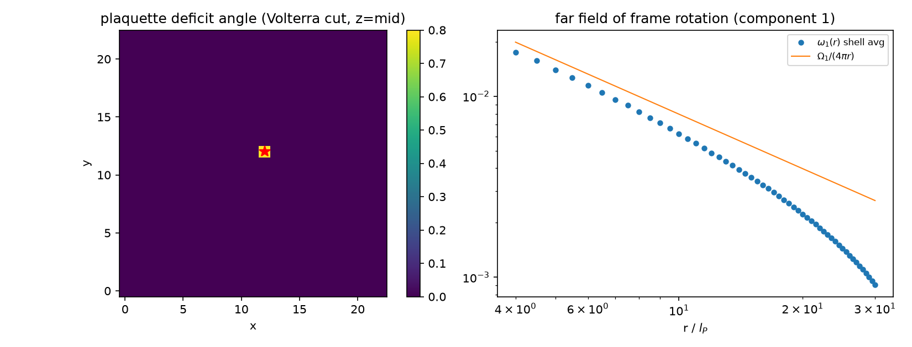

# 注记-SO3链接变量版最小验证：路径B规则1-7的数值检验

- **日期**：2026-09-06
- **层级**：验证脚本/（理论验证材料，未确认）
- **定位**：把《注记-碰撞写入标架联络的最小验证》从标量场升级为 SO(3) 链接变量版，对《注记-引力机制的静态几何方案：缺陷标架与格面曲率（路径B）》的规则 1-7（标架、链接变量、格面转角亏损、Volterra 缺陷、真空平坦性）做数值检验。验证对象是路径 B 的**几何机制层**；验证以 $F \in SO(3)$ 为输入，**不触及 B1 命门**（开放问题总览 P1-32 的 2026-09-05 B1 存档登记：$\kappa_\phi$ 哈密顿量不导出 $F \in SO(3)$，路径 B 已降级存档、方向 6 为主推候选），命门结论不受本验证影响；3+1 时间向完成不在数值范围（见第四节理论 flag）
- **关联**：《冲突诊断/注记-引力机制的静态几何方案：缺陷标架与格面曲率（路径B）》（规则 1-7）；开放问题总览 P1-32 的 B1 存档登记（2026-09-05）；《冲突诊断/注记-像素偏转与格点碰撞折返的冲突分析》（方向 6 与方向评估）；《验证脚本/注记-碰撞写入标架联络的最小验证》（标量版前置验证）；《杨-米尔斯方程的晶格推导》（格面工具同型）
- **脚本**：`验证脚本/minimal_verification_so3_link.py`（Python 3.13 + numpy 2.4 + scipy 1.18，scipy Rotation 做精确 SO(3) 运算，可复现）；图：`images/minimal_verification_so3.png`（见 §三 图 1）
- **状态**：几何机制层验证通过；3+1 时间向完成为新识别的关键缺口（第四节 flag 1），待作者裁决

---

## 一、验证目标

路径 B 的规则 1-7 构造从未数值检验。本验证以精确 SO(3) 矩阵运算（非小角近似）检验四组判据：机制层健全性（规则 2-5、7）、Volterra 缺陷几何（规则 5-6）、线性化远场（其 §四 步骤 2-4）、平滑/奇异分解。

## 二、模型设定

标架 $F(n) \in SO(3)$（scipy Rotation 精确表示）；链接变量 $U_a(n) = F(n+\hat a)F(n)^{\mathrm T}$；格面 holonomy 按路径序 $H = U_y(n)^{-1}U_x(n+\hat y)^{-1}U_y(n+\hat x)U_x(n)$（该序使单值标架严格伸缩抵消）；净转角由矩阵对数提取。Volterra 缺陷以分支切割实现：切割半平面上的链接携带常数旋转 $R_{\Omega}$（Frank 矢量）。线性化远场：框架微扰场 $\vec\omega$ 解分量离散泊松 $-\nabla^2\omega_i = \Omega_i\delta$。

## 三、结果

| 判据 | 结果 |
|---|---|
| 1a 真空平坦性（规则 7） | 常数标架（含非单位整体旋转）下全部格面转角 $3.5\times10^{-32}$，平坦 |
| 1b 纯规范陷阱 | 光滑单值标架的格面 holonomy 恒为 I：转角幅度 $\epsilon = 0.05/0.5/0.95$ rad 下最大残差 $\le 2\times10^{-16}$。**曲率是拓扑性而非幅度性**：光滑场无论"多弯"都零曲率 |
| 1c 非可积判别式 | 非可积链接（不来自单值 F）的格面角随链接强度线性增长（实测 $\kappa^{1.00}$）；结合 1b：可积 = 严格零，非可积 = 线性，判别式是可积性 |
| 2a 分支切割亏损 | 绕线缺陷环（半径 3/5/8/10）转角全部 $= \Omega = 0.8$（12 位精度，半径无关 = 锥面签名）；亏损恰为 Frank 矢量 |
| 2b 可加性与局域性 | 双缺陷（$\Omega_1 = 0.5$、$\Omega_2 = 0.3$）：含双缺陷大环 $= 0.8$，各自小环 $= 0.5/0.3$（12 位精度） |
| 2c $\epsilon_h \propto m$ 线性 | $m = 1/2/3$ → 亏损残差 $\le 2\times10^{-16}$；√m 陷阱在机制中不存在（路径 B §三 设计意图证实） |
| 3a 分量离散泊松 | 三分量独立验证：拟合 $A_i$ 对理论 $\Omega_i/(4\pi)$ 相对偏差 $1.9\times10^{-4}$，格面通量恒等 $\Omega_i$（10 位精度） |
| 3b 非阿贝尔压低 | 单源场 $w = g(n)\cdot\vec\Omega$ 严格同轴（转动可交换，偏差为零）；非平行双源下精确链接转角对线性化 $\Delta\omega$ 的偏差 $\sim r^{-10}$（线性项 $\sim r^{-2}$，相对压低 $\sim r^{-8}$）：远场线性化泊松充分 |
| 3c 平滑/奇异分解 | 平滑响应场的格面曲率严格为零（$2.3\times10^{-17}$）：远场不复制源，holonomy 全在缺陷，无重复计数 |

过程记录：[1c] 与 [3b] 的首轮预期（$\kappa^2$ 标度、单源非阿贝尔偏差 $\sim r^{-3}$）是脚本设计错误而非机制问题：非可积链接的一阶项不抵消（线性才对），单源场严格同轴（偏差应为零，实测斜率来自噪声拟合）。修正后的判据与结果如上表，两个教训写入脚本注释。

## 四、理论 flag（超出数值范围的发现，提交作者裁决）

**Flag 1（最重要）：锥面签名与牛顿力缺口。** [2a] 证实绕缺陷环 holonomy 半径无关：纯空间 SO(3) 亏损给出的是锥状空间（2+1 维引力型圆锥几何）。但牛顿 $1/r$ 吸引力住在时间向度规分量 $g_{00}$（原引力论文的静态标量近似 $h_{00} = 2\Phi/c^2$），纯静态空间标架构造单独无法给出牛顿引力。3+1 完成需要时间向铰链参与，而元相子体系的时间向就是摆程节拍。这强烈指向：**方向 6 的过程层（碰撞写入的每拍节拍）可能正是时间向铰链的物理内容，两路径在 3+1 层面不是竞争关系，而是合并后各自必要**（路径 B 供空间几何结构与源归一化，方向 6 供时间向节拍过程，且其标量稳态已被数值验证）。路径 B §四"弱场线性化 → 离散泊松"的断言跳过了这个缺口，其开放问题清单（六项）未含此项。

**Flag 2：线缺陷 vs 点缺陷。** 本验证用线缺陷（2D 锥面沿 z 延拓）；路径 B 的 σ 锁定孤子是点缺陷（hedgehog 型 Frank 场，绕数方向依赖），属路径 B 开放问题 3，未数值化。

**Flag 3：层位归属与三代张力（沿袭前轮评估，未决）。** 标架场应从实轴取向场 $\alpha$（信息层，注释 09 定案原文）还是慢相位场 $\varphi^a$（刚度层，路径 B 规则 1）构造，需作者裁决；且曲率若与电磁同住取向场，须说明"一次碰撞两种效应分用"如何维持。Frank 矢量 $\propto$ 绕数与亏损 $\propto m$ 的兼容性（三代同荷不同质）未决。

## 五、结论

**几何机制层：通过。** 路径 B 规则 1-7 的全部可数值化判据成立，且其两个关键设计被证实为机制必要而非任意选择：绑定能（而非 $\delta_\pm$ 值）作源，因光滑标架是纯规范、任意幅度零曲率（1b）；亏损 $\propto m$ 线性，无 √m 陷阱（2c）。剩余缺口集中于 3+1 时间向完成（Flag 1）与本体层三项。

**对合并方案的影响**：Flag 1 把"路径 B 结构 + 方向 6 过程"的合并从经济性建议升级为可能的结构必然：空间 Regge 几何 + 时间向写入节拍，恰好对应"空间曲率住在标架场（方向归波）+ 时间节拍住在摆程计数（距离归粒、时钟层）"的体系分层。此判断与 P1-32 的 B1 存档登记（方向 6 为主推候选）一致且相互支持：本轮验证的格面联络数学层为两路径共享，方向 6 的本体层形式化若成功即可直接调用。建议下一步为 3+1 雏形验证：把时间向铰链（写入节拍）与空间链接变量放进同一 Regge 求和，检验静态弱场下 $h_{00}$ 分量再现 $1/r$。

---

## 六、严格程度声明

第三节数值为可复现计算事实（脚本与图存档，随机性仅入 [1c] 随机场且种子固定）；第二节翻译规则为模型假设；第四节三项 flag 为理论层判断（Flag 1 为分析论证，未数值化）。本注记不改动路径 B 原文与任何基准文件，未确认前不入理论总纲。
