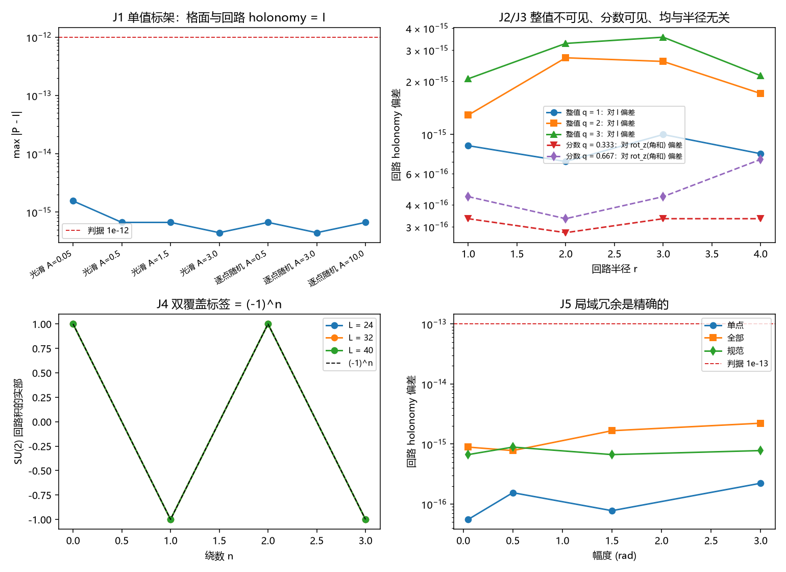

# 注记-T1b-2 标架联络扇区的空间拓扑荷：整值绕数在 SO(3) 层不可见

- **日期**：2026-09-18 05:46:38
- **对应脚本**：`验证脚本/minimal_verification_t1b2_frame_sector.py`（判据 J1 至 J5，5/5 通过；确定性，种子 20260918；运行约 1 秒；图存 `images/t1b2_frame_sector.png`，见 §一 图 1）
- **依据**：[[内部草稿/注记-判据T1b：四维拓扑数为零及其后果]] §五（T1b-2 的出处）；[[冲突诊断/注记-引力机制的静态几何方案：缺陷标架与格面曲率（路径B）]]（规则 1-7 与 B2 裁决）；[[验证脚本/注记-SO3链接变量版最小验证：路径B规则1-7的数值检验]]；[[内部草稿/开放问题总览：元相子理论待解决问题清单]] P4-31
- **定位**：判据 T1b-2 的可复现读数。判定对象是标架联络扇区的空间拓扑荷是否守恒。本注记不改动基准文件。
- **状态**：判据 5/5 通过。核心读数：整值向错绕核心回路的链接角和 $= 2\pi n$（半径 $r = 1..4$ 的读数 1.000000、2.000000、3.000000、$-1.000000$），而 SO(3) 回路 holonomy 偏差 $\le 3.6\times10^{-15}$；分数向错 $q = 1/3$、$2/3$ 给 holonomy $= \mathrm{rot}_z(2\pi q)$（偏差 $\le 7.2\times10^{-16}$，非恒等度 $1.500$）；双覆盖提升积 $= (-1)^n I$（偏差 $\le 1.9\times10^{-15}$，尺寸 $L = 24,32,40$ 一致）；局域冗余偏差 $\le 1.8\times10^{-15}$。

---

## 一、判据与结果

| 判据 | 内容 | 通过条件 | 实测 |
|---|---|---|---|
| J1 | 单值标架的格面与回路 holonomy | 小于 $10^{-12}$ | 七种构型最大 $1.55\times10^{-15}$ |
| J2 | 整值向错的回路 holonomy 对 $I$ 的偏差 | 小于 $10^{-12}$ | 最大 $3.55\times10^{-15}$，角和 $= 2\pi n$ |
| J2b | 不环绕核心的回路（圈住一段切割链） | 小于 $10^{-12}$ | $9.53\times10^{-16}$ |
| J3 | 分数向错 holonomy 对 $\mathrm{rot}_z(2\pi q)$ 的偏差 | 小于 $10^{-12}$ 且非恒等 | $7.22\times10^{-16}$，非恒等度 $1.500$ |
| J4 | 双覆盖提升积对 $(-1)^n I$ 的偏差 | 小于 $10^{-12}$ | $1.885\times10^{-15}$，三种尺寸一致 |
| J5 | 局域冗余下的回路 holonomy 偏差 | 小于 $10^{-13}$ | $1.776\times10^{-15}$ |

图注：左上为七种单值标架构型的格面与回路 holonomy 偏差，含判据线 $10^{-12}$；右上为回路 holonomy 偏差随半径 $r = 1..4$ 的变化，整值构型（$q = 1,2,3$）量的是对恒等的偏差，分数构型（$q = 1/3$、$2/3$）量的是对角和 $\mathrm{rot}_z(2\pi q)$ 的偏差；左下为 $SU(2)$ 回路积实部随绕数 $n$，三种补丁尺寸与 $(-1)^n$ 参考线重合；右下为单点标架重标识、全部标架重标识与局域规范变换三类局域冗余下的回路偏差随幅度。

## 二、模型设定

构造沿用路径 B 规则 1-7 的标架层：格点上放标架 $F(n) \in SO(3)$，链接变量取 $U_a(n) = F(n)^T F(n+a)$，格面 holonomy 取四个链接绕格面的有序乘积，即 Regge 转角亏损。单值标架指 $F(n)$ 是格点的单值函数；此时四个链接的首尾因子逐点相消，全部格面与全部回路的 holonomy 恒等于单位元。

向错构型取极角增量的主值再乘强度：$a(n)$ 为以核心为中心的极角，$\theta_a(n) = q\,\mathrm{wrap}_\pi[a(n+a) - a(n)]$，链接矩阵为 $\mathrm{rot}_z(\theta_a(n))$。$q$ 即向错强度，Frank 角为 $2\pi q$。主值代表在格点上携带一条切割链：绕核心一周时，链接角之和为 $2\pi$（而单值数组的原始差之和恒为零），乘 $q$ 后即 Frank 角。$q$ 为整数时该和是 $2\pi$ 的整数倍，切割链可由局域重标识移除；$q$ 非整数时不可移除。

## 三、读数的意义

**规则 7 有一个精确版本。** 只要链接由单值标架的差分给出，格面与回路的 holonomy 在机器精度内恒等于单位元，与标架幅度无关（$0.05$ 至 $10$ rad 七种构型，最大偏差 $1.55\times10^{-15}$）。这条读数把规则 7 从"真空平坦"升级为一条结构陈述：在规则 4 的构造下，标架层的曲率全部由缺陷承载，链接自身没有独立的联络动力学。

**整值绕数在 SO(3) 层不可见。** 绕核心一周的角累积是 $2\pi n$，而 $2\pi$ 的整数倍在 $SO(3)$ 中是恒等元，故整值向错（$n = \pm 1, 2, 3$）的回路 holonomy 与无缺陷构型不可分，半径 $r = 1..4$ 一视同仁（最大偏差 $3.55\times10^{-15}$）。这给 B2 当年的裁决补上了结构理由：曲率 $\propto$ 绕数那条路线在 $SO(3)$ 层根本给不出曲率，它与等效原理无关。

**分数向错可见。** Frank 角 $2\pi q$（$q$ 非整数）给出 holonomy $\mathrm{rot}_z(2\pi q)$，与半径无关，非恒等度 $1.500$（$q = 1/3$ 与 $2/3$ 相同）。这正是质量缺陷那一支：Regge 转角亏损取连续值，量级由质量定。当 $q$ 趋近整数时可见度连续趋于零，恰好接上整值情形的不可见。

**唯一的量子化标签住在双覆盖里。** 整数 $n$ 的信息没有消失：$SU(2)$ 提升下回路积为 $(-1)^n I$（偏差 $\le 1.9\times10^{-15}$，三种尺寸 $L = 24,32,40$ 给同一读数）。这枚 $Z_2$ 标签落在旋量结构一侧，与费米子通道同源，是标架扇区里唯一离散且不可连续调节的读数。

**局域冗余是精确的。** 单点标架重标识、全部格架重标识、以及链接角的局域规范变换（$\theta_a(n) \to \theta_a(n) + \lambda(n+a) - \lambda(n)$）都不改变任何回路的 holonomy，幅度取到 $3.0$ rad 仍为 $1.8\times10^{-15}$ 量级。故上面的读数承载的是构型的物理内容，与表观规范选择无关。

## 四、对判据 T1b-2 的判定

标架联络扇区的空间拓扑荷没有独立于相位场绕数的整值内容。整值部分与电荷扇区是同一个构型的同一个绕数，在 $SO(3)$ 曲率上不留痕迹；可见的曲率部分由非整值缺陷承载，取连续值，属质量分布的泛函。故"把空间拓扑荷改变一个整数"这条通道在标架侧不产生新的整值标签，T1b 的恒等式（四维拓扑数 $=$ 空间拓扑荷的时间变化量）在引力侧同样给零。标架扇区独有的一枚量子化数据是双覆盖的 $Z_2$ 旋量结构，它以中心元方式精确守恒，同样不能由局域过程连续改变。

## 五、与前一轮及既有结论的关系

**承接 T1b。** [[内部草稿/注记-判据T1b：四维拓扑数为零及其后果]] §五把本节登记为 T1b-2，判法同构：先查该扇区空间拓扑荷是否守恒，再套同一条恒等式。本节给出该扇区空间拓扑荷的三支读数（单值平凡、整值不可见、分数可见），守恒性由此落实。

**更正 B2 措辞。** 路径 B 的 B2 拓扑版当日以"宏观引力 $\propto$ 电荷、与等效原理矛盾"为由弃用。本节的读数给出更根本的理由：整值绕数在 $SO(3)$ 层根本不产生曲率，那条路线在结构上不可能成立。

**精确化一条既有措辞。** 路径 B 第六节写"环绕涡旋一周，标架轴旋转 $2\pi n$，即向错的 Frank 矢量"。读数显示该转动在 $SO(3)$ 内是恒等元，其内容全部落在双覆盖上（$(-1)^n$）。建议在后续引用处把该句精确化为"双覆盖侧的 $Z_2$ 标签"，避免读者把整值向错读成曲率源。

## 六、过程记录（判据订正三处）

**累积顺序。** 回路 holonomy 起初按左乘序累积（$H = M H$）。在绕单轴的构型上两种顺序都给恒等，故初期读数看似正常；一旦引入非共轴重标识，左乘序不再是伸缩积，局域冗余判据出现假失败（偏差 $1.8$）。改为行进序（$H = H M$）后回到 $10^{-15}$。教训：非阿贝尔回路的乘积顺序必须与所用判据匹配，绕单轴的构型无法暴露顺序错误。

**主值代表。** 链接角起初取极角增量的原始差，整周累积恒为零，对照判据（$q = 1/3$ 应为 $2\pi/3$）判负。改用主值后累积回到 $2\pi q$。教训：Frank 角承载在主值代表的选择上，把角展开成单值数组等于把切割抹掉。

**切割链重复计入。** 在主值之上再额外附加一条切割链后，累积被抵消回零，J2、J3、J4 二次判负。教训：主值代表已含切割，附加等于重复计数。

## 七、严格程度声明

**精确部分**：全部读数为显式 $SO(3)$ 与 $SU(2)$ 矩阵运算，偏差在 $10^{-15}$ 量级。规则 7 的平凡性与 J2 的不可见性是代数恒等式（单值标架的伸缩相消、$2\pi n$ 在 $SO(3)$ 中的恒等性）。

**构件部分**：向错构型取"极角增量的主值乘 $q$"，这是 Volterra 切割的最小格点表示；标架链接到物理引力的映射沿用 B1 公设版口径，规则 2-4 是构造，未能从哈密顿量导出。

**未做**：含时间方向的四维标架构型与 Pontryagin 密度的离散积分口径未定；标架梯度的非阿贝尔全结构未算（本脚本用绕单轴的约化族）。

## 八、边界声明

**验证什么**：单值标架的格面与回路 holonomy 恒等；整值向错在 $SO(3)$ 层不可见而在双覆盖上给 $(-1)^n$；分数向错给 $\mathrm{rot}_z(2\pi q)$；三类局域冗余精确。

**不验证什么**：不验证标架链接的动力学来源；不验证四维拓扑数的具体数值；不给"引力侧强 CP 型负担已封"的结论，那一步需要离散积分口径（登记为 T1b-2a）。