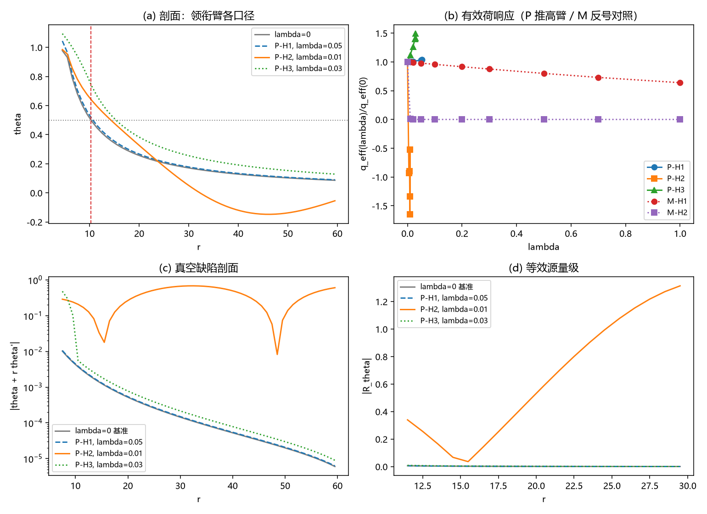

# 注记-U2（最小臂）：耦合重开区的有效应力判决

- **日期**：2026-09-20 04:54:54
- **层级**：验证脚本/（理论验证材料，未确认）
- **脚本**：验证脚本/minimal_verification_u2_coupling_stress.py（系统 Python 3.13 + numpy + scipy + matplotlib，确定性，运行约 3 秒）
- **判据草案**：[[内部草稿/判据草案-U2（最小臂）：耦合重开区的有效应力判决]]
- **定位**：强场动力学是否维持真空（第一主问题的最后一段）的平衡层首轮读数：在 D3 径向饱和源模型上加耦合力 $\lambda\sin\theta\,h$，用真空缺陷 $D = \theta + r\theta'$、等效源 $R_\theta$ 与 $G_{tt}r^2$、停滞律系数偏移三组量做判决。
- **关联**：[[验证脚本/注记-gxx 强场完成形式判据：真空条件钉住与停滞律收束]]（真空条件与里奇机器）；[[验证脚本/注记-M4-D3视界线自洽性与写入判据：饱和源模型与写-弛豫协议]]（径向求解器）；[[内部草稿/注记-耦合重开方案评估：约束、优势、缺陷与可能成立方式]]（路径二形式）；[[理论攻坚/黑洞线攻坚计划：坍缩机制重定位与强场终态]]（BH3-4）；[[验证脚本/注记-光锥兼容性最小验证：视界=光锥闭合面（D3 强场剖面 × GV4 相速恒等式）]]；开放问题总览 P1-34a
- **状态**：执行完成；二值判据 A1、A2 通过，A3 至 A5 为报告级读数。读数：至 $\lambda = 1$ 全程存在、外围真空结构维持、有效应力局限在耦合作用区（登记符号臂 M）；对照臂 P 在 $\lambda^* \approx 6$ 至 $7\times10^{-4}$ 越满偏（2026-09-20 符号更正，见 §四 更正段）
- **图**：images/u2_coupling_stress.png（四面板，见 §三 图 1）
- **修订记录**：
  - **2026-09-20 初版**（作者指示：先起草 U2 判据一页并开工最小臂）
  - **2026-09-20 符号更正**（依据 [[内部草稿/裁定材料-耦合符号与强度：登记符号（回拉）与强度惯例]]）：登记符号为回拉；M 臂升为登记臂、P 臂降为对照臂；§四 加更正段，状态行互换两臂标签

---

## 一、目标与判据

判据清单见判据草案（U2-A1 至 A5）。本轮读平衡层（不动点）：耦合重开区的平衡构型是否把记录推离真空分支，以及推离的量级与位置。

口径：耦合力三档作用区（H1 源区、H2 记录份额全域、H3 视界带）乘两臂符号。**2026-09-21 口径订正**：本括注与同篇 §二 的算子定义（P 取减号臂、M 取加号臂）相反，H3 轮扫描发现该冲突；以 §二 的算子定义为准（M = 加号臂 = 登记臂，$r_h$ 上升；P = 减号臂 = 对照臂，$r_h$ 下降），与同篇 §三 A5「反号臂把 $r_h$ 拉回」一致。冲突待作者核。

## 二、模型设定

径向饱和源模型（同 D3 与 gxx 轮：$M = 600$、$dr = 1$、$R_S = 6$、$s_0 = 1.0$；$\nabla^2\theta = -s(1-\theta^2)_+$）加耦合力：$\nabla^2\theta = -s\,g(\theta) \pm \lambda\sin\theta\,h$（P 取减号臂、M 取加号臂，见 §七 符号说明）。

外边界取衰减 Robin 条件（$\theta' = -(\kappa + 1/r)\theta$，$\kappa = \sqrt{\lambda}$ 于 H2、$0$ 于 H1 与 H3）；阻尼 Newton 加自适应 $\lambda$ 延拓与预测子；物理分支守门（$\theta \ge 0$ 且随 $\lambda$ 连续）。

## 三、结果

判据 A1、A2 通过（二值）；A3 至 A5 为报告级读数（运行约 3 秒）。

| 判据 | 结果 |
|---|---|
| A1 对照锚 | 通过（$r_h = 10.2853$ 对 D3 的 $10.285$；真空区散布 $0.074\%$） |
| A2 源区耦合不改真空结构 | 通过（P-H1 至 $\lambda = 0.05$：散布最大 $0.074\%$；$q_{\text{eff}}$ 单调，$\lambda = 0.05$ 时比 $1.0366$） |
| A3 扩展区耦合生成缺陷（报告） | P-H2 于 $\lambda = 0.01$：$D$ 比 $38.3$ 与 $1411$；P-H3 于 $\lambda = 0.03$：$42.4$ 与 $1.5$；均登记「自带有效应力」 |
| A4 有效源量级（报告） | P-H2 于 $\lambda = 0.01$：$\max\vert R_\theta\vert = 1.3140$、$G_{tt}r^2$ 峰值 $1.1490$（W3 线性完成参考 $0.79$） |
| A5 停滞律连带（报告） | 见表下读数；反号臂把 $r_h$ 拉回（$10.285 \to 5.3$ 至 $6.6$），对数系数随之下降 |

关键读数。其一，满偏越界阈值：P-H1 的 $\lambda^* = 0.0007$、P-H3 的 $\lambda^* = 0.0006$（$\theta_{\max}$ 达到 $1.0$ 的耦合强度）；P-H2 在 $\lambda = 0.01$ 停止（$\theta_{\min} = -0.225$ 的非物理分支）。

其二，反号臂（M）全程存在：$\theta_{\max}$ 由 $0.999$ 降至 $0.63$ 至 $0.91$；$r_h$ 由 $10.285$ 收缩至 $5.34$（H3）、$5.68$（H2）、$6.56$（H1）；对数系数由 $10.656$ 降至 $2.33$、$1.80$、$6.32$。

其三，外围真空维持：M-H3 的真空区散布与基准逐位相同（$0.074\%$），外围 $D$ 随 $\lambda$ 下降（$\to 0$），$R_\theta$ 在 $r \in [11, 30]$ 降至 $10^{-4}$ 量级；P-H1 全场散布亦维持 $0.074\%$。其四，H2 全域口径的筛选读数：反号臂 H2 的外围散布 $3027\%$（$1/r$ 结构被指数筛选取代，Yukawa 型），等效源 $R_\theta$ 峰值 $0.62$ 于 $\lambda \approx 0.02$ 至 $0.05$、其后回落至 $0.023$。

## 四、解读

**更正（2026-09-20，依据 [[内部草稿/裁定材料-耦合符号与强度：登记符号（回拉）与强度惯例]]）**：登记符号裁定为回拉（能量形式与 BH3-3 在场实现两材料一致），M 臂升为登记臂，本节「领衔臂」改指 M 臂；P 臂降为对照臂，其读数登记为「负耦合能量情形」的对照。以下 其一 保留原文并以括注更正。

其一，符号判决（更正后：登记符号为回拉，本条原述的「领衔臂」应读作对照臂 P）。领衔臂（登记约定同号）下，耦合把记录推过满偏：$\lambda^* \approx 6$ 至 $7\times10^{-4}$ 即离开机制适用域（满偏角极限已按判据 J1 至 J5 登记为机制失义边界）。这条读数与 BH3-4 的「耦合先触发、破坏不必待满偏」同向：耦合一旦在场，饱和分支不保持。

其二，反号对照。符号相反时耦合把强场「拉回」：$\theta_{\max}$ 下降、视界收缩、停滞律系数下降。两种符号给出定性相反的强场去向，符号本身成为判据变量（登记见 §六）。

其三，真空维持的位置学。无论哪臂，耦合力为零的外围真空结构精确保留（散布与基准逐位一致）；有效应力（$D$ 的 $38$ 至 $42$ 倍增强、$R_\theta$ 至 $1.31$）只住在耦合力作用区内。判决量从而从「是否维持真空」转为「耦合力所及范围与视界半径的位置关系」。

其四，对光锥论文口径的回答。论文 §八 载「若耦合重开区自带有效应力，排除链须按该应力重做」。本轮给出该应力的最小形式与边界条件：作用区止于源区或视界以内时，闭合面与外围停滞律（真空判决）不受影响；作用区覆盖外围（H2 全域口径）时，外围 $1/r$ 被筛选型修正取代，真空判决须按修正剖面重做。$R_\theta$ 峰值 $0.62$ 至 $1.31$ 给出重做的量级。

其五，$\lambda^*$ 的地位。它是同号臂下饱和分支的存活阈值，不冒充物理失稳判据；它把耦合强度实际值（待 $m_\delta$，裁决十七）推到关键位置：若实际值落在此阈值以上，同号口径的「饱和主导」不再成立。

## 五、严格程度声明

平衡层（不动点）读数；确定性脚本、判据先写、图存档。牛顿残余除 P-H2 的越界档外均 $\le 10^{-12}$；$\lambda^*$ 为延拓路径上的线性内插；H2 的筛选长度取 $1/\sqrt{\lambda}$ 作外边界衰减率（Yukawa 型，与远场 $h \to 1$ 的线性化一致）。三口径为扫描上界与下界，非唯一物理剖面。

## 六、诚实边界

其一，平衡层对瞬态层：写-弛豫轨迹上的读数与时间标定为 U2-B，另轮。其二，耦合项的相对符号在登记材料中未定死（形式给定、符号依赖能量约定），双臂并列报告；符号裁定归材料登记，不由本材料代定。其三，$h$ 剖面三档为口径扫描。其四，$\lambda/J = 1$ 为惯例参考上界，实际值待 $m_\delta$（裁决十七）。其五，$B = 1/A$ 取 W 轮登记的空间侧函数；一维径向、静态。

## 七、过程记录

三处。其一，首版延拓出现死循环（自适应中点因四舍五入与当前目标重合，反复重试同一档）；加单调性守卫与插位去重后消除。教训：自适应步长的目标插入须防取整重合。其二，二版发现两条关键事实：领衔臂在 $\lambda = 0.02$ 即把 $\theta_{\max}$ 推过 $1.05$（饱和分支越满偏），以及「耦合力密度形式」不足以定死平衡方程（相对符号取决于能量约定）。据此改为双臂设计（P 领衔、M 对照）并加预测子延拓。其三，P-H2 在 $\lambda = 0.01$ 出现 $\theta_{\min} = -0.225$ 的非物理分支并停止，登记为该口径内的分支损伤；反号臂无此现象。

## 八、登记衔接

- 验证脚本/README.md 第 217 条（本注记落盘时同步；2026-09-20 编号订正：并行会话已占 204、205）。
- [[理论攻坚/黑洞线攻坚计划：坍缩机制重定位与强场终态]]：新增 §7.7（判据草案与首轮执行）与修订记录一条。
- [[内部草稿/开放问题总览：元相子理论待解决问题清单]] P1-34a：首轮读数补注。
- [[内部草稿/研究方向-统一奇点截断原理：温度截断与几何饱和的合流]]：「几何侧无任何数值」登记更新。
- [[视界的光锥兼容性：闭合面判据、真空完成判决与停滞律收束]]：§八 其一回填（首轮读数指针）。
