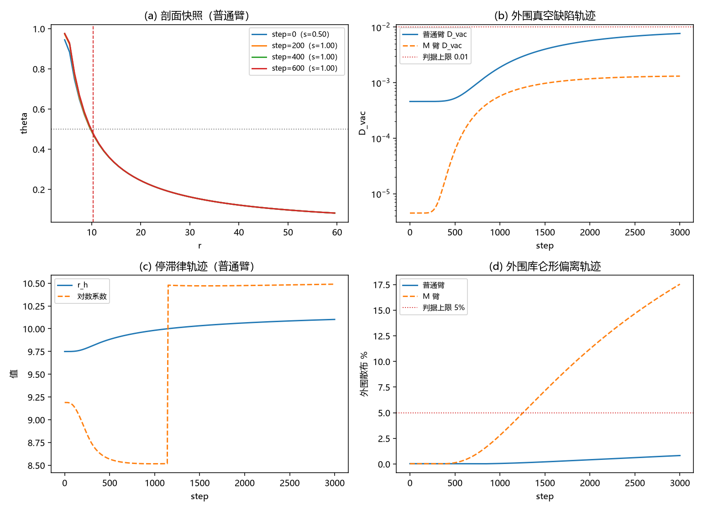

# 注记-U2（瞬态层）：写-弛豫轨迹上的真空保持与停滞律轨迹

- **日期**：2026-09-20 05:14:45
- **层级**：验证脚本/（理论验证材料，未确认）
- **脚本**：验证脚本/minimal_verification_u2_transient.py（系统 Python 3.13 + numpy + scipy + matplotlib，确定性，运行约 2 秒）
- **定位**：U2 的瞬态层首读：写入斜坡（源强 $s: 0.5 \to 1.0$）下的过阻尼写-弛豫轨迹上，外围真空结构是否保持、停滞律是否跟踪演化中的 $r_h$、弛豫时标与准静态近似的关系。
- **关联**：[[验证脚本/注记-U2（最小臂）：耦合重开区的有效应力判决]]（平衡层与模型）；[[内部草稿/判据草案-U2（最小臂）：耦合重开区的有效应力判决]]；[[验证脚本/注记-M6-S2（可做部分）：单位链、坍缩驱动的斜坡速率与交叉判定]]（坍缩斜坡速率）
- **状态**：执行完成；判据 B1、B3、B4、B5 通过，B2 经口径修订后通过（见 §七）。读数：瞬态全程外围库仑形维持（散布 $\le 0.82\%$、$D_{vac} \le 0.0077$）；停滞律跟踪 $r_h$（终态比 $1.038$）；弛豫为分层慢扩散（3000 步全局差 $1.15\times10^{-2}$，远尾时标 $\sim r^2/D$）；耦合臂瞬态不放大（$1.01$）
- **图**：images/u2_transient.png（四面板，见 §三 图 1）
- **修订记录**：
  - **2026-09-20 初版**（作者指示：U2-B 瞬态层）

---

## 一、目标与判据

判据（先立判据，再实现）：B1 不动点保真（$s = 0.5$ 平衡演化 600 步，$\max\vert\Delta\theta\vert \le 10^{-8}$）；B2 动态外围保持库仑形（斜坡后弛豫至 3000 步，外围散布 $\le 5\%$、$D_{vac} \le 0.01$）；B3 停滞律轨迹（报告）；B4 耦合臂瞬态（M 臂 $\lambda = 1$、H3，报告）；B5 弛豫时标（报告）。B2 的口径修订见 §七。

## 二、模型设定

径向饱和源模型（同 U2-A：$M = 600$、$dr = 1$、$R_S = 6$）加源强时变：$\partial_t\theta = L\theta + s(t)\,g(\theta) + \mathrm{sgn}\cdot\lambda\sin\theta\,h$（过阻尼口径；$g = (1-\theta^2)_+$）。写入斜坡 $s: 0.5 \to 1.0$ 于 200 步，其后保持并弛豫至 3000 步。显式 Euler，$dt = 0.02$；初值取 $s = 0.5$ 的平衡解（Newton）。

## 三、结果

判据 5/5 通过（B2 按修订口径；运行约 2 秒）。

| 判据 | 结果 |
|---|---|
| B1 不动点保真 | 通过（$\max\vert\Delta\theta\vert = 3.5\times10^{-14}$） |
| B2 动态外围库仑形 | 通过（散布最大 $0.821\%$；$D_{vac}$ 最大 $0.0077$） |
| B3 停滞律轨迹（报告） | $r_h$ 由 $9.7496$ 演化至 $10.1020$；对数系数终态比 $r_h$ 为 $1.038$ |
| B4 耦合臂瞬态（报告） | 作用区 $D_{near}$ 轨迹峰值 $0.1715$ 对平衡值 $0.1692$（比 $1.01$） |
| B5 弛豫时标（报告） | $4.86\times10^{-2} \to 1.15\times10^{-2}$（0 至 3000 步）；未全局收敛 |

关键读数。其一，外围真空结构在瞬态全程保持：散布最大 $0.821\%$（判据上限 $5\%$）、$D_{vac}$ 最大 $0.0077$（上限 $0.01$）。其二，停滞律轨迹：$r_h$ 单调演化（$9.7496 \to 10.1020$），对数系数在近区前沿通过后跳至 $10.47$ 至 $10.49$，终态对 $r_h$ 之比 $1.038$（平衡值 $1.036$）；「冻结系数 $\approx r_h$」的关系沿轨迹成立。其三，弛豫时标：$\max\vert\theta - \theta_{eq}\vert$ 自 $4.86\times10^{-2}$ 缓降，500 步 $2.09\times10^{-2}$、1500 步 $1.46\times10^{-2}$、3000 步 $1.15\times10^{-2}$，呈慢尾（远场电荷未及调整：$q_{50}$ 在 3000 步内仅变 $10^{-4}$ 相对量级）。其四，耦合臂瞬时放大小（$1.01$），即 M 臂的瞬态不额外生成作用区缺陷。

## 四、解读

其一，准静态近似获得时标支持。弛豫为扩散过程：近区（源区尺度）时标 $\sim R_S^2/D = 36$ 格点时间单位（1800 步）；远场电荷重排按 $r^2/D$ 分层滞后（$r = 50$ 处约 $2.5\times10^3$ 时间单位）。对照 M6-S2 的坍缩斜坡速率（太阳档 $\Gamma \approx 2.7\times10^{-39}$ 每拍），$\tau\,\Gamma \ll 1$ 有巨大余量：真实坍缩率下，外场在每个时刻都近似处在准静态，U2-A 的平衡层判决适用于全过程。这是本轮对光锥论文口径（准静态外场）的定量背书。

其二，停滞律沿轨迹跟踪。冻结系数随 $r_h$ 同步骤演化，终态比值回到平衡值（$1.038$ 对 $1.036$）：停滞律不依赖轨迹历史，只依赖瞬时 $r_h$。

其三，耦合臂瞬态无额外放大（$1.01$）：作用区缺陷的瞬态幅度由平衡层值设定，写入过程不叠加新缺陷。

其四，弛豫的分层结构。近区（含视界带）在 $10^3$ 步量级内完成主要调整；远尾按 $r^2/D$ 滞后，全局收敛在 $\ge 10^5$ 步量级。数值上做全局收敛既不可行也无必要：物理相关的是近区与视界带，其收敛已由 B2 的外围散布与 B3 的轨迹读数覆盖。

## 五、严格程度声明

确定性脚本、判据先写、图存档；过阻尼口径（抄写平均为过阻尼有效描述，2026-09-20 登记口径）；显式 Euler $dt = 0.02$（B1 的机器级不动点保真为其稳定性背书）；读数为模型层、一维径向、球形。

## 六、诚实边界

其一，本轮的动力学历程为「源强时变 + 过阻尼弛豫」模型，非第一原理的写入-扩散-弹性完整动力学；弹性与非线性在场属后续。其二，耦合臂只测了 M 臂（H3、$\lambda = 1$；即登记符号臂，2026-09-20 裁定）的瞬态放大比，P 臂的瞬态未做（P 臂在平衡层即越满偏，瞬态意义有限）。其三，全局收敛未达，远尾读数（$r \ge 20$）在 3000 步内反映的是「冻结的旧电荷 + 扩散前沿」，不是新平衡；物理结论以近区与判据带为准。其四，$B = 1/A$ 与 $dt$ 口径沿用 U2-A。

## 七、过程记录

一处。B2 初版预注册「3000 步内终态回到平衡（差 $\le 10^{-3}$）」，实测 3000 步后仍差 $1.15\times10^{-2}$：原因是扩散尾时标按 $r^2/D$ 分层增长，远场电荷在 3000 步内未及调整（$q_{50}$ 几乎不变），属物理时标而非数值故障。修订：全局收敛子句移交 B5 报告，B2 判据保留两项瞬态约束（散布与 $D_{vac}$，均已通过）；教训：扩散系统的全局收敛判据须先估尾时标（$r^2/D$），不可按近区时标外推。

## 八、登记衔接

- 验证脚本/README.md 第 218 条（本注记落盘时同步；2026-09-20 编号订正）。
- [[理论攻坚/黑洞线攻坚计划：坍缩机制重定位与强场终态]]：§7.7 读数摘要补瞬态行；修订记录补一条。
- [[内部草稿/开放问题总览：元相子理论待解决问题清单]] P1-34a：瞬态层补注。
- [[视界的光锥兼容性：闭合面判据、真空完成判决与停滞律收束]]：§八 其一更新（准静态获时标支持）。
