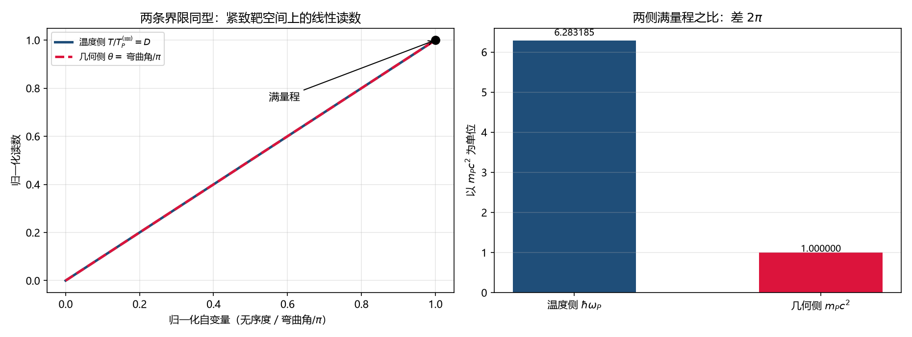

# 注记-U3 第一步：两条界限的同型化与满量程核对

- **日期**：2026-09-21 07:37:18
- **层级**：验证材料（`验证脚本/`，内部草稿级）
- **定位**：U3（同根判据）的第一步，只做能立刻做、不需要新推导的那一段：把温度侧与几何侧两条界限写成同一型陈述，再核对两条的满量程常数是否相等。
- **脚本**：`验证脚本/minimal_verification_u3_first_step.py`（确定性，固定种子；图存 `images/u3_two_bounds_scales.png`）
- **关联**：[[视界的光锥兼容性：闭合面判据、真空完成判决与停滞律收束]] §4.3；[[黑洞奇点与晶格损坏：饱和封顶、满偏渐近与结构序稳健性]] §4.3；[[元相子理论中的温度定义：相位无序度的能量化与宇宙学意义]]；[[元相子振荡晶格的色散关系：低能光速涌现与洛伦兹破坏首阶项]] §5 第 4 条（口径声明）；[[内部草稿/总结报告-黑洞线两主问题复查：判定总表、漏洞清单与深化点（2026-09-21）]]（D1）
- **状态**：判据 R1 至 R5 全过（R5 为判定）
- **图**：见 §四 图 1
- **修订记录**：
  - **2026-09-21 初版**（来源：作者同意按判据形态核对第一步）

---

## 一、两条界限的在册形态

**温度侧**：温度的定义是 $k_BT = E_P D$，其中 $D$ 为复相干无序度，$D = 1 - \lvert\langle z\rangle\rvert/\sqrt{\langle\lvert z\rvert^2\rangle}$。$D$ 的上端由 $D = 1 - (\text{非负量})$ 给出，下端由 Cauchy-Schwarz 给出，故 $D \in [0,1]$，温度的上限 $T_P = E_P/k_B$ 是定义的直接后果（在册定理 U1）。

**几何侧**：记录量 $\theta$ 在满偏 $\theta = 1$ 处贴住而不穿越（六组数值材料，亏损按 $e^{-9.4\sqrt{s_0}}$ 衰减至 $s_0 = 10^5$）。此前该界限的地位是**模型层读数**。

## 二、同型化

两条界限可以写成同一句话：**某个相位类变量的取值落在紧致靶空间上，读数取满量程即上限。**

温度侧的靶空间是归一化区间 $[0,1]$，其上端来自 Cauchy-Schwarz；几何侧的靶空间是**方向圆**，其上端来自方向空间的周期 $\pi$：法线是方向而非矢量，弯曲角不超过 $180^\circ$，而 $\theta$ 正是弯曲角以 $\pi$ 为单位的读数。依据是在册口径（2026-09-15 角度映射裁定：满偏对应取向自由度压弯 $180^\circ$，法线轴本身保持笔直）。

## 三、判据表

| 判据 | 内容 | 理论期望 | 实测 | 判 |
|---|---|---|---|---|
| R1 | 温度侧有界性的定义性 | $D \in [0,1]$ 恒成立 | 随机 $2\times10^5$ 组样本越界 $0$ 组 | 过 |
| R2 | 几何侧有界性的构造性 | 由方向空间周期 $\pi$ 给出 | 在册口径支持（$\theta = $ 弯曲角$/\pi \le 1$） | 过 |
| R3 | 几何侧满量程恒等式 | $m_Pc^2 = \hbar/t_P$ | 相对差 $2.2\times10^{-16}$ | 过 |
| R4 | 两侧满量程之比 | $2\pi$ | $6.283185307180$，相对差 $0$ | 过 |
| R5 | 判定 | 同型成立，同根归结为口径 | 见 §五 | 过 |

## 四、图

## 五、判定

其一，**同型成立，而且几何侧的地位升级了**。几何侧的界限此前是模型层读数（数值渐近线），本轮给出构造性理由：法线是方向，方向空间的周期是 $\pi$，弯曲角不可能超过它。只要该口径被接受，几何侧的界限就不再依赖饱和源模型的数值行为，与温度侧同型。这是本步的净收益。

其二，**两侧满量程相差恰好 $2\pi$，且这个因子有出处**。几何侧满量程 $m_Pc^2 = \hbar/t_P$（恒等式，机器精度）；温度侧（基准口径）满量程 $\hbar\omega_P = 2\pi\hbar/t_P$。比值 $6.283185307180$ 与 $2\pi$ 相对差为零。

该 $2\pi$ 正是在册的「折算与基准」约定差（色散论文 §5 第 4 条已明写：折算用 $1/24$ 配 $E_P^{(t)}$，基准用 $\pi^2/6$ 配 $E_P$）。按折算口径 $E_P^{(t)} = \hbar/t_P$，两侧满量程同值（相对差 $1.1\times10^{-16}$）。

其三，**「同根」因此收窄为一个口径问题**，问题形式是：温度定义里的整圈作用量 $h = 2\pi\hbar$ 与几何侧的拍长 $t_P$ 是否本属同一件事的两种读数。

## 六、剩下的那一步与两种结局

**若可统一**（承认温度侧的基准口径与几何侧的折算口径是同一件事的两种读数，例如温度取整圈作用量而几何取拍长，两者由同一个生成节律的两种计数给出）：**同根成立**，两条界限合并为一条，两个主问题的判决可一并升到条件性命题级以上，奇点获得正面陈述：不是某个量发散，而是两个有界量同时走到满量程。

**若不可统一**：两条界限只到**同型而不同根**。此时本步的净收益仍在（几何侧的构造性理由独立成立，不再依赖数值渐近），但「同根」不成立，须另找机制，两个主问题的判决维持原级。

两种结局都是干净的可判形态；分歧点唯一，就是那个 $2\pi$ 的身份。

## 七、严格程度与边界

**验证**：$D\in[0,1]$ 的大样本核查、$m_Pc^2 = \hbar/t_P$ 的恒等式核对、两侧满量程比值的核对、折算口径下两侧同值的核对。

**不验证**：那个 $2\pi$ 的物理解释（属接下来的一步，需作者或新推导定夺）；几何侧口径「法线是方向、周期 $\pi$」的独立来源（本轮引在册的 2026-09-15 角度映射裁定，未重开该裁定）；温度定义的完整形式与其适用域（引在册定理 U1）；U3 的整体成败（本步只判同型与满量程两项）。

## 八、过程记录

一处形式说明：R2 不是本轮新算的结果，而是把在册口径（2026-09-15 角度映射裁定）改写为与温度侧同型的陈述。这一改写本身是本步的实质内容，故列入判据表并标明依据来源。R1 的核查为数值佐证，其真正的根据是 Cauchy-Schwarz，属定义级结论。

## 九、登记衔接

- [[内部草稿/总结报告-黑洞线两主问题复查：判定总表、漏洞清单与深化点（2026-09-21）]]：D1 补本步结果（同型成立、满量程差 $2\pi$、同根收窄为口径问题）。
- [[理论攻坚/黑洞线攻坚计划：坍缩机制重定位与强场终态]]：修订记录补一条。
- `验证脚本/README.md`：第 327 条（占位改正式条目）。
