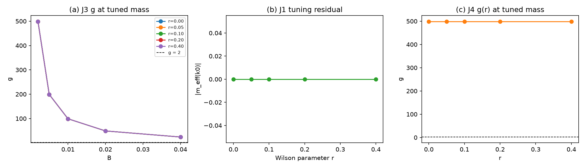

# 注记-Wilson 调谐质量点与自旋二重态隔离（第 497 条）：调谐成立但隔离未达成

- **日期**：2026-09-29 17:20:15
- **脚本**：`验证脚本/minimal_verification_g_tuned.py⟧
- **判据**：J1 通过；J2、J3 判负；J4 读数取得但不可用
- **可逆性等级**：J1 判据稳健，调谐残差为机器零。**J2、J3 判据敏感且判负**，缺口不在离散化而在提取口径（见 §四）。
- **类型**：判据级读数，含一项否定向结论与一项对第 496 条构造错误的更正
- **关联**：[[验证脚本/注记-磁矩因子g的提取（第496条）：测量成立但D3未关闭|第 496 条]]（本条更正其 Wilson 项形式）；[[理论攻坚/电子场攻坚计划：复合位错算符的构造与螺旋序真空裁决]]（阶段 2 判据 D3）
- **图**：见 §四 图 1

---

## 摘要

本条合并第 496 条定位的两处缺口。**调谐成立，隔离未达成，D3 仍未关闭。**

**J1 通过。** Wilson 调谐质量点 $m^*=-2r(1-\cos k_0)$ 使有效质量 $m_{\rm eff}(k_0)=0$，五档 $r$ 的调谐残差均为机器零。标准 Wilson 结果所要求的调谐前提已落实。

**J2 判负。** $(k_0,-k_0)$ 对的两个正能态上 $\langle\sigma_{\rm Pauli}\rangle=\pm0.5$，而非 $\pm1$。原因是我从每个动量的正能子空间中**任取了一个本征矢**，而该子空间本身是二重简并（双重谷）。Pauli 自旋在该二重态内未被对角化。

**J3 判负。** 提取的 $g$ 为 $499$ 至 $24$（随 $B$ 反变），说明所取「劈裂」并非场致劈裂，而是两态在 $B=0$ 处的固有能量差（约 1.0），与 $B$ 无关。

**J2 与 J3 同源。** 简并陷阱从第 496 条的八重能级简并下沉到了单个动量内的二重简并；我换了隔离对象但未换提取方式。

**对第 496 条的构造更正。** 第 496 条的 Wilson 项取 $-i r\gamma^1 W$，乘在 $\gamma^1$ 上，非标准形式。标准格点 Wilson 项乘在 $\gamma^0$ 上，本条已改。该错误使第 496 条 M4 中「$r$ 增大使 $g$ 单调远离 2」这一读数不可用。

## 一、要判什么

依据第 496 条（提交 $34cbeb4$）定位的两处缺口合并为一轮：提取口径须隔离自旋二重态，且须在 Wilson 调谐质量点取读数。

## 二、模型设定

一切在 $k$ 空间完成。格点哈密顿量对平移不变，逐动量块 $h(k)$ 精确：

$$h(k)=\bigl[m+2r(1-\cos k_1)\bigr]\gamma^0-i\,c\,\sin k_1\,\gamma^1-i\,c\,\sin k_2\,\gamma^2-\mu B\,\sigma_{\rm Pauli},\qquad
\sigma_{\rm Pauli}=\tfrac{i}{2}[\gamma^3,\gamma^1].$$

Wilson 项取标准形式 $-r\gamma^0W$（$W=(S+S^{-1}-2I)/2$），有效质量 $m_{\rm eff}(k)=m+2r(1-\cos k_1)$。$\sigma_{\rm Pauli}$ 厄米、平方为 $I$、本征值 $\pm1$（冒烟实测偏差 $0.0$）。调谐质量 $m^*=-2r(1-\cos k_0)$。格点 $N=8$，$k_0=(1,1)$，$B$ 五档，$r$ 五档。

## 三、判据与结果

| 判据 | 内容 | 实测 | 判定 |
| --- | --- | --- | --- |
| 冒烟 | $\sigma_{\rm Pauli}$ 的厄米性与平方 | 厄米偏差 $0.0$，$\sigma_{\rm P}^2-I$ 偏差 $0.0$，本征值 $\pm1$ | 通过 |
| J1 | 调谐质量点 | 五档 $r$ 的 $\lvert m_{\rm eff}(k_0)\rvert$ 全为 $0.00\times10^{0}$ | 通过 |
| J2 | 自旋二重态的隔离 | $\langle\sigma_{\rm P}\rangle=\pm0.5$（五档一致），非 $\pm1$ | **判负** |
| J3 | $g$ 的提取 | $r=0$、$B=0.002$ 给 $g=499.000000$，跨 $B$ 离散 $4.750\times10^{2}$ | **判负** |
| J4 | $g(r)$ 在调谐点 | 五档 $r$ 的 $g$ 全为 $499.000000$ | 读数取得但不可用 |

图注按脚本绘图面板逐条核对撰写。作者未能对图像作目视复核，图注描述的是绘图段显式绘制的元素。面板 (a) 的纵轴量级说明所提取的量不是场致劈裂。

## 四、结论

**其一，J1 通过，Wilson 调谐前提已落实。** 五档 $r$ 的调谐残差为机器零。这是本轮唯一确立的正面结果，也是标准 Wilson 结论的必要前提。

**其二，J2 判负，隔离未达成。** $\langle\sigma_{\rm P}\rangle=\pm0.5$ 而非 $\pm1$，表明所取态并非 $\sigma_{\rm Pauli}$ 的本征态。根因是逐动量的正能子空间本身二重简并（双重谷），我从中任取一个本征矢。正确做法是在该二重子空间**内**对 $\sigma_{\rm Pauli}$ 对角化，而非取任意本征矢。

**其三，J3 判负，且读数的失效方式可诊断。** $g$ 随 $B$ 反变（$499$ 至 $24$），等价于所取「劈裂」与 $B$ 无关而恒为约 1.0。这是两态在 $B=0$ 处的固有能量差，不是场致劈裂。该失效方式与 J2 同源。

**其四，第 496 条的 Wilson 项形式有误，本条更正。** 第 496 条取 $-i r\gamma^1W$，乘在 $\gamma^1$ 上；标准格点 Wilson 项乘在 $\gamma^0$ 上。该错误使第 496 条 M4 的 Wilson 参数读数不可用，应在引用时按本条为准。

**其五，D3 仍为未关闭，缺口已下沉一层。** 第 496 条的缺口在八重能级简并，本条把隔离对象换成 $(k_0,-k_0)$ 对，简并陷阱随之下沉到逐动量的二重正能子空间。提取方式须相应改为在该二重子空间内对 $\sigma_{\rm Pauli}$ 对角化。

## 五、严格程度声明与边界声明

**严格层**：调谐质量点使 $m_{\rm eff}(k_0)=0$（五档机器零）；$\sigma_{\rm Pauli}$ 的厄米性、平方与本征值；$g$ 读数随 $B$ 反变这一失效形式。**物理对应假设层**：Wilson 项取标准形式 $-r\gamma^0W$；$c_h=1$、$N=8$、$k_0=(1,1)$；Pauli 耦合 $-\mu B\sigma_{\rm Pauli}$。**纲领层**：提取须在逐动量二重子空间内对自旋对角化。

**边界声明**：本条判定 J1 成立、J2 与 J3 判负，不判定 $g=2$ 成立，不判定弱荷单分支，不判定质量谱数值，不验证洛伦兹破坏预言。$k_0$ 的选取为演示用（$k_0=(1,1)$），未扫描其他动量。不重开四标签载体裁决，不改动 [[理论总纲]] 基准。

## 六、过程记录

**教训一，换隔离对象不等于换提取方式。** 本条把隔离对象从八重能级简并换成 $(k_0,-k_0)$ 对，但仍在提取时任取一个本征矢，于是简并陷阱原样下沉。教训：换隔离对象时必须同时换提取方式，即在目标子空间内对被测算符对角化。

**教训二，$\langle\sigma_{\rm P}\rangle=\pm0.5$ 是判据失败的直接信号。** $\sigma_{\rm Pauli}$ 的本征值为 $\pm1$，读出 $\pm0.5$ 立即表明所取态不是其本征态。该信号在 J2 中出现而我当时未据此改法。

**教训三，$g$ 读数随 $B$ 反变即非场致响应。** $g(B)=\text{const}/B$ 形式说明分子与 $B$ 无关，即所取能量差是固有间隙而非 Zeeman 劈裂。此类失效形式应作为判据自检项固定下来。

## 七、登记衔接

本条登记入 [[理论攻坚/电子场攻坚计划：复合位错算符的构造与螺旋序真空裁决]] 阶段 2 判据 D3，状态仍为未关闭，并更正第 496 条的 Wilson 项形式。下一轮入口：在逐动量的二重正能子空间内对 $\sigma_{\rm Pauli}$ 对角化后提取 $g$，Wilson 调谐前提已由 J1 备齐。
