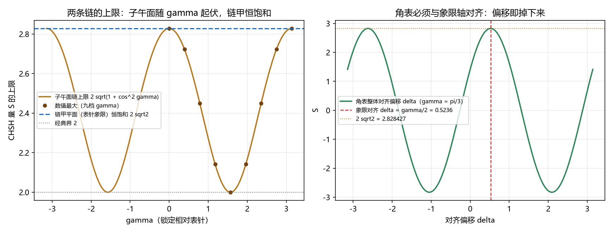

# 注记-Y 象限的相位语言操作合成的最小验证：双原语链、第二次重组合与象限对齐角表

- **日期**：2026-09-24 06:07:26
- **类型**：验证注记（判据级；判据 C1 至 C6 全过）
- **定位**：值侧论文开放问题三的执行轮。此前全空间口径（$S = 2\sqrt{2}$ 恒饱和）由相关矩阵结构给出（脚本 368 的三奇异值 $(1, |z|, |z|)$）；本轮补相位语言侧的显式操作协议与最优角表，把"为什么必须离开子午面"落到可施工的角上。
- **脚本**：`验证脚本/minimal_verification_y_quadrant_phase.py`（确定性；平面优化用粗网格 13 点加坐标上升细化）
- **图**：见 §六 图 1
- **已有输入**：[[齐雷尔森界的体系内来源：单位相量结构、象限对齐与信息因果性判据]]（第 3 节与开放问题三）；[[贝尔违反的场侧闸门：纠缠锁定对、经典圈对照与可见度阈]]（命题 7 的操作化）；[[研究方向-方向三：为何止步 2√2（信息因果性路线）推导稿]]（3.1 节）

---

## 一、模型与判据

模型与值侧论文第 2 节同口径：相关矩阵 $T = \mathrm{diag}(1) \oplus B$，$(Z, X, Y)$ 基下 $B = \begin{pmatrix} c & s \\ s & -c \end{pmatrix}$（$c = \cos\gamma$、$s = \sin\gamma$，锐锁定 $|z| = 1$），读数 $E(\vec a, \vec b) = \vec a^T T \vec b$。

相位语言原语只有两件：零模踢 $U_z(\theta) = \mathrm{diag}(1, e^{i\theta})$ 与支重组合 $H$（50/50 耦合），读出取层位占据。

判据 C1 至 C6 先行。C1 链甲（零模踢 → 支重组合 → 层位读出）的等效可观测量；C2 子午面链（含第二次重组合）的等效可观测量；C3 子午面限制上限；C4 全空间上限；C5 象限对齐；C6 协议表与判定。

## 二、结果

| 判据 | 读数 | 期望 |
| --- | --- | --- |
| C1 链甲 | 等效可观测量 $= \cos\theta X - \sin\theta Y$（矩阵差 $0.0$）；方向 $(Z, X, Y) = (0, 0.764842, -0.644218)$ | 表针象限平面内、方向角 $-\theta$ |
| C2 子午面链 | 等效可观测量 $= \cos\phi Z + \sin\phi X$（矩阵差 $4.5\times10^{-16}$）；方向 $(0.621610, 0.783327, 5.6\times10^{-17})$ | $(Z, X)$ 平面；链含第二次重组合 |
| C3 子午面限制 | 九档 $\gamma$ 的数值最大与 $2\sqrt{1+\cos^2\gamma}$ 最大偏差 $2.0\times10^{-5}$，且与 Horodecki 闭式 $2\sqrt{s_1^2+s_2^2}$ 一致 | 对值侧命题 3 闭式 |
| C4 全空间（链甲平面） | 九档 $\gamma$ 的数值最大与 $2\sqrt{2}$ 最大偏差 $4.4\times10^{-16}$ | 恒饱和 |
| C5 象限对齐 | $\gamma = \pi/3$：对齐角表 $S = 2.828427124746$（对 $2\sqrt{2}$ 差 $0.0$）；不对齐 $1.414214$；$\gamma = \pi/2$ 且不对齐 $0.0$ | 对齐时精确，错位即掉 |

## 三、四条解读

其一，链甲的等效可观测量是 $\cos\theta X - \sin\theta Y$，即表针象限平面内方向角 $-\theta$ 的方向（踢角与方向角差一个负号）。这是命题 7 那条 Ramsey 链（零模踢、重组合、层位读出）的方向推广：把踢角当旋钮，整条 (X, Y) 平面都在手边。

其二，子午面链的等效可观测量是 $\cos\phi Z + \sin\phi X$，落在 (Z, X) 平面。它的实现用了五个原语：踢 $-\pi/2$、重组合、踢 $\phi$、重组合、踢 $\pi/2$，读出。**第二次重组合就住在这里**：开放问题所指的那条协议由此合成，方向角 $\phi$ 即踢角 $\phi$。

其三，上限分岔与 $\gamma$ 的关系。设置限在 (Z, X) 平面（只能用子午面链）时，上限是 $2\sqrt{1+\cos^2\gamma}$，随 $\gamma$ 起伏，$\gamma = \pi/2$ 处落到经典界 2；设置用链甲（(X, Y) 平面）时，上限是 $2\sqrt{2}$ 且对一切 $\gamma$ 恒饱和。差别的来源是 $T$ 在这两个平面上的子块：子午面子块 $\mathrm{diag}(1, \cos\gamma)$ 的奇异值是 $(1, |\cos\gamma|)$，(X, Y) 子块 $B$ 是镜像、奇异值为 $(1, 1)$。

其四，最优角表必须与象限轴对齐。角表（踢角）：$A_1 = -\gamma/2$、$A_2 = -\gamma/2 - \pi/2$、$B_1 = -\gamma/2 + \pi/4$、$B_2 = -\gamma/2 - \pi/4$。该表在任意 $\gamma$ 上给 $S = 2\sqrt{2}$ 精确；把 $\gamma/2$ 的对齐去掉（角表取成 $\gamma$ 无关）后，$\gamma = \pi/3$ 处 $S$ 掉到 $1.414214$，$\gamma = \pi/2$ 处掉到 $0$。象限对齐由此从矩阵语言变成角语言。

## 四、严格程度与边界

链的等效可观测量为矩阵级核对（差 $\le 4.5\times10^{-16}$）；上限读数与角表为判据级（数值优化与 Horodecki 闭式双读）；协议表为构造性陈述。**不验证什么**：不重做 368、369、388、392 的读数；子午面链的场侧物理实现细节（第二条重组合在缺陷语言里的构造）不展开，只核等效可观测量；不主张公理级结论；不触碰 [[子理论索引]] 与任何基准文档。

## 五、过程记录（判据修正一处）

C1 首版把链甲写成 $\cos\theta X + \sin\theta Y$，实测为 $\cos\theta X - \sin\theta Y$（$Y$ 分量差一负号），属踢角与方向角的符号约定；按实测改写判据，并把协议表的踢角注明为方向角取负。子午面链首版预置两种符号候选，由实测选定 $\cos\phi Z + \sin\phi X$。

## 六、结论与登记

值侧论文开放问题三收口：Y 象限的相位语言操作合成给出显式协议（链甲与含第二次重组合的子午面链）与最优角表，$S = 2\sqrt{2}$ 在角表上精确、在子午面限制下退化为 $2\sqrt{1+\cos^2\gamma}$。论文第 9 节不验证事项与第 10 节第三条按本轮同步。

